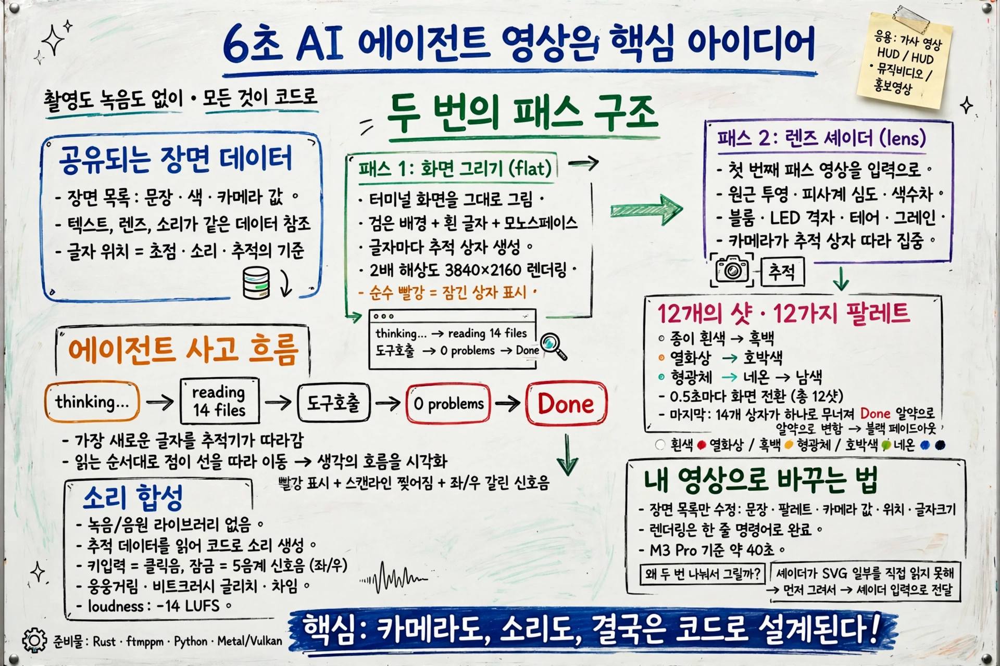
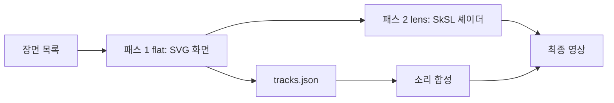
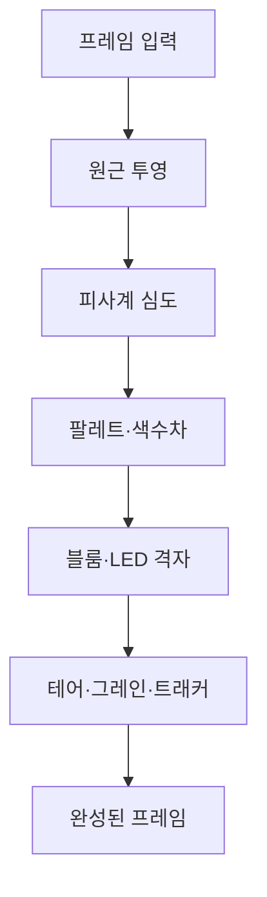

# ff-tracking: 촬영도 녹음도 없습니다. 6초짜리 영상, 픽셀부터 소리까지 전부 코드입니다

> **Summary**
> AI 에이전트가 터미널에 타이핑하는 6초를 가상의 카메라가 촬영한 영상입니다. 촬영도 녹음도 없이 픽셀부터 소리까지 전부 코드로 만들었습니다. 화면을 그리는 패스 1개, 렌즈를 흉내 내는 셰이더 패스 1개, 소리를 합성하는 스크립트 1개가 같은 장면 데이터를 공유해, 초점과 소리가 글자 위치를 정확히 따라갑니다. 장면 목록의 문장·색·카메라 값만 바꾸면 내 영상이 되고, 렌더링은 한 줄 명령어로 끝나며, M3 Pro 기준 약 40초가 걸립니다.

---

- AI 에이전트가 터미널에 타이핑하는 6초를, 가상의 카메라가 촬영한 영상입니다. 촬영도 녹음도 없습니다. 픽셀부터 소리까지 전부 코드로 만들었습니다.
- 화면을 그리는 패스 1개, 렌즈를 흉내 내는 셰이더 패스 1개, 소리를 합성하는 스크립트 1개가 같은 장면 데이터를 공유합니다. 그래서 초점과 소리가 글자 위치를 정확히 따라갑니다.
- 장면 목록의 문장·색·카메라 값만 바꾸면 내 영상이 됩니다. 렌더링은 한 줄 명령어로 끝납니다.

에이전트가 터미널에 글을 쓰는 장면을 영상으로 남기고 싶다고요? 화면 녹화를 켜면 될까요? 녹화 버튼을 누르는 순간 카메라는 고정되고, 소리는 따로 녹음해야 하고, 자막은 또 따로 입혀야 합니다. 그런데 촬영도 녹음도 없이, 코드만으로 6초짜리 영상을 완성했다면 어떨까요?

🎥 [동영상 보기](https://www.youtube.com/watch?v=0Ntthwpfd8Q)

## 화면 속에서는 무슨 일이 벌어질까요?

에이전트가 터미널에서 큰 소리로 생각합니다. `thinking…`에서 시작해 `reading 14 files`를 거쳐 `tool_call: render_frame()`을 부르고, 마침내 `✓ 0 problems`와 `Done`으로 끝납니다. 컴퓨터 비전 스타일의 추적기가 가장 새로 입력된 글자를 따라다닙니다. 가만히 있지 않는 카메라가 화면을 가까이에서 촬영합니다.

화면에 붙은 좌표가 눈에 들어오셨나요? `x: 1403 y: 559` 같은 숫자는 장식용 난수가 아닙니다. 그 프레임에서 해당 상자가 실제로 차지한 픽셀 위치입니다. 초점면도 추적 중인 상자가 정합니다. 에이전트가 타이핑하는 줄을 따라 피사계 심도가 이동합니다. 상자 사이를 잇는 선은 읽는 순서대로 이어지고, 점 하나가 선을 따라 달립니다. 생각의 흐름이 그대로 그려지는 셈입니다!

매 샷의 끝에는 잠금 장면이 있습니다. 가장 새로운 단어가 잠깁니다. 두 프레임 동안 빨간색으로 표시되고, 스캔라인이 찢어지듯 지나가고, 상자 위치에 맞춰 좌우가 갈린 신호음이 울립니다. 0.5초마다 화면이 바뀌는 12개의 샷은 종이 흰색, 열화상, 흑백, 형광체, 호박색, 남색, 네온까지 12가지 모습을 보여줍니다. 마지막에는 14개의 상자가 하나로 무너지며 `Done` 알약으로 변하고, 화면은 검게 페이드아웃됩니다!

## 두 번의 패스, 어떻게 찍었을까요?

비결은 화면을 두 번 그린다는 점입니다. 첫 번째 패스인 `flat`은 터미널이 화면을 그리는 방식 그대로 그립니다. 검은 바탕, 흰 글자, 모노스페이스 글꼴, 글자마다 하나의 `<text>` 요소입니다. 그래서 모든 글자의 위치를 정확히 압니다. 추적 상자도 화면 자체에 있습니다. 일부는 빗금 패턴으로 채워져 글자와 겹치는 부분에서 색이 반전됩니다. 유일한 색은 순수한 빨강, 잠긴 상자 표시뿐입니다. 렌즈가 최대 3배까지 확대하므로 이 패스는 2배 해상도인 3840×2160으로 렌더링합니다.

두 번째 패스인 `lens`는 첫 번째 패스의 프레임을 셰이더 입력으로 받아 촬영합니다. 하나의 SkSL 셰이더가 물리 현상을 전부 흉내 냅니다. 원근 투영, 피사계 심도, 팔레트와 색수차, 블룸과 LED 격자, 테어와 그레인, 카메라 트래커까지 말입니다. 두 패스와 소리가 같은 장면 데이터를 읽기 때문에, 렌즈는 초점을 맞출 글자가 실제로 어디 있는지 항상 압니다!

## 소리는 어디서 났을까요?

녹음실도, 음원 라이브러리도 없습니다. 소리 합성 스크립트가 추적 데이터를 읽어 모든 소리를 만들어냅니다. 화면의 웅웅거림, 컷마다 터지는 비트 크러시 글리치, 키 입력마다 울리는 클릭, 잠금마다 울리는 5음계 신호음이 상자 위치에 맞춰 좌우로 갈립니다. 무너지는 장면으로 향하는 상승음, `Done`에서 울리는 차임과 저음까지 모두 코드입니다. 음량은 측정 도구로 재서 -14 LUFS로 맞췄습니다.

선택 사항으로 음악 점수도 있습니다. 120 BPM의 어둡고 무거운 곡이 추적 데이터와 카메라 데이터를 함께 읽습니다. 추적된 상자가 신호음의 좌우를, 화면의 움직임이 패드의 좌우를, 줌이 저음 필터를, 빨간 잠금 프레임이 저음의 찢어짐을 정합니다. 컷이 박자 위에 정확히 떨어집니다!

## 내 영상으로 바꾸려면 어떻게 할까요?

장면 목록이 전부입니다. `hud/src/lib.rs`의 목록에서 각 샷은 문장, 팔레트, 카메라 값, 시작 위치, 글자 크기로 정해집니다. 문장을 바꾸고, 색을 바꾸고, 카메라를 바꾸면 됩니다. 그러고 나서 렌더링 스크립트 한 줄을 실행하면 추적기와 초점, 라벨과 신호음이 전부 따라옵니다. 렌더링은 M3 Pro 기준으로 40초 정도 걸립니다. 테스트 명령어가 모든 문장이 화면 안에 들어가는지, 카메라가 모든 대상을 화면에 담는지 검사해 줍니다.

준비물은 `Rust`, `ffmpeg`, `Python`입니다. macOS는 `Metal`로, 리눅스와 윈도우는 `Vulkan`으로 그립니다. 환경 변수 하나로 GPU 렌더링과 CPU 렌더링을 고를 수 있습니다. CPU 모드에서도 원래 셰이더가 그대로 돌아가니, GPU가 없어도 결과물을 확인할 수 있습니다.

## 왜 두 번 나눠서 그렸을까요?

셰이더가 같은 프레임의 SVG 일부를 직접 읽을 수 없기 때문입니다. 그래서 화면을 먼저 그리고, 그 결과를 셰이더에 넘기는 두 단계 구조가 됐습니다. 빌드 과정의 메모도 솔직합니다. `flat`은 셰이더 언어의 예약어라 도우미 이름으로 쓸 수 없고, 빈 화면을 반환하면 인코더가 끝난 뒤에야 오류가 드러난다고요. 이런 메모까지 공개돼 있으니, 따라 만들 때 같은 함정에 빠지지 않아도 됩니다.

## 벌써 누가 쓰고 있을까요?

공개한 첫 주말부터 쓰임새가 생겼습니다. 가사 영상, 뮤직비디오 속 HUD, 홍보 영상, 다른 서비스용 추적기 변형까지요. 6초짜리 데모가 템플릿이 된 셈입니다. 이 영상 자체도 코딩 에이전트와 함께 만들었고, 영상을 만드는 프롬프트까지 문서로 공개돼 있습니다. 프롬프트가 곧 제작 과정인 셈입니다!

촬영은 카메라가 하는 일이라고 믿었습니다. 그런데 이 6초는 말합니다. 카메라도, 소리도, 결국은 코드로 쓸 수 있다고요!

