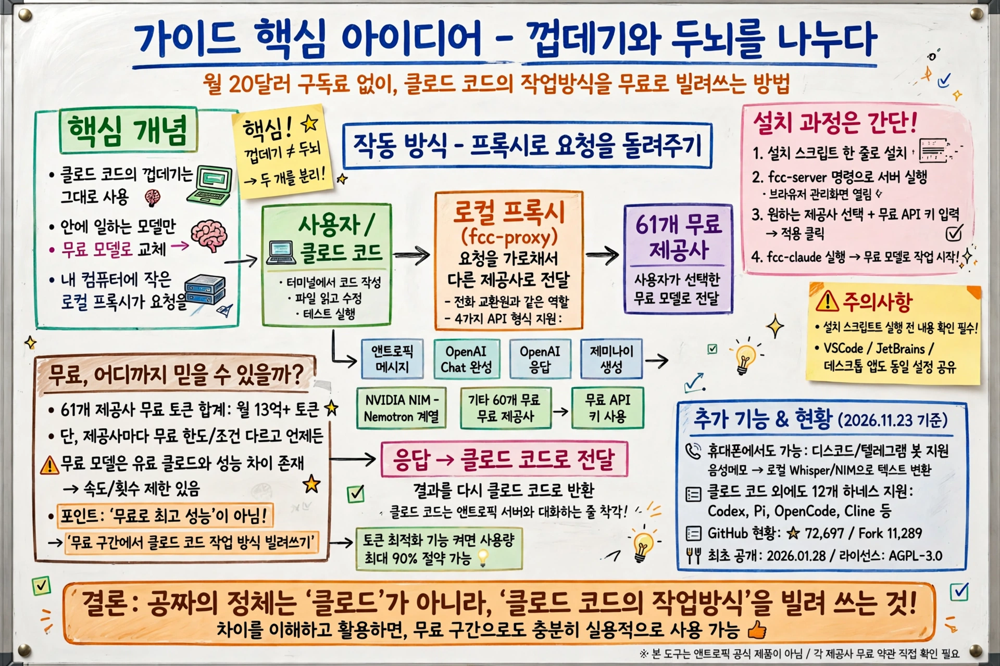
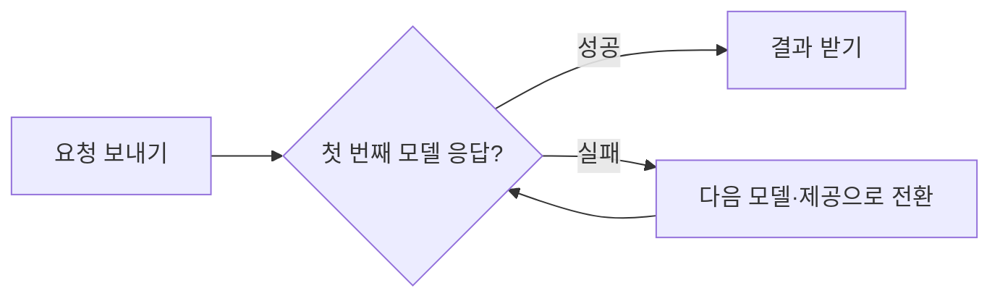

# free-claude-code: 클로드 코드는 그대로, 모델만 무료로 바꾸는 방법입니다

> **Summary**
> 클로드 코드의 터미널과 에이전트 기능은 유지하면서 로컬 프록시를 통해 61개 제공사의 무료 모델로 요청을 보내는 방법을 소개합니다. 여러 모델과 코딩 에이전트를 연결하고 휴대폰으로 작업을 지시할 수 있지만, 무료 모델은 유료 클로드와 성능이 다르고 사용량 제한과 제공사별 약관이 있으므로 조건을 확인해야 합니다.

---

- 클로드 코드의 껍데기는 그대로 쓰고, 안에서 일하는 모델만 무료 모델로 바꿉니다.
- 내 컴퓨터에 두는 작은 프록시가 요청을 받아 61개 제공사 중 고른 무료 모델로 돌려보냅니다.
- 진짜 클로드 모델을 공짜로 쓰는 게 아니라, 무료 모델로 클로드 코드의 작업 방식을 빌려 쓰는 것입니다.

월 20달러 구독료 때문에 클로드 코드를 못 쓰고 계셨나요? 터미널에서 파일을 읽고, 코드를 고치고, 테스트까지 돌리는 코딩 에이전트의 작업 방식은 탐나는데, 구독료가 걸림돌이었던 분이 많으셨을 겁니다. 그런데 껍데기와 두뇌를 나누면 길이 열립니다. 클로드 코드라는 껍데기는 그대로 쓰고, 안에서 일하는 모델만 무료 모델로 바꾸는 방법이 있습니다!

🎥 [동영상 보기](https://www.youtube.com/watch?v=M1dqGjdCEzQ)

## 껍데기와 두뇌를 나누면, 뭐가 달라질까요?

클로드 코드는 두 부분으로 나뉩니다. 터미널 화면, 파일 도구, 에이전트 흐름이 껍데기라면, 실제로 코드를 생각하는 모델이 두뇌입니다. 이 도구는 그 사이에 서는 로컬 프록시입니다. 클로드 코드가 보낸 요청을 가로채서, 사용자가 고른 다른 제공사의 모델로 돌려보냅니다. 전화를 돌려주는 교환원과 같은 원리입니다!

요청은 네 가지 API 형태로 오갑니다. 앤트로픽 메시지, OpenAI 채팅 완성, OpenAI 응답, 제미나이 생성 방식입니다. 그래서 클로드 코드는 앤트로픽 서버와 이야기하는 줄 알지만, 실제로는 고른 모델이 답을 내놓습니다. 네 가지 모델 자리(Fable·Opus·Sonnet·Haiku)마다 다른 모델을 꽂을 수도 있습니다. 무거운 일은 큰 모델에, 가벼운 일은 빠른 모델에 맡기는 식입니다.

## 설치는 얼마나 걸릴까요?

설치는 생각보다 짧습니다. 설치 스크립트 한 줄로 받고, `fcc-server` 명령으로 서버를 띄우면 브라우저 관리 화면이 열립니다. 거기서 제공사를 고르고 무료 API 키를 붙여넣은 뒤 적용을 누르면 끝입니다. 기본 모델은 NVIDIA NIM의 네모트론 계열로 잡혀 있습니다. 그다음 `fcc-claude` 명령으로 클로드 코드를 열면, 무료 모델이 안에서 일하기 시작합니다.

한 가지는 짚고 넘어가야 합니다. 설치 스크립트를 셸에 바로 흘려보내는 방식이라, 실행하기 전에 스크립트를 한 번 열어보는 것이 안전합니다. 또 VS Code와 JetBrains 확장, 데스크톱 앱, 브라우저 세션도 같은 모델을 씁니다. 터미널에서 쓰던 설정을 그대로 이어서 쓸 수 있습니다.

## 무료, 어디까지 믿을 수 있을까요?

월 13억 개가 넘는 무료 토큰이라는 숫자는 61개 제공사의 무료 구간을 합친 것입니다. 제공사마다 한도와 조건이 따로 있고, 언제든 바뀔 수 있습니다. 무료라는 말은 "제공사가 주는 무료 구간 안에서"라는 단서가 붙는다는 뜻입니다.

무료 모델의 성능도 짚어야 합니다. 무료 모델이 유료 클로드 모델과 같은 실력은 아닙니다. 무료 구간에는 속도와 횟수 제한이 따라붙습니다. 그래서 이 도구는 "무료로 최고 성능을 쓴다"가 아니라, "무료 구간 안에서 클로드 코드의 작업 방식을 빌려 쓴다"에 가깝습니다!

약관 이야기도 있습니다. 이 프로젝트는 제공사 약관을 따르고, 허용이 멈추면 해당 연동을 제거한다고 밝힙니다. 그래도 각 제공사의 무료 구간 약관은 직접 확인하는 것이 좋습니다. 라이선스는 AGPL-3.0이고, 앤트로픽의 공식 제품이 아니라는 점도 저장소 안내에 분명히 적혀 있습니다. 토큰 최적화 기능을 켜면 토큰 사용량을 최대 90%까지 줄인다고 밝히고 있습니다.

## 전화기에서도 코딩이 될까요?

됩니다! 디스코드와 텔레그램 봇으로 휴대폰에서 작업을 지시할 수 있습니다. 음성 메모도 보낼 수 있는데, 로컬 위스퍼나 NVIDIA NIM 전사로 텍스트로 바꿔줍니다. 클로드 코드 말고도 Codex, Pi, OpenCode, Cline 등 12개 하네스를 같은 방식으로 쓸 수 있습니다. 하나의 프록시에 여러 에이전트를 붙이는 구조입니다.

숫자도 정리해 두겠습니다. 2026년 9월 11일 캡처 기준 별 5만 4천 개, 포크 8천 7백 개였고, 2026년 11월 23일 확인 기준 별 7만 2천 697개, 포크 1만 1천 289개로 늘었습니다. 2026년 1월 28일에 처음 공개된 프로젝트입니다.

공짜의 정체는 클로드가 아니라, 클로드 코드의 작업 방식을 빌려 쓰는 것입니다. 그 차이를 알고 쓰면, 무료 구간은 충분히 쓸 만합니다!

