# github 커밋 자동화 프로그램

> **Summary**
> 구글 클라우드를 이용한 커밋 자동화 API 제작 방법을 설명하며, 무료 계정 생성, 서버 구축, git 설치 및 자동 커밋 스크립트 작성, 스케줄링 방법을 포함합니다. 또한, 토큰 인증 방식을 통해 깃허브에 로그인하고, 특정 주기마다 파일을 생성하여 자동으로 커밋하는 방법도 안내합니다.

---


> 📚 **목차**
>


## 1. Google Cloud 가입하기


아래 링크 목차 중 <1> Google cloud 가입하기만 따라해서 무료계정을 만들어둔다

→ 여긴 쉬우니까 스크린샷 첨부 안할게요 Google cloud 가입까지만 따라하고 서버는 만들지 마세요.

🔗 [https://brunch.co.kr/@topasvga/168](https://brunch.co.kr/@topasvga/168)

## 2. Google Cloud 무료서버 구축

무료 서버를 구축해야하니 다음 링크 참고

🔗 [https://annealing.tistory.com/211](https://annealing.tistory.com/211)

🔗 [https://wildeveloperetrain.tistory.com/154](https://wildeveloperetrain.tistory.com/154)


위 링크를 그대로 따라한 내 과정은..


VM인스턴스 이동 후 인스턴스 만들기를 해준다

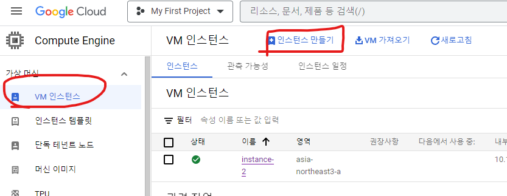


그 후 리전을 서울로 맞춰주시고 시리즈를 E2 머신유형을 e2 micro(vCPU 2개,1GB 메모리로 설정)

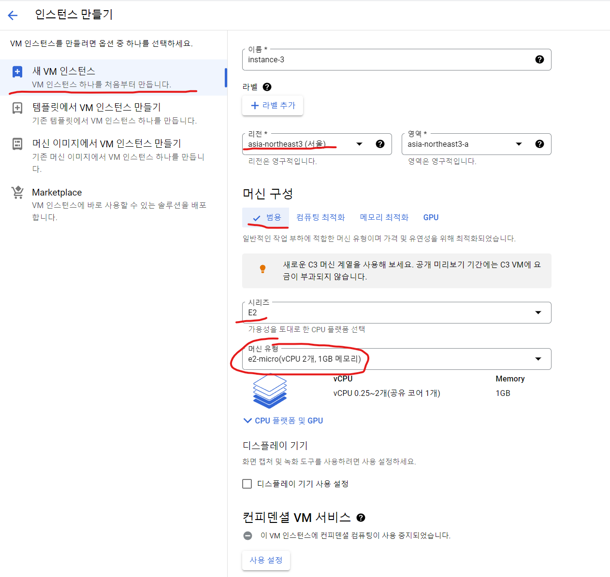


부팅디스크는 무료 최대인 30G용량으로 제한하고 **표준 영구 디스크로 반드시 선택해야 과금이 발생되지 않는다. **그리고 http,https 트래픽을허용해줍니다.

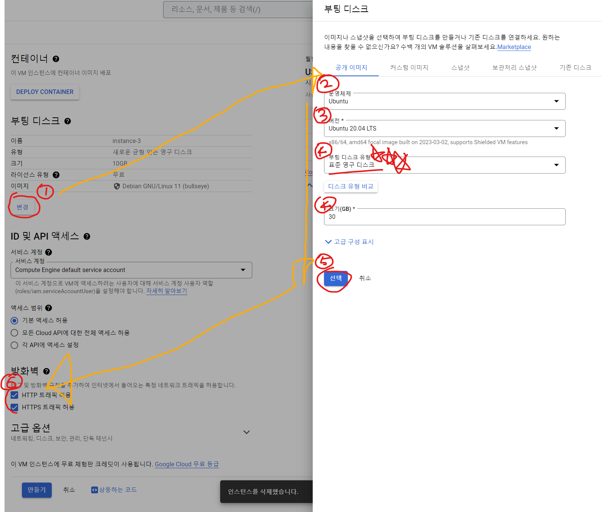


> 💡 **방화벽까지 설정이 완료되면 `만들기`를 눌러주고 잠시 기다리면 인스턴스가 생성 완료된다. **


가상 머신 생성 후 [해당 링크](https://console.cloud.google.com/home/dashboard?hl=ko&project=xenon-antonym-379603) 에서 결제상태가 매월 0원인지 확인하기

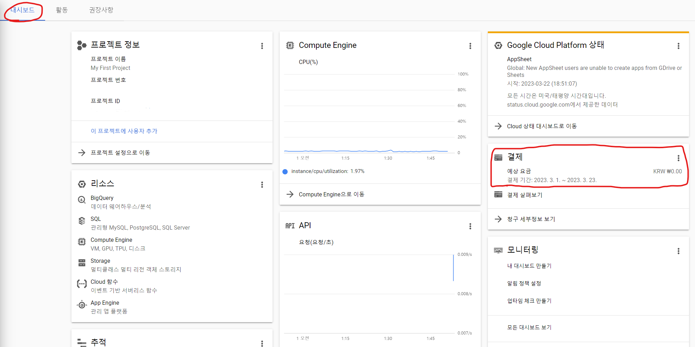

## 3.서버에 git 설치 후 로그인 

→ GCD SSH에서 git을 설치하고 로그인해봅시다

Google Cloud에서 (GCD 라고 부른다) Ubuntu 20.04 LTS Minimal 버전에서 git을 연결하는 방법은 다음과 같습니다.


일단 인스턴스된 서버에 접속하기위해 SSH를 클릭하여 연결합니다.

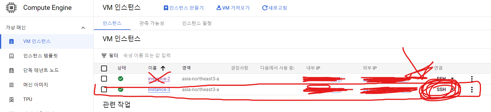


약간의 로딩 후 아래와같은 창이 뜬다면 성공입니다

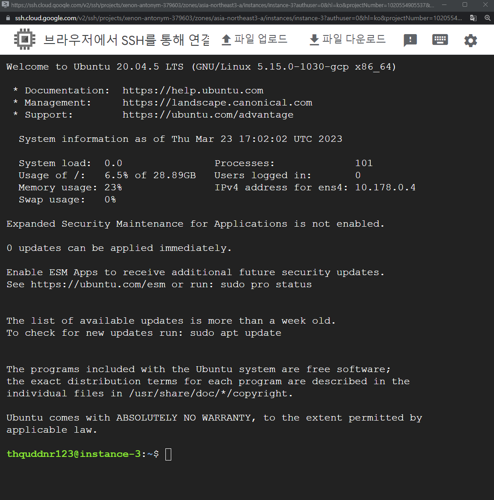


> 💡 **그럼 본격적으로 SSH를 통해 콘솔을 입력하기 전에, github에서 저장소를 생성해봅시다**

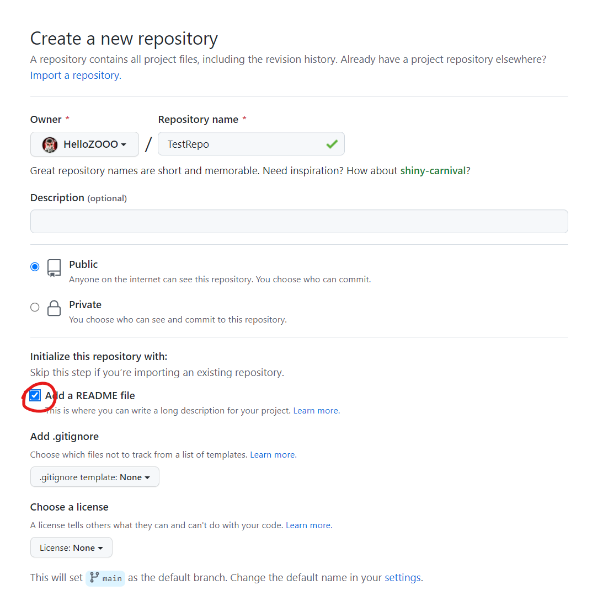

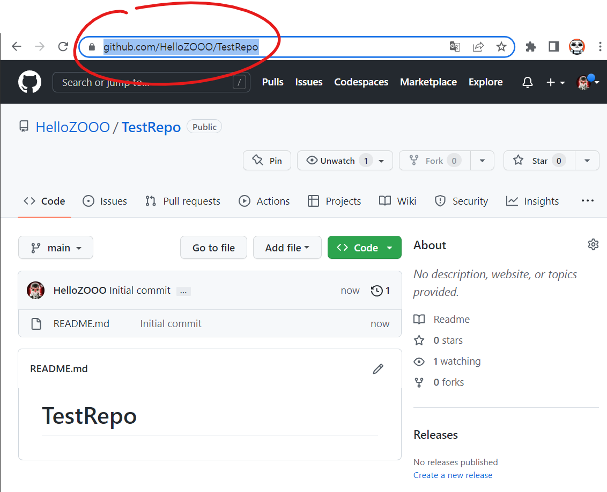


이제 다시 VM 인스턴스로 돌아와 Git이 설치되어 있는지 확인합니다.  SSH터미널에서 다음 명령을 실행하여 이를 수행할 수 있습니다.

```shell
sudo apt-get update
sudo apt-get install git
```


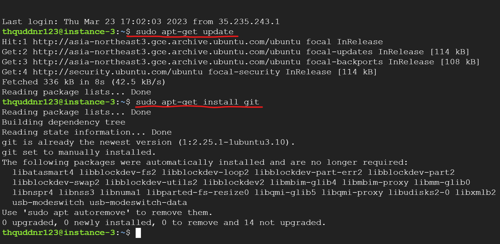


이제 방금전에 만든 git 저장소를 불러옵니다. 저는 따로 폴더를 새로 만들고 그 안에 git 레포토지를 클론하겠습니다

git을 클론하는 방법은 다음과 같으며

> `git clone <당신의 주소>.git` 

당신의 깃허브 레포토지를 복사하여 `<당신의 주소>` 에 붙여넣고 뒤에 `.git` 을 적어주면 됩니다


아래 예시는 제 저장소 기준입니다.

mkdir - cd 과정은 생략해도 상관없습니다.

```shell
mkdir autoCommit
cd autoCommit
git clone https://github.com/HelloZOOO/TestRepo.git 
```

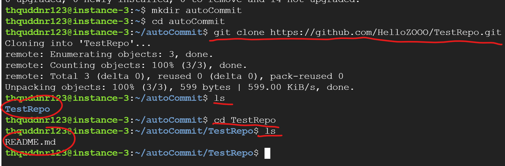


## 4. 자동 commit 스크립트 작성 및 git 토큰 발급


이제 commit과 push를 담당할 스크립트를 제작해줄겁니다.

그 전에, `pwd` 를 통해 자신의 경로가 어디인지 확인해주고

다음 명령어를 입력해줍니다

```shell
nano commit.sh
```

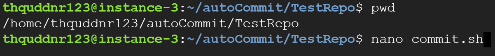


그리고 다음 코드를 입력해줍시다

/path/to/your/repo 부분에 아까 `pwd` 로 확인한 자신의 경로를 입력합니다.

절대경로가 싫으신분들은 상대경로로 `./` 를 넣으면 되는거 아닌가 싶겠지만, 이럴 경우 직접 손으로 bash 할거면 상관없지만, crontab 을 이용할것이기 때문에, **절대경로를 넣어야 정상적으로 코드가 실행됩니다.**

```shell
#!/bin/bash
cd /path/to/your/repo
git add .
git commit -m "Automated commit $(date)"
git push origin main
```

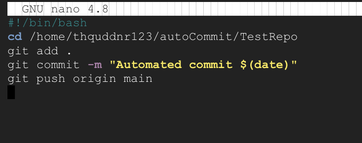

코드를 다 작성했으면 `ctrl + x` 를 입력 후에 `y`와 `enter`를 순차적으로 눌러 저장해줍시다.


이제 commit 준비는 완료되었습니다.

간단하게 테스트로 다음 명령어를 입력하여 [commit.sh](http://commit.sh/) 스크립트를 실행시켜봅시다.

```shell
bash commit.sh $
```

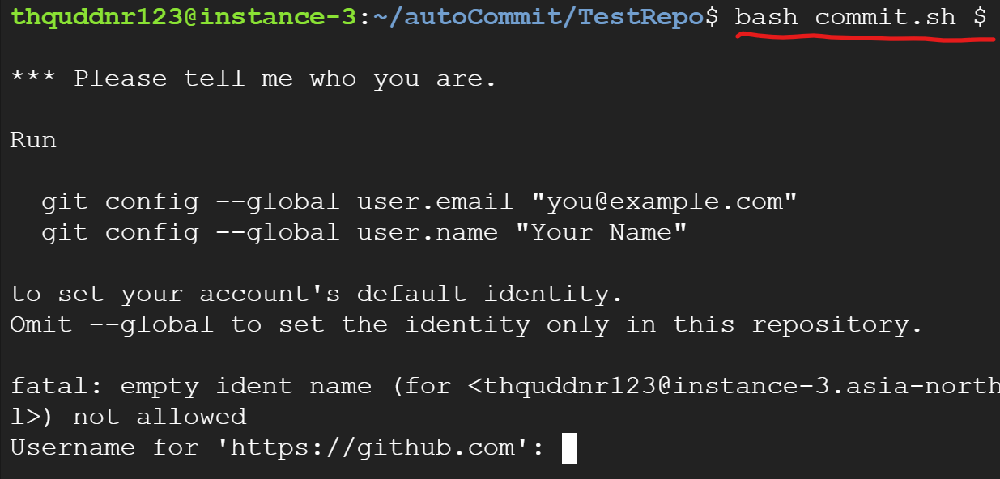


그러면 commit 과 push 권한을 얻기 위해 로그인을 하라고 하는데, 그대로 로그인해도 상관은 없지만, 저는 다른 방법으로 로그인하겠습니다.


깃허브에서는 토큰 인증 방식을 권장하고 있습니다. 토큰 인증 방식을 사용하면 비밀번호 대신 토큰을 사용하여 인증할 수 있습니다.


또한 앞으로 깃 명령어를 실행할 때 비밀번호 대신 토큰을 입력해도 됩니다.


> 💡 **토큰 로그인 방식은 다음 글을 참고해서 진행해주시면 됩니다**
> 토큰 활성화 기간에따라 다시 로그인해야할수도 있으니까 귀찮으시고 보안 신경 안쓰시면 종료기한 없는 토큰 발급받아주세요
>
> 🔗 [https://hoohaha.tistory.com/37](https://hoohaha.tistory.com/37)
>
>


요약한 내용은 다음과 같습니다.

1. 깃허브 웹사이트에서 로그인한 후, 오른쪽 상단의 프로필 아이콘을 클릭합니다.
1. “Settings” 메뉴를 선택합니다.
1. 왼쪽 메뉴에서 "Developer settings"를 선택한 후, “Personal access tokens” 메뉴로 이동합니다.
1. “Generate new token” 버튼을 클릭하여 새로운 토큰을 생성합니다.
1. 생성된 토큰을 복사한 후, GCD SSH에 접속합니다.
1. 다음 명령어를 순차적으로 입력하여 git 설정을 업데이트합니다.
```plain text
git config --global credential.helper store
```

```plain text
git config --global user.password **<당신의 토큰>**
```

```shell
git config --global user.email "당신의 github email"
git config --global user.name "당신의 github 이름"
```


설정이 완료되었다면 다시 아래 스크립트를 실행시키고 유저네임과 비밀번호(토큰) 을 입력해주면 

```shell
 bash commit.sh $
```


유저네임과 비밀번호를 입력하라고 할것입니다.

비밀번호 입력할때 아무것도 입력이 안되는것처럼 보이는데 제대로 입력되고있는상태입니다.

commit 과 push가 정상적으로 작동하는것을 확인할 수 있습니다.

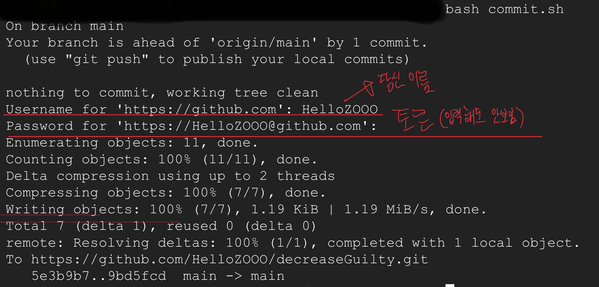

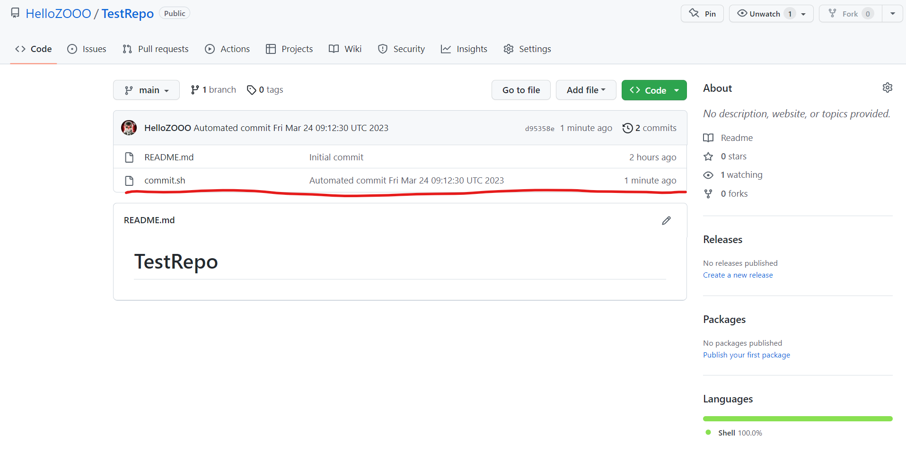


## 5. 스크립트 스케듈링

이제 작성한 Commit.sh 파일에 읽기 쓰기 실행 권한을 주는 작업을 합니다.

**권한을 주는 이유는 crontab 에서 매시간 자동으로 해당 스크립트를 실행하기 위함입니다.**

```shell
chmod +x commit.sh
```


명령어 입력 후 `**ls -l **`명령어를 입력하시면 해당 파일의 권한을 확인하실 수 있습니다.

`**-rwxrwxr-x **`부분은 해당 파일의 권한을 나타내며, `**rwx **`는 각각 읽기, 쓰기, 실행 권한을 나타냅니다. 

따라서 `**-rwxrwxr-x **`는 해당 파일의 소유자와 그룹은 읽기, 쓰기, 실행 권한이 있고, 다른 사용자는 실행 권한만 있음을 나타냅니다.

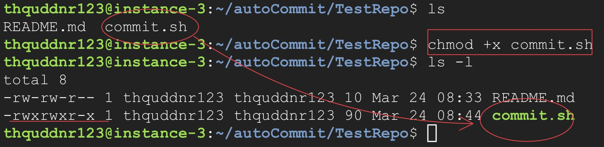

`chmod` 로 권한을 주는 작업은 매우 중요합니다.

> 💡 ****앞으로 특정 시간마다 프로세스를 실행시킬때마다 실행하는 스크립트는 다음과같이 권한을 가져야 **`**crontab -e**`** 에서 정상적으로 작동되기 때문입니다.****


> 💡 **이제 특정 시간마다 스크립트를 실행시켜주는 스케듈링 작업을 해봅시다**

`**crontab -e**`명령어는 어디에서 실행하던 상관없이 현재 사용자의 crontab 파일을 열게 됩니다. 디렉토리 상관 없이 아무곳에서나 실행시켜도 같은 화면이 뜰겁니다

```shell
crontab -e
```

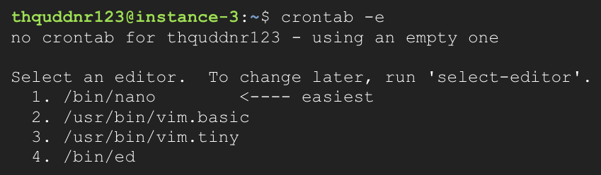

Select an editor은 nano editor인 1을 입력하고 엔터를 눌러줍시다.

(다른 에디터도 쓰실줄만 아시면 상관 없습니다.)


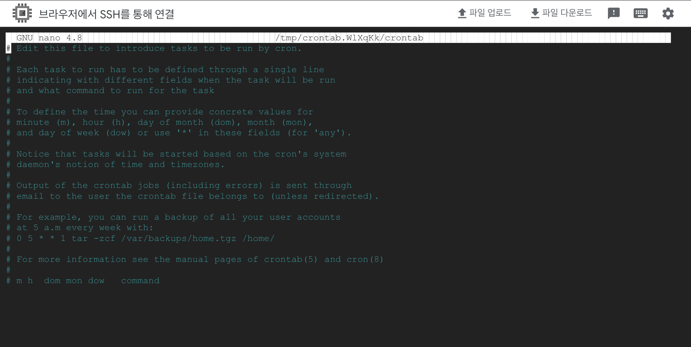

그럼 다음과 같은 에디터가 열리게됩니다.

nano 에디터라 입력모드 진입을 위해 단축키 입력할 필요 없이 걍 맨 아래에 다음 명령어를 입력합니다.

```shell
0 12 * * * /당신의 디렉토리 경로/commit.sh
```


해당 명령어는 매일 12시 0분에 특정 디렉토리에있는 commit.sh 를 실행하겠다는 코드입니다.

시간은 UTC 기준이며 일정 주기마다 실행하고 싶다면 아래 토글을 확인해주세요

<details>
<summary>다음과 같이 입력하면 됩니다. (토글 열기) </summary>

### →`0 9 * * * /당신의 디렉토리 경로/commit.sh`

또한, 5분마다 혹은 30분마다 특정 작업을 수행하고싶으면 다음과 같이 표현하면 됩니다

### →`*/5 * * * * /당신의 디렉토리 경로/commit.sh`

분 자리에 */5 혹은 */30 을 넣으면 5분에 한번 혹은 30분에 한번 특정 작업이 수행됩니다.

### →`* */6 * * * /당신의 디렉토리 경로/commit.sh`

시 자리에 다음과 같은 코드를 적으면 6시간에 한번 실행하겠다는 뜻입니다.

</details>


path 부분은 실행 될 스크립트가 포함된 디렉토리의 절대경로를 입력해야하기에 `pwd` 등을 활용해 주소를확인하는것이 좋습니다해. crontab 은 특정 디렉토리에서 실행되지 않기 때문에 상대주소가 아닌 절대주소로 불러오는것이 바람직합니다.

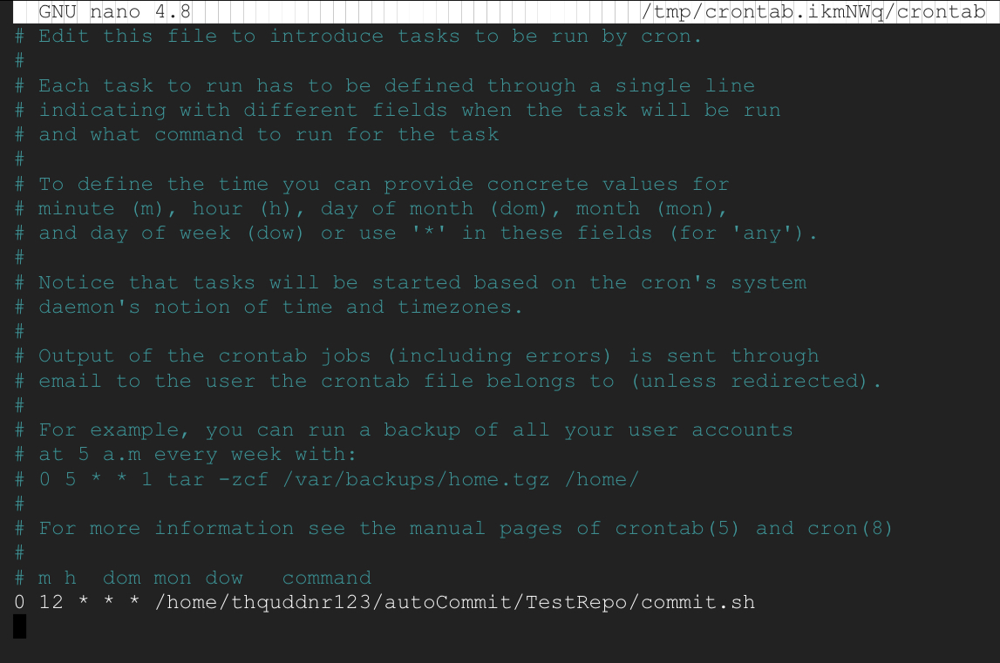


코드를 원하시는대로 입력했다면, 에디터에서

`ctrl + x` → `y` → `enter` 를 순차적으로 눌러 저장해줍시다.


## 6. 파일생성 매크로 제작

여기까지 작업하셨으면 이제 자동으로 커밋하는 작업은 끝이 났습니다만, 변경사항이 없으면 커밋되지 않는 문제점이 있어 특정 디렉토리에 파일을 특정 주기마다 실행하여 파일이 생성되는 변경사항을 강제로 만든 후 , 커밋이 완료되면 생성된 파일을 모두 삭제하고 다시 파일을 실행하는 작업을 할것입니다.


더미파일이 쌓일 폴더와 자동으로 파일을 생성시킬 스크립트도 생성해줍시다

```shell
mkdir dummy
nano makeDummy.sh
```

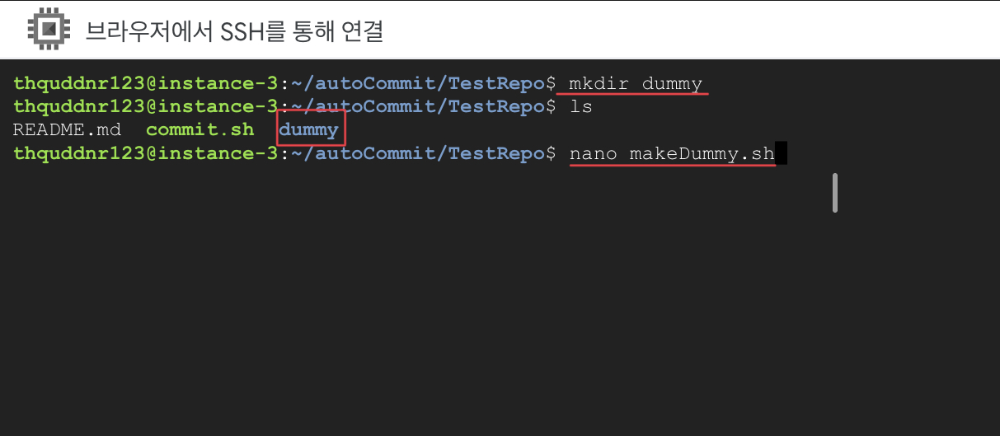


생성한 `makeDummy.sh` 스크립트에서 다음과 같은 코드를 작성해주고 `ctrl + x` 를 눌러 저장해줍시다

```shell
#!/bin/bash
filename=$(date '+%Y-%m-%d_%H-%M-%S').txt
touch /당신의 디렉토리/dummy/$filename
```

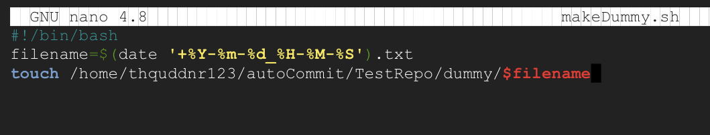


스크립트 스케듈링 전, 권한을 부여하기 위해 스크립트가 있는 디렉토리에서 다음 명령어를 입력합니다.

```shell
chmod +x makeDummy.sh
```

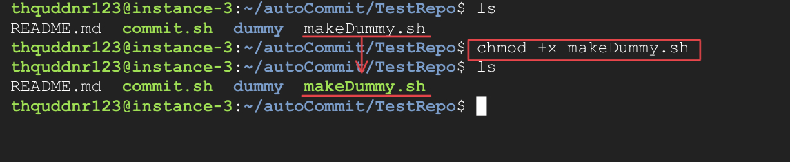

그리고 다시 crontab -e 명령어를 입력합니다

```shell
crontab -e
```

그리고 다음과 같은 스케듈링 코드를 작성해줍니다

```shell
*/30 * * * * /당신의 디렉토리 경로/makeDummy.sh
10 12 * * * find /당신의 디렉토리 경로/dummy -name '*.txt' -type f -delete
```

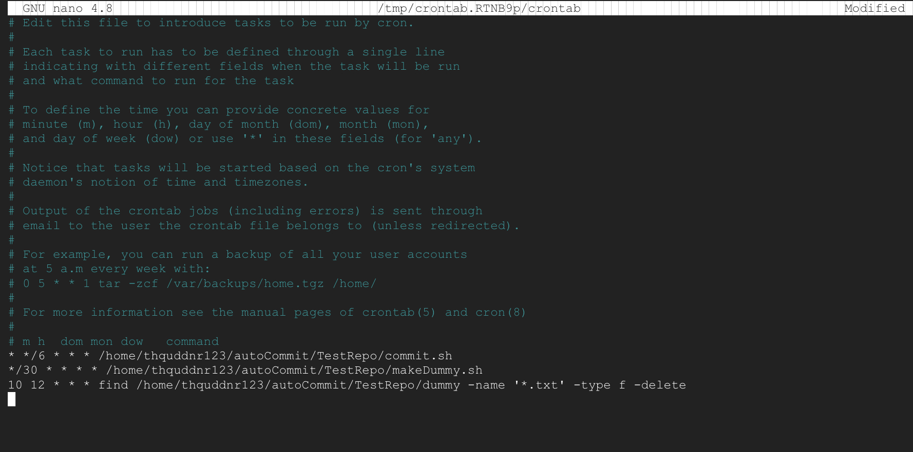


`ctrl + x` 로 코드 저장하고 이제 SSH를 통해 연결된 터미널을 닫아도 좋습니다.

이제 하루에 한번씩 커밋을 자동으로 해주는 서버 API가 완성되었습니다.


> 끝났으니까 컴터 꺼버리고 잠이나 주무십쇼.

> 이제 하루1커밋을 깜빡해도 좋습니다.


---


<details>
<summary>메모</summary>


## Q. Crantab을 수정해도 초기화가 안됩니다

🔗 [https://ciksiti.com/ko/chapters/3128-troubleshooting-crontab-not-running--linux-hint](https://ciksiti.com/ko/chapters/3128-troubleshooting-crontab-not-running--linux-hint)

🔗 [https://shlee0882.tistory.com/270](https://shlee0882.tistory.com/270)

## Q. cd /path/to/your/repo 에는 어떤 경로를 넣어야 합니까?

`**/path/to/your/repo**`는 당신이 클론한 레포지토리의 경로를 입력하시면 됩니다. 예를 들어, 만약 당신이 레포지토리를 `**/home/user/my-repo**`경로에 클론했다면, `**/path/to/your/repo**`대신 `**/home/user/my-repo **`를 입력하시면 됩니다.

## Q. 6시간마다 commit.SH를 한번씩 자동커밋하는 방법은 무엇일까요?

crontab을 이용하면 매 시간마다 스크립트 파일을 실행할 수 있습니다. 6시간마다 실행하려면 다음과 같이 설정하면 됩니다.

```plain text
0 */6 * * * /path/to/commit.sh

```

[위 설정은 매 시간 0분에 스크립트 파일을 실행하며, 실행 주기는 6시간입니다](https://m.blog.naver.com/shino1025/221432633410)

## Q. git push -f origin main git add . git commit -m "edit on SSH" 를 순차적으로 입력했습니다. 하지만 다음과 같은 에러 메시지를 받았습니다. On branch main Your branch is up to date with 'origin/main'. nothing to commit, working tree clean 어떻게 해결해야하나요?

에러 메시지를 보면 "nothing to commit, working tree clean"이라는 메시지가 나타납니다. 이는 현재 로컬 저장소의 변경 사항이 없다는 것을 의미합니다.

따라서, `**git add .**` 명령어를 실행하여 변경 사항을 추가한 후, `**git commit -m "edit on SSH"**` 명령어를 실행하여 변경 사항을 커밋해야 합니다.

만약 이전에 이미 커밋을 했다면, `**git push -f origin main**` 명령어를 실행하여 원격 저장소에 변경 사항을 강제로 push할 수 있습니다.

## Q. 간단하게 vi를 이용해 text.txt 를 추가시켰습니다. 이제 이 변경사항을 GCD SSH에서 push하고 commit하는 일련의 과정을 정리해 주십시오.

변경 사항을 추가한 후, 다음과 같은 명령어를 실행하여 변경 사항을 커밋하고 원격 저장소에 push할 수 있습니다.

```plain text
git add text.txt
git commit -m "Add text.txt"
git push origin main

```

## Q. 단순 코드 실행으로 일정 주기 파일 생성 스크립트

```plain text
nano random.sh
```

- nano 편집기가 실행됩니다.
- 다음과 같은 스크립트를 작성합니다.
```plain text
#!/bin/bash
while true
do
  filename=$(date '+%Y-%m-%d_%H-%M-%S').txt
  touch /path/to/directory/$filename
  sleep 3600
done
```

  이 스크립트는 while 루프를 사용하여 무한히 실행됩니다. 루프 내에서는 현재 날짜와 시간을 사용하여 파일 이름을 생성하고 touch 명령어를 사용하여 해당 파일을 생성합니다. 그런 다음 sleep 명령어를 사용하여 1시간 동안 대기합니다.

  위의 스크립트에서 /path/to/directory/ 부분은 생성하려는 파일이 저장될 디렉토리 경로로 변경해주시면 됩니다.

- Ctrl + X를 눌러서 저장하고 나옵니다.
1. 스크립트를 실행합니다.
  - 다음 명령어를 입력하여 스크립트를 실행합니다.
```plain text
bash random.sh &
```


## Q. 스크립트가 실행되고 있다는것을 확인하는 방법

스크립트가 실행되고 있는지 확인하는 방법은 다음과 같습니다.

1. 터미널에서 다음 명령어를 입력합니다.
```plain text
ps aux | grep random.sh
```

1. 실행 중인 스크립트의 PID를 확인합니다.
1. 스크립트를 중지하려면 다음 명령어를 입력합니다.
```plain text
kill -9 PID
```

위의 명령어에서 PID는 실행 중인 스크립트의 PID 번호입니다.


[r](http://script.sh/)andom.sh 라는 이름을 가진 프로세스를 전부 종료하는방법

현재 실행 중인 스크립트가 3개인 것 같습니다. 이 경우에는 다음 명령어를 사용하여 모든 스크립트를 종료할 수 있습니다.

```plain text
pkill -f random.sh
```

위의 명령어는 "random.sh"라는 이름을 가진 모든 프로세스를 종료합니다.

이상입니다. 도움이 되었길 바랍니다!

## Q. [README.md](http://readme.md/) 파일을 자동으로 작성하는 방법

네, 있습니다. 아래와 같이 script.sh 파일을 생성하고 코드를 저장한 후에 `**bash script.sh**` 명령어를 입력하면 됩니다.

```plain text
#!/bin/bash

while true
do
    echo "$(date) - $(openssl rand -hex 12)" >> README.md
    sleep 600
done

```

위 코드에서 `**openssl rand -hex 12**` 부분이 랜덤한 문자열을 생성하는 부분입니다. 이 부분을 수정하면 원하는 길이와 형태의 랜덤 문자열을 생성할 수 있습니다.

위 코드를 실행하기 전에 `**openssl**` 이 설치되어 있어야 합니다. 만약 설치되어 있지 않다면 아래 명령어로 설치할 수 있습니다.


아마 설치되어있을겁니다

```plain text
sudo apt-get install openssl
```

위 코드를 실행하기 위해서는 `**README.md**` 파일이 이미 존재해야 합니다. 만약 존재하지 않는다면 아래 명령어로 파일을 생성할 수 있습니다.

```plain text
touch README.md
```

만약 같은 폴더에 존재한다면 아래와 같이 상대경로로 표기할 수 있습니다.

```plain text
#!/bin/bash

while true
do
    echo "$(date) - $(openssl rand -hex 12)" >> ./README.md
    sleep 600
done
```


### 여기서 마크업 언어로 줄바꿈까지 넣으려면 코드를 다음과 같이 수정해준다

```shell
#!/bin/bash

while true
do
    echo "$(date) - $(openssl rand -hex 5) $(echo -e "<br/>")">> ./README.md
    sleep 3600
done
```


`#!/bin/bash echo "$(date) - $(openssl rand -hex 5) $(echo -e "<br/>")">> ./README.md` 해당 코드를 가진 [`autoWriteREADME.md`](http://autowritereadme.md/) 파일을 `crontab -e` 에서 `*/5 * * * * /home/thquddnr123/AutoCommit/decreaseGuilty/autoWriteREADME.sh `를 작성해여 5분마다 코드를 실행하려고 합니다. [README.md](http://readme.md/) 와 [autoWriteREADME.sh](http://autowritereadme.sh/) 둘 다 chmod +x 로 권한을 준 상태입니다. 하지만 시간이 되어도 README.md가 업데이트되지 않습니다. 하지만 bash [autoWriteREADME.sh](http://autowritereadme.sh/) 로 직접 실행하면 코드는 정상적으로 작동됩니다. 저는 자동으로 5분마다 실행되는 코드를 작성하고싶습니다. 어떻게 해야합니까?


해당 코드가 crontab에서 실행되지 않는 이유는 환경 변수 문제일 가능성이 높습니다. crontab에서는 일반적으로 사용자의 환경 변수를 사용하지 않기 때문입니다. 따라서 해당 스크립트 파일에서 사용하는 환경 변수를 직접 지정해주어야 합니다. 예를 들어, 다음과 같이 스크립트 파일을 수정하시면 됩니다:

```shell
#!/bin/bash
source /home/thquddnr123/.bashrc
cd /home/thquddnr123/AutoCommit/decreaseGuilty/
echo "$(date) - $(openssl rand -hex 5) $(echo -e "<br/>")">> ./README.md

```

위와 같이 수정하시면 crontab에서도 정상적으로 실행될 것입니다.


</details>

