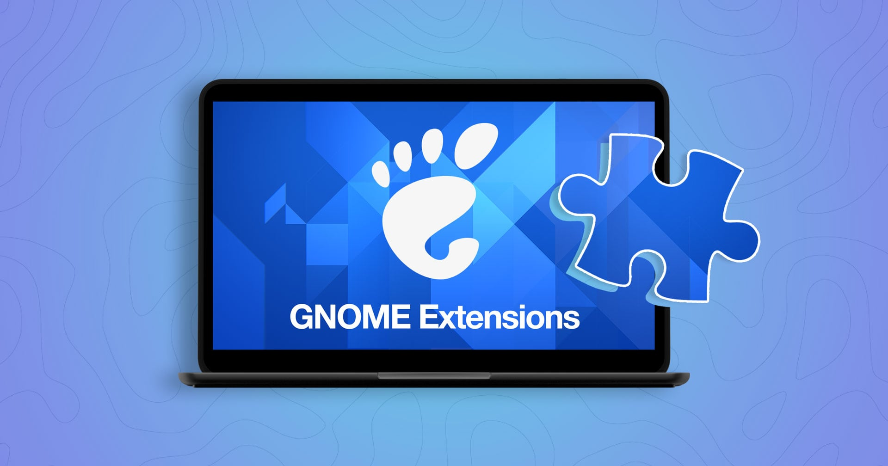
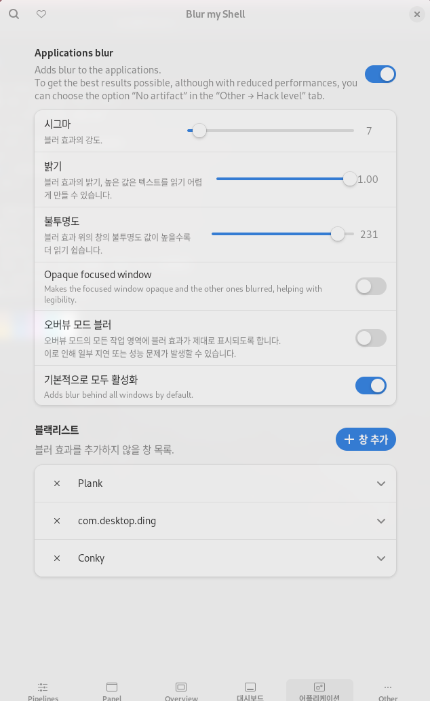

# gnome Extention

> **Summary**
> GNOME 확장 프로그램 설치 방법과 다양한 유용한 확장 목록을 소개합니다. 주요 확장으로는 popShell, gTile, GSConnect, Bluetooth 빠른 연결, 사용자 테마 등이 있으며, 각 확장에 대한 링크와 설명이 포함되어 있습니다. 사용자는 자신에게 맞는 확장을 선택하여 GNOME 환경을 개선할 수 있습니다.

---



# 설치방법

> gnome 확장 사이트는 [**여기**](https://extensions.gnome.org/)
> 해당 튜토리얼 [[1](https://wiki.gnome.org/action/show/Projects/GnomeShellIntegration/Installation?action=show&redirect=Projects%2FGnomeShellIntegrationForChrome%2FInstallation)][[2](https://hedgedoc.gnome.org/wiki-migration-guide?view=)] 를 참고하여 확장을 관리할 수 있음
>
> <details>
> <summary>설치방법</summary>
>
> 🔗 [https://hiseon.me/linux/ubuntu/gnome-shell-extension-install/](https://hiseon.me/linux/ubuntu/gnome-shell-extension-install/)
>
> 🔗 [https://kwonnam.pe.kr/wiki/linux/gnome/extension](https://kwonnam.pe.kr/wiki/linux/gnome/extension)
>
> </details>
>
>

```javascript
sudo dnf install gnome-browser-connector
```


## 배경 불투명하게

🔗 [https://extensions.gnome.org/extension/3193/blur-my-shell/](https://extensions.gnome.org/extension/3193/blur-my-shell/)




## 타일링 시스템

<details>
<summary>popShell</summary>

🔗 [https://github.com/pop-os/shell](https://github.com/pop-os/shell)

</details>

<details>
<summary>gTile</summary>

🔗 [https://extensions.gnome.org/extension/28/gtile/](https://extensions.gnome.org/extension/28/gtile/)

🔗 [https://extensions.gnome.org/extension/3733/tiling-assistant/](https://extensions.gnome.org/extension/3733/tiling-assistant/)

🔗 [https://extensions.gnome.org/extension/4548/tactile/](https://extensions.gnome.org/extension/4548/tactile/)

🔗 [https://youtu.be/-t_H_HfOPss?si=bJFC7n7I5DUPMrk6](https://youtu.be/-t_H_HfOPss?si=bJFC7n7I5DUPMrk6)

</details>

<details>
<summary>forge</summary>

🔗 [https://community.frame.work/t/ubuntu-popos-shell-how-do-you-configure-the-keyboard-shortcuts-to-try-to-mimic-my-i3wm-config/6223/2](https://community.frame.work/t/ubuntu-popos-shell-how-do-you-configure-the-keyboard-shortcuts-to-try-to-mimic-my-i3wm-config/6223/2)

🔗 [https://github.com/forge-ext/forge](https://github.com/forge-ext/forge)

🔗 [https://extensions.gnome.org/extension/4481/forge/](https://extensions.gnome.org/extension/4481/forge/)

</details>


## Other

> 0 - Extention List
> [https://extensions.gnome.org/extension/3088/extension-list/](https://extensions.gnome.org/extension/3088/extension-list/)
>
>

> **1 - 사용자 테마**
> 사용자 디렉토리
>
> URL에서 쉘 테마를 로드하려면:
>
> [https://extensions.gnome.org/extension/19/user-themes/](https://extensions.gnome.org/extension/19/user-themes/)
>
>

> **4 - 블루투스 빠른 연결**
> gnome 제어판
>
> URL에서 페어링된 장치에 대한 연결을 허용합니다:
>
> [https://extensions.gnome.org/extension/1401/bluetooth-quick-connect/](https://extensions.gnome.org/extension/1401/bluetooth-quick-connect/)
>
>

> **6 - 맞춤형 핫 코너**
> 핫 코너를 좋아하는 사람들에게는 그것을 얻는 데 시간이 좀 걸렸지만…지금은 푹 빠졌습니다.
>
> 한 모서리는 다시 데스크탑으로 돌아가고, 다른 모서리는 디스플레이를 절전 모드로 전환하고, 다른 모서리는 애플리케이션 목록을 표시하고, 마지막으로 마지막 모서리는 사용자 정의 스크립트 또는 애플리케이션을 실행합니다.
>
> 사랑해요 !!! 모든 모서리에 대해 원하는 것을 사용자 정의할 수 있습니다. 제가 가장 좋아하는 작업 중 하나는 장벽 크기 및 압력 임계값 매개변수를 사용하여 모서리를 "클릭하여 활성화"하는 것입니다. 확장된 기능에 대해서는
>
> 확장 번호
>
> **32를**
>
> 참조하세요 .
>
> URL:
>
> [https://extensions.gnome.org/extension/1362/custom-hot-corners/](https://extensions.gnome.org/extension/1362/custom-hot-corners/)
>
>

> **32 — 접힌 핫 코너 — 축소 (핫 엣지랑 충돌됨)**
> 된 핫 코너의 더 나은 UI를 사용하여 계속 볼 수 있습니다.
>
> URL:
>
> [https://extensions.gnome.org/extension/690/easyscreencast/](https://extensions.gnome.org/extension/4167/custom-hot-corners-extended/)
>
>

> **7 - GSConnect**
> 저는 항상 Apple 생태계, 특히 macOS와 iPhone의 관계를 높이 평가했습니다. 이제 Android 장치와 PC 간에 비슷한 경험을 하거나 더 나은 경험을 할 수 있습니다.
>
> 이 확장 기능을 사용하면 휴대폰이 PC 근처에 있을 필요가 없으며, 알림을 읽고 응답할 수 있으며, 장치 간 파일을 쉽게 전송할 수 있고, 배터리 정보, 클립보드 동기화, 마우스 및 키보드 지원 등이 가능하며, 새로운 기능이 정기적으로 구현됩니다.
>
> URL:
>
> [https://extensions.gnome.org/extension/1319/gsconnect/](https://extensions.gnome.org/extension/1319/gsconnect/)
>
>

> **9 - 다중 모니터 추가 기능**
> 좋습니다. 작업 공간은 훌륭하지만...추가 모니터가 더 좋습니다. PC
>
> URL에 두 개 이상의 모니터를 연결하는 경우 여러 옵션을 제어하세요:
>
> [https://extensions.gnome.org/extension/921/multi-monitors-add-on/](https://extensions.gnome.org/extension/921/multi-monitors-add-on/)
>
>

> **12 - 시스템화된 서비스**
> 팝업 메뉴에서 시스템 서비스를 쉽게 켜고 끌 수 있는 멋진 확장 기능입니다. Apache, Docker, MySQL 등과 같은 서비스를 추가할 수 있다는 것은 제 인생을 바꾸는 일입니다. 저는 여기서 게을러지고 있습니까?! …
>
> URL:
>
> [https://extensions.gnome.org/extension/1034/services-systemd/](https://extensions.gnome.org/extension/1034/services-systemd/)
>
>

> **13 - 사운드 입력 및 출력 장치 선택기**
> A 오디오 장치를 더 잘 제어하려면 필요합니다.
>
> URL:
>
> [https://extensions.gnome.org/extension/906/sound-output-device-chooser/](https://extensions.gnome.org/extension/906/sound-output-device-chooser/)
>
>

> **14 - 상태 영역 가로 간격**
> 1픽셀은 1픽셀입니다. 패널 간격을 제어하세요.
>
> URL:
>
> [https://extensions.gnome.org/extension/355/status-area-horizontal-spacing/](https://extensions.gnome.org/extension/355/status-area-horizontal-spacing/)
>
>

> **16 - 투명한 알림**
> 더 보기 좋은 메시지를 위해 알림의 불투명도를 조정하려는 경우 유용합니다.
>
> URL:
>
> [https://extensions.gnome.org/extension/1080/transparent-notification/](https://extensions.gnome.org/extension/1080/transparent-notification/)
>
>

> **17 - WindowOverlay 아이콘**
> Windows 개요에서 응용 프로그램 아이콘을 볼 때 멋지게 보입니다. 눈에 띄게 멋진
>
> URL:
>
> [https://extensions.gnome.org/extension/1080/transparent-notification/](https://extensions.gnome.org/extension/302/windowoverlay-icons/)
>
>

> **18 - KStatusNotifierItem/AppIndicator 지원 (온도보기)**
> KstatusNotifierItem 지원을 셸
>
> URL에 추가합니다:
>
> [https://extensions.gnome.org/extension/615/appindicator-support/](https://extensions.gnome.org/extension/615/appindicator-support/)
>
>

> **19 - Vitals**
> 다양한 방식으로 사용자 정의할 수 있는 시스템 정보를 패널에 추가합니다. 한번 사용해 보세요.
>
> URL:
>
> [https://extensions.gnome.org/extension/1460/vitals/](https://extensions.gnome.org/extension/1460/vitals/)
>
>

> **22 - 조바심**
> gnome-shell 애니메이션 속도 제어
>
> URL:
>
> [https://extensions.gnome.org/extension/277/impatience/](https://extensions.gnome.org/extension/277/impatience/)
>
>

> **23 - 클립보드 표시기**
> 상단 패널에 클립보드 표시기를 추가하고 클립보드 기록을 캐시합니다.
>
> URL:
>
> [https://extensions.gnome.org/extension/779/clipboard-indicator/](https://extensions.gnome.org/extension/779/clipboard-indicator/)
>
>

> **25 — Gnome 4.x UI 개선**
> 이제 Gnome 4.x에서는 좀 더 유용하게 만들기 위해 몇 가지 설정이 필요합니다. 이 확장을 사용하면 더 많은 제어가 가능해집니다. 설치 후
>
> *gnome-shell을*
>
> 다시 시작하는 것을 잊지 마십시오 .
>
> URL:
>
> [https://extensions.gnome.org/extension/4158/gnome-40-ui-improvements/](https://extensions.gnome.org/extension/4158/gnome-40-ui-improvements/)
>
>

> **30 — EasyScreen Cast**
> 그래서 데스크탑 비디오를 녹음해야 합니다. 이 확장은 gnome-shell에 통합된 비디오 녹음 기능을 사용할 수 있고 데스크탑 녹음의 다양한 설정을 신속하게 포장할 수 있도록 해줍니다.
>
> URL:
>
> [https://extensions.gnome.org/extension/690/easyscreencast/](https://extensions.gnome.org/extension/690/easyscreencast/)
>
>

> **34 — 미디어**
> 패널에서 현재 재생 중인 미디어에 대한 컨트롤과 정보를 간단하고 고무 표시합니다.
>
> URL:
>
> [https://extensions.gnome.org/extension/4470/media-controls/](https://extensions.gnome.org/extension/4470/media-controls/)
>
>

> **35 — 제스처 확장**
> [https://extensions.gnome.org/extension/1253/extended-gestures/](https://extensions.gnome.org/extension/1253/extended-gestures/)
>
>

> **36 — Hot Edge**
> 하단 선택해도 dock 보이게함
>
> [https://extensions.gnome.org/extension/1253/extended-gestures/](https://extensions.gnome.org/extension/1253/extended-gestures/)
>
>

> **37 — Compact Top Bar**
> 상단바 컴팩트하게 바꿔줌
>
> [https://extensions.gnome.org/extension/5669/compact-top-bar/](https://extensions.gnome.org/extension/5669/compact-top-bar/)
>
>

> **38 — Space Bar**
> 워크스페이스 커스터마이징 가능 (워크스페이스 이동 핫키도 추가 가능)
>
> [https://extensions.gnome.org/extension/5090/space-bar/](https://extensions.gnome.org/extension/5090/space-bar/)
>
>

> **39 — Top Hat**
> 시스템 가용자원 바로보기
>
> [https://extensions.gnome.org/extension/5219/tophat/](https://extensions.gnome.org/extension/5219/tophat/)
>
>

> 40 - Battery Heath Charging
> 배터리 임게점 설정
>
> [https://extensions.gnome.org/extension/5724/battery-health-charging/](https://extensions.gnome.org/extension/5724/battery-health-charging/)
>
>

> 41 - 검색바
> [https://discourse.ubuntu-kr.org/t/topic/48845](https://discourse.ubuntu-kr.org/t/topic/48845)
>
> [https://extensions.gnome.org/extension/5489/search-light/](https://extensions.gnome.org/extension/5489/search-light/)
>
> [https://extensions.gnome.org/extension/3956/gnome-fuzzy-app-search/](https://extensions.gnome.org/extension/3956/gnome-fuzzy-app-search/)
>
>

> 41 - 스크린샷 관련
> 스크린샷 기능을 탑 패널에서 관리할 수 있는 툴입니다. 우분투에 기본 스크린샷 단축키가 존재하긴 하지만 캡처된 사진을 탑 패널에서 간단하게 조작할 수 있다는 장점이 있습니다. 
>
> [https://extensions.gnome.org/extension/1112/screenshot-tool/](https://extensions.gnome.org/extension/1112/screenshot-tool/)
>
>

> 42 - 배터리 남은시간 표시
> 배터리 남으시간 확인 가능함
>
> [https://extensions.gnome.org/extension/2929/battery-time-percentage-compact/](https://extensions.gnome.org/extension/2929/battery-time-percentage-compact/)
>
>


