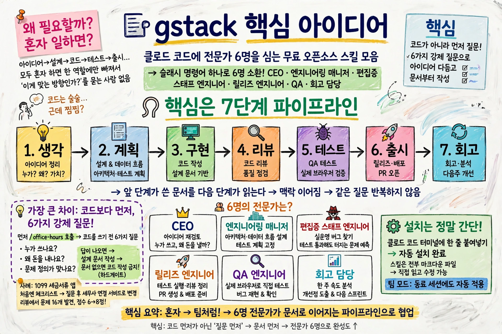
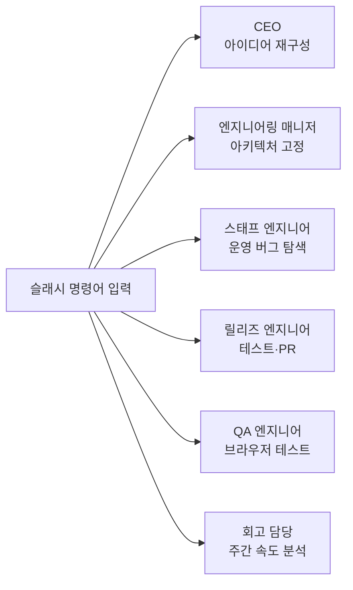
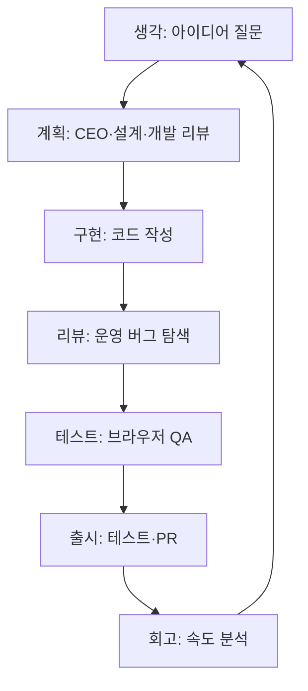
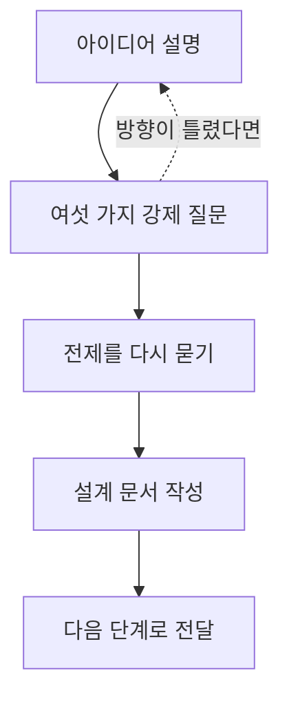

# gstack: 슬래시 하나로 전문가 6명을 부르면, 혼자서도 팀처럼 일합니다

> **Summary**
> gstack은 클로드 코드에서 CEO, 엔지니어링 매니저, 리뷰어, 릴리즈 엔지니어, QA, 회고 담당 역할을 불러 팀처럼 일하게 하는 무료 오픈소스 스킬 모음입니다. 아이디어 검토부터 계획, 구현, 리뷰, 테스트, 출시, 회고까지 단계별 문서를 이어받아 진행하며, 코드 작성 전에 질문과 설계를 거쳐 방향을 점검합니다. 터미널에서 간단히 설치할 수 있고, 필요한 스킬부터 선택해 사용할 수 있습니다.

---

- `gstack`은 클로드 코드에 전문가 6명을 심는 무료 오픈소스 스킬 모음입니다. 슬래시 명령어 하나로 CEO, 엔지니어링 매니저, 리뷰어, QA, 릴리즈 엔지니어를 소환합니다.
- 핵심은 파이프라인입니다. 생각→계획→구현→리뷰→테스트→출시→회고 순서로 이어지고, 앞 단계가 쓴 문서를 다음 단계가 읽습니다.
- 코드부터 쓰지 않는 점이 가장 다릅니다. 여섯 가지 강제 질문으로 아이디어를 먼저 다듬고, 설치는 터미널에 안내 한 줄을 붙여넣으면 끝납니다.

아이디어가 떠올라 클로드 코드에 "이거 만들어줘"라고 했더니, 코드는 술술 나왔는데 어딘가 찜찜했던 적 있으시죠? 내가 원한 게 맞는지, 나중에 터질 문제는 없는지, 아무도 묻지 않았습니다. 그 빈자리를 채우는 방법이 전문가를 부르는 것입니다! 이 스킬 모음은 유명 스타트업 액셀러레이터의 CEO가 매일 쓰던 워크플로우를 그대로 담은 것입니다.

🎥 [동영상 보기](https://www.youtube.com/watch?v=aog9FwKCfF0)

## 혼자 일하는데, 왜 팀이 필요할까요?

소프트웨어 하나를 만드는 일은 사실 여러 가지 일입니다. 아이디어를 다듬고, 설계를 정하고, 코드를 쓰고, 버그를 찾고, 테스트하고, 출시합니다. 혼자서 이 모든 역할을 번갈아 하면, 한 역할에만 빠져서 다른 역할을 놓치기 쉽습니다. 특히 "이게 맞는 방향인가"를 묻는 역할은 아무도 맡지 않습니다.

`gstack`은 이 문제를 역할로 풉니다. 클로드 코드를 만능 비서로 쓰는 대신, 전문가 6명을 따로 부릅니다. 각 전문가는 자기 일만 보고, 다음 전문가에게 문서를 넘깁니다. 혼자 일하면서도 팀처럼 일하는 구조입니다.

## 6명의 전문가는 누구일까요?

출시 당시 스킬은 6개였습니다. 역할은 이렇게 나뉩니다.

- **CEO**: 아이디어를 다시 생각합니다. "누가 쓰고, 왜 돈을 낼까요?"라고 묻습니다.
- **엔지니어링 매니저**: 아키텍처와 데이터 흐름, 빠진 경우와 테스트 계획을 고정합니다.
- **편집증 스태프 엔지니어**: 테스트는 통과하는데 실제 운영에서 터지는 버그를 찾습니다.
- **릴리즈 엔지니어**: 테스트를 돌리고 리뷰를 정리해 PR을 엽니다.
- **QA 엔지니어**: 진짜 브라우저를 열어 앱을 직접 눌러보고 버그를 재현합니다.
- **회고 담당**: 일주일 속도를 분석해 다음 주에 고칠 점을 찾습니다.

이 대목이 저는 가장 인상 깊었습니다. 숫자가 아니라, "생각하는 단계를 건너뛰지 않는다"는 원칙이 시스템으로 굳어 있다는 점입니다!

## 스프린트는 어떻게 이어질까요?

6명은 따로 노는 게 아닙니다. 하나의 스프린트로 이어집니다. 생각, 계획, 구현, 리뷰, 테스트, 출시, 회고 순서입니다. 앞 단계가 쓴 문서를 다음 단계가 읽습니다. 설계 문서가 없으면 계획 리뷰가 허공에 떠돌지 않고, 테스트 계획이 없으면 QA가 뭘 확인할지 모릅니다. 단계마다 맥락이 이어지니 같은 질문을 반복하지 않습니다.

## 코드보다 먼저, 여섯 가지 질문부터 던진다고요?

가장 먼저 부르는 전문가는 `/office-hours`입니다. 아이디어를 말하면, 코드를 쓰기 전에 여섯 가지 강제 질문을 던집니다. "누가 쓰나요?", "왜 돈을 내나요?" 같은 질문입니다. 답을 듣고 나면 설계 문서를 씁니다. 문서가 나오기 전에는 코드를 쓰지 않습니다. 이게 하드 게이트입니다!

공개된 데모가 잘 보여줍니다. 세금 서류 1099를 모으는 앱 아이디어가 있었습니다. 처음에는 체크리스트 도구였는데, 질문을 거치면서 세무사와 연결해주는 더 큰 사업으로 바뀌었습니다. 리뷰에서는 문제 16개가 나왔고, 점수는 6점에서 8점으로 올랐습니다. 코드 한 줄 쓰기 전에 방향이 바뀐 셈입니다. 계획 단계에서 틀린 방향을 잡는 게, 출시 후에 고치는 것보다 훨씬 쌉니다!

## 숫자는 얼마나 믿을 수 있을까요?

공개된 수치는 화려합니다. 60일 동안 60만 줄이 넘는 코드를 냈고, 그중 35%가 테스트였다고 합니다. 하루 1만~2만 줄 수준입니다. 다만 이 숫자는 공개한 쪽이 직접 밝힌 기록이라는 점을 알고 봐야 합니다. 줄 수가 중요한 게 아닙니다. 중요한 건 이 워크플로우로 매일 제품을 내보냈다는 점입니다.

스킬 개수도 계속 늘었습니다. 출시 당시 6개였던 스킬은 두 달 뒤 23개가 넘었습니다. 처음부터 전부 쓸 필요는 없습니다. 지금 필요한 역할부터 하나씩 불러보는 게 낫습니다.

## 설치는 얼마나 쉬울까요?

설치는 간단합니다. 클로드 코드 터미널에 안내 문장 한 줄을 붙여넣으면, 에이전트가 알아서 설치합니다. 스킬은 전부 마크다운 파일이라, 마음에 안 드는 부분은 직접 읽고 고칠 수 있습니다. 팀 모드로 켜면 동료들의 세션에도 자동으로 적용됩니다.

혼자 일한다고 혼자 생각할 필요는 없습니다. 전문가 6명을 부르는 슬래시 하나가, 그 간격을 메워줍니다!

