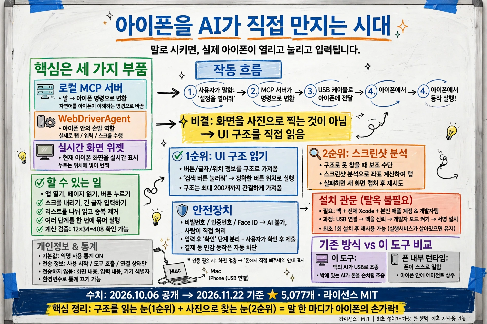
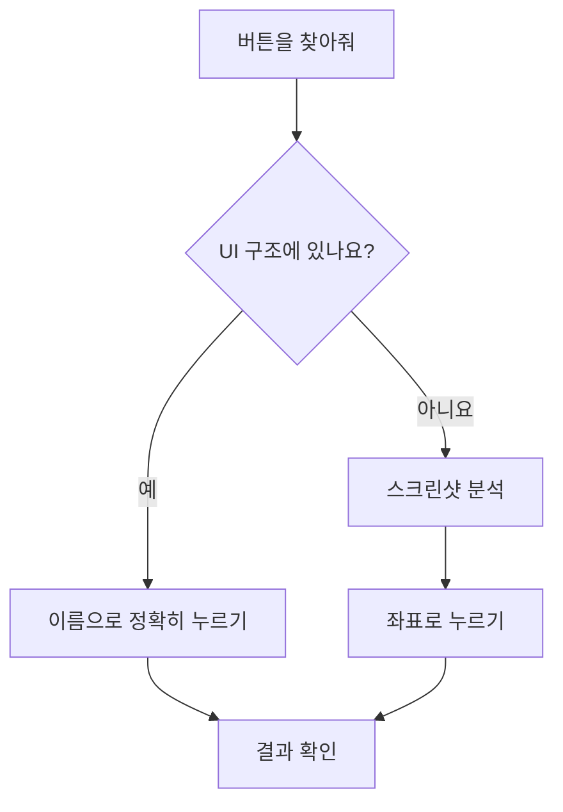

# iPhone Use: 말 한 마디면 AI가 진짜 아이폰을 만집니다. 화면이 아니라 UI 구조를 읽습니다

> **Summary**
> AI는 맥의 로컬 MCP 서버와 USB로 연결된 아이폰의 WebDriverAgent를 통해 앱을 열고, 누르고, 입력하는 등 실제 기기를 조작합니다. 화면 캡처보다 UI 구조를 우선 활용하고, 찾지 못하면 스크린샷을 분석해 좌표로 조작합니다. 탈옥은 필요 없지만 전체 Xcode와 계정 서명 등 초기 설정이 필요하며, 인증·결제 같은 민감한 작업은 사람이 직접 처리하도록 제한합니다.

---

- 아이폰을 AI가 직접 만지는 시대가 왔습니다. 말로 시키면, 실제 아이폰이 열리고 눌리고 입력됩니다.
- 비결은 화면 캡처가 아닙니다. 아이폰의 UI 구조를 직접 읽어 버튼과 글자를 찾아 누릅니다.
- 탈옥은 필요 없지만, 첫 설치는 만만치 않습니다. 맥과 전체 Xcode, 본인 계정 서명이 먼저입니다.

아이폰 설정에서 와이파이 하나 찾느라 손가락이 바빴던 적 있으시죠? 앱을 열고, 메뉴를 뒤지고, 스크롤을 내리는 일이요. 그런데 그 일을 이제 말로 시킬 수 있게 됐습니다. "메모장에 새 글 하나 써줘." 이렇게요!

🎥 [동영상 보기](https://www.youtube.com/watch?v=PzyOkem_dYk)

## 아이폰을 만지는 AI, 어떻게 움직일까요?

핵심은 세 가지 부품입니다. 말로 받은 일을 아이폰 명령으로 바꾸는 **로컬 MCP 서버**, 아이폰 안에서 실제로 손발이 되는 **WebDriverAgent**, 그리고 지금 화면을 보여주는 **실시간 화면 위젯**입니다. 에이전트가 "설정을 열어줘"라고 들으면, MCP 서버가 그 말을 아이폰이 알아듣는 명령으로 바꿉니다. 그리고 USB 케이블을 타고 아이폰 안의 실행 서비스로 전달됩니다.

## 화면을 보는 게 아니라, 구조를 읽습니다!

기존 방식은 화면을 사진처럼 찍어서 "이 버튼이 어디쯤 있겠지" 하고 추측했습니다. 이 도구는 다릅니다. 아이폰의 UI 구조를 직접 읽습니다. 버튼 이름, 글자, 위치가 목록으로 넘어오니까, "검색 버튼을 눌러줘"라는 말이 정확한 동작이 됩니다. 화면이 복잡해지면 목록은 200개까지만 간결하게 가져옵니다.

그런데 구조로 못 찾을 때도 있지 않을까요? 그럴 땐 두 번째 눈이 켜집니다. 스크린샷을 분석해서 좌표로 누르는 방식으로 전환합니다. 구조가 1순위, 사진 분석이 2순위인 셈입니다. 실패하면 새 화면을 다시 보고 위치를 고릅니다.

## 무엇을 시킬 수 있을까요?

할 수 있는 일은 생각보다 넓습니다. 앱을 열고, 페이지를 읽고, 누르고, 스크롤하고, 긴 글자를 입력합니다. 리스트를 나눠 읽으면서 중복을 빼고, 어디까지 봤는지도 알려줍니다. 여러 단계를 한 번에 묶어서 보내면, 모델이 왔다 갔다 하는 횟수도 줄어듭니다. 계산기에서 `12×34=408`을 확인하는 식의 검증까지, 말 한 마디로 이어집니다!

화면은 옆에서 실시간으로 보입니다. 아이폰 모양 그대로, 지금 누르는 위치에 빛이 번쩍입니다. 화면을 직접 눌러 개입할 수도 있고, 마우스로 끌고, 트랙패드 두 손가락으로 스크롤할 수도 있습니다. 에어드롭으로 사진을 맥으로 가져오는 길도 열려 있습니다.

## 그런데, 첫 설치는 왜 이렇게 까다로울까요?

여기가 이 도구의 진짜 관문입니다. 탈옥은 필요 없습니다. 대신 맥, 전체 Xcode, 본인 애플 계정과 개발자 팀이 필요합니다. 아이폰에 실행 서비스를 직접 서명해서 올리는 과정이 있기 때문입니다. USB로 연결하고, 맥을 신뢰하고, 개발자 모드를 켜고, 잠금을 푼 채로 기다려야 합니다. 설치는 프롬프트 한 줄로 시작하지만, 계정 로그인과 기기 신뢰는 사람이 직접 해야 합니다.

한 번 세팅이 끝나면 어떨까요? 그 다음부터는 같은 설정을 재사용합니다. 실행 서비스가 살아 있으면 다시 설치하지 않습니다. 준비가 됐는지 확인하는 명령이 먼저 돌고, 준비됐다는 신호가 와야 작업이 시작됩니다.

## 안전장치는 어떻게 돼 있을까요?

비밀번호, 인증번호, 얼굴 인증은 AI가 대신하지 않습니다. 인증이 필요하면 화면이 멈추고, "폰에서 직접 해주세요"라는 안내가 뜹니다. 입력과 제출도 분리돼 있습니다. 글을 입력했다고 바로 보내지 않고, 사람이 내용을 확인한 뒤에 제출합니다. 결제 버튼처럼 민감한 동작은 모델이 멋대로 누르지 않게 막아둡니다.

한 가지는 미리 알아두는 게 좋습니다. 기본 설정에서는 익명 사용 통계가 켜져 있습니다. 사용 시작, 도구 호출, 연결 상태 같은 정보가 외부 분석 서비스로 갑니다. 화면이나 입력 내용, 기기 식별자는 안 보낸다고 합니다. 끄고 싶으면 환경 변수 하나로 끌 수 있습니다. 설치 전에 이 부분은 직접 확인하고 결정하시면 됩니다.

## 폰 위에서 돌리기와, 폰을 밖에서 조종하기는 다릅니다

비슷해 보이지만 방향이 정반대인 도구가 있습니다. 아이폰 안에서 에이전트를 오래 돌리는 런타임이 있고, 이 도구는 맥에 있는 에이전트가 USB로 아이폰을 조종합니다. 전자는 "폰이 스스로 일한다"는 쪽이고, 후자는 "밖에 있는 AI가 폰을 손처럼 쓴다"는 쪽입니다. 어떤 쪽이 맞을지는, 아이폰을 어디에 두고 싶은지에 따라 갈립니다!

수치도 눈에 띕니다. 2026년 10월 6일에 공개된 뒤, 11월 22일 기준 별 5,077개를 모았습니다. 한 달 남짓 만에 5천 개가 넘었다는 건, "AI가 내 폰을 직접 만진다"는 상상이 얼마나 많은 사람의 궁금증을 건드렸는지 보여줍니다. 라이선스는 MIT입니다.

정리하면 이렇습니다. 아이폰을 직접 만지는 AI, 그 손은 USB 케이블 끝에 있습니다. 구조를 읽는 눈과, 사진으로 찾는 두 번째 눈을 함께 쓰니까요. 첫 설치의 문턱만 넘으면, 말 한 마디가 아이폰의 손가락이 됩니다!

