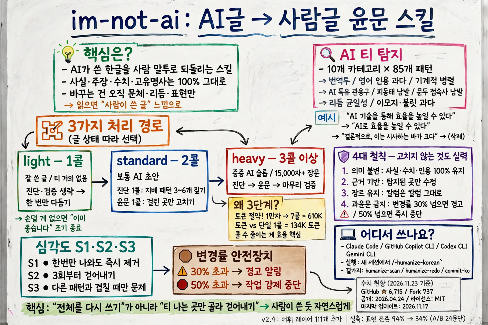
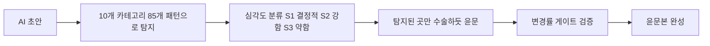
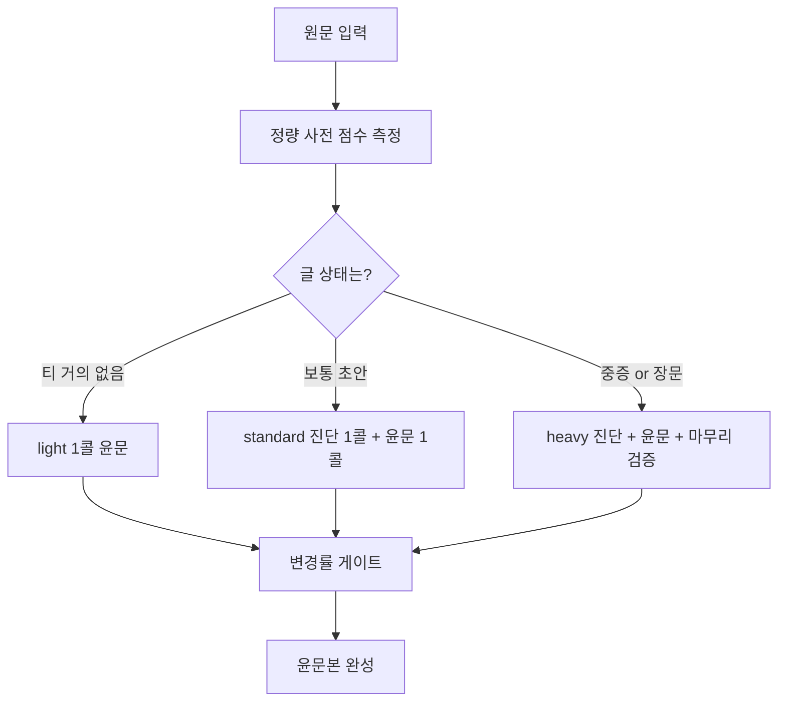

# im-not-ai: AI가 쓴 글을 고치는 게 아닙니다. 사람 말투로 되돌립니다

> **Summary**
> im-not-ai는 AI가 쓴 한글의 85가지 패턴을 찾아 사실과 의미는 유지한 채 사람다운 말투로 다듬는 스킬입니다. 글 상태에 따라 처리 경로를 선택하고 변경률을 제한해 과도한 수정을 막으며, CLI 도구에서 사용할 수 있습니다.

---

- `im-not-ai`는 AI가 쓴 한글 글을 사람 말투로 되돌리는 스킬입니다. 사실·주장·수치는 그대로 두고, 문체·리듬·표현만 고칩니다.
- AI 티를 10개 카테고리 85개 패턴으로 나눠 탐지하고, 글 상태에 따라 1콜·2콜·3콜 중 맞는 경로를 골라 윤문합니다.
- 변경률이 30%를 넘으면 경고하고 50%를 넘으면 멈춥니다. 과하게 고치지 않는 게 이 스킬의 철칙입니다.

AI로 초안을 뽑아놓고 다시 읽어본 적 있으시죠? 내용은 맞는데 어딘가 번역한 듯한 문장, "결론적으로"로 시작하는 문단, 첫째·둘째·셋째로 줄줄이 이어지는 나열이 눈에 밟힙니다. 읽는 사람은 두 줄 만에 알아챕니다. 이 글, AI가 썼구나 하고요!

🎥 [동영상 보기](https://www.youtube.com/watch?v=y-qz-qZBhGc)

## AI 티, 도대체 어디서 날까요?

AI 티는 한두 가지 버릇이 아닙니다. 이 스킬은 AI가 쓴 한글의 티를 **10개 카테고리 85개 패턴**으로 나눠서 봅니다. 번역투, 영어 인용 과다, 기계적 병렬, AI 특유 관용구, 피동태 남용, 문두 접속사 남발, 리듬 균일성, 이모지·불릿 과다까지요.

대표적인 패턴 몇 가지만 봐도 고개가 끄덕여집니다. "AI 기술을 통해 효율을 높일 수 있다"는 "AI로 효율을 높일 수 있다"로, "이에 있어서 중요한 점은"은 "여기서 중요한 건"으로 바뀝니다. "~에 의해 생성된"은 "~가 만든"이 되고, "결론적으로, 이는 시사하는 바가 크다"는 통째로 사라집니다. 문장을 고치는 게 아니라, 영어를 옮기다 생긴 티를 걷어내는 겁니다!

탐지에는 심각도도 붙습니다. **S1**은 한 번만 나와도 강한 AI 신호라서 우선 제거하고, **S2**는 1~2회까지는 봐주다가 3회부터 걷어내고, **S3**은 다른 패턴과 겹칠 때만 문제로 봅니다. 그래서 윤문은 "전체를 다시 쓰기"가 아니라 "걸린 곳만 고치기"입니다. 탐지되지 않은 구간은 손도 대지 않습니다.

## 잘 쓴 글은 1번만 부르면 됩니다!

글 상태에 따라 처리 경로가 달라지는 게 이 스킬의 가장 큰 특징입니다. 정량 점수를 재는 스크립트가 글의 티 수준을 먼저 재고, 그 점수로 **경로 힌트**를 정합니다. 잘 쓴 글에는 가벼운 경로를, 중증인 글에만 무거운 경로를 쓰는 겁니다.

- **light — 1콜**: 어휘 티가 거의 없는 잘 쓴 글입니다. 진단도 마무리 검증도 생략하고 한 번만 윤문합니다. 손댈 게 거의 없으면 "이미 좋습니다"로 조기 종료합니다.
- **standard — 2콜**: 보통의 AI 초안입니다. 진단 1콜로 지배 패턴 3~6개를 짚고, 겨냥 윤문 1콜로 고칩니다. 1만 자짜리 글도 쪼개지 않고 한 번에 처리합니다.
- **heavy — 3콜 이상**: 중증 AI 슬롭이 밀집했거나 15,000자를 넘는 장문, 검증 증적이 필요할 때입니다. 진단 → 윤문 → 마무리 검증까지 거칩니다.
왜 이렇게 나눌까요? 토큰이 아까워서입니다. 1만 자짜리 글을 청크로 쪼개 7콜로 돌리면 610K 토큰이 드는데, 단일 콜이면 134K 토큰으로 같은 품질이 나왔습니다. 절감은 모델을 바꾸는 게 아니라 **콜 수를 줄이는 데서** 옵니다.

## 고치지 않는 것도 실력입니다

이 스킬이 지키는 **4대 철칙**이 있습니다. 첫째, **의미 불변**입니다. 사실·주장·수치·고유명사·직접 인용은 100% 원문 그대로 둡니다. 둘째, **근거 기반**입니다. 탐지된 곳에만 손을 대고, 탐지되지 않은 구간은 건드리지 않습니다. 셋째, **장르 유지**입니다. 칼럼이 에세이로, 리포트가 문학으로 옮겨가지 않습니다. 넷째, **과윤문 금지**입니다. 변경률이 30%를 넘으면 경고하고, 50%를 넘으면 작업을 강제로 멈춥니다!

윤문 대상에서 아예 빼는 목록도 있습니다. 수치·단위·날짜, 고유명사·인명·제품명·모델명, 큰따옴표 안의 직접 인용, 법률·규정 조문, 학술 개념어는 탐지도 윤문도 하지 않습니다. 숫자를 고치면 글이 틀어지니까요. 윤문 뒤에는 품질 등급도 매깁니다. S1이 0건이고 점수가 70% 이상 좋아지면 A등급, S1이 남거나 과윤문 신호가 보이면 C·D등급으로 사람 검토를 권합니다.

## 단어 하나가 글을 배신합니다?

문장 구조만 고쳐서는 안 되는 티가 있습니다. "이 시장을 세 가지 **렌즈**로 보면", "변화는 세 개의 **축**으로 정리된다", "대안을 **쥔** 구매자" 같은 낱말입니다. 영어를 옮기다 생긴 표현이라 읽다가 걸리는데, 문법은 맞으니까 교정기도 안 잡습니다. 그래서 v2.4부터 **어휘 레이어**가 들어갔습니다. 읽다가 걸리는 낱말 111개를 블라인드 평가로 골라 문맥에 따라 고치는 겁니다. 일괄 치환이 아니라, 문맥을 보고 바꿀 때만 바꿉니다.

실측도 있습니다. 실사용 문단 24개에 두 번 돌린 A/B 테스트에서, 이런 표현이 남는 비율이 **94%에서 34%**로 줄었습니다. 다만 표본이 24문단 × 2회, 모델 하나로 작다는 점은 알아두면 좋습니다. 낱말 판정도 한 사람이 했고, 코파일럿 단일 호출 패키지에는 이 레이어가 들어가지 않습니다. 숫자는 참고로 보고, 결과는 직접 읽고 확인하는 게 맞습니다.

## 어디서 쓰고, 뭐가 더 있나요?

클로드 코드, 깃허브 코파일럿 CLI, 코덱스 CLI, 제미나이 CLI에서 쓸 수 있습니다. 마켓플레이스에서 검색해 설치하고, 새 세션에서 `/humanize-korean`이라고 부르면 됩니다. 웹 버전 클로드나 일반 챗GPT에서는 안 되고, 파일·셸·에이전트 기능이 있는 CLI에서 실행해야 합니다.

곁가지도 있습니다. 윤문이 필요한지 먼저 가볍게 재보는 `humanize-scan`, 가장 최근 윤문 결과를 2차로 다듬는 `humanize-redo`, 한글 커밋 메시지의 사무적인 말투만 걷어내는 `commit-ko`가 있습니다. `commit-ko`는 별도 설치가 필요합니다. 웹 버전도 별도 코드베이스로 운영 중입니다. 웹 버전 사전 테스트에서는 빠른 모드 기준으로 의미 보존이 세 모델 모두 100, AI 티 점수는 국산 모델이 두 샘플 모두 가장 낮게(15, 5) 나왔고, 변경률은 8~37%로 안정적이었습니다. 다만 프리뷰 단계라 속도는 다소 느렸다고 합니다.

숫자도 눈에 띕니다. 2026년 4월 24일 공개된 이 스킬은 2026년 6월 중순엔 별 3천 개를 앞둔 수준이었는데, 2026년 11월 23일 기준 **별 6,715개, 포크 737개**까지 늘었습니다. 다섯 달 만에 두 배가 넘었습니다. 라이선스는 MIT이고, 마지막 업데이트는 2026년 11월 17일이었습니다.

AI 티를 지우는 일은 탐지기를 속이는 기술이 아닙니다. 글을 읽는 사람에게 "이 글, 사람이 썼네"라는 느낌을 돌려주는 일입니다. 그 느낌은 문장을 다시 쓰는 데서 오는 게 아니라, 티가 나는 곳만 정확히 골라 걷어내는 데서 옵니다!

