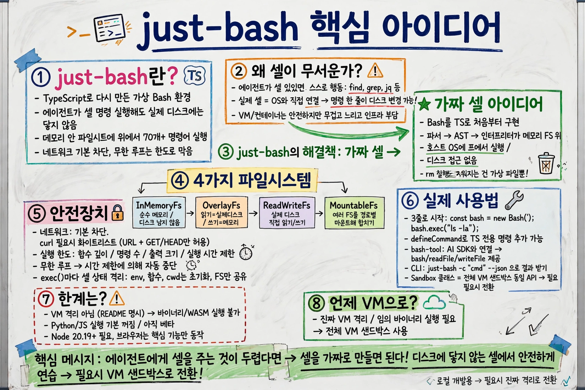
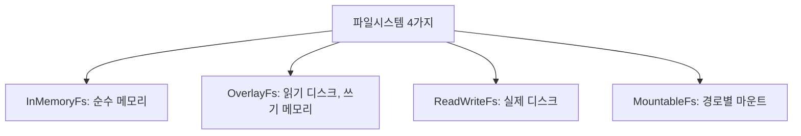
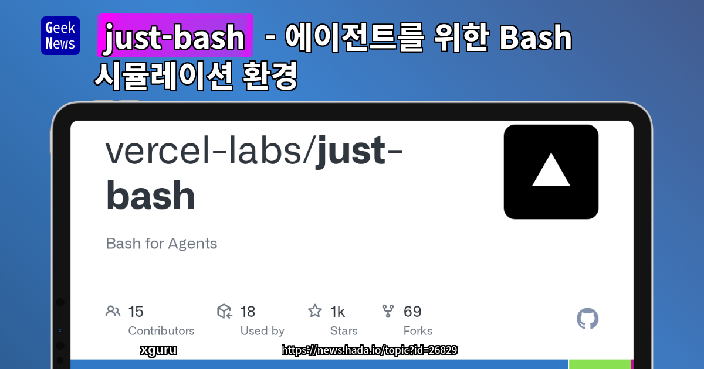

# just-bash: 에이전트에게 셸을 주되, 디스크에는 닿지 않게 하는 게 답입니다

> **Summary**
> just-bash는 TypeScript로 구현한 가상 Bash 환경으로, 에이전트가 메모리 파일시스템에서 70개 이상의 명령어를 실행하도록 해 실제 디스크 접근을 막습니다. 네트워크와 실행 한도를 제어하며, 가벼운 로컬 개발에 적합하지만 VM 수준의 격리를 제공하지는 않습니다.

---

# just-bash: 에이전트에게 셸을 주되, 디스크에는 닿지 않게 하는 게 답입니다

- just-bash는 TypeScript로 다시 만든 가상 Bash 환경입니다. 에이전트가 셸 명령을 실행해도 실제 디스크에는 닿지 않습니다.
- 메모리 안 파일시스템 위에서 70개가 넘는 명령어가 돌아가고, 네트워크는 기본 차단, 무한 루프는 한도로 막습니다.
- 로컬 개발용으로 쓰고, 진짜 VM 격리가 필요해지면 같은 API의 샌드박스로 갈아탈 수 있습니다.

에이전트에게 파일을 찾아달라고 했는데, 혹시 엉뚱한 명령을 실행해서 시스템을 건드릴까 봐 걱정된 적 있으시죠? 셸은 에이전트에게 가장 강력한 도구입니다. 파일을 읽고, 내용을 가공하고, 다음 행동을 정하는 일을 한 번에 해냅니다. 그런데 셸이 진짜라면 이야기가 달라집니다. 명령 한 줄이 디스크를 건드릴 수 있으니까요!

🎥 [동영상 보기](https://www.youtube.com/watch?v=EoyLzyJUcfI)

## 에이전트에게 셸을 주는 게 왜 무서울까요?

에이전트는 셸이 있으면 스스로 움직입니다. `find`로 파일을 찾고, `grep`으로 필요한 줄만 뽑고, `jq`로 JSON을 가공합니다. 토큰도 아낍니다. 큰 파일을 통째로 모델에 넣는 대신, 셸로 잘라서 필요한 조각만 가져오면 되니까요.

문제는 셸이 운영체제와 직접 연결된다는 점입니다. VM이나 컨테이너로 감싸면 안전해지지만, 무겁고 느리고 인프라가 필요합니다. 가벼운 에이전트 하나 돌리려고 VM을 띄우는 건 배보다 배꼽이 큽니다. 이럴 때 선택지가 뭐가 있을까요?

## 진짜 셸이 아니라, 가짜 셸을 주면 되지 않을까요?

just-bash의 답은 단순합니다. Bash를 TypeScript로 처음부터 다시 구현하는 겁니다. 파서가 명령을 읽어 AST로 바꾸고, 인터프리터가 메모리 안 파일시스템 위에서 실행합니다. 호스트 OS에는 프로세스가 뜨지 않고, 디스크 접근도 없습니다. 에이전트가 `rm`을 쳐도 지워지는 건 가상 파일뿐입니다!

명령어도 70개가 넘습니다. `cat`, `ls`, `grep`, `sed`, `awk`, `rg` 같은 기본기는 물론이고 `jq`, `sqlite3`, `yq` 같은 데이터 도구까지 들어 있습니다. 파이프, 리다이렉션, `&&` 연결, 변수, 글로브, 조건문, 반복문, 함수까지 Bash 문법 대부분이 됩니다. 이 장면이 저는 가장 인상 깊었습니다. 진짜 셸처럼 보이는데, 실체는 메모리 안 객체라는 점이요!

## 파일시스템은 네 가지, 뭐가 다를까요?

기본값은 `InMemoryFs`입니다. 순수 메모리 기반이라 디스크에 아무것도 남지 않습니다. 여기에 용도에 따라 세 가지를 더 얹을 수 있습니다.

- `OverlayFs`는 읽기는 실제 디스크에서, 쓰기는 메모리에서 합니다. 프로젝트를 읽기 전용으로 보여주고, 분석용 임시 파일은 가상으로 쌓을 때 좋습니다.
- `ReadWriteFs`는 실제 디스크에 직접 쓰고 읽습니다. 에이전트에게 진짜 쓰기를 허용할 때 씁니다.
- `MountableFs`는 여러 파일시스템을 경로별로 마운트해 하나의 네임스페이스로 합칩니다. 지식 베이스는 읽기 전용으로, 작업 공간은 쓰기 가능으로 나누는 식입니다.

## 네트워크와 무한 루프는 어떻게 막을까요?

네트워크는 기본 차단입니다. `curl` 명령 자체가 네트워크를 설정해야 생깁니다. 허용할 땐 URL 앞부분과 HTTP 메서드로 화이트리스트를 만듭니다. 허용된 주소로만, 기본은 GET과 HEAD만 됩니다.

실행 보호도 한도로 겁니다. 함수 깊이, 명령 수, 출력 크기, 실행 시간에 상한을 둘 수 있습니다. 무한 루프는 시간 제한에 걸려 멈춥니다. `exec()` 호출마다 셸 상태도 격리됩니다. 환경 변수, 함수, 작업 디렉터리는 호출마다 초기화되고, 파일시스템만 공유됩니다. 파일은 다음 호출에서도 보이지만, 셸 상태는 매번 깨끗하게 시작합니다!

## 실제로 어떻게 쓰면 될까요?

시작은 세 줄이면 됩니다. `Bash`를 만들고 `exec()`으로 명령을 실행하면 됩니다. `defineCommand`로 TypeScript 전용 명령을 추가할 수도 있습니다. 자주 쓰는 조회 로직을 명령 하나로 묶어두면, 에이전트는 그 명령만 부르면 됩니다.

AI SDK와 연결하는 도구도 있습니다. `bash-tool`이 `bash`, `readFile`, `writeFile` 도구를 제공해 모델이 파일시스템을 직접 뒤지며 필요한 맥락만 가져오게 합니다. 텍스트-SQL 에이전트를 다시 설계하면서 토큰 사용량을 줄이고 정확도를 높인 사례가 이 도구의 출발점입니다.

CLI도 있습니다. `just-bash -c`로 명령 한 줄을 실행하고, `--json`으로 결과를 프로그램이 읽기 좋게 받을 수 있습니다. 대화형 셸도 있습니다. `Sandbox` 클래스는 전체 VM 샌드박스와 같은 API라서, 로컬에서 개발하다가 진짜 격리가 필요해지면 그대로 갈아탈 수 있습니다.

## 한계는 없을까요?

분명히 짚을 점이 있습니다. 이건 VM 격리가 아닙니다. README가 직접 밝히고 있습니다. 바이너리나 WASM 실행은 지원하지 않고, Python과 JavaScript 실행은 기본으로 꺼져 있습니다. 아직 베타 소프트웨어라는 점도 README에 적혀 있습니다. Node 20.19 이상이 필요하고, 브라우저에서는 핵심 기능만 동작합니다. 진짜 VM 격리나 임의 바이너리 실행이 필요하면 전체 VM 샌드박스를 쓰면 됩니다. 가벼운 개발용과 무거운 운영용을 구분해서 쓰는 게 맞습니다!

에이전트에게 셸을 주는 일이 두렵다면, 셸을 가짜로 만들면 됩니다. 디스크에 닿지 않는 셸에서 마음껏 연습시키고, 진짜 격리가 필요할 때만 VM으로 옮기면 됩니다!

