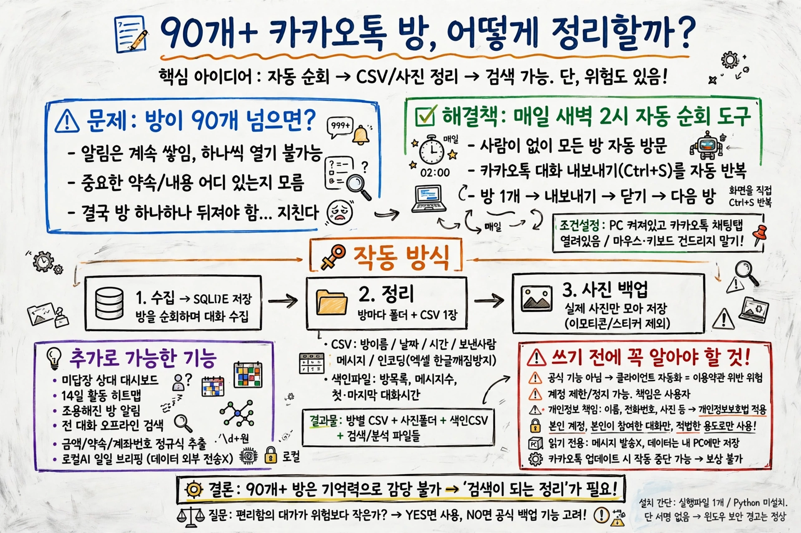
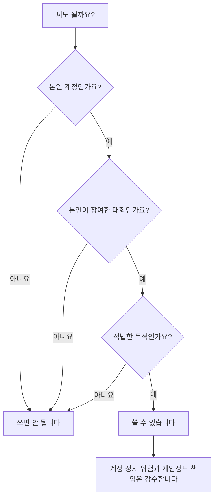

# kakao-auto: 카톡 대화방 90개, 새벽 2시에 사람 없이 CSV로 정리합니다

> **Summary**
> kakao-auto는 매일 새벽 2시에 카카오톡 대화방을 순회해 대화를 SQLite와 방별 CSV로 정리하고 사진을 로컬에 저장하는 도구입니다. 검색·대시보드·백업 기능도 제공하지만, 비공식 클라이언트 자동화로 계정 정지 위험이 있으며 수집된 개인정보에 대한 책임은 사용자에게 있으므로 본인 계정의 참여 대화만 적법한 목적으로 사용해야 합니다.

---

- 카카오톡 대화방이 90개를 넘으면, 하나씩 열어보는 정리 방식은 더 이상 통하지 않습니다.
- 이 도구는 매일 새벽 2시에 사람 없이 모든 방을 순회해 방마다 CSV 한 장과 사진까지 로컬에 정리합니다.
- 다만 카카오톡 공식 기능이 아니라 클라이언트 자동화라서, 계정 정지 위험과 개인정보 책임을 먼저 따져봐야 합니다.

업무방이 90개를 넘으면 어떤 기분일까요? 알림 숫자는 계속 쌓이는데, 어느 방에서 무슨 말이 오갔는지 하나씩 열어보는 건 이미 불가능합니다. 중요한 약속이 어디에 있었는지 찾으려면, 결국 방을 하나하나 뒤져야 합니다. 이런 적 있으시죠?

🎥 [동영상 보기](https://www.youtube.com/watch?v=DD8V3BuM2Y8)

## 90개 방, 어떻게 다 돌까요?

비결은 의외로 단순합니다. 카카오톡이 화면을 직접 그리는 방식이라 일반적인 자동화 도구는 대화 내용을 읽어오지 못합니다. 그래서 이 도구는 카카오톡 자체의 대화 내보내기 기능(`Ctrl+S`)을 그대로 눌러서 결과를 가져옵니다. 방을 하나씩 열고, 내보내고, 닫는 과정을 끝까지 반복하는 겁니다!

수집한 대화는 먼저 `SQLite` 데이터베이스에 쌓입니다. 그리고 방마다 폴더 하나, CSV 한 장으로 다시 정리됩니다. CSV 컬럼은 방 이름, 날짜, 시간, 보낸 사람, 메시지 여섯 가지이고, 엑셀에서 한글이 깨지지 않는 인코딩으로 저장됩니다. 방 목록과 메시지 수, 처음·마지막 대화 시간을 담은 색인 파일도 함께 나옵니다. 사진은 실제 사진만 따로 모아두고, 이모티콘과 스티커는 제외합니다.

## 새벽 2시, 사람 없이 도는 비결은요?

메뉴에서 한 번만 설정하면 매일 새벽 2시에 같은 작업이 자동으로 돕니다. 모니터가 없어도 됩니다. 화면이 깨진 노트북에서 덮개를 닫은 채로 돌린 실증 사례도 있습니다. 다만 조건이 있습니다. 그 시각에 PC가 켜져 있고 로그인된 상태여야 하고, 카카오톡이 채팅 탭에 열려 있어야 합니다. 화면 속 창 위치가 흔들리면 순회가 틀어지니, 돌아가는 동안 마우스나 키보드를 건드리지 않는 것이 좋습니다.

설치도 간단합니다. 설치 파일을 받아 실행하면 되고, 파이썬을 따로 깔 필요가 없습니다. 서명이 없는 파일이라 윈도우 보안 경고가 뜨는데, 이건 서명 인증서가 없는 오픈소스라서 생기는 정상적인 경고입니다.

## CSV 말고 또 뭐가 남을까요?

정리만 하는 도구가 아닙니다. 답장을 아직 안 한 상대가 누군지 보여주는 대시보드, 14일 활동 히트맵, 조용해진 방을 알려주는 기능이 있습니다. 모든 대화를 한 번에 검색하는 오프라인 검색, 방과 사람을 잇는 관계 그래프, 엑셀 내보내기도 있습니다. 금액·약속·계좌번호를 정규식으로 뽑아내는 기능, 사진 백업, 암호화 백업까지 메뉴에 들어 있습니다. 일일 브리핑은 로컬 AI로 요약하는 선택지도 있어서, 데이터를 밖으로 보내지 않고 정리할 수 있습니다.

이쯤 되면 궁금해지실 겁니다. 대화 정리가 왜 이렇게까지 필요할까요? 방이 90개를 넘으면 기억력으로는 안 되기 때문입니다. 정리는 결국 검색이 되게 만드는 일입니다!

## 쓰기 전에 꼭 알아야 할 것은요?

여기서 한 가지는 분명히 짚고 넘어가야 합니다. 이 도구는 카카오톡 공식 기능이 아닙니다. 클라이언트를 자동화하는 방식이라 이용약관을 위반하게 되고, 계정이 제한되거나 정지될 수 있습니다. 그 위험은 전적으로 사용하는 사람의 몫입니다!

또 하나, 수집물에는 다른 사람의 개인정보가 들어 있습니다. 이름, 전화번호, 주소, 주문 내역, 사진까지 말입니다. 개인정보보호법상 책임도 사용자에게 있습니다. 본인 계정에서, 본인이 참여한 대화만, 적법한 목적으로 써야 합니다. 남을 감시하거나 본인이 참여하지 않은 대화를 가로채는 용도로는 절대 쓰면 안 됩니다!

메시지를 보내는 기능은 없습니다. 읽기 전용이라 대화를 건드리지 않고, 데이터도 전부 내 컴퓨터에만 둡니다. 암호를 깨거나 인증을 우회하는 방식도 아닙니다. 그래도 약관 위반이라는 사실은 바뀌지 않습니다. 카카오톡이 업데이트되면 언제든 멈출 수 있고, 그때의 손해도 보상받지 못합니다.

정리하고 싶은 방이 90개라면, 이 도구는 분명 매력적입니다. 새벽 2시에 사람 없이 돌고, 방마다 CSV 한 장이 남고, 검색까지 됩니다. 다만 그 전에 물을 한 가지는 있습니다. 편리함의 대가로 감당할 위험이, 내 방 90개의 가치보다 작은가요? 답이 예라면 쓸 수 있습니다. 그게 아니라면, 공식 백업 기능으로 충분한지 먼저 살펴보는 것이 좋습니다!

