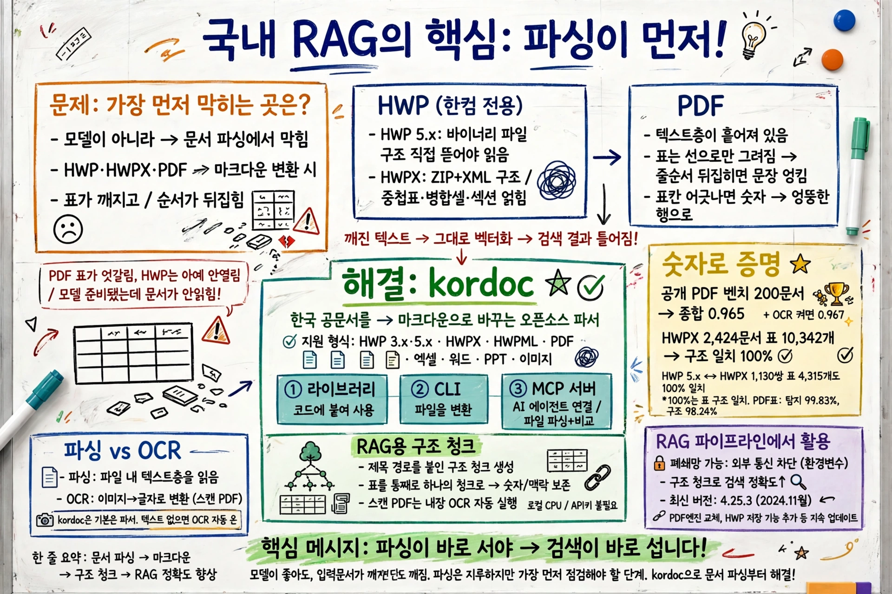
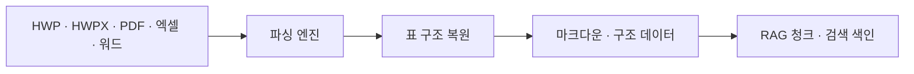
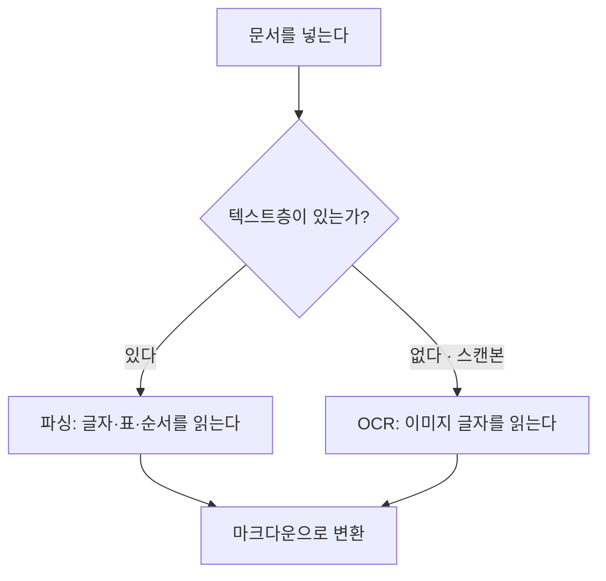

# kordoc: HWP 파일이 RAG의 병목이라면, 파싱부터 바꿔야 합니다

> **Summary**
> kordoc은 HWP·HWPX·PDF 등 다양한 문서를 마크다운과 RAG용 구조 청크로 변환하는 오픈소스 파서로, 표 구조 복원과 로컬 OCR을 지원합니다. 공개 벤치에서 높은 성능을 보였지만, 수치는 표 구조 일치 등 특정 범위에 한정되므로 실제 사용 시 최신 옵션과 지표를 확인해야 합니다.

---

- 국내 RAG에서 가장 먼저 막히는 곳은 모델이 아니라 문서 파싱입니다. HWP·HWPX·PDF를 마크다운으로 바꾸는 단계에서 표가 깨지고 순서가 뒤집힙니다.
- kordoc은 HWP 3.x·5.x·HWPX·HWPML·PDF·엑셀·워드까지 마크다운으로 바꾸는 오픈소스 파서입니다. 공개 PDF 벤치에서 200문서 종합 0.965를 기록했고, 원본 HWPX 2,424문서의 표 10,342개는 구조가 전부 일치했습니다.
- 라이브러리·CLI·MCP 서버 세 가지로 쓰고, RAG용 구조 청크도 바로 뽑습니다. 스캔 PDF는 내장 OCR이 따로 읽습니다.


공공문서 한 묶음을 받아서 RAG에 넣으려고 열어본 적 있으시죠? HWP 파일이 잔뜩 섞여 있습니다. PDF는 표가 엇갈리고, HWP는 아예 열리지도 않습니다. 모델은 준비됐는데, 문서가 안 읽힙니다!

🎥 [동영상 보기](https://www.youtube.com/watch?v=9kRbwiTRQLs)

## 왜 HWP 파싱이 이렇게 어려울까요?

HWP는 한컴의 전용 포맷입니다. 구형 HWP 5.x는 바이너리 파일이라 구조를 직접 뜯어야 읽힙니다. HWPX는 ZIP 안에 XML이 들어 있는 구조라 겉보기엔 쉬워 보이지만, 중첩 표와 병합 셀, 섹션 나누기가 얽혀 있습니다.

PDF도 만만치 않습니다. 글자는 텍스트층에 흩어져 있고, 표는 선으로만 그려져 있습니다. 줄 순서가 뒤집히면 문장이 엉키고, 표 칸이 어긋나면 숫자가 엉뚱한 행으로 들어갑니다. RAG는 이렇게 깨진 텍스트를 그대로 벡터로 만듭니다. 검색이 틀어지는 건 당연한 결과입니다!

그래서 국내 RAG 파이프라인은 파싱에서 갈립니다. 모델을 바꾸기 전에, 문서를 제대로 읽는 것부터 확인해야 합니다.

## kordoc은 무엇을 하나요?

kordoc은 한국 공문서를 마크다운으로 바꾸는 파서입니다. HWP 3.x·5.x, HWPX, HWPML, PDF, 엑셀, 워드, 파워포인트, 이미지까지 읽습니다. 한컴오피스 없이 파일을 직접 읽고, Node.js 20 이상이면 어디서든 돌아갑니다.

쓰는 방법은 세 가지입니다. 라이브러리로 코드에 붙이거나, CLI로 파일을 변환하거나, MCP 서버로 AI 에이전트에 연결합니다. MCP에 등록하면 에이전트가 파일 경로만 받아서 파싱하고, 양식을 채우고, 문서를 비교합니다.

```bash
npx kordoc 문서.hwpx -o 문서.md
npx kordoc 스캔본.pdf --ocr -o 스캔본.md
npx kordoc *.pdf --jobs 4 -d ./결과
```



## 숫자로 확인하면 어떨까요?

공개 벤치 결과가 있습니다. PDF 파서 공개 벤치(opendataloader-bench) 200문서에서 종합 0.965를 기록했습니다. 같은 리더보드의 파서 12개보다 높은 점수입니다. OCR을 켜면 0.967까지 올라갑니다.

HWP 쪽 숫자는 더 눈에 띕니다. 원본 HWPX 2,424문서의 표 10,342개가 구조 일치 100%를 기록했습니다. HWP 5.x와 HWPX 짝 문서 1,130쌍의 표 4,315개도 구조가 전부 일치했습니다.

다만 "100%"라는 말은 정확히 읽어야 합니다. 표의 구조가 일치했다는 뜻이지, 모든 문서가 완벽하게 재현된다는 뜻이 아닙니다. 셀 내용과 화면 재현은 별도 지표입니다. PDF 표도 탐지 99.83%, 구조 일치 98.24%로, 100%는 아닙니다. 숫자는 강점이지만, 숫자 뒤의 범위를 함께 봐야 합니다!



## 파싱과 OCR, 뭐가 다를까요?

이 둘은 자주 헷갈립니다. 파싱은 파일 안에 이미 있는 텍스트층을 읽는 일입니다. OCR은 글자가 이미지로만 있는 페이지를 사진처럼 읽어 글자로 바꾸는 일입니다.

kordoc은 기본적으로 파서입니다. 텍스트가 있는 PDF와 HWP를 읽는 것이 본업입니다. 스캔 PDF처럼 텍스트층이 없으면 내장 OCR이 자동으로 켜집니다. 로컬에서 돌아가 API 키가 필요 없습니다. 손글씨 인식 모델도 따로 고를 수 있습니다.

이 글은 파싱 파이프라인 이야기입니다. 글자를 사진에서 읽는 OCR 모델 자체를 다루는 글과는 주제가 다릅니다. 파싱이 먼저 바로 서야, OCR이 읽은 글자도 제자리에 들어갑니다.

## RAG에는 어떻게 쓰나요?

RAG용으로는 `--format chunks` 옵션이 있습니다. 제목 경로를 붙인 구조 청크와 독립 표 청크를 냅니다. 표를 통째로 하나의 청크로 묶어 주기 때문에, 표 속 숫자가 문맥 없이 흩어지지 않습니다.

폐쇄망에서도 쓸 수 있습니다. 환경 변수 하나로 외부 통신을 모두 막고, OCR도 로컬 CPU에서 돕니다. 공공기관 문서 파이프라인에서 이 점이 크게 작용합니다.

한 가지 더, 이 도구는 빠르게 바뀌고 있습니다. 소개 글이 나왔던 9월 말 이후에도 버전이 계속 올랐고, 11월 말 기준 최신 배포는 4.25.3입니다. PDF 텍스트층 엔진 교체, HWP 저장 기능 추가 같은 변화가 이어지고 있습니다. 쓸 때는 최신 문서로 옵션을 확인하는 편이 안전합니다!

## 파싱이 바로 서야 검색이 바로 섭니다

모델이 좋아져도, 입력 문서가 깨져 있으면 답은 깨집니다. HWP 표 하나가 어긋나면, 그 표를 근거로 한 답이 통째로 틀어집니다. 파싱은 RAG에서 가장 지루한 단계이지만, 가장 먼저 점검해야 할 단계입니다.

kordoc은 그 지루한 단계를 덜어주는 도구입니다. HWP와 PDF를 마크다운으로 바꾸고, 표 구조를 지키고, RAG 청크까지 뽑습니다. 문서 파싱에서 막혀 있었다면, 파서부터 바꿔보는 것이 순서입니다!

