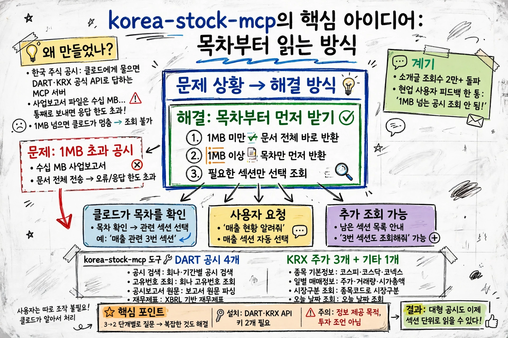
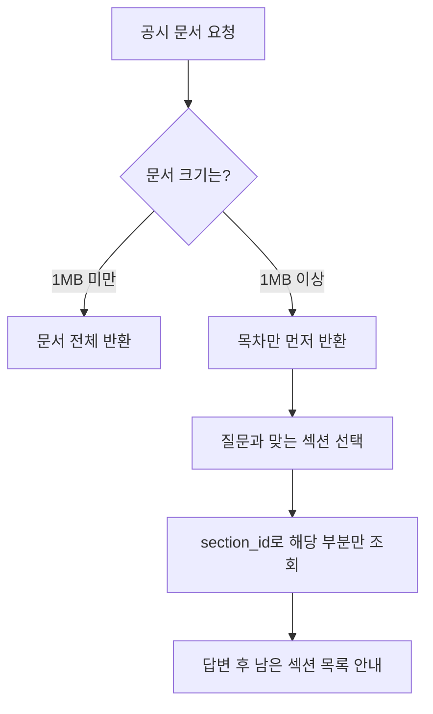
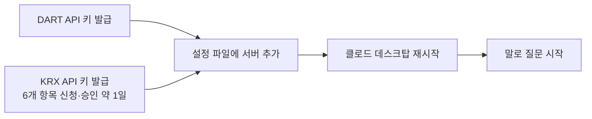
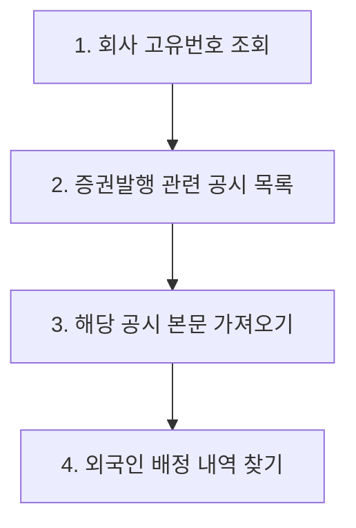

# korea-stock-mcp: 수십 MB짜리 공시도 목차부터 보면, 필요한 부분만 쏙 가져옵니다

> **Summary**
> korea-stock-mcp는 DART와 KRX 공식 API를 통해 공시와 주가 데이터를 조회·분석하는 MCP 서버입니다. 1MB 이상 대용량 공시는 목차를 먼저 제공하고 필요한 섹션만 선택해 읽도록 해 응답 한도 문제를 해결합니다. API 키를 설정하면 클로드 데스크탑에서 자연어로 재무제표, 공시, 주가 등을 질문할 수 있으며, 결과는 정보 제공용으로 투자 조언이 아닙니다.

---

- 한국 주식 공시, 클로드에게 물으면 DART와 KRX 공식 API로 답해주는 MCP 서버입니다.
- 사업보고서처럼 수 MB짜리 공시는 통째로 넘기면 응답 한도를 넘겨 터지는데, 1MB가 넘으면 목차만 먼저 받고 필요한 섹션만 골라 읽는 방식으로 해결했습니다.
- 소개 글이 조회수 2만을 넘긴 뒤, 현업에서 쓰던 분이 보낸 피드백 한 통이 이 목차 방식을 만들었습니다.


사업보고서 하나 열어보려고 했는데, 파일이 수십 MB라서 클로드가 멈춰버린 적 있으시죠? 공시는 보고 싶은데, 통째로 넘기면 응답 한도를 넘겨버리니까요. 이 글은 그 막힘을 목차부터 읽는 방식으로 푼 도구 이야기입니다!

🎥 [동영상 보기](https://www.youtube.com/watch?v=-X6u8oZd3Qo)

## korea-stock-mcp는 뭘 해줄까요?

한국 주식 분석을 위한 MCP 서버입니다. DART와 KRX 공식 API를 연결해, 클로드에게 말로 물으면 공시와 주가 데이터를 가져와 분석해줍니다.

도구는 8개입니다. DART 쪽이 4개, KRX 쪽이 3개, 날짜 도구가 1개입니다.

- `get_disclosure_list`: 회사별·기간별 공시 검색
- `get_corp_code`: 회사 고유번호 조회
- `get_disclosure`: 공시보고서 원문 파싱
- `get_financial_statement`: XBRL 기반 재무제표
- `get_stock_base_info`: 종목 기본정보 (코스피·코스닥·코넥스)
- `get_stock_trade_info`: 일별 매매정보 (주가·거래량·시가총액)
- `get_market_type`: 종목코드로 시장구분 조회
- `get_today_date`: 오늘 날짜 조회
공시 검색부터 재무제표, 주가까지 한 번에 묻는 게 이 도구의 출발점입니다. 따로 사이트를 뒤질 필요가 없습니다!

## 왜 1MB가 문제였을까요?

한국 상장사 사업보고서는 수십 MB를 넘기기도 합니다. MCP 프로토콜 특성상 이런 문서를 한 번에 전부 넘기면 응답 한도를 초과하거나 오류가 납니다. 1MB가 넘는 공시는 조회가 안 됐던 겁니다.

이 장면이 저는 가장 인상 깊었습니다. 소개 글이 조회수 2만을 넘긴 뒤, 현업에서 이 도구를 쓰던 분이 메일을 보내왔습니다. 다트와 거래소 API 연결은 좋은데, 1MB 넘는 공시는 조회가 안 된다는 내용이었습니다!

## 목차부터 받는 방식은 어떻게 돌까요?

해법은 통째로 넘기지 않는 겁니다. 문서 크기에 따라 처리 방식을 바꿨습니다.

- **1MB 미만**: 문서 전체를 바로 반환합니다.
- **1MB 이상**: 문서 전체 대신 **목차**만 먼저 반환합니다. 클로드가 목차를 보고 질문과 관련된 섹션을 고른 뒤, `section_id`로 원하는 부분만 가져옵니다.


사용자는 따로 조작할 필요가 없습니다. 문서가 크면 클로드가 알아서 목차를 확인하고, 관련 섹션을 골라 내용을 조회합니다. 답을 들은 뒤 남은 섹션 목록도 안내받으니, 추가로 궁금한 부분이 있으면 그때 요청하면 됩니다. 대용량 감사보고서도 이제 섹션 단위로 읽을 수 있습니다!

"사업보고서에서 매출 현황 알려줘"라고 물으면, 매출 관련 섹션이 자동으로 골라집니다. "방금 목차에서 3번 섹션도 조회해줘"라고 하면 특정 섹션을 직접 요청할 수도 있습니다.

## 설치는 어떻게 할까요?

준비물은 API 키 두 개입니다. DART 키는 오픈 다트 사이트에서 회원가입 뒤 신청하고, KRX 키는 KRX 오픈 API에서 신청합니다. KRX는 6개 항목(유가증권·코스닥·코넥스 일별매매정보와 종목기본정보)을 각각 신청해야 하고, 승인까지 약 1일이 걸립니다.

키를 받았으면 클로드 데스크탑 설정에 서버를 추가합니다. 설정에서 개발자 메뉴를 열고 `claude_desktop_config.json` 파일을 편집한 뒤, 아래처럼 적고 클로드를 재시작하면 됩니다.

```json
{
  "mcpServers": {
    "korea-stock-mcp": {
      "command": "npx",
      "args": ["-y", "korea-stock-mcp@latest"],
      "env": {
        "DART_API_KEY": "발급받은 키",
        "KRX_API_KEY": "발급받은 키"
      }
    }
  }
}
```



로컬에서 직접 고쳐보며 테스트할 수도 있습니다. 의존성을 설치하고 환경변수를 적은 뒤 MCP 인스펙터로 연결하면, 도구를 하나씩 직접 호출해볼 수 있습니다. 소스를 수정하면 서버가 자동으로 재시작됩니다. Node.js 18 이상이 필요합니다.

## 실제로 뭘 물어볼 수 있을까요?

예시는 네 가지입니다. 삼양식품의 2023년부터 2025년 2분기까지 분기별 매출과 영업이익, 성장률을 물어볼 수 있습니다. 에이피알은 같은 기간 매출·영업이익 성장에 주가와 시가총액 흐름까지 함께 볼 수 있습니다. HJ중공업은 뭘 해서 돈을 버는지, 사업부문별 매출까지 같이 물어볼 수 있습니다. 인벤테라 IPO에서는 외국인 배정 내역을 찾는 질문도 됩니다.

## 복잡한 질문은 어떻게 물을까요?

한 번에 원하는 답이 안 나올 때는 질문을 단계별로 나누면 됩니다. 예를 들어 증권신고서에서 외국인 배정 내역을 찾을 때는 이렇게 묻습니다.



각 단계의 결과를 확인하면서 원하는 정보에 도달하는 방식입니다. 복잡한 질문일수록 단계를 나누는 게 정확합니다!

## 이 도구의 한계는 뭘까요?

이 도구는 정보 제공이 목적이고, 투자 조언이 아닙니다. 공시와 주가 데이터를 가져와 정리해주는 역할까지가 이 도구의 몫입니다. 투자 결정은 본인의 책임입니다.

현업 사용자의 피드백 한 통이 만든 목차 방식처럼, 쓰는 사람이 늘수록 도구는 계속 다듬어집니다. 공시 읽는 일이 막막했다면, 목차부터 물어보는 방식부터 써보면 어떨까요?

