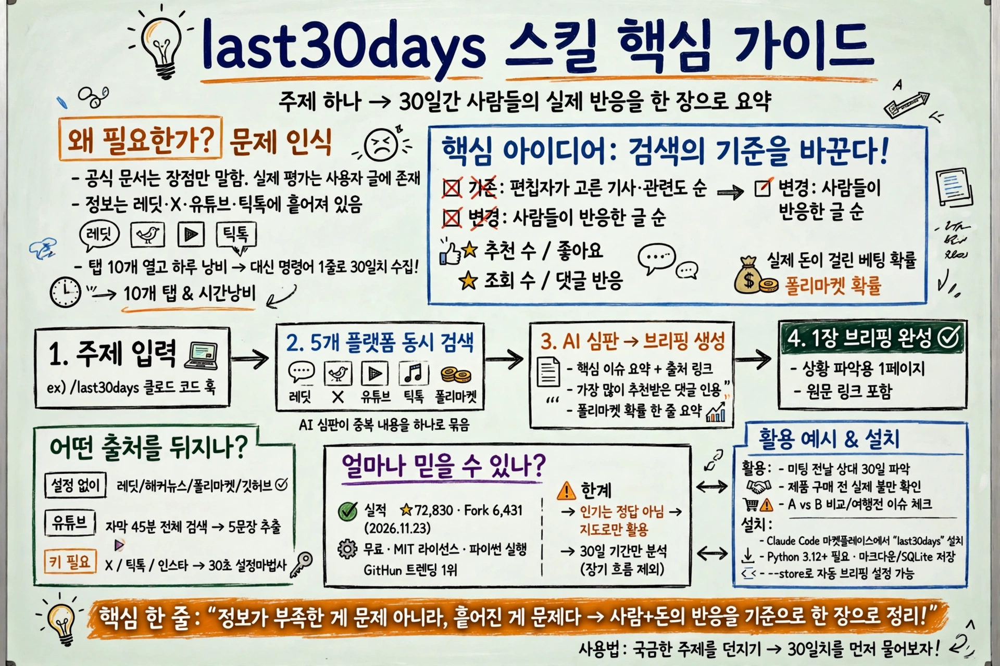
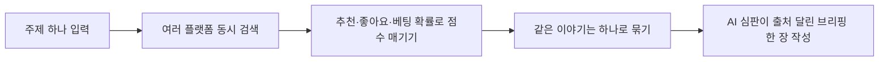
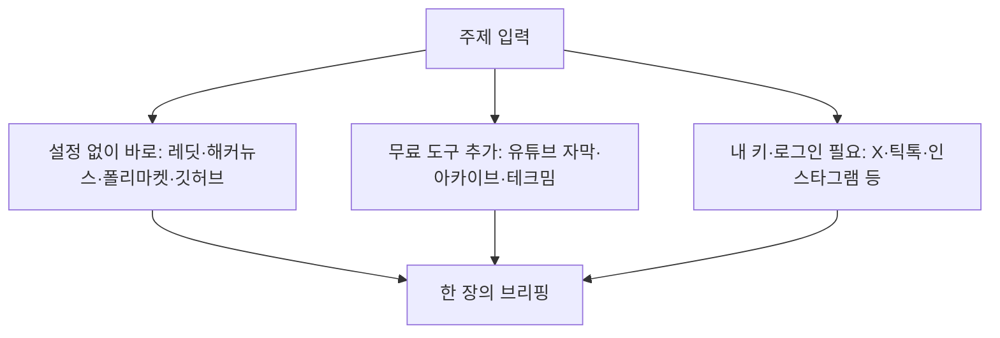

# last30days: 검색 기준을 바꾸면, 30일치 사람들의 반응이 한 장으로 모입니다

> **Summary**
> last30days는 최근 30일간 레딧·X·유튜브·틱톡·폴리마켓 등에서 사람들의 반응을 수집하고, 추천·좋아요·조회 수와 베팅 확률을 기준으로 정리해 출처 링크와 인용이 포함된 브리핑을 만듭니다. 빠르게 여론을 파악하는 출발점으로 유용하지만, 인기가 정확성을 보장하지 않고 오래된 배경은 다루지 않으므로 원문을 확인해야 합니다.

---

- 주제 하나 던지면, 최근 30일 동안 사람들이 실제로 뭐라고 했는지 한 장으로 정리해 줍니다.
- 검색 결과를 편집자 기준이 아니라 추천 수, 좋아요, 실제 돈이 걸린 베팅 확률 순으로 매깁니다.
- 레딧·X·유튜브·틱톡·폴리마켓을 동시에 뒤지고, AI 심판이 하나로 묶어 브리핑을 만듭니다.


새로운 도구가 나왔는데, 공식 문서만 읽고 판단해 본 적 있으시죠? 문서는 늘 장점만 말합니다. 진짜 평가는 사람들이 남긴 글에 있습니다. 문제는 그 글이 레딧·X·유튜브·틱톡에 흩어져 있다는 것입니다. 탭을 열 개 열고 하루를 쓰는 대신, 명령어 한 줄로 30일치를 긁어오는 방법이 있습니다. `last30days`라는 스킬입니다!

🎥 [동영상 보기](https://www.youtube.com/watch?v=Ua0APTMVcb8)

## 왜 구글 검색만으로는 부족할까요?

검색 엔진은 기사를 모읍니다. 편집자가 고른 글을 보여줍니다. 그런데 요즘 기술 소식은 커뮤니티에서 먼저 터집니다. 레딧 스레드, X 스레드, 유튜브 반응 영상, 해커뉴스 토론. 학습 데이터가 몇 달 전에서 멈춘 AI는 어제의 논쟁을 모릅니다. 그래서 답이 추측이 됩니다.

> 구글은 편집자를 모읍니다. 이 스킬은 사람을 검색합니다.

이 스킬의 발상은 단순합니다. 검색 기준을 바꾸는 것입니다. 관련도가 아니라 반응으로 매깁니다. 추천 수, 좋아요, 조회 수, 그리고 예측 시장에 걸린 실제 돈입니다. 사람들이 시간과 지갑으로 투표한 결과가 위로 올라옵니다.

## 명령어 한 줄이면, 어떻게 돌아갈까요?

사용법은 짧습니다. 주제 하나를 던지면 됩니다. 예를 들어 `/last30days 클로드 코드 훅`처럼요. 그러면 엔진이 여러 플랫폼을 동시에 뒤집니다. 같은 이야기가 여러 곳에 나오면 하나로 묶습니다. AI 심판이 출처가 달린 브리핑 한 장으로 정리해 줍니다. 원문 링크와 인용 문장까지 붙습니다.



브리핑에는 뭐가 들어갈까요? 이야기마다 출처 링크, 가장 많이 추천받은 댓글 인용, 폴리마켓 확률 한 줄이 붙습니다. 회의 전날 상대방을 파악할 때, 제품을 사기 전에 실제 불만을 확인할 때, 이 한 장이면 출발점이 됩니다. 물론 시작점일 뿐입니다. 인용하기 전에는 원문 스레드를 직접 열어보는 것이 맞습니다!

## 어떤 곳을 뒤지나요?

출처는 크게 세 갈래입니다. 설정 없이 바로 되는 곳, 무료 도구를 더하면 열리는 곳, 내 키나 로그인이 필요한 곳입니다.



설정 없이 되는 곳이 먼저입니다. 레딧은 댓글까지, 해커뉴스는 토론까지, 폴리마켓은 실제 돈이 걸린 확률까지, 깃허브는 이슈와 토론까지 봅니다. 주제가 기업이면 특허 출원과 채용 페이지도 함께 봅니다.

유튜브는 무료 도구 하나면 열립니다. 45분짜리 영상의 자막 전체를 뒤져서 인용할 만한 다섯 문장을 골라냅니다. 로그인도 필요 없습니다. X는 다릅니다. 내 키를 넣거나, 로그인한 브라우저 세션을 쓰는 방식입니다. 틱톡과 인스타그램 등도 별도 키가 필요합니다. 처음 실행하면 설정 마법사가 30초 만에 이 추가 출처들을 열어줍니다.

## 얼마나 믿을 수 있을까요?

숫자부터 짚어보겠습니다. 저장소는 2026년 1월에 열렸고, 2026년 11월 23일 기준으로 별 72,830개, 포크 6,431개를 받았습니다. 클립을 저장한 11월 20일에는 별 6만 8천 개였습니다. 사흘 만에 5천 개 가까이 늘었습니다. 깃허브 트렌딩 하루 1위에도 올랐습니다. 무료이고, MIT 라이선스입니다. 파이썬으로 돌아가고, 검색은 내 컴퓨터에서 실행됩니다.

하지만 한계도 분명합니다. 반응이 많다는 것이 옳다는 뜻은 아닙니다. 인기는 방향을 알려줄 뿐, 정답을 보증하지 않습니다. 브리핑은 지도로 쓰고, 결론은 직접 확인하는 것이 맞습니다. 또 30일 창만 봅니다. 오래된 배경과 장기 흐름은 들어가지 않습니다. 그래서 이 스킬은 출발점으로 쓰는 것이 맞습니다!

## 어디에 쓰면 좋을까요?

미팅 전날 상대방의 최근 30일을 읽을 때 좋습니다. 제품을 만들기 전에 사람들이 실제로 어떤 문제에 부딪히는지 확인할 때도 좋습니다. 여행 전에 어떤 놀이기구가 닫혔는지, 커뮤니티가 뭐라고 하는지 볼 때도 쓸 수 있습니다. 주제는 사람, 회사, 제품, "A 대 B" 비교까지 무엇이든 됩니다.

비슷한 조사 도구와 뭐가 다를까요? 앱 화면을 조사해 만드는 법을 알려주는 스킬이 따로 있습니다. 검색 에이전트가 링크와 점수를 돌려주는 도구도 있습니다. 이 글의 도구는 다릅니다. 소셜 반응 자체를 모으는 것이 목적입니다. 사람들의 말과 돈을 기준으로 삼는다는 점이 다릅니다.

## 설치는 어떻게 하나요?

클로드 코드에서는 마켓플레이스에서 `last30days`를 찾아 설치하면 됩니다. 마켓플레이스 경로라 자동 업데이트도 됩니다. 다른 호스트에서는 스킬 추가 명령 한 줄로 전역 설치합니다. 파이썬 3.12 이상이 필요합니다. 설치 뒤에는 주제만 던지면 됩니다.

```javascript
/last30days 클로드 코드 훅
```

검색 결과는 기본적으로 마크다운 파일로 저장됩니다. `--store` 옵션을 붙이면 SQLite에 쌓이고, 정해진 목록을 주기적으로 돌려 새 소식을 받는 기능도 있습니다. 매일·매주 브리핑으로 받아볼 수도 있습니다.

## 핵심은 무엇일까요?

검색의 기준을 바꾸는 것입니다. 편집자가 고른 글이 아니라, 사람들이 반응한 글을 봅니다. 추천 수와 좋아요, 그리고 실제 돈이 걸린 확률로 순서를 정합니다. AI가 그 결과를 한 장으로 묶어줍니다. 정보가 부족한 것이 문제가 아니라, 흩어진 것이 문제라면 이 방식이 답이 됩니다!

다음에 새로운 주제를 만나면, 검색창부터 열지 말고 30일치를 먼저 물어보는 것은 어떨까요?

