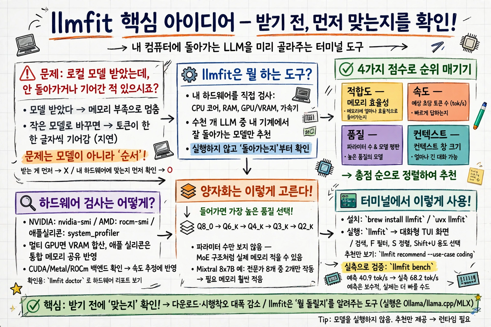
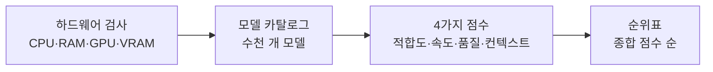
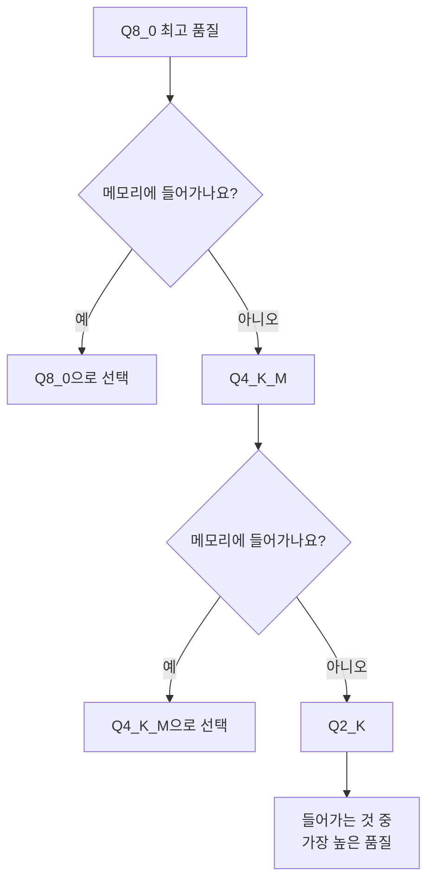

# llmfit: 내 컴퓨터에서 돌아가는 LLM, 다운로드 전에 먼저 골라줍니다

> **Summary**
> llmfit은 CPU·RAM·GPU 등 컴퓨터 사양을 분석해 실행 가능한 LLM을 적합도, 속도, 품질, 컨텍스트 기준으로 추천하는 터미널 도구입니다. 메모리에 들어가는 가장 높은 품질의 양자화를 골라 다운로드 전 적합성을 확인할 수 있으며, 성능 예측은 실제 벤치마크로 검증할 수 있습니다. 모델 실행은 Ollama나 llama.cpp 같은 별도 런타임이 담당합니다.

---

- `llmfit`은 내 컴퓨터 하드웨어를 직접 검사해, 수천 개 LLM 중 내 기계에서 잘 돌아가는 모델만 골라주는 터미널 도구입니다.
- 적합도·속도·품질·컨텍스트 4가지 점수로 순위를 매기고, 메모리에 들어가는 가장 높은 품질의 양자화를 골라줍니다.
- 다운로드는 나중입니다. 받기 전에 "돌아가는지"부터 확인하는 게 핵심입니다.

## 로컬 모델 받았는데, 안 돌아가거나 기어간 적 있으시죠?

로컬 LLM을 돌려보려고 모델 하나를 받았습니다. 용량은 되겠지 싶었는데, 실행하자마자 메모리가 모자란다고 멈춥니다. 작은 모델로 바꾸니 돌아가긴 하는데, 토큰이 한 글자씩 기어갑니다. 이런 적 있으시죠?

문제는 모델이 아니라 순서입니다. 받는 게 먼저가 아니라, 내 하드웨어에 맞는지를 먼저 아는 게 순서입니다!

🎥 [동영상 보기](https://www.youtube.com/watch?v=zf8jpD77sKY)

## llmfit은 뭘 하는 도구일까요?

`llmfit`은 터미널에서 돌아가는 도구입니다. 내 컴퓨터의 CPU 코어, 시스템 RAM, GPU와 VRAM, 가속기 종류를 직접 검사합니다. 그리고 수천 개 모델의 파라미터 수, 컨텍스트 길이, 양자화 방식을 대조해, 내 기계에서 잘 돌아가는 모델을 순위표로 보여줍니다.

순위는 네 가지 점수로 매깁니다. 적합도는 메모리를 얼마나 효율적으로 쓰는지, 속도는 예상 초당 토큰 수, 품질은 파라미터 수와 계열 평판, 컨텍스트는 쓸 수 있는 컨텍스트 창의 크기입니다. 네 점수를 합친 종합 점수 순으로 정렬됩니다. 공개된 지 9개월 만에 별 3만 9천 개를 넘었습니다.

## 하드웨어 검사는 어떻게 할까요?

사양 파일을 읽는 게 아니라, 기계를 직접 물어봅니다. NVIDIA GPU는 `nvidia-smi`로, AMD는 `rocm-smi`로, 애플 실리콘은 `system_profiler`로 확인합니다. 멀티 GPU면 VRAM을 합산하고, 애플 실리콘의 통합 메모리는 CPU와 GPU가 한 풀을 공유한다는 점까지 반영합니다.

설치된 추론 백엔드도 봅니다. CUDA, Metal, ROCm 중 무엇이 깔려 있는지에 따라 속도 추정이 달라지기 때문입니다. 검사가 틀렸는지 확인하고 싶으면 `llmfit doctor` 명령으로 하드웨어 리포트를 볼 수 있습니다.

## 양자화는 어떻게 고를까요?

같은 모델도 양자화에 따라 메모리 사용량이 크게 달라집니다. `llmfit`은 Q8_0부터 Q2_K까지 품질 계층을 위에서 아래로 내려가며, 내 메모리에 들어가는 가장 높은 품질을 고릅니다. 그냥 작은 걸 고르는 게 아니라, 들어가는 것 중 가장 좋은 걸 고르는 겁니다!

파라미터 수만 보고 판단하지 않는 것도 포인트입니다. Mixtral 8x7B처럼 전문가 혼합(MoE) 구조는 8개 전문가 중 토큰당 2개만 동작합니다. 종이 위 숫자로는 23.9GB짜리 문제처럼 보여도, 아키텍처를 읽으면 실제 필요한 메모리는 훨씬 적습니다.

## 터미널에서 어떻게 쓸까요?

설치는 한 줄이면 됩니다. macOS·Linux는 `brew install llmfit`, 윈도우는 `scoop install llmfit`, `uv`를 쓰면 `uv tool install -U llmfit`입니다. 설치 없이 바로 써보려면 `uvx llmfit`도 됩니다.

실행도 간단합니다! `llmfit`만 치면 대화형 화면(TUI)이 열립니다. 화면 위쪽에 내 하드웨어 사양이, 아래쪽에 점수 매겨진 모델 목록이 나옵니다. `/`로 검색하고, `F`로 적합도 필터를 바꾸고, `S`로 정렬을 바꿉니다. 용도별로 보고 싶으면 Shift+U로 코딩·추론·채팅·멀티모달·임베딩 중 하나를 고릅니다.

원하는 모델이 내 기계에 안 맞으면, `P` 키로 계획 모드를 열어봅니다. 그 모델을 돌리려면 어떤 하드웨어가 필요한지 알려줍니다. 하드웨어 업그레이드를 고민할 때 유용합니다!

CLI로도 쓸 수 있습니다. `llmfit fit`은 표로, `llmfit recommend --use-case coding`은 코딩용 추천만, `llmfit info "모델 이름"`은 한 모델의 적합도 분석을 보여줍니다. JSON으로 뽑으면 스크립트나 에이전트에 연결할 수 있습니다.

## 추정치, 믿어도 될까요?

추정치는 어디까지나 추정치입니다. 숫자를 그대로 믿기보다, 직접 재보는 게 순서입니다. 실측 기능이 있습니다. 모델을 받아서 실행한 뒤 `llmfit bench`로 실제 초당 토큰 수를 잽니다. `llmfit bench --share`로 결과를 공유하면, 다음 릴리스부터 같은 하드웨어를 쓰는 사람에게 실측값이 표시됩니다. 예측과 실측이 어긋난 사례도 있습니다. 한 테스트에서는 예측 40.9 tok/s, 실측 68.2 tok/s가 나왔습니다. 예측이 보수적이었던 셈입니다.

한 가지 분명히 할 점이 있습니다. `llmfit`은 모델을 실행하지 않습니다. 실행은 Ollama나 `llama.cpp`, MLX 같은 런타임이 맡습니다. `llmfit`은 "뭘 돌릴지"를 알려주는 도구입니다. 추천받은 모델을 돌리려면 런타임 하나가 깔려 있어야 합니다.

## 맺음말

로컬 LLM의 첫 번째 병목은 모델이 아니라, 내 하드웨어에 대한 정보입니다. 받기 전에 맞는지를 아는 것만으로, 다운로드와 시행착오가 크게 줄어듭니다. `llmfit`은 그 "맞는지"를 한 번의 명령으로 알려주는 도구입니다!

