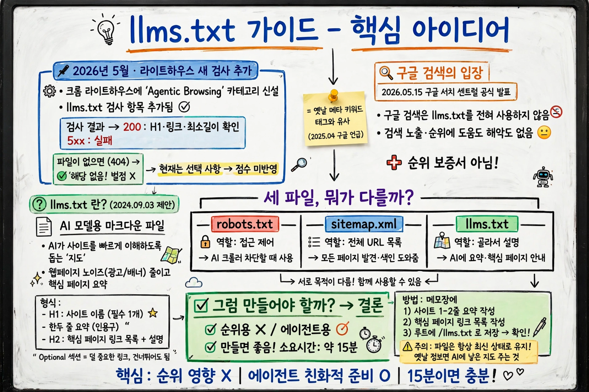
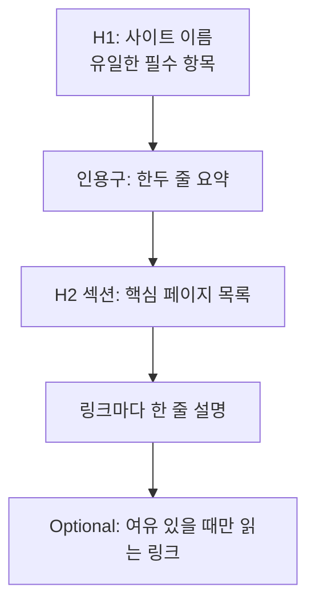
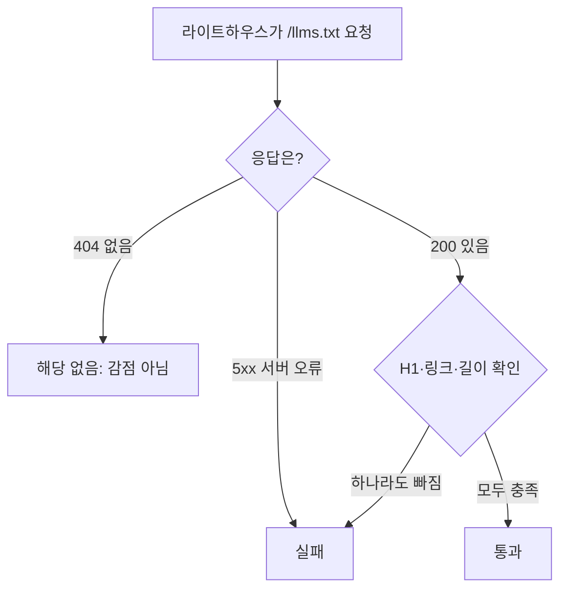
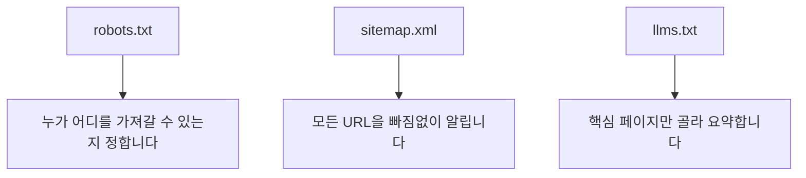

# llms.txt: 구글이 라이트하우스에 넣었습니다. 하지만 검색 순위에 도움은 안 됩니다

> **Summary**
> llms.txt는 AI 에이전트가 사이트의 핵심 구조와 페이지를 빠르게 파악하도록 돕는 선택적 안내 파일입니다. 구글 라이트하우스에 검사가 추가됐지만, 파일이 없어도 감점되지 않으며 구글 검색 순위에도 영향을 주지 않습니다. 순위 개선이 아닌 에이전트의 사이트 이해를 돕기 위해 만들고, 사이트가 바뀌면 함께 업데이트하면 됩니다.

---

- 구글 크롬의 라이트하우스에 2026년 5월, `llms.txt` 검사 항목이 새로 들어갔습니다.
- 파일이 없어도 감점이 아니라 "해당 없음"입니다. 구글 검색은 이 파일을 무시한다고 못 박았습니다.
- 그래도 에이전트가 사이트 구조를 파악하는 시간을 줄여주니, 만드는 데 15분이면 충분합니다.


내 사이트 주소 뒤에 `/llms.txt`를 붙여서 쳐본 적 있으시죠? 직접 확인해 보니 제 블로그도 404가 떴습니다. 요즘은 이 파일이 없으면 AI 노출에서 뒤처진다는 말이 돌고 있으니까요. 그런데 2026년 5월, 구글이 이 파일을 라이트하우스 검사 항목에 넣은 건 사실입니다. 다만 그 사실이 의미하는 바는, 돌고 있는 말과는 조금 다릅니다!

🎥 [동영상 보기](https://www.youtube.com/watch?v=ogIUBEDe2OU)

## llms.txt, 도대체 뭘까요?

2024년 9월 3일에 공개된 제안입니다. AI 모델이 사이트를 이해하는 데 쓰는 마크다운 파일이고, 사이트 루트에 `llms.txt`로 둡니다.

출발점은 모델의 한계였습니다. 모델이 한 번에 읽을 수 있는 분량에는 한계가 있는데, 웹페이지는 내비게이션·광고·쿠키 배너·스크립트로 가득합니다. 모델이 그걸 다 읽느라 공간을 낭비하는 거죠. 이 파일은 그 낭비를 줄이는 지도입니다. 사이트가 뭔지 한두 줄로 요약하고, 핵심 페이지 목록을 링크와 함께 적어둡니다. 모델이 잡다한 걸 건너뛰고 바로 핵심으로 갑니다!

형식은 작습니다. H1에 사이트 이름(유일한 필수 항목), 인용구에 한두 줄 요약, H2 섹션마다 `[이름](URL): 설명` 형태의 링크 목록을 둡니다. `Optional` 섹션은 컨텍스트가 부족할 때 건너뛰어도 되는 링크입니다. 페이지마다 `.md` 사본을 함께 두자는 제안도 있습니다.

```javascript
# 예시 사이트
> 예시 사이트가 무엇인지 한두 줄로 요약합니다.
## 핵심 페이지
- [시작하기](https://example.com/start): 처음 오는 사람을 위한 안내
- [문서](https://example.com/docs): 전체 문서 목록
```



## 구글이 라이트하우스에 넣은 건 무슨 뜻일까요?

2026년 5월, 크롬의 라이트하우스에 "Agentic Browsing"이라는 새 카테고리가 생겼고, 그 안에 `llms.txt` 검사가 들어갔습니다. 공식 문서가 5월 5일에 업데이트됐습니다.

문서 문구는 이렇습니다. "이 파일이 없으면 에이전트가 사이트의 상위 수준 구조와 기본 콘텐츠를 파악하기 위해 사이트를 크롤링하는 데 더 많은 시간을 할애할 수 있습니다."

검사 방식도 확인했습니다. 파일을 가져올 때 서버 오류(5xx)가 나면 실패합니다. 파일이 없으면(404) "해당 없음"입니다. 지금은 선택 사항이라 감점이 아닙니다! 200 응답이면 H1·링크·최소 길이가 맞는지 봅니다.

그래서 2020년 코어 웹 바이탈 이야기가 다시 나옵니다. 라이트하우스에 들어간 지 1년 뒤 실제 검색 순위 요인이 됐으니까요. "이번에도 그럴 것"이라는 기대가 나오는 이유입니다. 그런데 이번에는 한 가지가 다릅니다. 그건 다음 섹션에서 다룹니다.



## 그런데 구글 검색은 정반대 말을 합니다?

2026년 5월 15일, 구글 서치 센트럴 가이드가 나왔습니다. "구글 검색에 나타나기 위해 새로운 머신 리더블 파일, AI 텍스트 파일, 마크업, 마크다운을 만들 필요가 없습니다. 구글 검색 자체가 이를 사용하지 않기 때문입니다."

파일을 만드는 건 "완전히 괜찮"지만, "구글 검색이 이를 무시하므로 사이트의 노출이나 순위에 도움도 해악도 되지 않습니다."

정리하면 이렇습니다. 라이트하우스 검사는 에이전트가 사이트를 잘 읽을 수 있는지를 보는 것이고, 구글 검색 순위는 다른 문제입니다. 검사 항목에 들어갔다고 순위에 반영되는 건 아닙니다!

구글 측은 2025년 4월에 이 파일을 옛날 메타 키워드 태그에 비유했습니다. 서버 로그를 보면 AI 크롤러가 이 파일을 요청하지도 않았다는 겁니다. 어느 메이저 AI 회사도 자기 검색·답변 제품이 `llms.txt`를 읽는다고 밝힌 바가 없습니다.

## 세 파일, 뭐가 다를까요?

헷갈리는 파일이 세 개 있습니다. 하는 일이 전부 다릅니다.



`robots.txt`는 접근 제어입니다. 크롤러의 출입을 정하는 파일이라, AI 크롤러를 막으려면 여전히 이 파일을 써야 합니다. `sitemap.xml`은 빠짐없이 알리는 파일입니다. 모든 URL을 나열해서 발견과 색인을 돕습니다. `llms.txt`는 골라서 설명하는 파일입니다. 권한을 주지도, 막지도 않습니다. 읽는 쪽이 마음대로 읽을 뿐입니다.

## 그럼 만들어야 할까요?

결론부터 말하면, 순위용이 아니라 에이전트용으로 만들면 됩니다. 만드는 데 15분이면 충분하고, 해가 될 건 없습니다!

방법은 단순합니다. 메모장을 열고 사이트 설명 한두 줄과 핵심 URL 목록을 적습니다. 그리고 사이트 루트 디렉터리에 두면 됩니다. `example.com/llms.txt`처럼요. 그다음 자기 도메인 뒤에 `/llms.txt`를 붙여서 확인합니다. 404가 아니라 파일이 뜨면 끝입니다.

다만 한 가지는 기억해야 합니다. 파일은 살아 있어야 합니다. 사이트가 바뀌는데 파일이 옛날 모습 그대로면, 에이전트에게 낡은 지도를 쥐여주는 셈이니까요. 만들었으면 바꿀 때마다 함께 고쳐야 합니다.

라이트하우스에 들어갔다는 건 구글이 에이전트 시대를 염두에 두기 시작했다는 신호입니다. 다만 그 신호를 순위 보증서로 읽으면 안 됩니다! 파일 하나 만드는 건 15분짜리 일이고, 진짜 노출은 여전히 크롤링 가능한 좋은 페이지에서 나옵니다.

