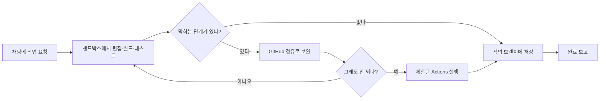
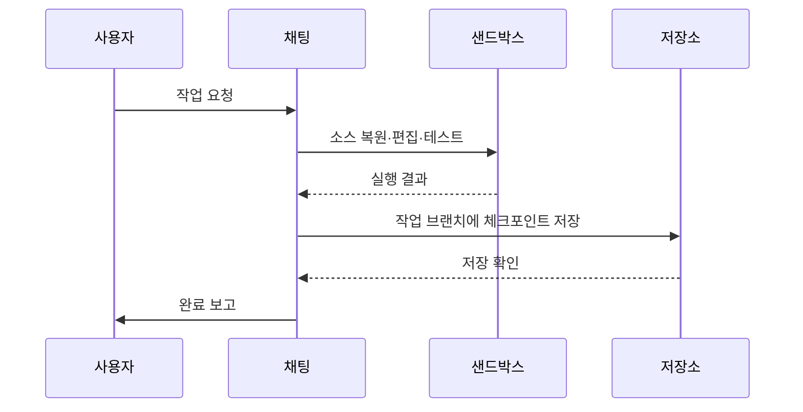

# luna-chat-coder: Codex 한도 안 쓰고 ChatGPT 웹 채팅으로 코딩하는 방법입니다

> **Summary**
> ChatGPT 웹 채팅 사용량은 Codex 한도와 별개로 계산되며, 무료 채팅도 넉넉하게 쓸 수 있습니다. 템플릿 저장소와 스킬을 쓰면 샌드박스에서 편집·빌드·테스트를 하고, 막히는 부분만 GitHub와 제한된 Actions로 보완합니다. 작업은 저장소 작업 브랜치에 자주 저장돼 샌드박스가 사라져도 이어갈 수 있지만, Actions 사용량과 도구 제한은 따로 챙겨야 합니다.

---

- ChatGPT 웹 채팅 사용량은 Codex 한도와 별개로 계산됩니다. 무료 채팅도 넉넉하게 쓸 수 있습니다.
- 웹 채팅 안의 작업 컨테이너는 코드를 실행하지만 인터넷이 막혀 있어, 의존성 설치나 큰 변경 게시가 막힙니다.
- 템플릿 저장소와 스킬을 쓰면 샌드박스에서 편집·빌드·테스트를 하고, 막히는 부분만 GitHub와 제한된 Actions로 보완합니다.

Codex 한도가 바닥났는데 급하게 고쳐야 할 코드가 생긴 적 있으시죠? 채팅창을 열면 답은 해주는데, 정작 저장소에 있는 코드를 직접 고쳐주지는 않잖아요. 웹 채팅에도 코드를 실행하는 작업 공간이 있다는 사실, 알고 계셨나요?

🎥 [동영상 보기](https://www.youtube.com/watch?v=hhdpnbfH6NU)

## 웹 채팅에도 작업 공간이 있습니다. 그런데 인터넷이 막혀 있습니다!

웹 채팅에는 코드를 실행하는 작업 컨테이너가 들어 있습니다. 대화 중에 Python 코드를 실행해 달라고 하면 이 환경이 쓰입니다. 문제는 이 컨테이너가 인터넷과 단절되어 있다는 점입니다. 의존성을 받거나, 저장소에서 소스를 가져오거나, 변경을 게시하는 단계에서 막히기 쉽습니다. 그래서 실용적인 코딩에는 쓰기 어려웠습니다.

기존 방법은 어땠을까요? MCP 서버를 퍼블릭에 노출하거나 별도 터널을 여는 방식이 있었습니다. 로컬 에이전트를 띄우는 방법도 있었고요. 그런데 터널을 직접 운영한다는 건 결국 인프라를 하나 더 떠안는 일입니다. 가볍게 쓰기엔 부담이 큽니다!

## 스킬이 샌드박스와 GitHub를 이어줍니다

핵심 아이디어는 단순합니다. 채팅 모델에게 "어떻게 일할지"를 적어둔 스킬 파일을 저장소에 넣어두는 겁니다. 이 스킬은 세 가지를 지시합니다. 첫째, 편집·빌드·테스트는 되도록 채팅 안의 샌드박스에서 한다. 둘째, 샌드박스만으로 부족한 단계는 연결된 GitHub 경로로 보완한다. 셋째, 그것도 안 될 때만 제한된 GitHub Actions 실행으로 처리한다.

설정은 네 단계입니다.

1. 템플릿 저장소를 복제합니다. `Use this template` 버튼을 누르면 새 저장소가 만들어집니다.
1. ChatGPT 플러그인 목록에서 GitHub 플러그인을 설치하고 계정을 연결합니다.
1. GitHub 앱 목록에서 ChatGPT Codex Connector를 설치하고, 만든 저장소에 접근 권한을 줍니다.
1. 일반 대화에서 저장소 주소와 원하는 작업을 말합니다. "이 기능을 구현하고 풀 리퀘스트를 열어달라"는 식으로요.
여기서 한 가지는 꼭 확인해야 합니다. 커넥터를 "일부 저장소만 선택"으로 설치했다면, 새로 만든 저장소를 접근 목록에 추가해야 합니다. 무료 사용자에게 특히 자주 빠지는 부분이라고 원문에서도 강조했습니다!

## 샌드박스가 사라져도 작업은 남을까요?

샌드박스는 일회용입니다. 채팅이 끊기거나 작업 공간이 사라지면, 안에 있던 변경도 함께 사라집니다. 그래서 이 스킬은 작업 중인 내용을 원본 저장소의 작업 브랜치에 자주 저장합니다. 체크포인트가 있으면 마지막 저장 지점부터 다시 이어갈 수 있습니다.

이 부분이 저는 가장 인상 깊었습니다. "채팅이 날아가면 작업도 날아간다"는 걱정을, 저장소라는 튼튼한 바닥에 맡기는 방식이니까요!

## 한도는 정말 안 깎이나요?

정확히 말하면, 웹 채팅 사용량과 Codex 사용량은 따로 계산됩니다. 무료 사용자의 기본 채팅 모델은 GPT-5.6 Luna로 바뀌었고, 악용 방지 조건 아래 텍스트 채팅의 사용량 제한이 없어졌습니다. 다만 파일 업로드·이미지 같은 도구에는 기존 제한이 그대로 유지됩니다. 그러니까 "한도가 아예 없다"가 아니라, "Codex 한도랑은 별개로 채팅 한도가 적용된다"가 정확한 표현입니다!

그리고 Actions도 공짜가 아닙니다. 공개 저장소는 무료지만, 비공개 저장소는 월 무료 사용량 안에서만 무료입니다. Actions 미션을 자주 쓰면 사용량이 쌓이니, 샌드박스에서 할 수 있는 일은 샌드박스에서 끝내는 게 좋습니다.

또 한 가지, 조직 계정이라면 플러그인이나 GitHub 앱 설치에 관리자 승인이 필요할 수 있습니다. 회사 계정으로 쓸 때는 미리 확인해두는 게 좋습니다.

## Codex 대신 쓸 수 있을까요?

완전히 대신하기는 어렵습니다. Codex는 로컬 환경과 IDE에 직접 붙어 일하는 에이전트이고, 이 방법은 채팅창 안에서 샌드박스와 GitHub를 오가며 일하는 방식입니다. 큰 리팩터링이나 복잡한 통합 테스트처럼 무거운 작업은 여전히 전용 에이전트가 편합니다. 하지만 가벼운 수정, 작은 기능 추가, 테스트 돌려보기 같은 일이라면 웹 채팅만으로 충분할 때가 많습니다!

한도가 아까워서 손을 놓고 있었다면, 채팅창부터 다시 열어보세요. 이미 있는 도구를 이어 붙이는 것만으로도 코딩 에이전트에 꽤 가까워집니다.

도구는 새로 살 필요가 없습니다. 있는 것을 이어 붙이는 것만으로도 충분할 때가 많습니다.

