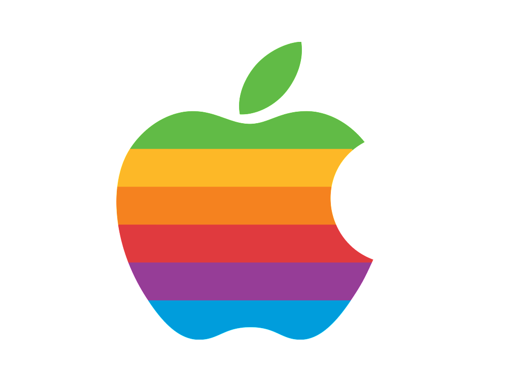

# macOS

> **Summary**
> M4 Mac Mini는 성능과 가성비를 갖춘 기기로, 다양한 콘솔 에뮬레이션을 지원합니다. OpenEMU, DuckStation, PCSX2, RPCS3, Dolphin, Xenia, Ryujinx, CEMU 등의 도구를 통해 고해상도에서 원활한 게임 실행이 가능하며, Metal 백엔드 기술과 Rosetta 2 최적화로 에뮬레이션 효율성이 향상되었습니다. 그러나 PS4와 같은 최신 콘솔 에뮬레이션은 여전히 제약이 있으며, 향후 성능 개선이 기대됩니다.

---

🎥 [동영상 보기](https://youtu.be/ybFPtlGOpnY?si=qIH93SdBK1hItFSI)

# **교육용 기사: M4 Mac Mini에서 에뮬레이션의 새로운 시대**

# **소개**

M4 Mac Mini는 성능과 가성비를 모두 잡은 2024년 최고의 기기로, 작업, 영상 편집, 게임 모두에서 탁월한 성능을 보여줍니다. 이 기사에서는 Mac Mini를 활용한 최신 콘솔 에뮬레이션 방법과 이 기술의 진전을 소개합니다.

# **주요 에뮬레이션 도구 및 지원되는 시스템**

1.	**OpenEMU**

•	Atari, Super Nintendo, GameCube 같은 클래식 콘솔을 지원.

•	직관적인 드래그 앤 드롭 방식으로 간편하게 사용 가능.

2.	**PlayStation 에뮬레이션**

•	**PS1**: DuckStation은 Metal 렌더러를 활용해 4K 해상도와 향상된 그래픽을 지원.

•	**PS2**: PCSX2는 Metal 렌더러와 Rosetta 2를 통해 원활한 실행.

•	**PS3**: RPCS3의 ARM 네이티브 버전을 통해 720p~4K 해상도에서 대부분의 게임 실행 가능.

3.	**Nintendo 에뮬레이션**

•	**3DS**: Lime3DS는 3DS 게임을 60FPS에서 원활히 실행.

•	**Wii/GameCube**: Dolphin 에뮬레이터를 통해 4K에서 원활한 실행과 높은 그래픽 품질 제공.

4.	**Xbox 에뮬레이션**

•	Xenia로 Xbox 360 게임 실행 가능.

•	Rosetta 2와 Wine 레이어를 통해 작동하나 성능은 제한적.

5.	**Switch 및 Wii U 에뮬레이션**

•	Ryujinx와 CEMU는 최신 Metal 백엔드를 활용하여 Mac에서 놀라운 성능을 보여줌.

# **기술적 진보와 Mac 지원**

**Metal 백엔드 기술**

•	새로운 Metal 백엔드는 렌더링 성능을 획기적으로 향상시키며, 특히 CEMU 및 RPCS3에서의 성능 개선이 두드러짐.

•	비동기 셰이더 컴파일을 통해 그래픽 지연 없이 원활한 게임 플레이 지원.

**Rosetta 2와 ARM 최적화**

•	Rosetta 2를 통한 인텔 기반 에뮬레이터 실행.

•	ARM 최적화로 M4 Mac Mini의 에뮬레이션 효율성이 대폭 향상.

# **한계 및 미래 전망**

1.	**한계**

•	PS4와 같은 최신 콘솔 에뮬레이션은 여전히 성능과 안정성에 제약.

•	일부 프로젝트는 초기 개발 단계로 최적화가 미흡.

2.	**미래 전망**

•	PS4 에뮬레이터인 Shar PS4의 성능 개선 기대.

•	Wii U 및 Switch 프로젝트에서 Metal 백엔드가 점진적으로 확산될 가능성.

# **결론**

M4 Mac Mini는 게임 에뮬레이션에서도 강력한 플랫폼으로 자리 잡고 있습니다. Mac의 에뮬레이션 지원은 지속적으로 발전 중이며, 향후 더 많은 콘솔과 게임이 Mac에서 실행될 수 있을 것입니다.

**더 많은 가이드와 기술 정보를 원하시면 의견을 공유해주세요!**

