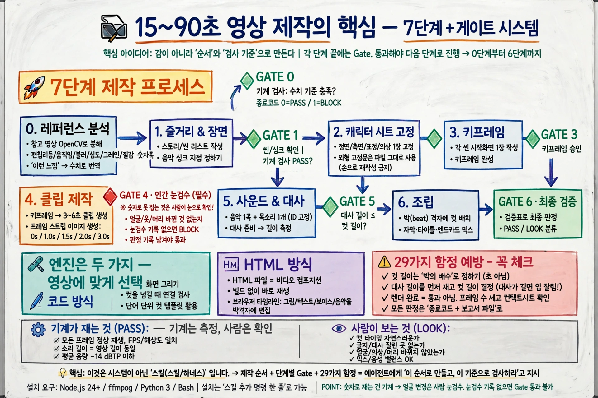
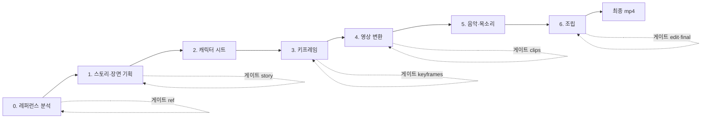
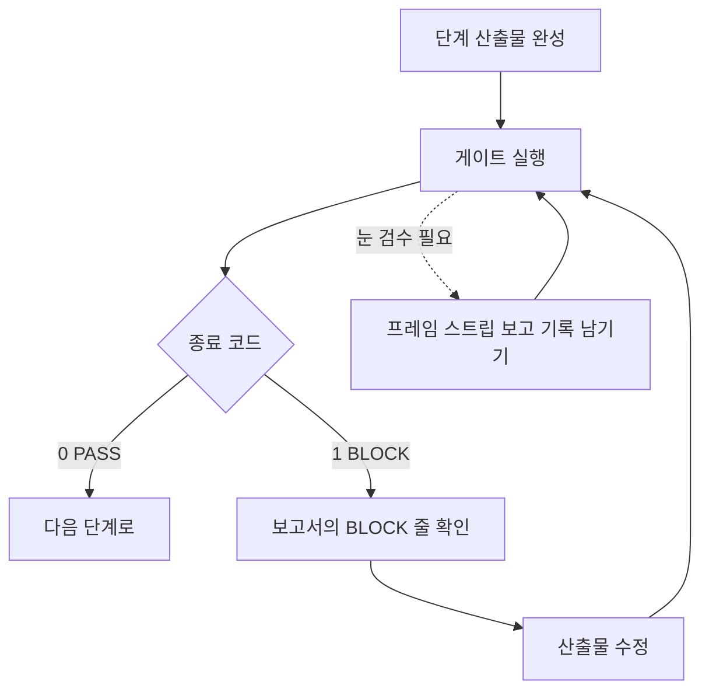

# motion-video-skill: 90초 영상, 감으로 만들지 말고 게이트를 통과시켜 만듭니다

> **Summary**
> 15~90초 모션 그래픽·홍보·캐릭터 영상을 7단계로 나누고, 각 단계마다 게이트가 산출물을 검사해 통과해야 다음 단계로 넘어갑니다. 숫자로 잴 수 있는 것은 기계가 재고, 얼굴이 바뀌는지 같은 것은 사람이 눈으로 봐야 합니다. 눈 검수 기록이 없으면 게이트는 통과시켜 주지 않습니다. 엔진은 두 가지입니다. 코드로 화면을 그리는 방식과 HTML 파일로 만드는 방식 중 영상에 맞는 것을 고릅니다.

---

- 15~90초 모션 그래픽·홍보·캐릭터 영상을 7단계로 나누고, 각 단계마다 게이트가 산출물을 검사해 통과해야 다음 단계로 넘어갑니다.
- 숫자로 잴 수 있는 것은 기계가 재고, 얼굴이 바뀌는지 같은 것은 사람이 눈으로 봐야 합니다. 눈 검수 기록이 없으면 게이트는 통과시켜 주지 않습니다.
- 엔진은 두 가지입니다. 코드로 화면을 그리는 방식과 HTML 파일로 만드는 방식 중 영상에 맞는 것을 고릅니다.

30초짜리 홍보 영상 하나 만들려고 영상 편집 프로그램을 켰는데, 어디서부터 손대야 할지 막막했던 적 있으시죠? 캐릭터 얼굴은 장면마다 조금씩 달라지고, 음악 박자와 컷은 어긋나고, 다 끝낸 줄 알았는데 대사 끝이 잘려 있었습니다. 그런데 이걸 "감"이 아니라 "순서"의 문제로 보면 어떨까요?

이 스킬은 모션 그래픽·홍보·캐릭터 영상을 처음부터 끝까지 만드는 순서와 점검 기준을 담은 Claude Code 스킬입니다. 영상 길이는 15~90초, 기본은 30~90초입니다. 핵심은 하나입니다. 만드는 순서와, 각 단계가 끝날 때 무엇을 검사할지가 정해져 있다는 점입니다!

영상 제작, 어디서부터 시작해야 할까요? 답은 레퍼런스부터입니다.

🎥 [동영상 보기](https://www.youtube.com/watch?v=5NRAOnKc3c8)

## 7단계, 각 단계마다 게이트가 기다립니다

제작은 7단계로 나뉩니다. 0단계 레퍼런스 분석부터 6단계 조립까지, 한 단계가 끝나면 게이트가 산출물을 검사합니다. 통과해야 다음 단계로 갑니다. 단계와 검사는 이렇게 짝을 이룹니다.

0단계가 이 스킬의 시작점입니다. 참고하고 싶은 영상을 OpenCV로 분해해 편집 리듬·움직임·블러·심도·그레인·질감을 숫자로 남깁니다. "이런 느낌으로"라는 말을 숫자로 번역하는 단계입니다. 완성된 영상도 같은 숫자로 다시 재니까, 처음 정한 기준이 끝까지 살아 있습니다.

1단계에서는 줄거리와 장면 목록, 음악 싱크 지점을 정합니다. 2단계에서는 캐릭터의 정면·측면·표정·의상을 한 장에 고정한 시트를 만듭니다. 외형 고정문은 파일에서 그대로 붙여 씁니다. 손으로 다시 쓰면 달라지거든요! 3단계에서는 장면마다 시작 화면 1장씩 키프레임을 그리고, 4단계에서는 그 키프레임을 시작 화면으로 고정해 3~6초짜리 클립을 만듭니다. 5단계에서는 음악 1곡과 목소리 1개(ID 고정), 대사를 준비하고, 6단계에서는 박 격자에 맞춰 컷을 배치하고 자막·타이틀·엔드카드를 얹어 믹스합니다.

## 게이트는 어떻게 판정할까요?

검사는 `gate.py`라는 스크립트가 맡습니다. 단계마다 산출물을 측정해 종료 코드로 판정합니다. 종료 코드 0이면 통과, 1이면 막힘(BLOCK)입니다. 막히면 `qa` 폴더의 보고서에 적힌 BLOCK 줄을 읽고 산출물을 고친 뒤 같은 게이트를 다시 실행합니다.

그런데 모든 검사를 기계가 할 수 있는 것은 아닙니다. 시작 화면이 키프레임과 같아도 1~2초 뒤에 인물의 옷이나 머리가 바뀌는 클립이 있습니다. 그래서 `clips` 게이트는 클립마다 키프레임과 0초, 1.0초, 1.5초, 2.0초, 3.0초 프레임을 한 줄에 놓은 프레임 스트립 이미지를 만듭니다. 사람이 그 이미지를 보고 판정 기록을 남겨야 통과합니다. 숫자로는 인물 변형을 잡을 수 없으니까요!

이 점이 저는 가장 인상 깊었습니다. 자동화가 "사람을 빼는 것"이 아니라 "사람이 봐야 할 곳을 정확히 짚어주는 것"이라는 게, 프레임 스트립 하나로 증명되니까요!

## 29가지 함정, 먼저 읽고 시작합니다

스킬에는 자주 생기는 함정 29가지의 예방법이 들어 있습니다. 시작하기 전에 먼저 읽는 문서입니다. 대표적인 함정 몇 가지만 꼽아보겠습니다.

첫째, 컷 길이는 초가 아니라 박의 배수로 정합니다. 음악 박자에 컷을 맞추는 게 이 스킬의 기본 자세입니다. 둘째, 대사 길이를 먼저 재고 컷 길이를 정합니다. 대사가 컷보다 길면 입이 잘립니다. 셋째, 렌더가 끝난 것은 통과의 근거가 아닙니다. 프레임 수를 세고 컨택트 시트를 직접 봐야 합니다. 넷째, 검사 출력을 파이프로 자르면 종료 코드가 사라집니다. 판정은 게이트의 종료 코드와 보고서 파일로 합니다.

함정 목록은 "조심하세요" 수준의 조언이 아닙니다. 각 함정에 하네스 검사 ID가 붙어 있어, 게이트가 실제로 막아줍니다. 실수를 예방하는 문서와 실수를 잡아내는 검사가 같은 목록을 공유하는 셈입니다.

## 엔진은 두 가지, 영상에 맞게 고릅니다

화면을 만드는 엔진은 두 가지가 들어 있습니다. 하나는 코드로 화면을 그리는 방식이고, 다른 하나는 HTML 파일로 화면을 만드는 방식입니다. 코드 방식에는 컷을 넘길 때 화면에 무언가 이어지게 하는 검사와 단어 단위 컷 템플릿이 들어 있습니다. HTML 방식은 순수 HTML 파일이 곧 비디오 컴포지션이라 빌드 단계 없이 바로 재생합니다.

어떤 엔진을 쓸지는 시작할 때 정합니다. 정하기 어려우면 스킬이 기준에 따라 추천해 줍니다. 타임라인 편집기도 들어 있어, 브라우저에서 그림·텍스트·목소리·음악 트랙을 박 격자 위에서 편집할 수 있습니다. 에이전트가 쓰는 편집 파일과 같은 파일을 건드리니까, 손으로 고친 내용이 그대로 이어집니다.

## 시스템이 아니라 스킬입니다. 뭐가 다를까요?

비슷해 보이는 영상 제작 도구와 헷갈리기 쉽습니다. 12개 비디오 프로덕션 파이프라인을 갖춘 시스템은 파이프라인 자체가 제품입니다. 이 글의 주인공은 그게 아닙니다. 제작 순서와 단계별 점검 기준을 담은 스킬, 즉 에이전트에게 "이 순서로 만들고, 이 기준으로 검사하라"고 알려주는 하네스입니다. 렌더링 엔진은 스킬 안에 딸려 있는 도구일 뿐, 스킬의 본체는 7단계 순서와 게이트, 그리고 29가지 함정 목록입니다.

그래서 이 스킬을 쓴다는 것은 영상 제작 도구를 하나 더 설치한다는 뜻이 아닙니다. 에이전트에게 영상 제작의 작업 순서를 가르친다는 뜻에 가깝습니다!

## 완성된 영상은 한 장의 표로 판정합니다

마지막에는 검증 스크립트가 완성된 영상을 다시 한 번 측정해 한 장의 표로 정리합니다. 기계가 재는 것은 명확합니다. 모든 프레임이 깨지지 않고 풀리는지, 프레임 속도와 크기가 맞는지, 소리와 그림의 길이가 같은지, 평균 음량은 −14 LUFS 근처인지, 가장 큰 피크는 −1 dBTP 아래인지. 표는 값이 싼 검사부터 순서대로 보여줍니다.

사람이 봐야 할 항목도 표에 들어갑니다. 컷 타이밍, 잘린 글자, 바뀌는 얼굴, 믹스의 느낌 같은 것들입니다. 이 행들은 PASS라고 적지 않고 LOOK이라고 적습니다. 컨택트 시트와 마지막 프레임을 보고 쓴 검수 기록이 있어야 최종 게이트가 열립니다. 새로 생긴 검사는 처음에는 경고만 하고(`observe`), 실제 작업에서 충분히 시험한 뒤에야 막는 검사(`enforce`)로 바뀝니다.

설치는 스킬 추가 명령 한 줄이면 됩니다. Node.js 24 이상, `ffmpeg`, Python 3, Bash가 필요합니다. Claude Code는 물론 다른 스킬 지원 런타임에서도 같은 폴더를 씁니다. 생성 도구가 없으면 에이전트가 프롬프트를 써 주고, 사용자가 만든 파일을 받아 이어갑니다. 도구 로그인이나 결제를 에이전트가 대신하지 않는다는 점도 스킬에 적혀 있습니다.

영상 제작의 어려움은 기술이 아니라 순서였습니다. 무엇을 먼저 정하고, 무엇을 검사하고, 어디를 눈으로 봐야 하는지. 그 순서가 스킬로 정리되니, 90초짜리 영상도 "한 단계씩 통과시키는 일"이 됩니다. 다음에 영상을 만들 때는 편집 프로그램부터 켜지 말고, 통과 기준부터 정해보는 게 어떨까요?

