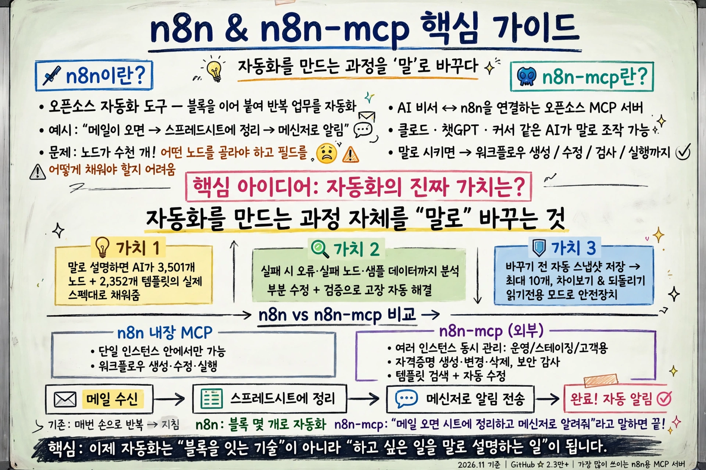
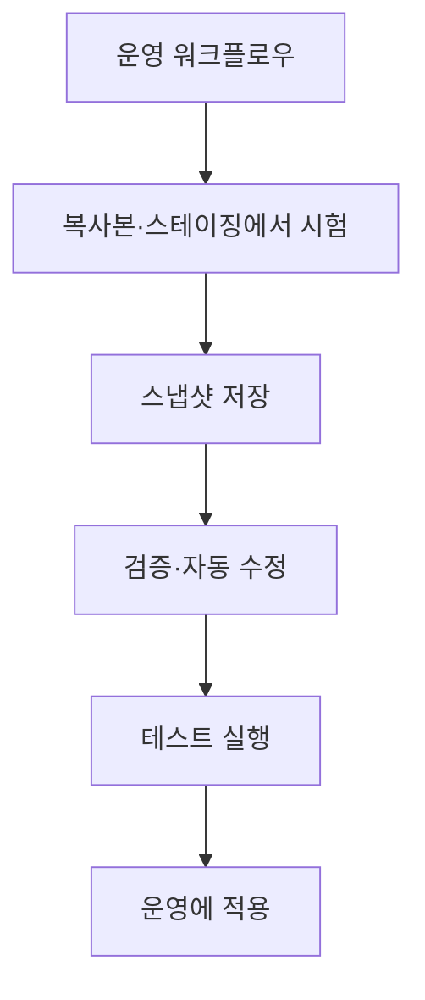

# n8n-mcp: 말로 시키면 워크플로우가 짜집니다. 블록은 이제 AI가 잇습니다

> **Summary**
> n8n-mcp는 AI 비서가 자연어 지시만으로 n8n 워크플로우를 만들고 수정·검증·실행하며 오류까지 분석하도록 돕는 오픈소스 MCP 서버입니다. 방대한 노드 문서와 템플릿, 스냅샷·되돌리기·읽기 전용 모드 같은 안전장치를 제공해 자동화 구축의 문턱을 낮추지만, 운영에 적용하기 전에는 복사본이나 스테이징 환경에서 충분히 테스트해야 합니다.

---

- n8n은 블록을 이어 붙여 "메일 오면 시트에 정리하고 메신저로 알림" 같은 일을 자동으로 돌리는 오픈소스 도구입니다.
- n8n-mcp는 클로드·챗GPT·커서 같은 AI 비서가 n8n을 직접 다루게 해주는 오픈소스 MCP 서버입니다. 말로 시키면 워크플로우를 짜고, 고치고, 검사하고, 실행까지 합니다.
- 별 2.3만 개가 넘는 이 도구의 진짜 가치는 자동화가 아니라, 자동화를 만드는 과정 자체를 말로 바꾸는 데 있습니다.


메일이 오면 스프레드시트에 정리하고, 메신저로 알림을 보내는 일, 이런 적 있으시죠? 매번 손으로 하기엔 지겹고, 자동화로 만들자니 블록이 너무 많습니다. n8n은 이 반복을 블록 몇 개로 줄여주는 도구입니다. 그런데 블록을 잇는 일 자체가 또 하나의 벽이었습니다.

🎥 [동영상 보기](https://www.youtube.com/watch?v=mBT3Mduby4A)

## n8n은 뭐고, 왜 어려울까요?

n8n은 앱과 서비스를 블록(노드)으로 이어서 자동화를 만드는 오픈소스 도구입니다. 트리거가 시작 신호를 보내면, 노드들이 순서대로 일을 처리합니다. 메일 수신, 시트 정리, 알림 발송이 한 줄로 이어지는 방식입니다. 회사에서도, 부업에서도 많이 씁니다. 문제는 노드가 수천 개라는 점입니다. 어떤 노드를 골라야 하는지, 필드를 어떻게 채워야 하는지, 연결이 틀리면 어디서 막히는지 알기 어렵습니다. 자동화를 만들려다 자동화 만드는 법을 배우는 시간이 먼저 듭니다!

## 말로 시키면, AI가 워크플로우를 짭니다

n8n-mcp는 AI 비서와 n8n 사이에 꽂는 연결 장치입니다. MCP는 AI가 외부 도구를 쓸 수 있게 해주는 표준 규격입니다. 이 서버를 연결하면, 말로 시키는 일이 그대로 n8n 조작이 됩니다. "메일 오면 시트에 정리하고 슬랙으로 알려줘"라고 말하면, AI가 노드를 고르고, 연결하고, 워크플로우를 만들어줍니다! 3,501개 노드와 2,352개 템플릿에 대한 지식이 서버 안에 들어 있어서, AI가 노드 문서를 추측하지 않고 실제 스펙대로 채웁니다!

```mermaid
flowchart LR
    A[말로 시키기<br/>"메일 오면 정리해줘"] --> B[n8n-mcp 서버]
    B --> C[노드 문서·템플릿<br/>3,501개 노드]
    C --> D[워크플로우 생성·수정]
    D --> E[n8n 인스턴스에서 실행]
```

## 고장 난 워크플로우, AI가 직접 봅니다

자동화의 진짜 고통은 만드는 순간이 아니라 고장 난 뒤입니다. 실행이 실패하면 어느 노드에서, 왜 멈췄는지 찾아야 합니다. 그런데 그걸 직접 찾아다닐 필요가 있을까요? n8n-mcp는 실패한 실행을 읽어서 오류와 실패한 노드, 그 앞 노드의 샘플 데이터까지 돌려줍니다. 고칠 때도 워크플로우 전체를 다시 보내지 않고, 바뀐 노드와 연결만 부분 수정합니다. 배포 전에는 검증 도구가 알려지지 않은 노드, 잘못된 버전, 빠진 필수 필드, 끊긴 연결을 먼저 잡아내고, 흔한 문제는 자동으로 고쳐줍니다. 테스트도 웹훅·폼·채팅 트리거를 통해 직접 돌려볼 수 있습니다. 만드는 것보다 고치는 데 시간을 덜 쓰는 것, 그게 이 도구가 주는 가장 큰 변화 아닐까요?

## 내장 MCP와 뭐가 다를까요?

n8n 자체에도 인스턴스 안에 들어 있는 MCP 서버가 있습니다. 한 개 인스턴스에서 워크플로우를 만들고 고치는 일은 내장 서버로도 충분합니다. 그런데 n8n-mcp는 바깥에서 여러 인스턴스를 한 번에 다룹니다. 운영용·스테이징·고객용 인스턴스를 한 연결로 오갈 수 있습니다. 자격 증명을 만들고·바꾸고·지우는 일, 자동 수정, 실행 오류 분석, 템플릿 검색, 보안 감사 같은 기능도 이쪽에만 있습니다. 오래된 n8n 버전에서도 공개 API를 통해 동작합니다. 둘 중 하나를 고르는 문제가 아닙니다. 내장 서버가 기반이고, 여러 인스턴스나 추가 기능이 필요하면 n8n-mcp를 얹는 구조입니다. 이름이 같아서 헷갈리기 쉬운데, n8n 문서에서 예시 연결 이름으로 쓰는 `n8n-mcp`와 이 오픈소스 서버는 다른 것입니다!

## 안전장치부터 알고 쓰세요

AI가 실제 워크플로우를 바꾸는 도구라서, 안전장치가 먼저입니다. n8n-mcp는 노드나 연결을 바꾸기 전에 워크플로우 스냅샷을 기본으로 저장합니다. 워크플로우마다 최대 10개까지 쌓이고, 차이 보기와 되돌리기가 됩니다. 그래도 운영 중인 워크플로우는 직접 고치지 않는 게 원칙입니다. 복사본이나 스테이징 인스턴스에서 먼저 시험하고, 배포 전에 검증을 돌리는 순서가 README에도 적혀 있습니다. 읽기 전용 모드로 두면 쓰기 동작 자체가 막힙니다. 한 가지 더 주의할 점이 있습니다. AI가 워크플로우를 읽고 쓰는 동안 n8n 화면에서 같은 워크플로우를 고치면, 화면에서 고친 내용이 덮어씌워질 수 있습니다. AI가 작업하는 동안에는 화면 편집을 잠시 멈추는 게 안전합니다.



## 자동화의 문턱이 낮아졌습니다

이 글의 출발점은 X 포스트 한 줄이었습니다. 포스트 자체는 직접 읽지 못해서, 저장소 README 전문을 1차 원본으로 삼아 재구성했습니다. 확인한 사실은 분명합니다. n8n-mcp는 2026년 11월 기준으로 별 2.3만 개를 넘긴, 가장 많이 쓰이는 n8n용 MCP 서버입니다. 설치는 패키지 매니저로 한 줄이면 되고, 클로드 코드·커서·윈드서프 등 여러 도구와 연결됩니다. 호스팅 대시보드를 쓰면 설치 없이 무료 범위 안에서 바로 시험할 수도 있습니다. 동반 프로젝트로, 운영 수준 워크플로우를 만드는 법을 가르치는 스킬 모음도 함께 공개돼 있습니다. 자동화는 이제 블록을 잇는 기술이 아니라, 하고 싶은 일을 말로 설명하는 일이 되고 있습니다. 말 한 마디로 시작해보는 건 어떨까요?

