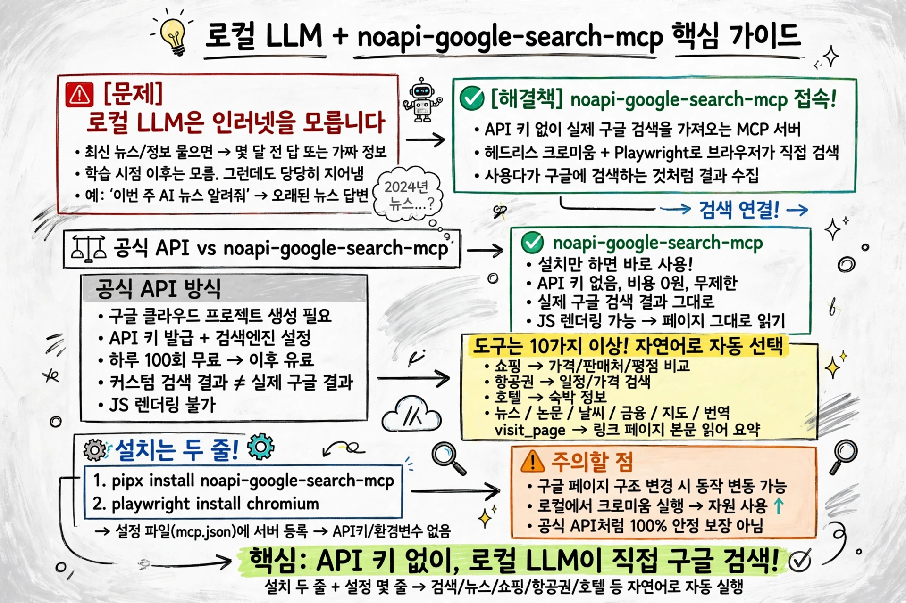
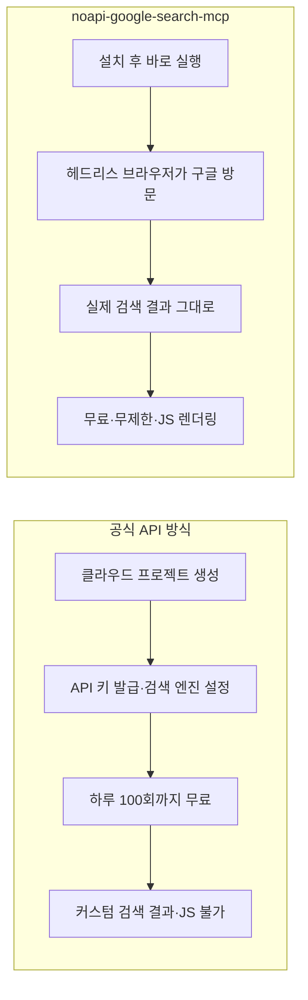
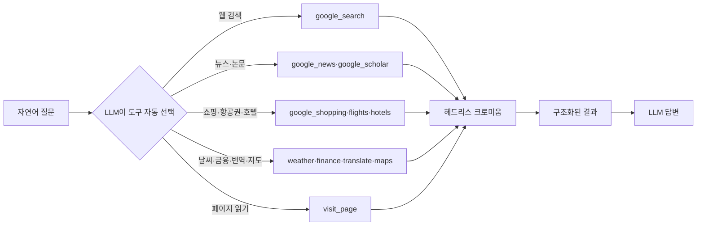

# noapi-google-search-mcp: API 키 없이 로컬 LLM이 구글 검색을 직접 합니다

> **Summary**
> API 키 없이 로컬 LLM이 실제 구글 검색 결과를 쓸 수 있게 해주는 MCP 서버 noapi-google-search-mcp를 소개합니다. 헤드리스 크로미움으로 브라우저가 직접 구글을 방문하는 방식이라 공식 API의 클라우드 설정·하루 100회 한도·커스텀 검색 결과 문제를 피하고, 검색·뉴스·논문·쇼핑·항공권·호텔·날씨·금융까지 자연어로 물으면 LLM이 도구를 골라 실행합니다. 설치는 두 줄이면 되고 설정 파일에 넣을 비밀값도 없습니다.

---

- 로컬 LLM은 인터넷을 모릅니다. 최신 정보를 물으면 오래된 답을 하거나 그럴듯하게 지어냅니다.
- noapi-google-search-mcp는 API 키 없이 헤드리스 브라우저로 실제 구글 검색 결과를 가져오는 MCP 서버입니다.
- 검색·뉴스·논문·쇼핑·항공권·호텔·날씨·금융까지, 자연어로 물으면 LLM이 도구를 골라 실행합니다.


## 로컬 LLM에게 최신 뉴스를 물어본 적 있으시죠?

로컬 LLM을 켜고 "이번 주 AI 뉴스 알려줘"라고 물었습니다. 돌아온 답은 몇 달 전 얘기였습니다. 모델이 학습한 시점 이후의 일은 모르는 게 당연합니다. 그런데 답은 당당했습니다. 모른다고 말하지 않고, 그럴듯하게 지어냈습니다. 이런 적 있으시죠?

해결책은 검색을 붙이는 것입니다. 그런데 공식 API를 쓰려면 클라우드 프로젝트를 만들고, 키를 발급받고, 검색 엔진을 설정해야 합니다. 하루 100회까지만 무료입니다. 그 과정을 통째로 건너뛰는 방법이 있습니다!

🎥 [동영상 보기](https://www.youtube.com/watch?v=kqkb-pm0FYA)

## noapi-google-search-mcp, 브라우저가 직접 검색합니다

noapi-google-search-mcp는 로컬 LLM에게 진짜 구글 검색을 붙여주는 MCP 서버입니다. `MCP`는 AI 앱이 외부 도구와 데이터를 연결하는 공통 규격입니다. 이 서버는 그 규격으로 구글 검색을 LLM에게 열어줍니다.

방식이 다릅니다. API를 호출하지 않습니다. 헤드리스 크로미움(Headless Chromium)이 `Playwright`로 브라우저를 띄워, 실제 사용자가 구글에 들어가는 것처럼 검색 결과를 가져옵니다. 그래서 API 키도, 검색 엔진 설정도, 사용량 한도도 없습니다. 설치하고 바로 쓰면 됩니다!

이 장면이 저는 가장 인상 깊었습니다. "API 키를 발급받으세요"라는 문장 자체가 사라진다는 점입니다. 키가 없으면 유출될 키도 없습니다.


## 공식 API와 뭐가 다를까요?

공식 API 방식은 준비가 깁니다. 구글 클라우드 프로젝트를 만들고, API를 활성화하고, 키를 발급받고, 커스텀 검색 엔진을 설정해야 합니다. 하루 100회까지만 무료이고, 그 이후는 유료입니다. 그리고 돌려받는 결과는 일반 사용자가 보는 구글 검색 결과와 다릅니다. 커스텀 검색 엔진의 랭킹이기 때문입니다. 자바스크립트로 그려지는 페이지도 읽지 못합니다.

이 도구는 그 반대로 갑니다. 브라우저가 직접 구글을 열기 때문에, 보는 결과는 실제 사용자가 보는 결과와 같습니다. 자바스크립트 페이지도 크로미움이 렌더링해서 읽습니다. 비용은 0원, 횟수 제한도 없습니다!



## 검색만 있는 게 아닙니다, 도구만 열 가지가 넘습니다

이 서버의 강점은 도구가 많다는 점입니다. 웹 검색만 있는 게 아닙니다. 쇼핑은 가격·판매처·평점을, 항공권은 일정과 가격을, 호텔은 숙박 정보를 가져옵니다. 번역·지도·날씨·금융·뉴스·학술 검색까지, 구글의 특화된 서비스를 각각의 도구로 제공합니다. 검색한 페이지 본문을 직접 읽어오는 `visit_page`도 있습니다.

사용자는 도구 이름을 외울 필요가 없습니다. 자연어로 물으면 LLM이 알아서 고릅니다. "2025년 최고의 파이썬 웹 프레임워크 검색해줘"라고 하면 웹 검색 도구가, "레딧에서 홈 랩 셋업 글 찾아줘"라고 하면 사이트 필터가 붙은 검색이, "가장 저렴한 맥북 에어 찾아줘"라고 하면 쇼핑 도구가 불려집니다. "이 기사 읽고 요약해줘"라고 링크를 주면 페이지를 읽어옵니다. 이게 MCP의 약속입니다. 도구를 설명만 해두면, LLM이 문맥을 보고 골라 씁니다!



## 설치는 두 줄, 설정은 몇 줄입니다

설치는 간단합니다. `pipx`로 패키지를 설치하고, 브라우저 자동화용 크로미움을 받습니다. 딱 두 줄입니다.

```bash
pipx install noapi-google-search-mcp
playwright install chromium
```

`pipx`가 없으면 가상 환경을 만들어서 설치해도 됩니다. 그 다음에는 쓰는 LLM 클라이언트의 설정 파일에 서버를 한 줄로 등록합니다. `claude_desktop_config.json`이나 `mcp.json`에 서버 이름과 실행 명령만 적으면 됩니다. API 키도, 환경 변수도 없습니다. 설정 파일에 넣을 비밀값 자체가 없습니다.

지원하는 클라이언트도 넓습니다. `LM Studio`, `Claude Desktop`은 물론 MCP를 지원하는 어떤 클라이언트와도 붙습니다. 라이선스는 `MIT`입니다.

## 주의할 점, 알고 쓰면 좋습니다

한 가지는 알고 쓰는 게 좋습니다. 이 도구는 공식 API가 아니라 브라우저로 구글 페이지를 직접 가져오는 방식입니다. 구글이 검색 결과 페이지 구조를 바꾸면 동작이 달라질 수 있습니다. 공식 API처럼 안정적인 계약이 있는 게 아닙니다. 무료·무제한의 대가로, 페이지 구조에 의존한다는 점을 받아들이는 셈입니다.

그리고 로컬에서 크로미움이 돌아간다는 점도 있습니다. 검색할 때마다 브라우저가 뜨고 페이지를 렌더링하니, 가벼운 API 호출보다는 자원을 더 씁니다. 로컬 LLM을 돌리는 머신이라면 감당할 수준이지만, 알고 쓰는 게 좋습니다.

그럼에도 이 도구가 던지는 질문은 분명합니다. 검색 기능을 붙이는 데 클라우드 프로젝트와 키 발급이 꼭 필요할까요? 브라우저 하나면 되는 일을, 왜 설정부터 시작해야 할까요?

## 키 없이, 로컬 LLM이 직접 구글을 검색합니다

API 키 없이 로컬 LLM이 구글을 직접 검색합니다. 설정은 설치 두 줄과 설정 몇 줄이 전부입니다. 검색·뉴스·논문·쇼핑·항공권·호텔까지, 자연어로 물으면 도구가 골라집니다. 그 한 줄이 이 도구의 전부입니다!

