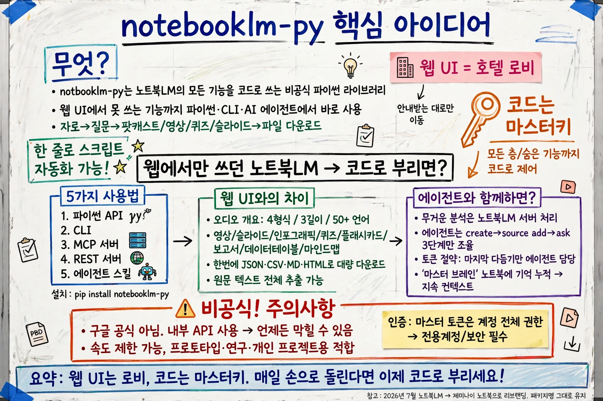
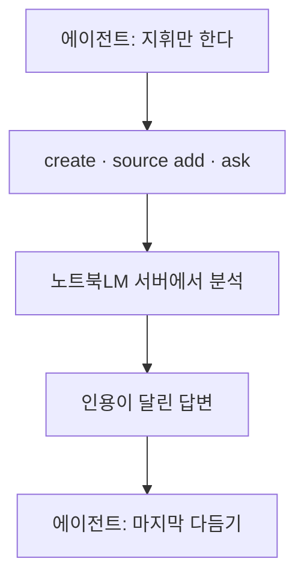
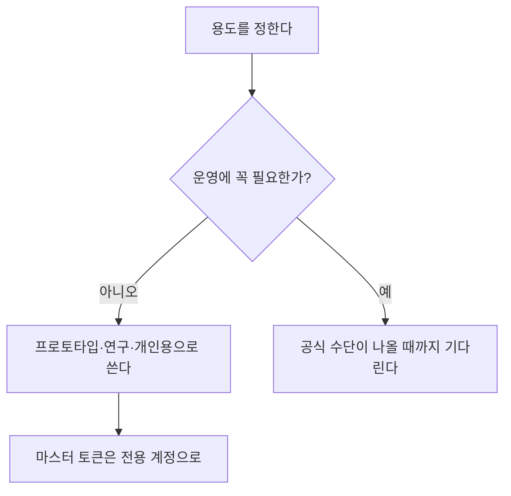

# notebooklm-py: 노트북LM은 웹에서만 쓰는 게 아니라, 코드로 굴리는 겁니다

> **Summary**
> notebooklm-py는 노트북LM의 자료 수집, 질문, 콘텐츠 생성과 다운로드를 파이썬·CLI·MCP 등으로 자동화하는 비공식 라이브러리입니다. 분석은 노트북LM 서버에서 처리해 에이전트의 부담을 줄이고, 근거 있는 답변과 프로젝트 지식을 활용할 수 있지만, 내부 API 변경과 인증 정보 관리 위험이 있어 프로토타입·연구·개인 프로젝트에 적합합니다.

---

- `notebooklm-py`는 노트북LM의 모든 기능을 코드로 쓸 수 있게 해주는 비공식 파이썬 라이브러리입니다. 웹 UI에서 못 쓰는 기능까지 파이썬·CLI·AI 에이전트에서 바로 부릴 수 있습니다.
- 자료를 넣고 질문하고, 팟캐스트·영상·퀴즈·슬라이드까지 만들고, 파일로 내려받는 흐름을 스크립트 하나로 돌릴 수 있습니다.
- 비공식이라 구글 내부 API가 바뀌면 언제든 막힐 수 있습니다. 프로토타입·연구·개인 프로젝트용으로 쓰는 게 맞습니다.


노트북LM에 자료 30개를 올린 적 있으시죠? PDF 하나, 유튜브 링크 하나, 클릭하고 기다리고, 또 클릭하고 기다리고. 분석 자체는 좋은데, 손이 먼저 지칩니다. 웹 UI는 호텔 로비와 비슷합니다. 안내받는 대로만 움직일 수 있죠. 그런데 마스터키가 있다면 어떨까요? 모든 층에 직접 들어가는 것처럼, 숨겨진 기능까지 코드로 부릴 수 있다면요!

🎥 [동영상 보기](https://www.youtube.com/watch?v=usTeU4Uh0iM)

## 웹에서만 쓰던 노트북LM, 코드로 부리면 뭐가 달라질까요?

`notebooklm-py`는 노트북LM을 코드로 부리는 비공식 파이썬 라이브러리입니다. 파이썬 API, CLI, MCP 서버, REST 서버, 에이전트 스킬까지 다섯 가지 방법으로 쓸 수 있습니다. 설치는 한 줄이면 됩니다.

```bash
uv tool install "notebooklm-py[browser]"
notebooklm login
notebooklm auth check --test --json
```

첫 로그인 때는 브라우저가 자동으로 열리고, 크로미움(약 170MB)이 함께 내려받습니다. 인증은 세 가지 방법입니다. 브라우저로 직접 로그인하는 방법, 이미 로그인된 브라우저의 쿠키를 가져오는 방법, 그리고 마스터 토큰입니다. 마스터 토큰은 만료된 세션을 스스로 되살려서, 서버나 CI처럼 사람이 안 보는 곳에서 돌릴 때 씁니다. 파이썬 3.10부터 3.15까지 지원하고, 라이선스는 MIT입니다.

## 웹 UI와 뭐가 다를까요?

기본 기능은 웹과 같습니다. 노트북을 만들고, URL·유튜브·PDF·텍스트·마크다운·워드·EPUB·오디오·영상·이미지·구글 드라이브에서 자료를 넣고, 출처 근거가 달린 답을 물어보고, 노트에 저장합니다. 차이는 "웹에서 못 하는 것"에 있습니다!


오디오 개요는 4가지 형식, 3가지 길이, 50개 넘는 언어로 만들 수 있고, 영상 개요·슬라이드·인포그래픽·퀴즈·플래시카드·보고서·데이터 테이블·마인드맵까지 나옵니다. 웹에서는 클릭으로 하나씩 받던 것을, 여기서는 한 번에 내려받습니다. 퀴즈와 플래시카드는 JSON·마크다운·HTML로 뽑히고, 마인드맵은 JSON 트리로, 데이터 테이블은 CSV로 나옵니다. 슬라이드는 낱장씩 자연어로 고칠 수 있고, 대화 기록 전체를 노트로 저장할 수도 있습니다. 자료의 원문 텍스트를 통째로 꺼내는 것도 됩니다.

## 에이전트한테 맡기면 토큰이 아껴질까요?

이 라이브러리의 진짜 쓰임새는 에이전트와 붙을 때 드러납니다. 무거운 분석은 노트북LM이 서버에서 하고, 에이전트는 지휘만 하는 겁니다. 문서 30개를 노트북에 던져두고, 에이전트는 `create` → `source add` → `ask` 세 단계만 조율합니다. 추론은 서버에서 일어나니, 에이전트 토큰은 마지막 다듬기에만 씁니다!



이 장면이 저는 가장 와닿았습니다. "마스터 브레인" 노트북 하나에 매 세션의 결정과 수정 사항을 노트로 쌓아두면, 다음 세션 시작 때 그 노트북에 물어보는 것만으로 기억이 이어진다는 점이요.

내부 문서·설계서·RFC를 담은 노트북을 MCP 서버로 열어두면, 코딩 에이전트는 내 코드에서 근거를 찾아 답합니다. 벡터 DB를 직접 세우지 않고도, 근거 있는 "프로젝트 두뇌"를 갖는 셈입니다. 스킬을 만들 때는 노트북LM이 만든 퀴즈를 평가 문제로 써서, 스스로 만든 문제로 스스로를 속이지 않고 검증할 수도 있습니다.

## 비공식이라는데, 어디까지 믿으면 될까요?

여기서 한 가지는 분명히 해야 합니다. 이 라이브러리는 구글 공식이 아닙니다. 문서화되지 않은 내부 API를 쓰기 때문에, 구글이 엔드포인트를 바꾸면 예고 없이 막힐 수 있습니다. 많이 쓰면 속도 제한에 걸릴 수도 있습니다. 프로토타입·연구·개인 프로젝트에 쓰는 게 맞습니다!

인증 정보도 조심해야 합니다. 마스터 토큰은 계정 전체에 닿는 강력한 자격 증명이라, 전용 계정으로 쓰고 프로필을 잘 지켜야 합니다. 참고로 노트북LM은 2026년 7월에 제미나이 노트북으로 이름이 바뀌었습니다. 같은 제품이고, 이 라이브러리도 그대로 동작합니다. 패키지 이름은 그대로 유지됩니다.



웹 UI는 로비, 코드는 마스터키입니다. 노트북LM을 매일 손으로 돌리고 있다면, 한 번쯤 코드로 부려볼 만합니다!

