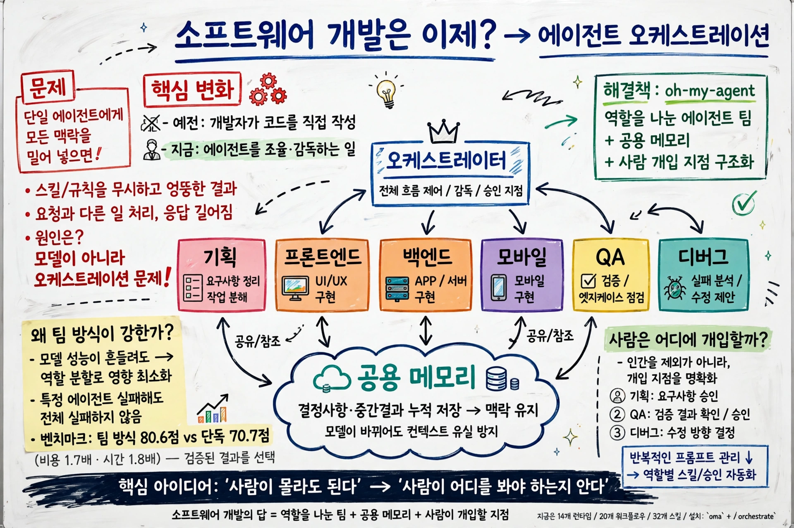
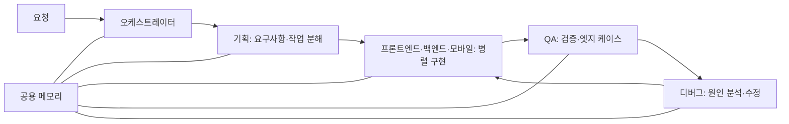
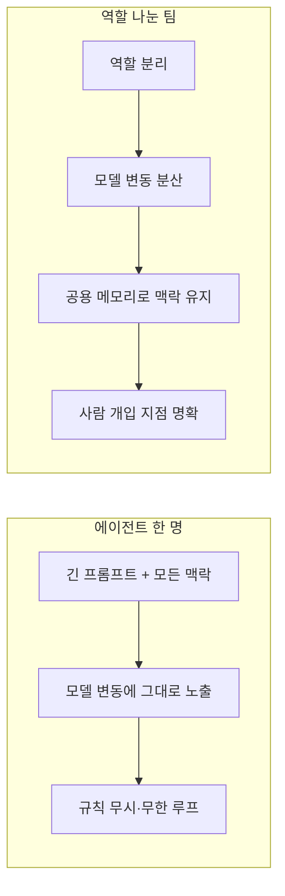
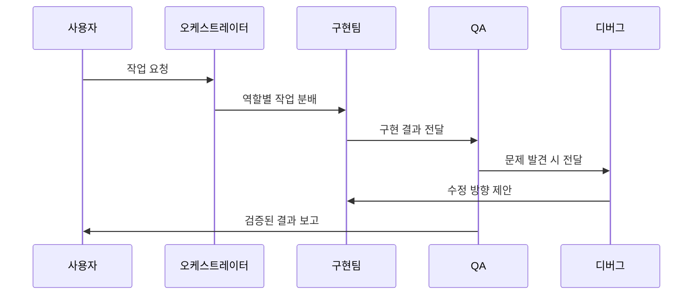

# oh-my-agent: 에이전트 한 명이 아니라 역할이 나뉜 팀이 일합니다

> **Summary**
> 소프트웨어 개발은 이제 코드를 직접 쓰는 일이 아니라 에이전트를 조율하고 감독하는 일로 바뀌었습니다. oh-my-agent는 역할을 나눈 에이전트 팀에 공용 메모리를 붙여 협업 구조를 기본값으로 제공하고, 모델 성능 변동성을 완화하며 사람이 개입할 지점을 명확히 합니다.

---

- 소프트웨어 개발은 이제 코드를 직접 쓰는 일이 아니라 에이전트를 조율하고 감독하는 일로 바뀌었습니다.
- 그런데 에이전트 한 명에게 모든 맥락을 밀어 넣으면 스킬을 안 읽고, 규칙을 무시하고, 엉뚱한 일을 합니다. 모델 탓처럼 보이지만, 사실은 오케스트레이션 문제입니다.
- oh-my-agent는 역할을 나눈 에이전트 팀에 공용 메모리를 붙이고, 사람이 개입할 지점을 구조로 드러냅니다.

## 에이전트에게 일을 맡겼는데, 엉뚱한 일을 하고 있다면?

코딩 에이전트에게 기능 하나를 맡겼습니다. 잠시 뒤 돌아보니 열심히 일은 했습니다. 그런데 요청한 일은 아니었습니다. 스킬 파일은 안 읽었고, 정해둔 규칙은 대화 중간에 무시됐고, 응답은 통제 없이 길어졌습니다. 이런 적 있으시죠?

모델이 나빠서 그럴까요? 그럴 수도 있습니다. 그런데 같은 모델이라도 구조가 다르면 결과가 달라집니다. 문제는 모델이 아니라 오케스트레이션입니다!

🎥 [동영상 보기](https://www.youtube.com/watch?v=ZIWWDDu02Ik)

## oh-my-agent, 에이전트도 역할 나눠 팀으로 일합니다

oh-my-agent는 역할 기반 에이전트 오케스트레이션 레이어입니다. 핵심은 단순합니다. 에이전트 한 명에게 모든 맥락을 밀어 넣지 말고, 책임을 나눈 팀으로 굴리는 것입니다.

오케스트레이터가 전체 흐름을 제어합니다. 서브 에이전트는 각자 역할에만 집중합니다. 필요한 맥락은 공용 메모리를 통해 공유합니다. 이 구조가 처음에는 특정 에이전트 도구용으로 시작했지만, 지금은 14개 코딩 에이전트 런타임에서 돌아가는 팀으로 커졌습니다.

이 장면이 저는 가장 인상 깊었습니다. "프롬프트를 잘 쓰는 문제"가 아니라 "협업 구조를 기본값으로 제공하면 되지 않을까?" — 이 질문이 출발점이라는 점입니다!

## 팀은 어떻게 나뉠까요?

역할은 일하는 방식 그대로 나뉩니다. 기획은 요구사항을 정리하고 작업을 분해합니다. 프론트엔드와 백엔드는 각자 영역에서 구현을 맡고, 모바일은 따로 둡니다. QA는 요구사항 대비 검증과 엣지 케이스를 점검하고, 디버그는 실패 원인을 분석해 수정 방향을 제안합니다.

각 에이전트는 역할에 맞게 최적화된 스킬과 프롬프트 구조를 갖고 있습니다. 오케스트레이터가 이들을 하나의 흐름으로 묶습니다. 기획이 만든 계획은 구현으로, 구현 결과는 검증으로, 검증에서 나온 문제는 디버그로 이어집니다.

## 모델이 흔들려도 팀은 버팁니다

모델 성능은 업데이트나 서버 상황에 따라 갑자기 달라집니다. 단일 에이전트와 긴 프롬프트에 의존하는 구조는 이런 변동에 매우 취약합니다. 역할이 쪼개져 있으면 특정 모델의 일시적인 성능 하락이 전체 결과를 망치지 않습니다.

공용 메모리도 같은 역할을 합니다. 결정 사항과 중간 결과가 메모리에 누적되기 때문에, 모델이 바뀌거나 응답 품질이 흔들려도 맥락이 쉽게 유실되지 않습니다.

숫자도 있습니다. 벤치마크에서 이 팀 방식은 일반 코딩 에이전트 단독 사용보다 80.6점 대 70.7점으로 앞섰습니다. 대신 비용은 1.7배, 시간은 1.8배 들었습니다. 빠르고 싸게 가느냐, 검증된 결과를 받느냐의 선택입니다!

## 사람은 어디에 개입할까요?

핵심은 인간을 루프에서 제거하는 게 아닙니다. 어디에 개입해야 하는지를 분명히 하는 것입니다. 기획·QA·디버그 역할이 분리되어 있기 때문에 어디까지 AI가 맡았는지, 어디서 사람이 판단해야 하는지가 구조적으로 드러납니다.

반복적인 프롬프트 관리도 줄어듭니다. 매번 같은 역할 설명과 규칙, 승인 과정을 프롬프트로 다시 입력하는 대신, 역할별 스킬 번들과 병렬 실행 가능한 오케스트레이터가 기본값으로 자동화합니다.

이 부분이 저는 가장 와닿았습니다. "사람이 몰라도 된다"가 아니라 "사람이 어디를 봐야 하는지 안다"는 게, 협업의 진짜 모습이니까요!

## 숫자로 보는 팀 방식

처음에는 풀스택 웹·모바일 앱에서 하루 50커밋 이상을 소화하는 구조로 설계됐습니다. 지금은 기획부터 설계·구현·검증·배포까지 20개 워크플로우와 32개 스킬을 갖춘 팀으로 커졌습니다. 한 번의 설치로 14개 런타임에서 같은 팀 구조를 씁니다.

설치는 패키지 매니저로 한 줄이면 됩니다. 설치 뒤에는 `oma` 명령으로 상태를 확인하고, 에이전트에서 `/orchestrate` 같은 명령으로 팀을 부릅니다.

## 에이전트 시대, 일하는 방식이 바뀌었습니다

소프트웨어 개발은 더 이상 "도구를 잘 쓰는 법"의 문제가 아닙니다. 에이전트를 어떻게 조율하고 감독하느냐의 문제입니다. 에이전트 한 명에게 다 맡기는 대신, 역할을 나눈 팀으로 굴리고, 공용 메모리로 맥락을 잇고, 사람이 개입할 지점을 분명히 하는 것. 그 구조가 답입니다!

