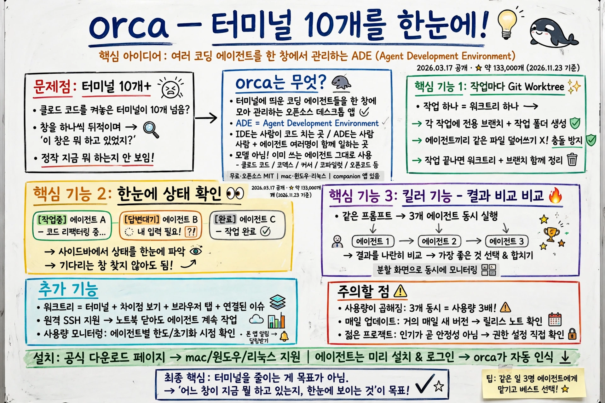
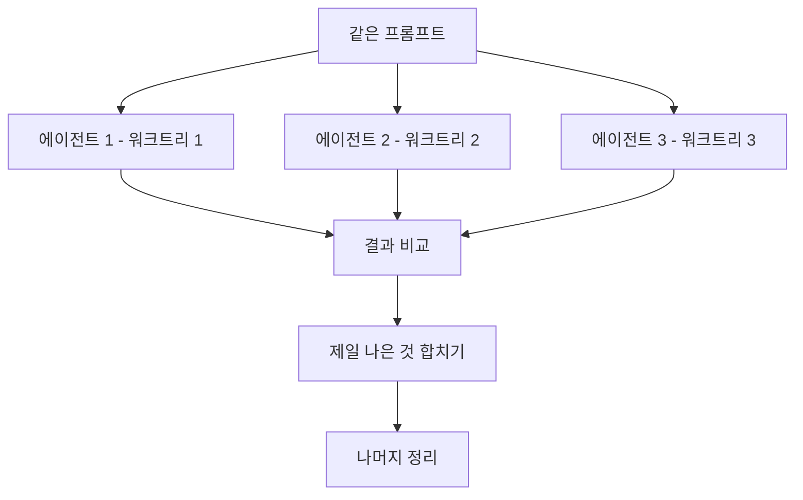

# orca: 터미널 10개를 켜는 게 아닙니다. 작업마다 창 하나씩 나누는 겁니다

> **Summary**
> orca는 여러 코딩 에이전트를 한곳에서 관리하는 무료 오픈소스 데스크톱 앱입니다. 작업마다 별도의 깃 워크트리를 만들어 에이전트 간 충돌을 줄이고, 창 분할과 상태 표시로 진행 상황을 한눈에 확인할 수 있습니다. 결과 비교, 원격 작업, 사용량 확인도 지원하지만 에이전트를 동시에 실행하면 사용량이 늘고 프로젝트가 아직 젊으므로 권한과 최신 릴리스 정보를 확인하는 것이 좋습니다.

---

- orca는 터미널에 띄운 코딩 에이전트들을 한 창에 모아 관리하는 오픈소스 데스크톱 앱입니다.
- 작업마다 깃 워크트리를 하나씩 나눠주니, 에이전트 여러 개가 같은 파일을 두고 부딪히지 않습니다.
- 어느 창이 일 중이고, 어디가 내 답을 기다리는지, 한눈에 보입니다.

클로드 코드를 켜놓은 터미널이 10개를 넘긴 적 있으시죠? 창을 하나씩 뒤적이며 "이 창은 뭐 하고 있었지?" 하고 헤매게 됩니다. 터미널은 늘어나는데, 정작 지금 뭘 하고 있는지는 안 보입니다!

🎥 [동영상 보기](https://www.youtube.com/watch?v=_tQ4QRYyXw8)

### orca는 뭘까요?

orca는 에이전트 개발 환경, ADE입니다. IDE가 "사람이 코드를 치는 곳"이라면, ADE는 "사람과 에이전트 여러 명이 함께 일하는 곳"입니다.

모델이 아닙니다. 이미 쓰는 에이전트와 구독을 그대로 가져옵니다. 터미널에서 돌아가는 CLI 에이전트라면 무엇이든 띄울 수 있습니다. 클로드 코드, 코덱스, 커서, 코파일럿, 오픈코드 등 수십 개가 됩니다.

무료 오픈소스이고, MIT 라이선스입니다. 맥·윈도우·리눅스에서 돌아가고, 폰에서 확인하는 companion 앱도 있습니다. 2026년 3월 17일에 공개됐고, 2026년 11월 23일 기준 별이 약 13만 3천 개입니다.

### 터미널 10개, 어떻게 정리할까요?

**작업 하나당 워크트리 하나입니다.** 각 작업에 자기만의 브랜치와 작업 폴더가 생깁니다. 에이전트끼리 같은 파일을 덮어쓰는 일이 사라집니다. 작업이 끝나면 워크트리를 지우는 동시에 브랜치도 함께 정리됩니다.

**같은 일을 여러 에이전트에게 맡길 수도 있습니다.** 같은 프롬프트를 세 에이전트에게 보내고, 결과를 나란히 비교해 제일 나은 것을 골라 합치는 방식입니다. 공식 안내에서 "킬러 기능"이라고 부르는 흐름입니다.

**창 나누기가 기본입니다.** 탭을 끌어다 분할 화면으로 만들면, 여러 에이전트가 일하는 모습을 동시에 봅니다. 터미널 탭을 오가며 찾지 않아도 됩니다.

**상태가 보입니다.** 어느 에이전트가 일 중인지, 끝났는지, 내 입력이 필요한지 사이드바에 뜹니다. 기다리는 창을 찾아다닐 필요가 없습니다.

**사용량도 보입니다.** 에이전트별 한도를 얼마나 썼고, 언제 초기화되는지 하단에서 확인합니다. 계정 전환도 로그아웃 없이 됩니다.

이 장면이 저는 가장 와닿았습니다. 창을 뒤적이는 시간이 사라지니까요!

### 작업 하나에 뭐가 딸려올까요?

워크트리 하나에는 터미널만 딸리는 게 아닙니다. 차이점 보기, 브라우저 탭, 연결된 이슈까지 한 묶음으로 따라옵니다. 브라우저에는 디자인 모드도 있습니다. 화면의 요소를 집어 에이전트 채팅에 바로 넘길 수 있습니다.

원격으로도 돕니다. SSH 호스트에 워크트리를 만들고, 노트북을 닫아도 에이전트는 계속 일합니다. 폰 앱은 에이전트가 내 답을 기다릴 때 알림을 보내줍니다. 자리에서 답하고, 일은 이어갑니다.

### 설치는 어떻게 할까요?

공식 다운로드 페이지에서 설치 파일을 받습니다. 맥·윈도우·리눅스 모두 있습니다.

맥에서는 패키지 매니저로도 받을 수 있습니다. 다만 이름만 `orca`로 치면 전혀 다른 패키지가 깔립니다. 공식 안내에 나온 전체 이름을 그대로 써야 합니다!

에이전트는 미리 설치해 로그인해 둡니다. orca는 이미 깔린 에이전트를 자동으로 찾아줍니다. 채팅 화면과 터미널 화면을 오갈 수도 있습니다. 같은 대화를 화면만 바꿔 이어갑니다.

### 뭘 조심해야 할까요?

**사용량이 곱해집니다.** 에이전트 세 개를 동시에 돌리면 사용량도 세 배로 돕니다. 경주는 아껴 쓰는 게 맞습니다.

**매일 바뀝니다.** 개발팀이 거의 매일 새 버전을 냅니다. 오늘 본 화면이 내일은 달라져 있을 수 있습니다. 기능을 확인할 때는 릴리스 노트가 가장 정확합니다.

**젊은 프로젝트입니다.** 2026년 3월에 나왔고, 원문 게시글(2026-07-20) 당시 별이 2만 개 남짓이었는데 4개월 만에 13만 개를 넘겼습니다. 인기가 곧 안정성은 아닙니다. 권한 설정은 처음에 직접 확인하는 게 안전합니다.

원문 게시글은 로그인 벽 뒤라 직접 읽지 못했습니다. 이 글은 공개 저장소와 공식 문서를 직접 읽고 정리했습니다.

터미널을 줄이는 게 목표가 아닙니다. 어느 창이 뭘 하고 있는지, 한눈에 보이는 게 목표입니다.

