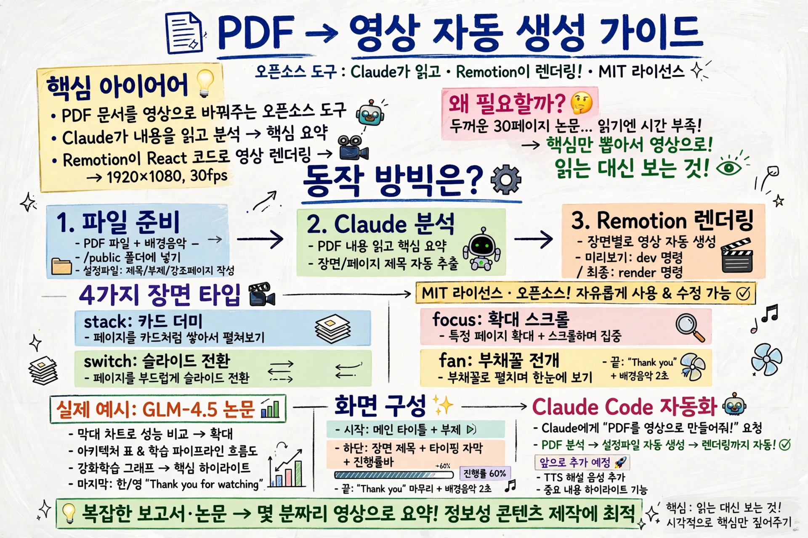
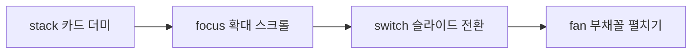
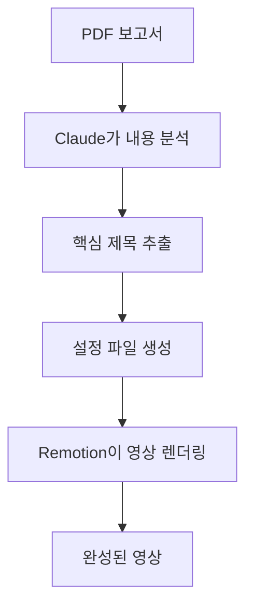

# pdf2video: PDF 보고서를 영상으로 바꾸면, 읽는 대신 봅니다

> **Summary**
> 오픈소스 도구가 Claude로 PDF 내용을 분석하고 Remotion으로 영상화해, 페이지를 카드·확대·슬라이드·부채꼴 장면으로 보여줍니다. 핵심 제목과 설명, 진행률을 더해 복잡한 보고서나 논문을 짧은 영상으로 요약하며, Claude Code를 사용하면 설정과 렌더링도 자동화할 수 있습니다.

---

- PDF 문서를 영상으로 바꿔주는 오픈소스 도구가 나왔습니다. Claude가 내용을 읽고, Remotion이 영상으로 만듭니다!
- 페이지를 카드처럼 펼치고, 핵심 부분은 확대하고, 장면마다 타이핑 자막과 진행률이 붙습니다.
- 복잡한 보고서나 논문을 영상으로 요약해서 보여줄 때 특히 유용합니다. 정보성 콘텐츠를 만드는 분들에게 딱 맞는 도구입니다.

두꺼운 PDF 보고서를 받아들고 한숨 쉰 적 있으시죠? 30페이지짜리 논문, 읽어야 하는데 시간은 없고, 핵심만 뽑아서 공유해야 하는데 손이 안 갑니다. 이럴 때 보고서를 영상으로 바꿔주면 어떨까요? 읽는 대신 보면 됩니다!

🎥 [동영상 보기](https://www.youtube.com/watch?v=9PwpJpJJ3IY)

## PDF를 영상으로 바꾸는 도구, 어떻게 동작할까요?

이 도구는 PDF 문서를 영상으로 바꿔주는 오픈소스 프로젝트입니다. MIT 라이선스로 공개됐습니다. 핵심은 두 가지 기술의 결합입니다. Claude가 PDF 내용을 읽고 분석하고, Remotion이 그 내용을 영상으로 렌더링합니다. Remotion은 React로 영상을 만드는 프레임워크입니다. 코드를 짜면 영상이 나옵니다!

동작 방식은 단순합니다. PDF 파일과 배경 음악을 `public/` 폴더에 넣고, 설정 파일에 제목과 부제, 강조할 페이지를 적습니다. 그러면 Remotion이 페이지를 장면으로 나눠 영상을 만듭니다. 미리보기는 `npm run dev`로 확인하고, 최종 영상은 렌더링 명령으로 뽑아냅니다. 해상도는 1920×1080, 초당 30프레임입니다.

## 장면은 네 가지, 어떻게 다를까요?

장면 타입은 네 가지입니다. `stack`은 페이지를 카드 더미처럼 쌓아 보여주고, `focus`는 특정 페이지를 확대해서 스크롤하며 보여줍니다. `switch`는 페이지를 슬라이드처럼 부드럽게 넘기고, `fan`은 부채꼴로 펼쳐서 보여줍니다. 장면마다 길이를 다르게 정할 수 있습니다.

애니메이션도 신경 썼습니다. 카드를 펼칠 때는 포커 카드처럼 자연스럽게 퍼지고, 스크롤 전에는 숨쉬는 듯한 효과가 들어갑니다. 스크롤이 멈출 때는 통통 튀는 효과가 붙고, 장면이 바뀔 때는 접히는 애니메이션으로 이어집니다. 핵심 페이지는 2배 해상도로 렌더링해서 확대해도 선명합니다!

화면 구성도 꼼꼼합니다. 영상 시작에는 메인 타이틀과 부제가 나오고, 페이지를 볼 때는 모서리에 타이틀이 계속 뜹니다. 하단에는 장면 제목과 타이핑 효과의 설명, 그리고 진행률(1/5 형식)이 표시됩니다. 마지막에는 "Thank you" 메시지로 끝납니다. 배경 음악은 2초씩 페이드인·페이드아웃됩니다.

## 실제 예시, 논문 한 편이 영상이 될까요?

이 도구가 어떻게 보이는지, 실제 예시가 있습니다. GLM-4.5라는 AI 연구 보고서가 영상으로 바뀌었습니다. 표지부터 시작해서 막대 차트로 성능을 비교하고, 아키텍처 표에서 파라미터를 보여주고, 학습 파이프라인 흐름도를 따라가고, 강화학습 그래프를 훑고, 마지막 평가 표로 마무리합니다. 마지막 슬라이드는 영어와 한국어로 "Thank you for watching"이 나옵니다. 두꺼운 논문이 몇 분짜리 영상이 됩니다.

이 장면이 저는 가장 인상 깊었습니다. 차트와 표가 그냥 나오는 게 아니라, 확대되고 스크롤되면서 핵심만 짚어주니까요.

## Claude에게 맡기면, 설정까지 자동으로?

이 프로젝트에는 Claude Code 스킬도 들어 있습니다. Claude에게 PDF를 영상으로 바꿔달라고 말하면, Claude가 PDF를 읽고 분석해서 핵심과 페이지 제목을 뽑고, 설정 파일(`props.json`)을 만들고, 영상까지 자동으로 렌더링합니다. 설정 파일을 직접 쓸 필요도 없습니다.

앞으로는 TTS 해설과 중요 내용 하이라이트 기능도 추가될 예정입니다. 해설이 붙으면 영상이 더 완성됩니다. 복잡한 보고서나 논문을 영상으로 요약해서 보여줄 때, 특히 정보성 콘텐츠를 만드는 분들에게 유용합니다. PDF를 읽는 대신, 영상으로 보면 됩니다!

