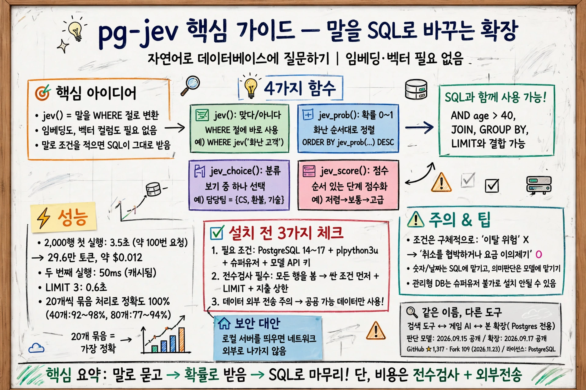
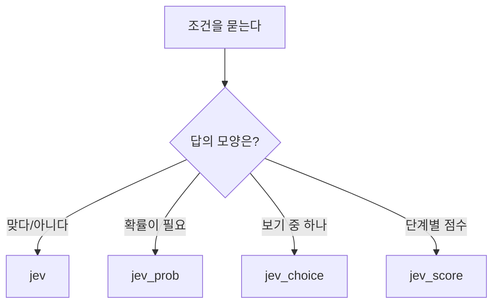

# pg-jev: SQL에 말로 조건을 적으면, 벡터 없이 행을 골라냅니다

> **Summary**
> pg-jev는 자연어 조건을 PostgreSQL의 필터·정렬·분류에 활용하는 확장으로, 임베딩 없이 판단 모델의 확률·선택지·점수를 SQL에서 사용할 수 있습니다. 캐시 덕분에 반복 실행은 빠르지만, 조건에 따라 모든 행을 검사하고 데이터가 외부 API로 전송될 수 있으므로 비용과 개인정보 보호에 유의해야 합니다.

---

- `jev()`는 말로 쓴 조건을 `WHERE` 절로 바꿔줍니다. 임베딩도, 벡터 컬럼도 필요 없습니다.
- 확률·분류·점수까지 한 번에 묻습니다. 화난 고객 순으로 정렬하고, 담당 팀까지 나눠줍니다.
- 2,000행 첫 실행이 3.5초, 두 번째는 50밀리초입니다. 다만 행 내용은 외부 API로 나가니, 공유해도 되는 데이터에만 써야 합니다.


고객 문의 테이블을 열어본 적 있으시죠? "화난 고객부터 봐야 하는데" — 막상 SQL을 쓰려니 막힙니다. 감정은 `LIKE '%화남%'`으로 고를 수 없으니까요!

🎥 [동영상 보기](https://www.youtube.com/watch?v=Ck7wB7pdebQ)

## 말로 조건을 적으면, SQL이 그대로 받습니다

`pg-jev`는 PostgreSQL 확장 프로그램입니다. 조건을 문장으로 적으면, 행마다 맞는지 판단해 주는 함수 `jev()`를 쓸 수 있습니다.

```sql
SELECT * FROM people WHERE jev(people, 'the name is European');
```

이게 전부입니다. 인덱스를 새로 만들 필요도, 임베딩을 계산할 필요도 없습니다. `jev()`는 그냥 불리언 함수라 `AND age > 40` 같은 조건, 조인, `GROUP BY`, `LIMIT`과 그대로 섞어 쓸 수 있습니다. 조건을 문장으로 적는다는 발상, 어떻게 보셨나요?

## 판단은 모델이, 문장은 안 만듭니다

뒤에서 일하는 모델은 판단 전용 모델입니다. 글을 생성하지 않고, 질문마다 **확률**로 답합니다. 그래서 답이 문장이 아니라 숫자와 선택지로 돌아옵니다. 네 가지 질문 방식이 있습니다.

- `jev()`: 맞다/아니다 — `WHERE` 절에 바로 씁니다.
- `jev_prob()`: 확률 0~1 — 화난 순서대로 정렬합니다.
- `jev_choice()`: 보기 중 하나 — 담당 팀을 나눠줍니다.
- `jev_score()`: 순서 있는 단계 — 상품을 저렴함부터 고급까지 점수로 매깁니다.
```sql
SELECT subject, jev_prob(tickets, 'the customer is angry') AS p
FROM tickets ORDER BY p DESC LIMIT 20;
```

확률이 먼저 나오면, 임계값은 나중에 정해도 됩니다. 애매한 사례는 0.5 근처에 모인다는 점, 알고 계셨나요?


## 20개씩 묶는 이유가 있습니다

행은 한 번에 20개씩 묶어 보냅니다. 왜 20개일까요? 정확히 잰 결과 때문입니다. 정답과 대조한 측정에서 1~20개 묶음은 100% 맞았고, 40개는 92~98%, 80개는 77~94%로 떨어졌습니다. 묶음을 넓히면 토큰은 4% 아끼지만, 정확도를 잃습니다. 작게 묶는 게 이득입니다!

처음 호출은 테이블을 앞에서부터 미리 읽어둡니다. `LIMIT`이 있으면 읽기를 멈추고, 싼 조건이 먼저 거른 행은 판단하지 않습니다. 답은 세션에 저장돼, 다시 실행하거나 임계값을 바꿔도 공짜입니다. 2,000행 테이블 측정에서는 첫 실행이 약 3.5초에 100번 요청, 약 29만 6천 토큰, 약 0.012달러였고, 두 번째 실행은 50밀리초였습니다. `LIMIT 3`은 새 조건에서도 0.6초면 끝났습니다. 빠르지 않나요?



## 설치 전에 확인할 세 가지가 있습니다

먼저, 필요한 게 있습니다. PostgreSQL 14~17, `plpython3u`, 슈퍼유저 권한, 그리고 판단 모델 API 키입니다. 설치는 패키지 관리자로 끝납니다. 에이전트에게 맡기면 사전 점검부터 설치, 키 설정, 동작 확인까지 이어서 해줍니다.

둘째, **전수 검사**입니다. 조건에 맞는 행을 찾으려면 결국 모든 행을 봐야 합니다. 싼 조건을 먼저 두고, `LIMIT`으로 일찍 멈추고, 지출 상한을 걸어두는 게 순서입니다. 지출 현황은 `jev_stats()`로 바로 봅니다.

셋째, **행 내용이 외부로 나간다**는 점입니다. 공유하면 안 되는 데이터에는 쓰면 안 됩니다. 다만 행이 네트워크를 안 나가게 하는 길도 있습니다. 같은 규격을 말하는 로컬 서버를 직접 띄우면, 판단이 내 네트워크 안에서 끝납니다!

그리고 한 가지 더. 관리형 데이터베이스는 슈퍼유저와 `plpython3u`를 안 주는 곳이 많아, 이 확장을 못 올리는 경우가 있습니다. 내 서버에서 직접 돌리는 게 전제입니다.

## 같은 이름, 다른 도구라는 점도 짚고 갑니다

이름이 비슷해 헷갈리기 쉬운데, 셋은 다릅니다. 검색을 계획하고 답 대신 링크와 점수를 돌려주는 검색 도구, 스타크래프트 II 최강 AI를 이긴 게임 에이전트와는 별개입니다. 이 글의 주인공은 **Postgres 테이블에 자연어로 묻는 확장**입니다. 판단 모델은 2026년 9월 15일에 공개됐고, 이 확장은 이틀 뒤인 9월 17일에 나왔습니다. 별 1,317개, 포크 109개(2026년 11월 23일 기준), 라이선스는 PostgreSQL 라이선스입니다.

조건을 잘 쓰는 요령도 있습니다. "이탈 위험" 같은 뭉뚱그린 말보다, "취소를 협박하거나, 요금에 이의를 제기하거나, 법적 조치를 언급한다"처럼 정확히 적는 게 낫습니다. 숫자와 날짜, 정확히 맞는 값은 SQL에 맡기고, 의미 판단만 모델에 맡기는 겁니다. 조건을 쓸 때, 모호한 말을 그대로 두신 적은 없으신가요?

SQL이 못하는 일을 억지로 SQL로 쓰지 않아도 됩니다. 말로 묻고, 확률로 받고, SQL로 마무리하면 됩니다. 다만 그 편리함의 대가가 전수 검사와 외부 전송이라는 점, 잊지 마세요!

