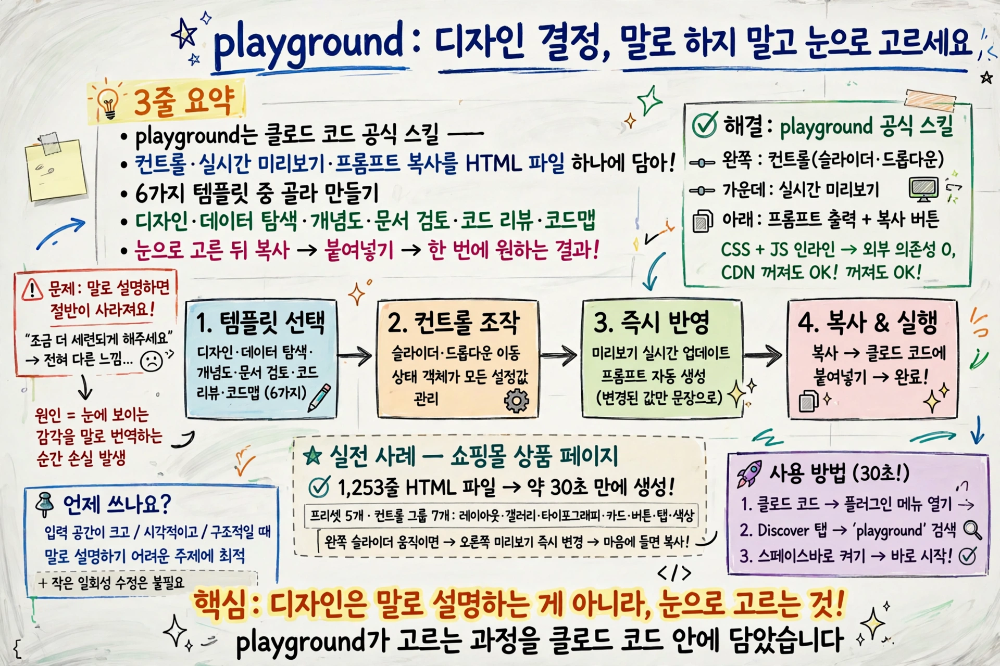
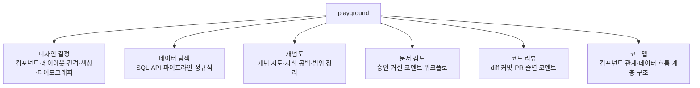
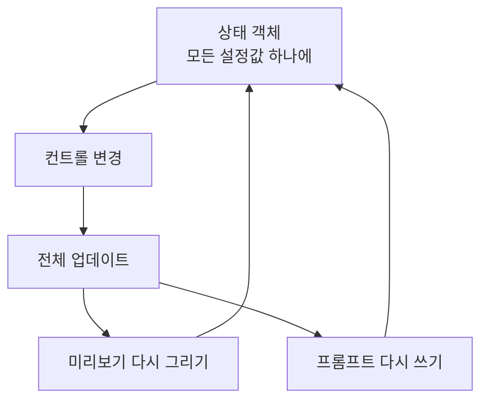

# playground: 디자인 결정, 말로 하지 말고 눈으로 고르세요

> **Summary**
> playground는 클로드 코드에서 시각적 설정을 조정하고 결과를 실시간으로 미리 본 뒤, 선택한 내용을 자연어 프롬프트로 복사해 적용할 수 있게 해주는 공식 스킬입니다. 디자인, 데이터 탐색, 개념도 등 6가지 템플릿을 제공하며, 말로 설명하기 어려운 복잡하고 시각적인 작업에 특히 유용합니다.

---

# playground: 디자인 결정, 말로 하지 말고 눈으로 고르세요

- playground는 클로드 코드 공식 스킬입니다. 컨트롤·실시간 미리보기·프롬프트 복사를 HTML 파일 하나에 담아줍니다.
- 디자인·데이터 탐색·개념도·문서 검토·코드 리뷰·코드맵, 6가지 템플릿 중 맞는 것을 골라 만듭니다.
- 눈으로 고른 뒤 복사한 프롬프트를 붙여넣으면, 한 번에 원하는 결과가 나옵니다!

디자인 수정을 요청했는데, 결과가 매번 아쉬웠던 적 있으시죠? "조금 더 세련되게 해주세요"라고 말했는데, 돌아온 화면은 전혀 다른 느낌이었습니다. 문제는 실력이 아니라 번역이었습니다. 눈에 보이는 감각을 말로 옮기는 순간, 절반이 사라집니다!

🎥 [동영상 보기](https://www.youtube.com/watch?v=C0hboBvJmBo)

## playground, 도대체 뭘까요?

playground는 클로드 코드의 공식 스킬입니다. 플러그인 메뉴에서 찾아 켜면, 클로드 코드가 대화형 HTML 플레이그라운드를 만들어줍니다. 왼쪽에는 슬라이더·드롭다운 같은 컨트롤이, 오른쪽에는 실시간 미리보기가, 아래쪽에는 프롬프트 출력과 복사 버튼이 있습니다. CSS와 자바스크립트를 모두 파일 안에 인라인으로 넣어서, 외부 의존성이 없습니다. CDN이 멈춰도 플레이그라운드는 그대로 돕니다!

## 어떻게 돌아갈까요?

먼저 주제에 맞는 템플릿을 고릅니다. 디자인 결정·데이터 탐색·개념도·문서 검토·코드 리뷰·코드맵, 6가지입니다. 주제에 딱 맞는 것이 없으면 가장 가까운 것을 골라 바꿔 씁니다. 하나의 상태 객체가 모든 설정값을 갖고 있습니다. 컨트롤을 움직일 때마다 미리보기와 프롬프트가 즉시 다시 그려집니다. 적용 버튼은 없습니다! 프롬프트 출력도 값 나열이 아닙니다. 기본값과 다른 선택만 자연스러운 문장으로 적어줍니다. 그래서 복사해서 붙여넣기만 하면 됩니다.

## 6가지 템플릿, 뭐가 있을까요?

## 실제로 얼마나 빠를까요?

실전 사례가 있습니다. 쇼핑몰 상품 페이지를 다시 디자인하는 데, 1,253줄짜리 HTML 파일이 약 30초 만에 만들어졌습니다. 프리셋 5개, 컨트롤 그룹 7개(레이아웃·갤러리·타이포그래피·카드·버튼·탭·색상)가 들어갔습니다. 왼쪽에서 슬라이더를 움직이면 오른쪽 미리보기가 즉시 바뀝니다. 마음에 드는 조합을 찾으면, 아래쪽에 이미 프롬프트가 쓰여 있습니다. 복사, 붙여넣기, 실행. 한 번에 끝납니다!

이 부분이 저는 가장 인상 깊었습니다. 시각적 직관을 말로 번역하는 일을, 플레이그라운드가 대신 해준다는 점이요!

## 언제 쓰면 좋을까요?

입력 공간이 크고, 시각적이고, 구조적일 때 씁니다. 말로 설명하기 어려운 주제가 딱 맞습니다. 반대로 작은 일회성 수정에는 필요 없습니다. 컨트롤 몇 개만 바꾸는 일이라면, 그냥 말로 시키는 게 빠릅니다.

## 설치는 어떻게 할까요?

클로드 코드에서 `/plugin`을 열고 Discover 탭으로 간 뒤, "playground"를 검색해 스페이스바로 켜면 됩니다. 30초면 끝납니다! 설치가 끝나면 클로드 코드가 플레이그라운드를 만들 줄 알게 됩니다. 파일을 만든 뒤에는 브라우저에서 바로 열어 확인합니다.

## 주의할 점은 없을까요?

몇 가지 실수가 반복됩니다. 프롬프트를 값 나열로 쓰면 안 됩니다. 자연스러운 지시문으로 써야 합니다. 컨트롤이 너무 많으면 관심사별로 묶고, 고급 설정은 접을 수 있는 섹션에 숨깁니다. 미리보기가 즉시 바뀌지 않으면, 컨트롤 변경마다 다시 그리도록 해야 합니다. 기본값과 프리셋이 없으면 첫 화면이 비어 보입니다. 외부 의존성을 쓰면 안 됩니다. 프롬프트에 맥락이 부족하면, 플레이그라운드를 보지 않고는 실행할 수 없습니다.

디자인은 말로 설명하는 게 아니라, 눈으로 고르는 것입니다. playground는 그 고르는 과정을 클로드 코드 안에 넣어줍니다.

