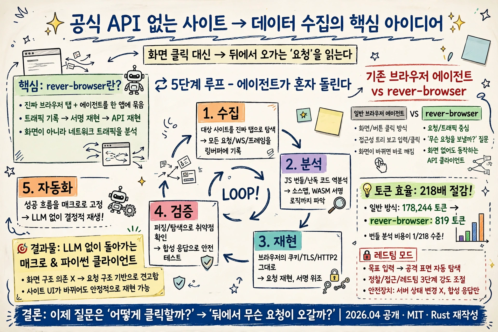
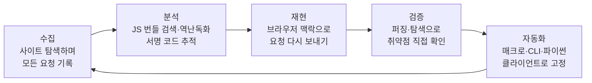
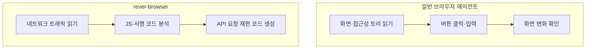

# rever-browser: 브라우저 에이전트에게 클릭이 아니라 트래픽을 보게 합니다

> **Summary**
> 공식 API가 없는 사이트에서 에이전트는 화면을 클릭하는 대신 뒤에서 오가는 요청을 읽습니다. rever-browser는 진짜 브라우저 탭과 에이전트를 한 앱에 묶어, 트래픽 기록부터 서명 재현까지 다섯 단계 루프로 이어지게 만듭니다. 마지막에는 LLM 없이 돌아가는 매크로와 파이썬 클라이언트가 남고, 토큰은 일반 방식보다 최대 218배 적게 듭니다.

---

- 공식 API가 없는 사이트, 에이전트는 화면을 클릭하는 대신 뒤에서 오가는 요청을 읽습니다.
- `rever-browser`는 진짜 브라우저 탭과 에이전트를 한 앱에 묶어, 트래픽 기록부터 서명 재현까지 이어지게 만듭니다.
- 다섯 단계 루프가 돌고, 마지막에는 LLM 없이 돌아가는 매크로와 파이썬 클라이언트가 남습니다.


공식 API가 없는 사이트에서 데이터를 가져와야 할 때, 어떻게 하시나요? 보통은 브라우저 개발자 도구를 열고 네트워크 탭을 뒤집니다. 어떤 요청이 가는지, 헤더는 뭘 붙이는지, 서명은 어떻게 만드는지 하나씩 따라가죠. 그런데 이 과정을 에이전트에게 통째로 맡기면 어떨까요? `rever-browser`는 바로 그 일을 하는 데스크톱 브라우저입니다!

🎥 [동영상 보기](https://www.youtube.com/watch?v=k-kSgQ_7ukc)

## 웹 리버싱, 도대체 뭘까요?

웹 리버싱은 사이트가 서버와 주고받는 요청을 관찰해, 그 API를 알아내는 일입니다. 화면에 보이는 건 결과물일 뿐입니다. 진짜 일은 뒤에서 일어납니다. 로그인할 때 어떤 요청이 가는지, 검색어를 칠 때 어떤 본문이 실리는지, 서명은 어떤 순서로 계산되는지. 이걸 알아내면 화면을 클릭하지 않고도 같은 요청을 보낼 수 있습니다.

그래서 리버싱의 결과물은 스크린샷이 아니라 코드입니다. "이 사이트가 무슨 요청을 보내지?"에서 "이 API를 그대로 재현하는 코드"까지 이어지는 게 목표입니다. 공식 API가 없어도, 사이트가 이미 쓰는 내부 API를 그대로 쓰는 셈입니다.

## 다섯 단계, 에이전트가 혼자 돕니다?

`rever-browser` 안에서 리버싱은 다섯 단계 루프로 돕니다. 에이전트가 스스로 단계를 옮기고, 모든 과정이 화면에 보입니다.



**수집**부터가 다릅니다. 대상 사이트를 앱 안의 진짜 탭에서 평소처럼 탐색하면, 엔진 안의 네트워크 탭이 모든 요청을 링 버퍼에 기록합니다. 웹소켓 연결과 프레임까지 잡힙니다. **분석**에서는 JS 번들을 검색하고, 난독화된 코드를 풀고, 소스맵에서 원래 코드를 되찾고, 웹어셈블리를 뜯어봅니다. 서명 로직이 웹어셈블리 안에 숨어 있어도 놓치지 않습니다.

**재현**은 브라우저 자신의 맥락으로 요청을 다시 보냅니다. 쿠키, TLS, HTTP/2까지 그대로입니다. 서명을 위조해 화면에 안 보이던 필드를 끌어내는 것도 이 단계입니다. **검증**에서는 퍼징과 탐색으로 취약점을 직접 확인하고, **자동화**에서는 잘 돌아가는 순서를 매크로로 얼려둡니다. 매크로는 LLM 없이 결정적으로 재생됩니다!

## 브라우저 에이전트와 뭐가 다를까요?

대부분의 브라우저 에이전트는 화면을 읽고 클릭하는 방식입니다. 접근성 트리를 보고 버튼을 누르고 입력창을 채웁니다. 화면 자동화에는 잘 맞지만, API를 알아내는 일에는 맞지 않습니다. 화면 뒤에서 무슨 요청이 오가는지는 안 보이니까요.

`rever-browser`는 반대 방향에서 출발합니다. 에이전트가 보는 건 화면이 아니라 트래픽입니다.



일반 에이전트가 "어떻게 클릭할까"를 묻는다면, 이 도구는 "무슨 요청을 보낼까"를 묻습니다. 그래서 결과물도 다릅니다. 클릭 자동화가 아니라, 브라우저 없이 돌아가는 API 클라이언트입니다. 한 번 알아낸 API는 화면이 바뀌어도 잘 안 깨집니다. 화면 구조가 아니라 요청 구조에 기대니까요.

## 레드팀 모드, 혼자서 스캔까지 한다고요?

이 도구에는 레드팀 모드도 있습니다. 목표를 하나 주면, 에이전트가 알아서 공격 표면을 훑습니다. 임시 계정을 만들고 로그인하고, 페이지를 찾아 탭 여러 개를 병렬로 띄워 클릭하고 입력하고 제출하면서 탐색합니다. 강도는 세 단계입니다. **정찰**은 관찰만 하고, **접근**은 캡처한 요청을 그대로 재생하고, **레드팀**은 변형된 탐색까지 더합니다.

여기서 안전장치가 하나 있습니다. 내 컴퓨터나 실험실 목표가 아니면, 서버 상태를 바꾸는 요청은 아예 보내지 않습니다. 대신 합성 응답으로 답하고 끝점 모양만 기록합니다. 서버를 건드리지 않고도 취약점을 확인할 수 있게 만든 울타리입니다. 단, 이 울타리가 있다고 해서 아무 사이트나 건드려도 되는 건 아닙니다. 허가받은 대상에만 써야 합니다!

## 토큰이 218배나 적게 든다고요?

에이전트에게 브라우저를 맡길 때 가장 아까운 건 토큰입니다. 번들 하나를 통째로 읽히면 컨텍스트가 금방 찹니다. 이 도구는 필요한 조각만 건네는 방식으로 이 문제를 풀었습니다. 번들 전체가 아니라 검색 결과 한 줄, 서명을 계산하는 코드 전체가 아니라 캡처한 서명 하나만 주는 식입니다.

측정 결과도 있습니다. 서명된 요청 하나를 재현하는 데 일반 브라우저 도구 방식은 6,365토큰, 이 도구는 2,355토큰이 들었습니다. 422KB짜리 실제 번들에서 서명 코드를 찾는 작업은 178,244토큰에서 819토큰으로 줄었습니다. **218배 차이입니다!** 목표가 커져도 비용이 거의 안 늘어나는 구조라서, 큰 사이트를 뜯을수록 차이가 벌어집니다.

## 지금 쓰려면 뭘 알아야 할까요?

이 도구는 아직 젊습니다. 2026년 4월에 처음 공개됐고, 별은 60개 남짓입니다. 그리고 2026년 11월 19일에 큰 변화가 있었습니다. 기존 전자 기반 앱을 걷어내고 러스트로 다시 쓴 것입니다. 그래서 지금은 소스에서 직접 빌드해야 하고, 설치 파일은 아직 없습니다. 도구 수는 공개 당시 46개에서 지금은 170개가 넘었고, 기본 에이전트는 클로드 코드 하나입니다. 다른 에이전트는 아직 연결되지 않았습니다. 라이선스는 MIT입니다.

```bash
./scripts/apply-rust-patches.sh
cargo run -p rever -- <url>
```

소스 빌드라 진입 장벽은 있지만, 방향은 분명합니다. 브라우저 에이전트의 다음 질문은 "화면을 어떻게 클릭할까"가 아니라 "뒤에서 무슨 요청이 오갈까"입니다. 내 사이트의 보안 검사를 해보고 싶다면, 이 도구가 그 질문에 답하는 가장 직접적인 방법입니다!

