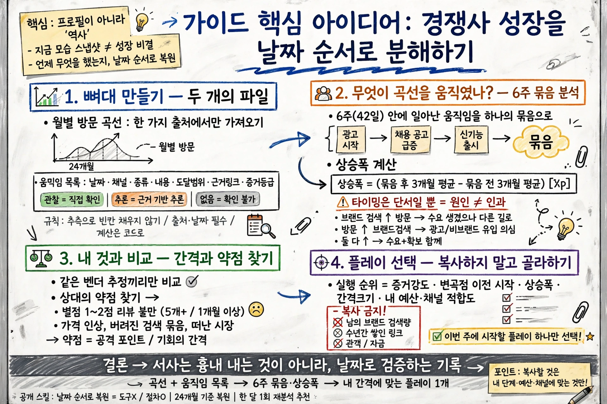
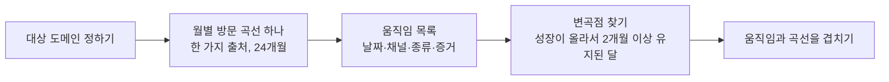
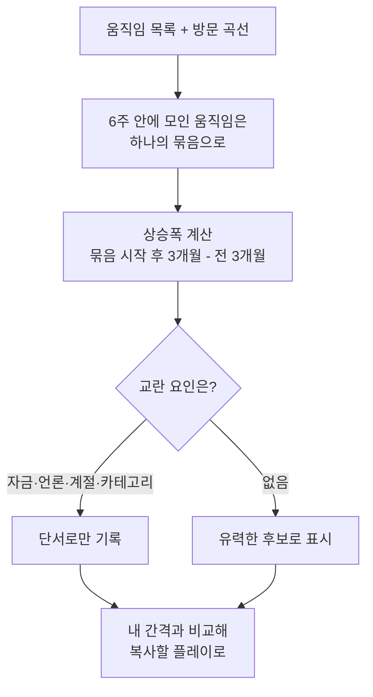

# reverse-engineer-marketing: 경쟁사가 커진 이유, 말이 아니라 날짜로 읽습니다

> **Summary**
> 경쟁사의 성장은 현재 모습이 아니라 월별 방문 추이와 날짜별 움직임을 함께 살펴 시간 순서로 분석해야 합니다. 6주 안의 움직임을 묶어 성장 변화와 비교하되, 상관관계를 원인으로 단정하지 말고 자금 유치·언론 보도·계절성 같은 교란 요인도 고려합니다. 증거와 출처를 기록하고 자사와의 간격, 예산, 채널 적합성을 바탕으로 실행할 플레이 하나를 고르며, 브랜드 검색량이나 오래 쌓인 링크처럼 가져올 수 없는 자산은 따라 하려 하지 않습니다.

---

- 경쟁사가 어떻게 컸는지 알려면 지금 모습이 아니라 날짜 순서로 읽어야 합니다. 월별 방문 곡선과 날짜가 찍힌 움직임 목록이 뼈대입니다.
- 움직임이 몰린 6주 묶음을 곡선과 겹쳐 보면 무엇이 성장과 함께 왔는지 보입니다. 다만 함께 왔다는 것이 원인이라는 뜻은 아닙니다.
- 복사할 것은 내 단계와 예산, 채널에 맞는 것만 골라야 합니다. 남의 브랜드 검색량이나 쌓인 링크는 가져올 수 없습니다.

경쟁사 사이트를 열어봤습니다. 어느 날 갑자기 검색 결과가 달라지고, 광고가 여기저기 보이고, 채용 공고가 쏟아집니다. 왜 쟤네만 잘될까요?

🎥 [동영상 보기](https://www.youtube.com/watch?v=y7SN4FK8noY)

## 프로필이 아니라 역사입니다 — 왜 날짜 순서인가요?

경쟁사를 소개하는 글은 대부분 지금 모습만 보여줍니다. 가격, 기능, 포지셔닝을 나란히 놓고 비교하는 스냅샷입니다. 그런데 성장의 비결은 스냅샷에 없습니다. 어떻게 여기까지 왔는지가 빠져 있으니까요!

이 글의 원본이 된 공개 스킬은 그 차이를 분명히 합니다. 분해는 프로필이 아니라 역사입니다. 회사가 무엇을 하는지가 아니라, 언제 무엇을 했는지를 날짜 순서로 복원하는 작업입니다. 스킬 버전은 1.2.0이고, 참고 문서가 11개 딸려 있습니다.

원본이 된 공유 글 자체는 직접 읽지 못했습니다. 로그인 벽 뒤에 있어 본문을 확인할 수 없었고, 대신 스킬 저장소의 설명서 전문과 참고 문서를 1차 원본으로 삼았습니다. 원문은 확인하지 못했고, 설명서가 근거라는 점을 밝혀둡니다.

## 뼈대부터 만듭니다 — 곡선 하나와 움직임 목록?

분해의 뼈대는 파일 두 개입니다. 하나는 월별 방문 곡선, 다른 하나는 날짜가 찍힌 움직임 목록입니다.

방문 곡선은 한 가지 출처에서만 가져옵니다. 출처를 섞으면 실제로 일어나지 않은 점프가 생기기 때문입니다. 여기에 브랜드 검색량을 두 번째 신호로 얹습니다. 검색이 아니라 수요가 먼저 움직였는지 가늠할 수 있습니다. 기본 창은 최근 24개월입니다.

움직임 목록은 날짜, 채널, 종류, 내용, 도달 범위, 근거 링크, 증거 등급으로 이뤄진 표입니다. 페이지가 새로 생긴 날, 가격이 바뀐 달, 광고 픽셀이 처음 나타난 달, 홈페이지 문구가 바뀐 달이 한 줄씩 쌓입니다. 모든 단계가 이 표에 행을 더합니다.

증거에는 등급이 붙습니다. **관찰**은 페이지나 데이터가 직접 보여주는 것, **추론**은 관찰에서 이유를 댄 것, **없음**은 찾아봤는데 나오지 않은 것입니다. 빈칸을 추측으로 메우지 않는 것이 규칙입니다. 수치는 출처와 날짜를 달고 씁니다. "월 방문 약 19만 회(추정치, 2026-10-30 기준)"처럼 말이죠. 계산은 코드가 합니다.

## 움직임은 어디에서 찾나요? — 아홉 단계를 훑어보면?

첫 단계는 무료 수집기입니다. 사이트맵에서 페이지 묶음을 읽고, 아카이브에서 픽셀과 스크립트가 처음 나타난 달을 찾고, 가격과 홈페이지 문구의 변화 이력을 뽑습니다. DNS 기록에서는 쓰는 메일 도구와 연결된 외부 서비스를, 인증서 기록에서는 새 서브도메인이 처음 생긴 날짜를 읽습니다. 새 서브도메인은 출시 며칠 전에 생기는 경우가 많습니다!

두 번째 단계는 퍼널을 걷는 일입니다. 검색 키워드를 페이지 묶음별로 나누고, AI 답변에서 브랜드가 인용되는지를 보고, 광고 라이브러리에서 오래 살아남은 광고를 찾습니다. 45일 넘게 돌아간 광고는 테스트할 가치가 있다는 신호입니다. 다만 성과가 좋다는 뜻은 아닙니다. 가입과 첫 화면, 요금제와 무료 체험, 추천 루프, 채용 공고까지 훑습니다. 채용 공고는 다음에 키울 채널을 예고합니다.

세 번째 단계는 직접 들어가 보는 일입니다. 가입하고, 이메일을 30~60일 모으고, 결제 벽과 해지 화면을 확인합니다. 단, 이 단계는 승인이 먼저입니다. 실명과 본인 도메인의 전용 메일함으로만 진행하고, 직원이나 고객에게는 연락하지 않습니다.

네 번째와 다섯 번째 단계는 팀의 목소리와 숨은 신호입니다. 공개 팟캐스트와 인터뷰, 채용 공고에서 성장 주장을 모아 날짜와 함께 기록하고, "보고된 주장"이라는 꼬리표를 답니다. 숨은 신호로는 뉴스레터 협찬, 팟캐스트 광고, 유튜브 협찬, 제휴 링크, 리뷰 수의 급증, 앱 순위, 다운로드 수 같은 사이트 밖 숫자를 봅니다.

여섯 번째 단계는 콘텐츠 패턴입니다. 채널마다 최근 180일 글 중 10일 이상 지난 것만 골라 상위 3분의 1과 하위 3분의 1을 비교합니다. 채널끼리 순위를 섞지 않습니다. 글이 24개 미만이면 패턴을 부르지 않습니다.

## 무엇이 곡선을 움직였나요? — 묶음과 상승폭으로 따집니다

움직임이 모이면 7단계가 시작됩니다. 6주(42일) 안에 일어난 움직임은 하나의 묶음으로 봅니다. 공은 묶음 전체에 돌립니다.

상승폭은 이렇게 계산합니다. 묶음이 시작된 달부터 3개월 동안의 월평균 성장률에서, 그 전 3개월의 월평균 성장률을 뺍니다. 단위는 퍼센트포인트입니다. 양쪽 6개월이 다 있어야 하고, 시리즈 끝자락에 있는 묶음은 상승폭을 매기지 않습니다.

**타이밍은 단서이지 결론이 아닙니다.** 움직임이 점프보다 먼저 있었다고 해서 원인이라는 뜻은 아닙니다. 같은 시기에 자금 유치, 언론 보도, 계절성, 카테고리 전체의 상승이 겹쳤을 수 있습니다. 상승폭을 보고할 때는 적용되는 교란 요인을 함께 적습니다.

방문 수와 브랜드 검색량을 따로 읽는 것도 요령입니다. 브랜드 검색은 오르고 방문은 그대로라면, 수요는 생겼는데 다른 길로 들어온 것입니다. 방문은 오르고 브랜드 검색이 그대로라면, 브랜드가 아닌 검색 페이지나 광고를 의심해 봅니다. 둘 다 오르면 수요와 확보가 함께 움직인 것이고, 출시나 화제 이후에 흔한 그림입니다.

## 내 것과 비교하면 무엇이 남나요? — 간격과 약점을 봅니다

8단계는 내 회사와의 간격입니다. 같은 벤더의 추정치끼리 비교합니다. 남의 벤더 추정치를 내 실제 분석 숫자와 나란히 놓지 않습니다. 그다음 내 실제 데이터를 깊이 있게 씁니다. 검색 콘솔에서는 남의 잘나가는 페이지 묶음을 내가 갖고 있는지, 분석에서는 내 채널 구성과 가입 전환율을 봅니다.

그리고 방향을 뒤집습니다. 상대의 약점은 어디일까요? 별점 1~2점 리뷰의 불만 주제, 가격 인상, 버려진 검색 묶음, 떠난 시장을 봅니다. 약점 주제가 되려면 다섯 개 이상의 낮은 평가가 한 달 넘게 쌓여야 합니다. 화난 글 하나가 약점이 되지는 않습니다!

9단계는 플레이입니다. 간격을 메우는 행동을 증거 강도, 변곡점 이전 시작 여부, 상승폭, 간격 크기, 내 단계와 예산, 채널 적합도로 순위를 매깁니다. 각 플레이에는 증거와 실행 스킬, 노력(하루·일주일·한 분기), 첫 결과가 나올 시간, 볼 지표, 시도 비용, 그대로 붙여넣을 수 있는 지시가 딸립니다.

복사하지 말아야 할 것도 목록으로 적습니다. **가져올 수 없는 것**입니다. 브랜드 검색량, 수년간 쌓인 링크, 관객, 자금이 그렇습니다. 상대 검색 트래픽의 대부분이 브랜드 이름이라면, 총 방문 수를 모델로 삼지 말라고 못 박습니다. 마지막에는 이번 주에 시작할 플레이 하나만 남깁니다.

## 이 글의 각도는 어디인가요?

비슷한 주제의 앞선 글들과 각도가 다릅니다. 앞서 다룬 역설계 도구 글들은 프로그램 속을 뜯어 기능을 복원하는 도구 자체가 주제였습니다. 코드가 읽히는 시대의 사업 해자를 다룬 글은 시나리오와 그 사업적 함의가 중심이었습니다. 이 글은 다릅니다. 경쟁사의 성장 서사를 마케팅 증거로 날짜 순서대로 복원하는 방법 자체를 다룹니다. 도구가 아니라 방법, 가설이 아니라 절차입니다.

## 결론 — 서사는 흉내 내는 것이 아닙니다

경쟁사의 성장 서사는 흉내 낼 이야기가 아니라 날짜로 검증할 수 있는 기록입니다. 곡선 하나와 움직임 목록에서 시작해, 묶음의 상승폭을 재고, 내 간격에 맞는 플레이 하나를 고릅니다!

공개 스킬 저장소는 별 62,082개, 포크 9,064개(2026-11-23 기준, 깃허브 API 직접 확인), MIT 라이선스입니다. 무료 수집기만 쓰면 빠른 살펴보기는 0원으로 할 수 있고, 전체 분해의 유료 호출 상한은 기본 5달러입니다. 한 달에 한 번씩 다시 돌리면 새 움직임만 골라 보여주는 관찰 모드도 있습니다.

