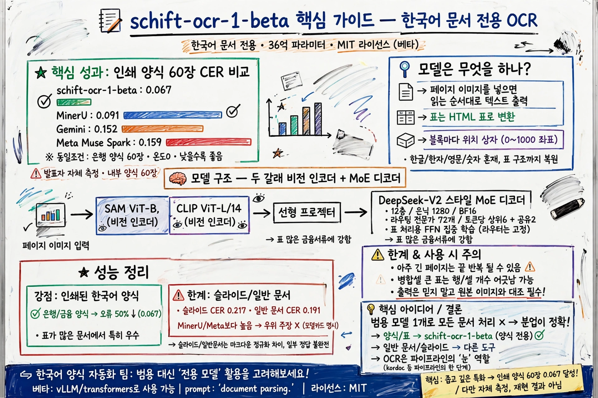
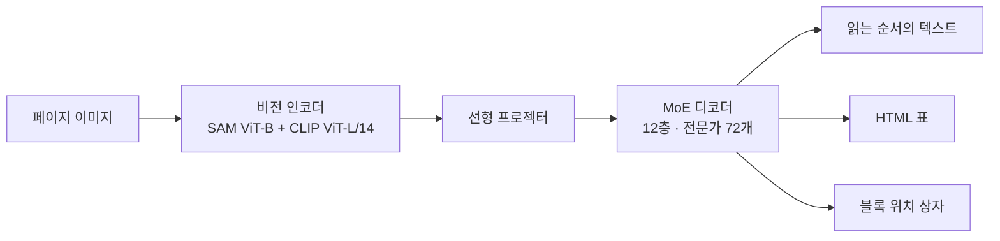
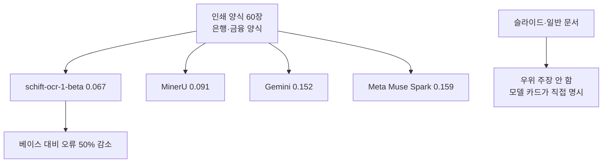

# schift-ocr-1-beta: 한국어 은행 양식 60장, 오류율 0.067로 읽어냅니다

> **Summary**
> schift-ocr-1-beta는 한국어 금융 양식에 특화된 OCR 모델로, 자체 측정한 은행 양식 60장 테스트에서 문자 오류율 0.067을 기록해 비교 모델보다 좋은 성능을 보였습니다. 텍스트와 HTML 표, 블록 위치 정보를 출력하며 MIT 라이선스로 베타 공개됐지만, 슬라이드와 일반 문서에서는 우위를 주장하지 않고 긴 페이지나 복잡한 표는 결과 확인이 필요합니다.

---

- 한국어 문서 전용 OCR 모델이 나왔습니다. 은행 양식 60장 기준 문자 오류율이 0.067로, 같은 조건의 MinerU(0.091), Gemini(0.152), Meta Muse Spark(0.159)보다 낮습니다.
- 페이지 이미지를 넣으면 읽는 순서대로 텍스트를 뱉고, 표는 HTML 표로, 블록마다 위치 상자까지 붙여줍니다. 약 36억 개 파라미터, MIT 라이선스, 베타 공개 가중치입니다.
- 다만 이 숫자는 발표자의 자체 측정입니다. 슬라이드와 일반 문서에서는 우위를 주장하지 않는다고 모델 카드가 직접 밝히고 있습니다.

은행 서류 한 장을 스캔해서 텍스트로 옮겨본 적 있으시죠? 이름, 계좌번호, 금액이 찍힌 표를 눈으로 보면 금방 읽히는데, 기계에 맡기면 숫자가 뒤집히고 칸이 어긋나기 일쑤입니다. 한국어는 더 까다롭습니다. 한글, 한자, 영문, 숫자가 한 줄에 섞이고, 표 안의 작은 글씨가 줄줄이 이어지니까요!

🎥 [동영상 보기](https://www.youtube.com/watch?v=viMxsVoNKxs)

## OCR이 뭐길래, 한국어 문서가 어려울까요?

OCR은 이미지 속 글자를 텍스트로 읽어내는 기술입니다. 그런데 문서 OCR은 글자만 읽으면 끝나지 않습니다. 어디가 제목이고, 어디가 표이며, 표의 어느 칸에 어떤 숫자가 들어가는지까지 알아야 문서가 됩니다. 그래서 요즘 문서 OCR 모델은 글자를 읽는 데서 그치지 않고, 레이아웃과 표 구조까지 함께 뱉어냅니다.

한국어 문서는 이 과제가 유난히 빡셉니다. 은행 양식만 봐도 그렇습니다. 작은 칸에 빽빽한 숫자와 약어가 들어가고, 한자 표기와 영문 약어가 섞입니다. 범용 모델은 영어 문서에서는 잘 읽다가도, 이런 한국어 양식 앞에서는 오류가 확 늘어납니다. 그래서 한국어 문서만 노린 전용 모델이 나오는 것, 그 자체가 소식입니다!

## 이 모델은 어떻게 읽을까요?

이 모델의 이름은 `schift-ocr-1-beta`입니다. 베이스는 `baidu/Unlimited-OCR`이고, 한국어 문서에 맞게 추가 학습을 거쳤습니다. 페이지 이미지를 넣으면 읽는 순서대로 텍스트를 쓰고, 표는 HTML 표로 변환하며, 블록마다 0~1000 좌표의 위치 상자를 붙여줍니다.

구조를 뜯어보면 이렇습니다. 눈 역할을 하는 비전 인코더가 두 갈래입니다. 하나는 SAM ViT-B, 다른 하나는 CLIP ViT-L/14입니다. 두 갈래가 본 이미지를 선형 프로젝터가 디코더 언어로 바꿔 건넵니다. 디코더는 DeepSeek-V2 스타일의 전문가 혼합(MoE) 구조입니다. 12개 층, 은닉 크기 1280, 층마다 72개의 라우팅 전문가가 있고, 토큰 하나마다 상위 6개 전문가와 공유 전문가 2개가 함께 일합니다. 전체 파라미터는 약 36억 개, BF16 정밀도입니다.

학습의 포인트가 재미있습니다. 한국어 문서 추가 학습은 표 내용을 처리하는 전문가 쪽 피드포워드 층에 집중했고, 라우터는 베이스 모델 그대로 두었습니다. 표를 잘 읽는 전문가를 키운 셈입니다. 그래서 은행 양식처럼 표가 많은 문서에서 오류가 크게 줄었습니다.

## 숫자, 어떻게 읽어야 할까요?

모델 카드가 공개한 측정 방식을 먼저 짚겠습니다. 지표는 문자 오류율(CER)입니다. 정답 텍스트와 비교해 틀린 글자 비율을 재고, 페이지마다 1.0으로 상한을 둔 뒤 평균을 냅니다. 낮을수록 좋습니다. 모든 모델을 온도 0, 같은 페이지 이미지로 돌렸습니다.

비교한 문서 세트는 세 가지입니다. 인쇄된 양식 60장(스캔한 한국 은행·금융 양식), 강의 슬라이드 100장, 일반 문서 100장(한국 보고서·간행물)입니다. 결과는 이렇습니다.

| 모델 | 인쇄 양식 | 슬라이드 | 일반 문서 |
| --- | --- | --- | --- |
| schift-ocr-1-beta | **0.067** | 0.217 | 0.191 |
| 베이스 모델 | 0.135 | 0.228 | 0.219 |
| MinerU2.5-Pro | 0.091 | 0.222 | 0.164 |
| PaddleOCR-VL-1.6 | 0.155 | 0.258 | 0.161 |
| Gemini 3.1 flash-lite | 0.152 | 0.391 | 0.178 |
| Meta Muse Spark 1.3 | 0.159 | 0.410 | 0.132 |

인쇄 양식에서는 베이스 모델 대비 오류가 50% 줄었습니다. 그런데 슬라이드와 일반 문서에서는 이야기가 달라집니다. 슬라이드 0.217, 일반 문서 0.191로, 일반 문서에서는 MinerU나 Meta 모델보다 오류율이 높습니다. 모델 카드도 이 점을 숨기지 않습니다. 슬라이드와 일반 문서 점수는 각 모델 출력의 마크다운 표기 정규화 방식에 따라 달라지고, 슬라이드 정답 중 일부가 불완전해서, 이 두 세트에서는 우위를 주장하지 않는다고 직접 적어두었습니다!

그래서 숫자를 읽는 기준이 분명해집니다. 이 모델의 강점은 인쇄된 한국어 양식, 특히 표가 많은 금융 서류입니다. 범용 문서 리더로서 모든 종류를 제쳤다는 뜻이 아닙니다. 발표자의 자체 측정이라는 점도 함께 기억해야 합니다. 내부 양식 60장이라는 조건이 붙은 숫자이고, 독립 기관이 같은 조건으로 재현한 결과가 아닙니다. 팀이 따로 운영하는 공개 한국어 OCR 벤치마크도 있으니, 관심 있으시면 그쪽 점수와 함께 보는 것이 좋습니다.

## 파싱 파이프라인이랑 뭐가 다를까요?

여기서 한 가지를 분명히 짚겠습니다. 이 글은 OCR 모델 자체 이야기입니다. 문서 파일을 받아서 구조화하는 파이프라인 이야기가 아닙니다. 예전에 다룬 `kordoc`이 HWP·PDF 파일을 통째로 받아 파싱하는 파이프라인이라면, 이 모델은 그 파이프라인 안에서 "이미지를 텍스트로 읽는 눈" 역할을 하는 부품에 가깝습니다. 파이프라인은 파일 형식 처리, 페이지 분할, 후처리까지 묶은 전체 공정이고, OCR 모델은 그중 한 단계입니다. 둘을 헷갈리면 안 됩니다!

## 실제로 쓰려면 어떻게 할까요?

모델은 MIT 라이선스로 공개된 베타 가중치입니다. 다만 더 좋은 버전은 API로만 제공한다고 모델 카드가 밝히고 있습니다. 공개된 베타는 `vLLM`으로 서빙하거나 `transformers`로 직접 불러서 쓸 수 있습니다. `vLLM`에서는 원격 코드를 신뢰하는 옵션과 함께 서빙하고, 페이지 이미지와 함께 `document parsing.`이라는 프롬프트를 보내면 됩니다. 출력은 블록마다 종류와 위치 상자가 붙은 형태라, 표를 골라내거나 특정 칸만 뽑는 후처리가 가능합니다.

한계도 베타답게 적혀 있습니다. 아주 긴 페이지는 끝부분이 반복되는 경우가 있고, 병합 셀이 많은 큰 표는 행마다 셀 개수가 어긋날 수 있습니다. 금융 양식처럼 표가 빡빡한 문서에서 쓴다면, 이 두 가지는 직접 확인해보는 것이 좋습니다. 정확도가 생명인 서류라면, 모델이 뱉은 표를 그대로 믿지 말고 원본 이미지와 한 번 대조하는 습관이 필요합니다!

## 그래서, 이 모델을 어떻게 보면 좋을까요?

한국어 문서 전용이라는 선택이 인상 깊었습니다. 범용 거대 모델과 정면으로 붙는 대신, 한국어 양식이라는 좁은 땅에서 정확도를 끌어올렸으니까요. 인쇄 양식 60장 기준 오류율 0.067이라는 숫자는 그 선택이 통했다는 신호입니다. 물론 숫자의 조건(내부 양식 60장, 자체 측정)을 빼고 보면 안 됩니다. 슬라이드와 일반 문서에서는 우위를 주장하지 않는다는 솔직한 단서까지 포함해서, 이 모델의 자리를 잡는 것이 맞습니다.

문서 자동화가 필요한 팀이라면, 범용 모델 하나로 모든 문서를 처리하려는 생각부터 내려놓는 것이 어떨까요? 양식은 양식 전용 모델에게, 일반 문서는 다른 도구에게 맡기는 분업이 더 정확할 수 있습니다. 한국어 양식을 많이 다루신다면, 이 베타 모델을 한 번 돌려보는 것부터 시작해 보시는 것이 어떨까요?

