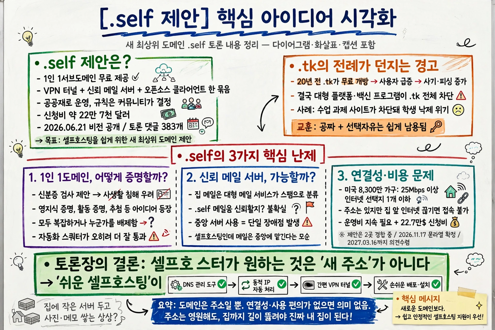
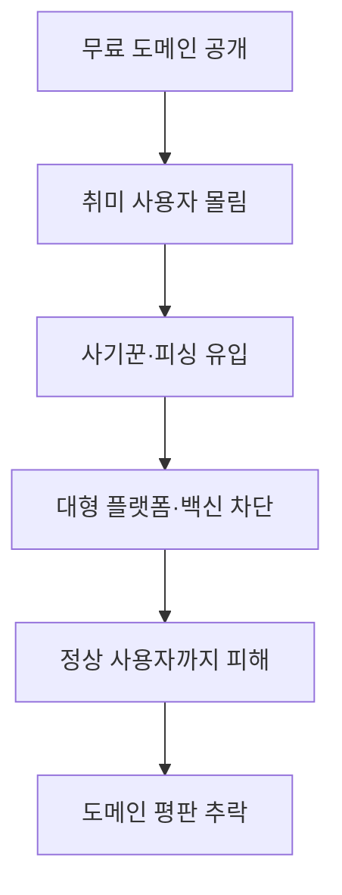
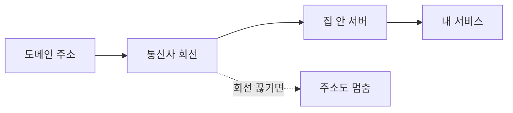
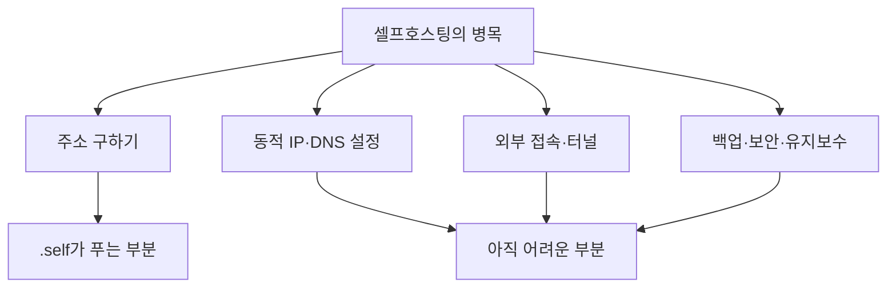

# .self: 공짜 도메인에 박수치기 전에, 무료 도메인의 전례부터 봐야 합니다

> **Summary**
> .self 제안에 토론장은 환호보다 20년 전 무료 도메인 .tk의 전례부터 꺼냈습니다. 무료와 자유 선택은 양립이 어렵고, 1인 1도메인 증명과 공유 메일 신뢰도 아직 답이 없습니다. 결론적으로 토론장은 새 주소보다 쉬운 셀프호스팅을 원했습니다.

---

- `.self` 제안이 나오자 토론장은 환호보다 20년 전 무료 도메인 `.tk`의 전례부터 꺼냈습니다.
- 무료와 자유 선택은 양립이 어렵고, 1인 1도메인을 증명할 방법도, 공유 메일을 믿게 할 방법도 아직 답이 없습니다.
- 그래도 토론이 남긴 결론은 분명합니다. 셀프호스터가 바라는 건 새 주소가 아니라 쉬운 셀프호스팅입니다.

집에 작은 서버 하나 두고 사진도 올리고 메모도 쌓는 상상, 해보신 적 있으시죠? 주소 하나만 있으면 될 것 같았습니다. 그런데 새 최상위 도메인 `.self` 제안이 토론장에 오르자, 반응은 축하보다 검증에 가까웠습니다!

🎥 [동영상 보기](https://www.youtube.com/watch?v=-XgnMOoVF0A)

## 제안은 이렇습니다

`.self`는 셀프호스팅을 위해 밑바탕부터 설계된 새 최상위 도메인 제안입니다. 1인 1서브도메인 무료, VPN 터널과 신뢰 메일 서버 같은 공유 서비스, 오픈소스 클라이언트까지 한 묶음입니다. 공공재로 운영되고 규칙은 커뮤니티가 정합니다. 신청비는 약 22만 7천 달러, 2026년 6월 21일 비전이 공개됐고 토론에는 383개의 댓글이 달렸습니다. 여기까지는 앞선 글에서 다뤘습니다. 이 글은 그다음, 토론장이 던진 질문들을 따라가 봅니다.

### 무료 도메인, 왜 20년 전 이야기부터 나올까요?

토론장에서 가장 먼저 소환된 이름은 `.tk`였습니다. 20년 전 `.tk`가 무료가 되자 취미 사용자부터 몰렸고, 뒤이어 사기꾼이 따라왔습니다. 결국 대형 플랫폼과 백신 프로그램이 `.tk`를 통째로 차단하기 시작했습니다. 수업 과제 사이트를 `.tk`에 올렸던 한 참여자는 선생님 화면에서 사이트가 열리지 않아 낙제를 걱정해야 했다고 합니다.

무료라는 말 뒤에 오는 질문은 하나입니다. 공짜로 주면서 이름까지 마음대로 고르게 할 수 있을까요? 토론장의 답은 대체로 아니었습니다. 둘 다 주면 스쿼팅으로 쓸모가 없어지고, 피싱 때문에 여기저기서 차단된다는 겁니다. 대안으로 나온 말이 재밌습니다. 이름을 못 고르게 하고 단어 세 개 조합 같은 무작위 이름을 나눠주자는 제안입니다. 공짜를 지키려면 선택을 포기해야 한다는 뜻입니다!

### 1인 1도메인, 사람은 어떻게 증명할까요?

`.self`의 핵심 약속은 1인 1서브도메인입니다. 파킹도, 스쿼팅도, 재판매도 안 됩니다. 그런데 한 사람임을 어떻게 증명할까요? 신분증 검사가 먼저 떠오르지만, 토론장에서는 시작부터 반대가 나왔습니다. 사생활 침해라는 이유도 있지만, 더 날카로운 지적이 있었습니다. 사기꾼은 신분증도 더 구할 수 있다는 겁니다. 사기로 모은 신분증으로 도메인을 더 받는 식입니다.

영지식 증명, 사용 증명, 추첨, 양도 금지 같은 아이디어도 나왔습니다. 하지만 하나같이 복잡하거나 누군가를 배제한다는 평가를 받았습니다. 활동 여부를 재는 방법도 마찬가지입니다. 꾸준히 쓰는 사람보다 자동화한 스쿼터가 검사를 더 잘 통과할 수 있다는 지적이 나왔습니다.

제안 쪽 답변도 있었습니다. ICANN 평가 과정에서 검토하고, 남용자는 찾아서 취소할 수 있다는 겁니다. 다만 비용이 문제이고, 평판 보호가 최우선이라 사용에 일정한 제한을 둘 수밖에 없다는 단서도 붙었습니다. 약속은 분명한데, 지키는 방법이 아직 확정되지 않은 상태입니다.

### 공유 메일, 누가 믿어줄까요?

`.self`는 신뢰 메일 서버를 함께 운영하겠다고 했습니다. 집에서 메일을 직접 보내면 대형 메일 서비스가 스팸으로 치기 쉬우니, 믿을 만한 서버를 공유하겠다는 발상입니다. 그런데 토론장의 반응은 회의적이었습니다. 대형 메일 서비스가 `.self` 메일을 과연 신뢰해줄지, 아무도 장담하지 못했습니다.

더 근본적인 지적도 있었습니다. 셀프호스팅을 하자면서 메일은 중앙 서버에 맡기는 게 맞느냐는 겁니다. 중앙 메일은 편리하지만, 단일 장애점이자 남용의 표적이 될 수 있습니다. 메일 하나를 위해 중앙을 다시 세우는 셈이라는 지적입니다!

### 도메인이 있어도, 집까지 길이 없으면요?

가장 뼈아픈 지적은 따로 있었습니다. 도메인은 주소일 뿐, 연결성을 해결하지 못한다는 겁니다. 미국에서는 8,300만 가구가 25Mbps 이상 광대역 선택지가 하나 이하라고 합니다. 주소는 영원히 내 것이어도, 그 주소로 오는 길은 통신사 손에 달려 있습니다. 집 앞 인터넷이 끊기면 `.self` 주소도 같이 멈춥니다.

비용 문제도 있습니다. 신청비 약 22만 7천 달러에 운영비까지 더해집니다. 후원과 기부로 메우겠다는 계획인데, 토론장에서는 레츠 인크립트와 비교하며 고개를 갸웃했습니다. 그쪽은 처음부터 거대 기관의 후원을 받았고, 기술 계획도 구체적이었다는 겁니다. `.self` 신청은 2곳이 경합 중이고, 2026년 11월 17일 문자열이 확정돼 평가가 진행 중입니다. 공개 의견 수렴은 2027년 3월 16일까지 이어집니다.

### 셀프호스터가 진짜 바라는 건 뭘까요?

토론장에서 가장 많이 나온 질문은 따로 있었습니다. 새 최상위 도메인이 꼭 필요할까요? 기존 도메인으로도 다 된다는 겁니다. 저렴한 `.xyz`, `.me` 같은 도메인, 집 안에서만 쓰는 `.home.arpa`나 `.local`도 있습니다. 도메인부터 만드는 건 가장 어려운 사이드 퀘스트부터 푸는 것이라는 표현까지 나왔습니다.

셀프호스터가 진짜로 바라는 건 따로 있다는 겁니다. DNS 도구, 동적 IP 처리, 터널, 쉬운 배포 같은 것들입니다. 주소가 문제가 아니라, 집에서 서버를 굴리는 일 자체가 어렵다는 겁니다. 새 주소보다 쉬운 셀프호스팅이 먼저라는 목소리입니다!

## 그래서, `.self`는 어떻게 봐야 할까요?

토론장의 결론은 생각보다 단순합니다. 제안의 방향은 응원받았지만, 풀어야 할 숙제가 주소보다 많다는 겁니다. 무료의 남용, 사람의 증명, 메일의 신뢰, 연결의 한계, 운영의 비용까지, 도메인 하나로는 답이 안 되는 질문들입니다.

그래도 토론 자체가 의미가 없었던 건 아닙니다. 셀프호스팅의 병목이 어디인지, 사람들이 무엇을 바라는지, 383개의 댓글이 꽤 정확히 짚어줬습니다. 주소는 영원할 수 있습니다. 하지만 집까지 길이 뚫려야 진짜 내 집이 됩니다!

