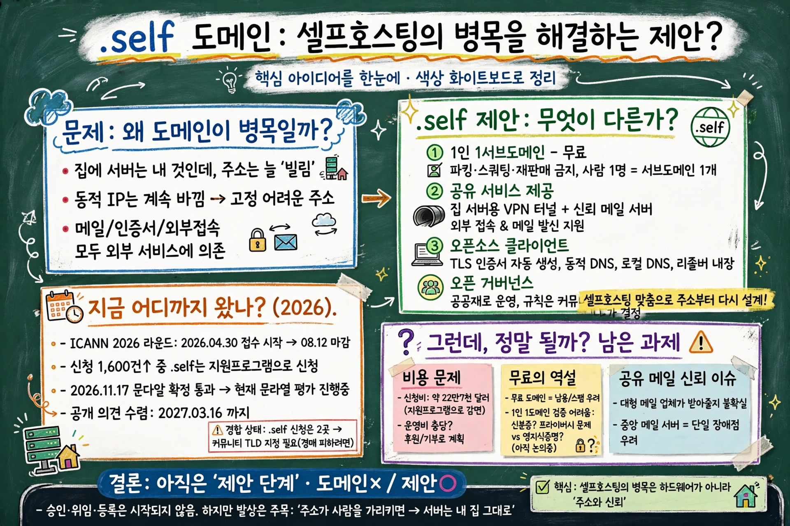
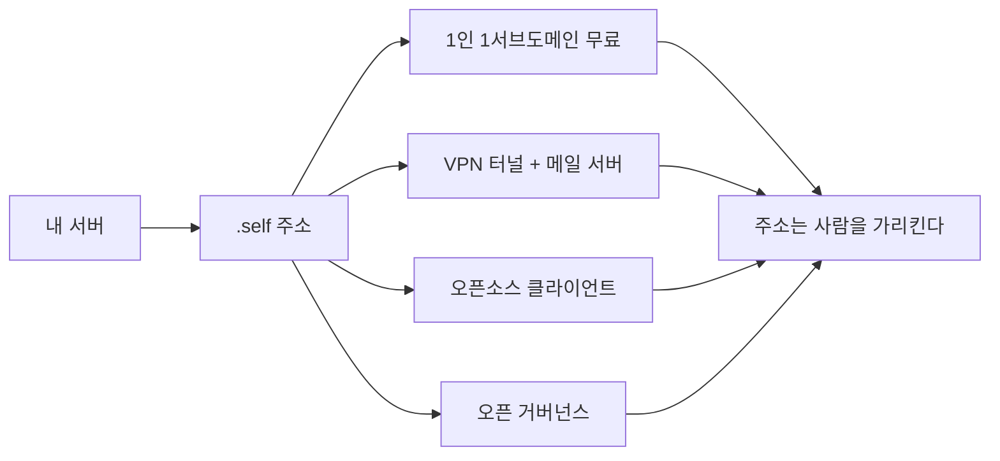
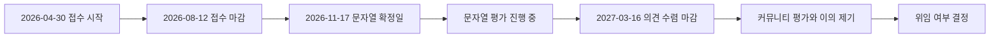
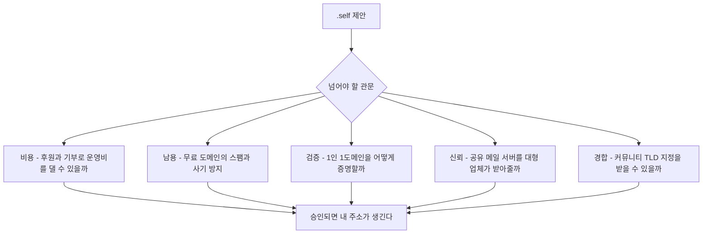

# .self: 내 서버의 주소, 빌리는 게 아니라 갖는 겁니다

> **Summary**
> 셀프호스팅 전용 최상위 도메인 .self가 ICANN 2026 라운드에 신청됐습니다. 1인 1서브도메인 무료, VPN 터널과 신뢰 메일 서버 같은 공유 서비스, 오픈소스 클라이언트까지 한 묶음이고, 공공재로 운영되며 규칙은 커뮤니티가 정합니다. 다만 아직은 제안 단계라, 22만 7천 달러의 신청비와 무료 도메인의 남용 우려, 1인 1도메인 검증 문제, 경합 신청자까지 넘어야 할 관문이 많습니다.

---

- 집에 둔 서버에 내 이름을 붙이는 주소가 따로 나옵니다. 셀프호스팅 전용 최상위 도메인 `.self`가 ICANN 2026 라운드에 신청됐습니다.
- 1인 1서브도메인 무료, VPN 터널과 신뢰 메일 서버 같은 공유 서비스, 오픈소스 클라이언트까지 한 묶음입니다. 공공재로 운영되고 규칙은 커뮤니티가 정합니다.
- 다만 아직은 제안 단계입니다. 22만 7천 달러의 신청비, 무료 도메인의 남용 우려, 1인 1도메인 검증 문제까지 넘어야 할 산이 많습니다.

집에 작은 서버 하나 두신 적 있으시죠? 사진 백업부터 메모, 파일 공유까지 내 컴퓨터에서 돌아가면 마음이 놓입니다. 그런데 주소가 문제입니다. 집 IP는 바뀌고, 빌린 도메인은 업체가 바뀌면 같이 흔들리고, 플랫폼 주소를 쓰면 내 데이터가 남의 땅에 얹힌 기분이 듭니다. 서버는 내 것인데, 주소는 늘 빌린 것이었습니다!

🎥 [동영상 보기](https://www.youtube.com/watch?v=hzWcJU2pzRk)

## 도메인이 왜 셀프호스팅의 병목일까요?

셀프호스팅의 어려움은 대개 하드웨어나 설치에 있다고 생각합니다. 그런데 막상 서버를 띄우고 나면 남는 건 주소 문제입니다. 동적 IP를 어떻게 고정할지, 인증서는 어떻게 갱신할지, 메일은 어떻게 보낼지. 하나하나 풀 수는 있지만, 그때마다 외부 서비스에 기대야 합니다. 주소가 사람을 가리키는 게 아니라, 플랫폼과 업체를 가리키기 때문입니다. 그래서 나온 발상이 있습니다. 도메인부터 셀프호스팅에 맞게 다시 설계하자는 겁니다!

## .self는 뭐가 다른가요?

`.self`는 셀프호스팅을 위해 밑바탕부터 새로 설계된 최상위 도메인 제안입니다. 2026년 6월 21일 비영리 재단이 비전을 공개했고, ICANN 2026 라운드에 신청서를 냈습니다. 핵심은 네 가지입니다.

첫째, 1인 1서브도메인입니다. 한 사람에게 서브도메인 하나를 무료로 줍니다. 파킹도, 스쿼팅도, 재판매도 금지입니다. 이름이 사람을 가리키게 하겠다는 뜻입니다.

둘째, 공유 서비스입니다. 비공개 IP를 위한 VPN 터널과 신뢰할 수 있는 메일 서버를 함께 운영합니다. 집 서버의 고질적인 약점인 외부 접속과 메일 발신을 도메인 쪽에서 받쳐주는 셈입니다.

셋째, 오픈소스 클라이언트입니다. 공유 메일과 VPN을 쓰는 클라이언트에 `TLS` 인증서 생성, 동적 DNS, 캐싱이 되는 로컬 DNS 리졸버까지 들어갑니다.

넷째, 오픈 거버넌스입니다. `.self`는 공공재로 운영되고, 모든 기능과 규칙은 커뮤니티 입력에 따라 정해집니다. 규칙을 정하는 주체가 따로 있는 게 아니라, 쓰는 사람들이 함께 정합니다!

## 신청은 어디까지 왔나요?

ICANN의 2026 라운드는 2026년 4월 30일에 문을 열었고, 8월 12일에 접수를 마감했습니다. 신청은 1,600건이 넘었고, 그중 46건이 지원 프로그램 신청입니다. `.self`는 지원 프로그램 승인 참여자로 신청했고, 2026년 11월 17일 문자열 확정일을 지나 지금은 문자열 평가가 진행 중입니다. 공개 의견 수렴은 2027년 3월 16일까지 열려 있습니다.

숫자만 보면 순조로워 보입니다. 그런데 한 가지 변수가 있습니다. `.self`를 신청한 곳이 두 곳입니다. 경합 상태라는 뜻입니다. 재단은 커뮤니티 기반 TLD 지정을 요청했는데, 이 지정을 받으면 경매를 피할 수 있습니다. 커뮤니티를 진짜로 대표한다는 걸 증명해야 하는 관문입니다.

## 그런데, 정말 될까요?

좋은 질문입니다. 제안이 예쁘다고 현실이 따라오는 건 아니니까요. 토론에서 나온 의심을 하나씩 짚어보겠습니다.

먼저 비용입니다. 신청비만 약 22만 7천 달러입니다. 지원 프로그램으로 감면은 받았지만, 그래도 큰돈입니다. 운영비도 따로 듭니다. 등록비가 무료인데 운영비를 어디서 충당할까요? 재단은 후원과 기부로 메우겠다는 계획입니다. 기부로 돌아가는 인증 기관을 떠올리면 불가능한 그림은 아닙니다. 다만 그 기관은 처음부터 탄탄한 후원자가 있었다는 지적도 나옵니다.

둘째, 무료의 역설입니다. 무료 도메인은 남용의 표적이 되기 쉽습니다. 20년 전 무료로 풀린 한 최상위 도메인은 스팸과 사기의 온상이 됐고, 결국 대형 플랫폼과 백신에서 차단됐습니다. 공짜 주소가 스팸 주소로 찍히면, 정작 쓰는 사람이 피해를 봅니다. 1인 1도메인을 어떻게 증명할지도 숙제입니다. 신분증을 걷자니 프라이버시와 충돌하고, 영지식 증명 같은 기술적 해법도 아직 논의 단계입니다.

셋째, 공유 메일 서버의 신뢰 문제입니다. 메일을 대신 보내주는 서버가 있어도, 대형 메일 업체가 그 메일을 받아줄지는 별개 문제입니다. 중앙 메일 서버가 생기면 그 자체가 단일 장애점이 된다는 지적도 있습니다. 셀프호스팅을 돕겠다고 중앙 서비스를 하나 더 만드는 셈이 되니까요!

그래서 이 글의 결론은 이렇습니다. `.self`는 아직 도메인이 아니라 제안입니다. 승인도, 위임도, 등록도 시작되지 않았습니다. 하지만 발상 자체는 짚어볼 만합니다. 셀프호스팅의 병목이 하드웨어가 아니라 주소와 신뢰였다는 지적이니까요. 주소가 사람을 가리키면, 서버가 어디에 있든 내 자리는 그대로입니다. 그 약속이 지켜질지는 이제 평가와 토론이 정합니다.

