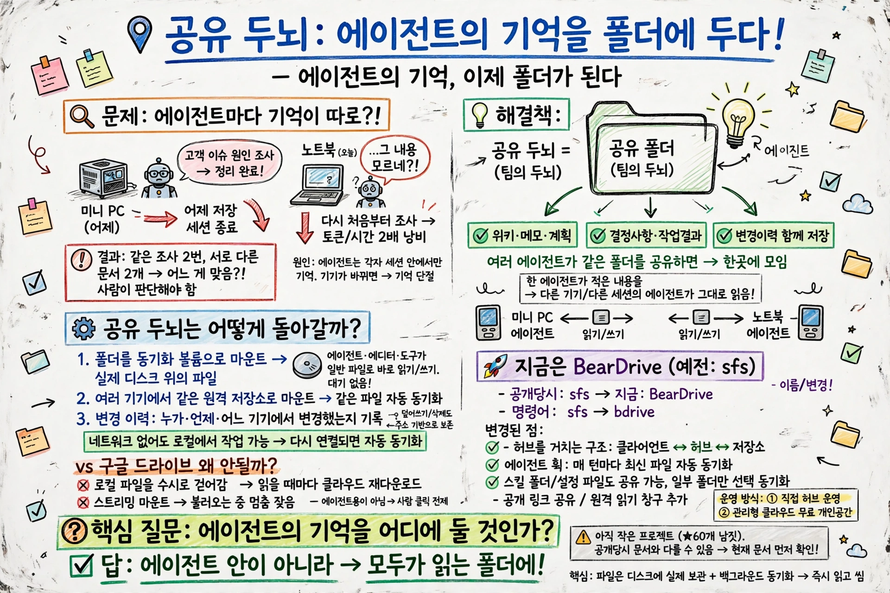
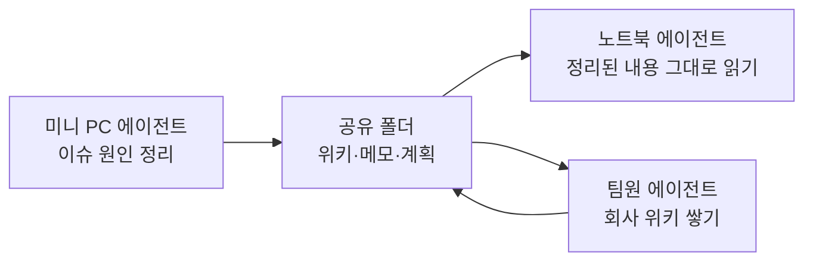
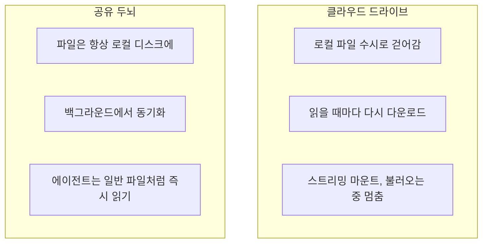

# sfs: 에이전트마다 따로 쌓던 기억, 폴더 하나에 모으면 팀의 두뇌가 됩니다

> **Summary**
> 에이전트는 각자 세션 안에서만 기억해서, 기기가 바뀌면 어제 정리한 내용을 오늘 다른 에이전트가 모릅니다. 여러 에이전트가 폴더 하나를 공유하면 위키·메모·계획이 한곳에 모여 팀의 두뇌가 되고, 파일은 디스크 위의 진짜 파일 그대로 두고 백그라운드에서 동기화합니다. 다만 이 프로젝트는 공개 당시 sfs에서 지금은 BearDrive로 이름과 동기화 방식이 바뀌었고, 아직 별 60개 남짓의 작은 프로젝트라 현재 문서를 먼저 확인해야 합니다.

---

- 어제 한 에이전트가 정리해 둔 결정, 오늘 다른 기기의 에이전트는 모릅니다.
- 여러 에이전트가 폴더 하나를 공유하면, 위키·메모·계획이 한곳에 모여 팀의 두뇌가 됩니다.
- 파일은 디스크 위의 진짜 파일 그대로 두고, 백그라운드에서 동기화합니다.

코딩 에이전트를 노트북과 미니 PC에서 번갈아 쓰다 보면 이런 장면이 있습니다. 어제 미니 PC의 에이전트가 고객 이슈 원인을 찾아 정리해 뒀는데, 오늘 노트북의 에이전트는 그걸 모릅니다. 처음부터 다시 조사합니다. 토큰도 시간도 두 번 듭니다. 왜 그럴까요?

🎥 [동영상 보기](https://www.youtube.com/watch?v=PUlF6_Xe420)

### 에이전트마다 기억이 따로 쌓이면 무슨 일이 생길까요?

에이전트는 각자 자기 세션 안에서만 기억합니다. 기기가 바뀌면, 세션이 바뀌면, 기억도 끊깁니다. 같은 조사를 두 번 하고, 결론이 다른 문서가 두 장 생깁니다. 어느 쪽이 맞는지 사람이 다시 가려야 합니다. 이 장면이 저는 가장 답답했습니다. 기억은 쌓이는데, 쌓인 기억이 이어지지 않으니까요!

공유 두뇌의 발상은 단순합니다. 기억을 에이전트 안에 두지 않고, 폴더에 둡니다. 여러 에이전트가 같은 폴더를 공유하면, 위키·메모·계획 문서·작업 결과물이 한곳에 모입니다. 한 에이전트가 적어둔 결정사항을 다른 기기, 다른 세션의 에이전트가 그대로 읽습니다. 누가 어떤 기기에서 언제 무엇을 바꿨는지도 남습니다.

### 공유 두뇌는 어떻게 돌아갈까요?

핵심은 폴더를 동기화 볼륨으로 마운트한다는 점입니다. 마운트된 폴더의 파일은 디스크 위의 실제 파일입니다. 에디터도, 도구도, 에이전트도 별도 통합 없이 바로 씁니다. 다른 기기에서 같은 원격 저장소로 마운트하면 같은 파일이 따라옵니다. 용례도 구체적입니다. 지원 에이전트와 엔지니어링 에이전트가 고객 이슈 맥락을 함께 보고, 미니 PC와 노트북이 파일 변경을 공유하고, 팀원들이 각자 에이전트에서 회사 위키를 함께 쌓습니다.

바뀐 내용을 확인하는 방법도 있습니다. 변경 이력 명령으로 누가, 언제, 어느 기기에서 어떤 파일을 바꿨는지 봅니다. 내용은 주소 기반으로 저장돼, 덮어쓰거나 지운 파일의 내용도 보존됩니다. 네트워크가 없어도 폴더는 온전히 쓸 수 있고, 복구되면 자동으로 올라갑니다. 동시 편집은 결정적인 순서로 재생해 충돌을 피합니다. 맥과 리눅스에서 돌아갑니다.

### 구글 드라이브로는 안 될까요?

처음엔 드라이브 같은 걸 쓰면 되지 않나 싶었습니다. 그런데 에이전트 워크스페이스로 써 보니 세 가지가 걸렸습니다. 첫째, 드라이브는 디스크를 아끼려고 로컬 파일을 수시로 걷어갑니다. 에이전트가 파일을 읽으려 할 때마다 클라우드에서 다시 받아야 합니다. 둘째, 스트리밍 마운트라 파일을 불러오는 도중에 멈추는 일이 잦습니다. 셋째, 애초에 에이전트용으로 설계된 도구가 아닙니다. 사람이 화면에서 클릭하는 걸 전제로 합니다.

공유 두뇌는 반대로 갑니다. 모든 파일을 항상 로컬 디스크에 실제로 두고, 백그라운드에서 동기화합니다. 에이전트는 일반 파일처럼 즉시 읽고 씁니다. 기다림이 없습니다!

### 이름도 방식도 바뀌었습니다. 지금은 어떨까요?

한 가지는 분명히 짚어야 합니다. 이 프로젝트는 이름이 바뀌었습니다. 공개 당시 `sfs`였던 이름이 지금은 BearDrive가 됐고, 명령어도 `sfs`에서 `bdrive`로 바뀌었습니다. 동기화 방식도 달라졌습니다. 처음에는 원격 저장소를 직접 마운트하는 형태였는데, 지금은 허브를 거치는 형태입니다. 클라이언트는 허브와 통신하고, 저장소는 허브만 봅니다. 충돌 처리도 처음의 결정적 재생 방식에서, 마지막에 쓴 쪽이 이기고 진 쪽은 충돌 파일로 남기는 방식으로 바뀌었습니다.

대신 새로 생긴 것도 많습니다. 에이전트 훅이 매 턴마다 최신 파일을 당겨오고, 편집 뒤에는 바로 올립니다. 스킬 폴더와 설정 파일도 일반 파일이라 팀 전체에 함께 퍼집니다. 일부 폴더만 골라 동기화할 수도 있고, 파일을 공개 링크로 공유하거나 원격으로 읽는 창구도 생겼습니다. 운영 방식은 두 가지입니다. 직접 허브를 띄워 쓰거나, 관리형 클라우드의 무료 개인 공간을 쓰는 겁니다.

그럼에도 아직은 작은 프로젝트입니다. 별이 60개 남짓이라, 도입 전에 직접 써 보는 게 맞습니다. 이름과 방식이 바뀐 만큼, 공개 당시 글만 보고 설치하면 지금 문서와 어긋날 수 있습니다. 현재 문서를 먼저 확인하세요!

공유 두뇌의 질문은 결국 하나입니다. 에이전트의 기억을 어디에 둘 것인가? 답은 에이전트 안이 아니라, 모두가 읽는 폴더입니다!

