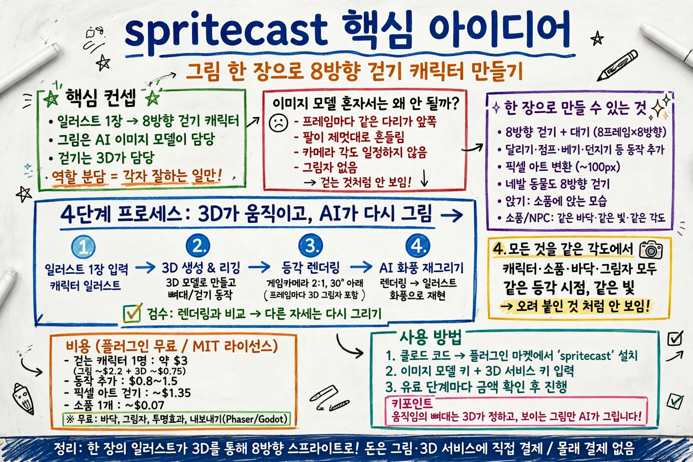
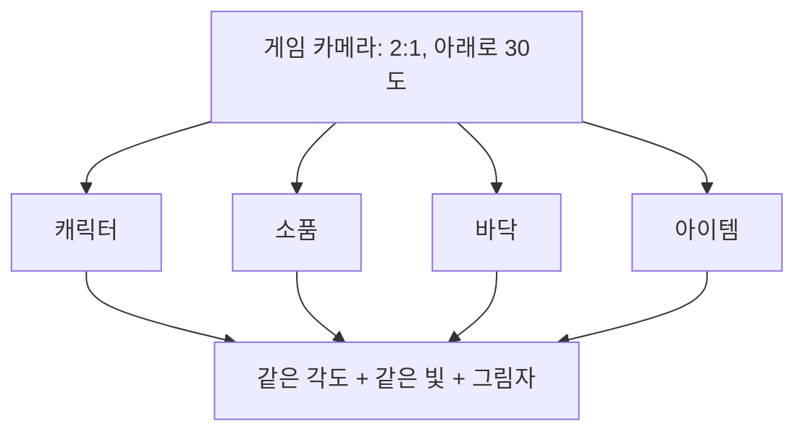

# spritecast: 일러스트 한 장으로 8방향 걷기 스프라이트를 만듭니다. 그리는 건 AI, 걷는 건 3D입니다

> **Summary**
> spritecast는 일러스트 한 장에서 8방향 걷기 스프라이트를 만드는 무료 MIT 라이선스 클로드 코드 플러그인입니다. 걷는 일은 3D가 하고, 이미지 모델은 각 프레임을 일러스트의 화풍으로 다시 그리기만 합니다. 캐릭터·소품·바닥·아이템까지 전부 같은 게임 카메라 각도에서 나오니, 등각 게임이 오려 붙인 것처럼 보이지 않습니다. 플러그인 자체는 무료이고, 그림과 3D 비용만 각 서비스에 직접 냅니다. 걷는 캐릭터 한 명은 약 3달러, 소품 하나는 약 0.07달러이고, 유료 단계마다 금액을 확인받고 진행합니다.

---

- 일러스트 한 장이면 게임 캐릭터가 8방향으로 걷습니다. 그리는 건 이미지 모델이, 걷게 하는 건 3D가 맡습니다.
- 캐릭터·소품·바닥·그림자까지 전부 같은 카메라 각도에서 나오니, 게임이 오려 붙인 것처럼 보이지 않습니다.
- 플러그인 자체는 무료이고 MIT 라이선스입니다. 그림과 3D 비용만 각 서비스에 직접 내고, 유료 단계마다 금액을 확인받고 진행합니다.

게임 캐릭터 하나를 8방향으로 걷게 만들어 본 적 있으시죠? 앞·뒤·옆·대각선, 방향마다 다리를 그려야 합니다. 한 장만 잘 그리면 끝이 아닙니다. 여덟 장이 모두 같은 사람이어야 하고, 다리는 번갈아 움직여야 합니다. 손으로 그리면 며칠이 걸리는 작업입니다. AI 이미지 모델에 맡기면 어떨까요? 예쁜 그림은 나옵니다. 그런데 걷지는 않습니다!

🎥 [동영상 보기](https://www.youtube.com/watch?v=ZLogvXzKDws)

## 이미지 모델 혼자서는 왜 걷게 못 만들까요?

이미지 모델은 한 장을 그리는 데는 강합니다. 그런데 프레임마다 몸과 자세를 유지하지 못합니다. 말로 걸음을 시키면 여덟 장의 예쁜 그림이 나옵니다. 문제는 그 그림들이 걷지 않는다는 점입니다.

- 여덟 프레임 내내 같은 다리가 앞에 나옵니다.
- 팔은 제멋대로 흔들립니다.
- 카메라는 눈높이에 머뭅니다.
- 그림자가 없습니다.
그래서 spritecast는 이미지 모델에게 걷기를 시키지 않습니다. 걷는 일은 3D가 하고, 이미지 모델은 그리기만 합니다. 역할이 나뉘니 각자 잘하는 일만 합니다!

## 3D가 움직이고, AI는 다시 그립니다

과정은 네 단계입니다. 일러스트 한 장이 들어가면, 8방향 걷기 스프라이트가 나옵니다.

1. 일러스트에서 전방향 회전 이미지를 그립니다.
1. 3D 생성 서비스가 일러스트를 3D 모델로 만들고, 뼈대를 입혀 걷기와 기본 자세를 줍니다.
1. 게임 카메라로 걷기를 렌더링합니다. 기본값은 2:1, 아래로 30도 기울인 각도입니다. 프레임마다 3D 몸통의 그림자도 함께 나옵니다.
1. 이미지 모델이 렌더링된 각 프레임을 일러스트의 화풍으로 다시 그립니다.
그린 프레임은 렌더링 결과와 대조해서 검사합니다. 다른 자세로 그려진 프레임은 표시되고, 다시 그릴 수 있습니다. 억지로 늘려 맞추지 않습니다.

> 핵심은 이겁니다. 움직임의 뼈대는 3D가 정하고, 보이는 그림만 AI가 그립니다!

## 한 장으로 무엇을 만들 수 있나요?

걷기만 나오는 게 아닙니다. 같은 3D 뼈대에서 여러 가지를 뽑아냅니다.

- **걷기**: 한 장의 일러스트에서 8방향 걷기(방향마다 8프레임)와 8방향 서 있는 모습이 나옵니다. 프레임마다 그림자가 따라옵니다.
- **동작**: 달리기·점프·베기·던지기 같은 동작을 추가합니다. 이름만 말해도 되고, 동작 클립 파일을 가져오면 더 자연스럽게 나옵니다.
- **픽셀 아트**: 걷는 캐릭터를 약 100픽셀 높이의 픽셀 스프라이트로 바꿉니다. 들고 던지는 물건까지 픽셀에 맞춥니다.
- **동물**: 네 발 달린 동물도 8방향으로 걷게 만듭니다. 사놓은 뼈대가 없어도 됩니다.
- **앉기**: 캐릭터를 소품 위에 앉힙니다. 의자 팔걸이가 앞에 오는 위치까지 3D로 계산합니다.
- **소품**: 설명만으로 소품이나 서 있는 NPC를 만듭니다. 실제 크기로 블록을 쌓아 만들고, 그림자와 고정점까지 붙입니다.
소품은 시간차를 두고 만들어도 한 바닥에 가지런히 섭니다. 크기와 조명이 같기 때문입니다. 나무·바위·책장·상인 NPC, 무엇이든 같은 땅에 서 있습니다.

## 모든 것을 같은 각도에서 그립니다

등각 게임이 AI 티가 나는 이유는 한 장이 못생겨서가 아닙니다. 카메라가 제각각이기 때문입니다! 위에서 본 캐릭터 옆에 정면에서 본 하트와 물약이 서 있으면, 아무리 예뻐도 오려 붙인 것처럼 보입니다.

spritecast는 캐릭터·나무·바닥은 물론, 하트와 물약까지 각자 3D 모델에서 같은 등각 시점과 같은 빛으로 만듭니다. 화면 위쪽에 뜨는 하트 같은 화면 요소는 정면으로 그려도 됩니다. 같은 3D 하트에서 그렸으니까요.

## 얼마가 드나요?

플러그인 자체는 무료이고 MIT 라이선스입니다. 돈은 그림과 3D를 만드는 각 서비스에 직접 냅니다. 유료 단계마다 금액을 보여주고, 확인을 받고 나서 진행합니다. 몰래 결제되는 일은 없습니다.

- 걷는 캐릭터 한 명: 약 3달러 (그림 약 2.2달러 + 3D 약 0.75달러)
- 동작 하나 추가: 약 0.8~1.5달러 (동작 클립 파일을 가져오면 3D 비용은 없습니다)
- 픽셀 아트 걷기: 약 1.35달러
- 네 발 동물 걷기: 약 2.8달러
- 앉은 모습: 약 0.22달러
- 소품 하나: 약 0.07달러 (방향 추가 시 방향마다 약 0.08달러)
공짜인 것도 많습니다. 바닥(초원·길·웅덩이), 3D 그림자, 투명 효과, 생물의 자세, 바람, Phaser와 Godot으로의 내보내기는 비용이 없습니다. 네 방향만 그리는 옵션을 고르면 걷는 캐릭터 비용이 절반 가까이로 줄고, 그래도 8방향으로 걷습니다.

키 없이 무료로 맛볼 수도 있습니다. 클로드 코드에 "try SpriteCast"라고 말하면, 키 없이 컴퓨터 안에서 예시를 렌더링해 줍니다.

## 직접 써보려면?

설치는 간단합니다. 클로드 코드의 플러그인 마켓플레이스에서 `spritecast`를 검색해 설치합니다. 그림을 그릴 때는 이미지 모델 키가 필요하고, 걷는 캐릭터를 만들 때는 3D 서비스 키가 필요합니다. 플러그인을 켜면 키를 물어봅니다.

만든 결과물이 궁금하시다면, 이 플러그인으로 만든 작은 픽셀 액션 게임을 살펴보는 것도 좋습니다. 노란 우비를 입은 소녀가 우산 물로 불 몬스터를 끄는 게임입니다. 소녀와 숲의 소품 28개가 전부 이 플러그인에서 나왔습니다. 게임 안에서 소품이 타면, 서 있던 방향 그대로 반쯤 탄 나무, 탄 나무로 바뀝니다. 효과 253개도 함께 들어 있습니다.

이 글은 게임 엔진 소개가 아닙니다. P356에서 다룬 estella가 2D와 3D를 한 엔진에 담아 에이전트가 게임 자체를 만드는 도구라면, spritecast는 게임에 들어갈 그림 자산, 그중에서도 스프라이트만 만드는 플러그인입니다. 영상 시스템인 P321의 OpenMontage와도 다릅니다. 게임의 몸통이 아니라, 그 몸통 위를 걷는 캐릭터와 소품을 만드는 도구입니다!

그림 한 장이 게임 캐릭터가 되는 시대입니다. 이제 남은 질문은 하나입니다. 어떤 캐릭터를 걷게 만들어 볼까요?

