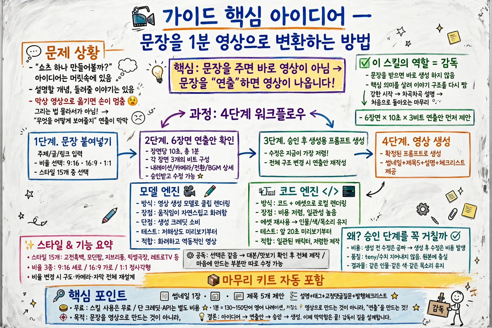
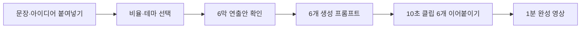
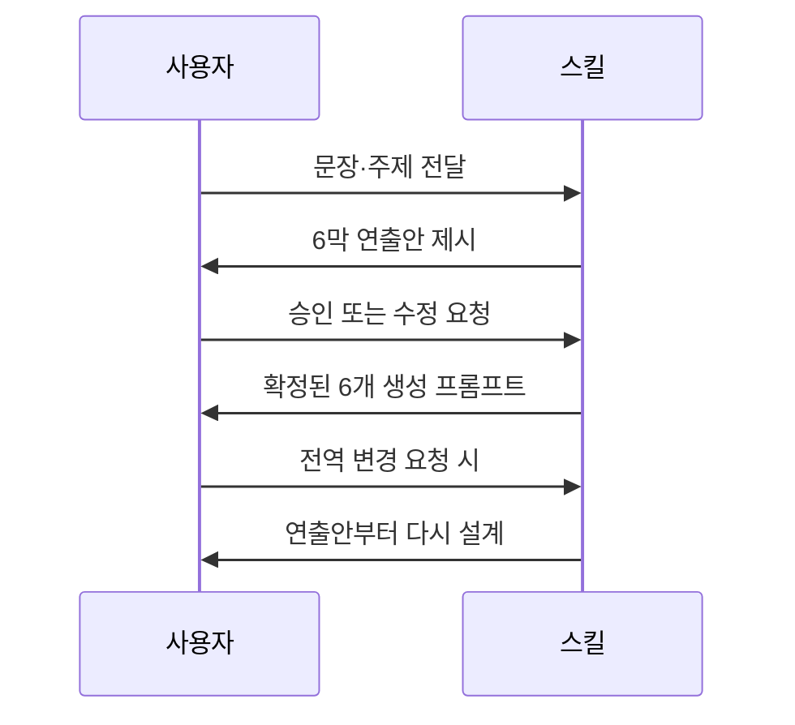

# stickman-video-director: 문장 하나를 1분짜리 스틱맨 영상으로 바꾸는 법

> **Summary**
> 문장 하나를 붙여넣으면 스킬이 1분짜리 스틱맨 영상의 대본과 연출안을 먼저 짜주고, 여섯 장면의 연출안을 확인한 뒤에야 생성용 프롬프트를 만듭니다. 모델 엔진은 영상 생성 모델로 클립을 직접 렌더링하고, 코드 엔진은 에이전트가 코드를 짜서 로컬에서 렌더링하므로 영상 모델 크레딧 없이 만들 수 있습니다. 스타일 15개와 세 가지 화면 비율, 밝은·어두운 테마를 고를 수 있고, 썸네일과 제목, 설명까지 챙기는 마무리 키트도 함께 제공합니다.

---

- 문장 하나를 붙여넣으면, 스킬이 1분짜리 스틱맨 영상의 대본과 연출안을 먼저 짜줍니다.
- 여섯 장면, 장면마다 열 초, 장면마다 세 개의 비트로 짠 연출안을 확인한 뒤에야 생성용 프롬프트가 나옵니다.
- 모델로 찍어내는 방식과 코드로 직접 그려내는 방식, 두 가지 엔진이 있어서 비용과 일관성을 골라 쓸 수 있습니다.

"쇼츠 하나 만들어볼까?" 아이디어는 머릿속에 있습니다. 설명하고 싶은 개념 하나, 들려주고 싶은 이야기 하나쯤은 누구나 갖고 있습니다. 그런데 막상 영상으로 옮기려고 하면 손이 멈춥니다. 그리는 법을 몰라서가 아닙니다. 무엇을 어떻게 보여줄지, 그 연출을 정하는 일이 막막하기 때문입니다.

🎥 [동영상 보기](https://www.youtube.com/watch?v=4D9wJ3NYk00)

## 문장을 영상에 넣는다는 건, 무슨 뜻일까요?

좋은 문장 하나가 있다고 해서 좋은 영상이 되는 건 아닙니다. 한 인물, 한 배경으로 10초를 채우면 화면은 거의 움직이지 않습니다. 1분을 채우려면 연출이 필요합니다. 강한 첫 장면으로 시선을 붙잡고, 설명의 속도를 조절하고, 추상적인 개념을 눈에 보이는 비유로 바꾸고, 카메라를 움직이고, 장면을 이어 붙이고, 여섯 번의 독립 생성이 끝난 뒤에도 같은 인물, 같은 색, 같은 목소리로 묶어줘야 합니다.

이 스킬이 하는 일이 바로 그 연출입니다! 문장을 받으면 곧장 영상을 뽑아내지 않습니다. 먼저 이야기를 다시 짭니다. 핵심 의미를 살리면서 강한 시작, 차곡차곡 쌓이는 설명, 끝에서 처음으로 돌아오는 마무리를 갖춘 구조로 말입니다. 그리고 그 구조를 여섯 장면의 연출안으로 보여줍니다. 영어 내레이션, 화면 구성, 카메라 움직임, 전환, 배경음악과 효과음까지 담은 안을 먼저 확인받고, 승인이 떨어진 뒤에야 생성용 프롬프트를 만듭니다. 생성 크레딧을 쓰기 전에, 바꿀 수 있는 건 다 바꿔보는 겁니다!

## 두 가지 엔진, 어떻게 다를까요?

같은 연출안이라도 만드는 방법은 두 가지입니다. 모델 엔진은 영상 생성 모델에 프롬프트를 넣어 클립을 직접 렌더링합니다. 움직임이 유려하고 화면이 화려한 대신, 생성 크레딧을 씁니다. 코드 엔진은 에이전트가 그림 에셋을 만들고 코드를 짜서 로컬에서 직접 렌더링합니다. 영상 모델 크레딧이 들지 않고, 에이전트 사용량만으로 해결됩니다. 에셋을 미리 만들어 재사용하기 때문에 인물이 장면마다 달라지는 일도 적습니다.

어떤 방식을 고르든 시작은 같습니다. 주제나 글, 링크를 주고, 비율과 스타일을 정하고, 대본과 맛보기부터 확인합니다. 모델 엔진은 저해상도 테스트부터, 코드 엔진은 앞부분 20초 미리보기부터 확인한 뒤 전체를 만듭니다. 마음에 안 드는 부분만 따로 고치는 것도 됩니다.

## 왜 승인을 먼저 받을까요?

수정이 가장 쌀 때 고치기 위해서입니다. 연출안이 확정되기 전에는 문장 하나 바꾸는 일이 공짜에 가깝습니다. 하지만 프롬프트가 나가고 클립이 생성된 뒤에는 되돌리는 비용이 생깁니다. 그래서 이 스킬은 확인 단계를 건너뛰지 않습니다. 비율이나 테마처럼 전체를 바꾸는 변경이 생기면, 글자만 갈아끼우지 않고 연출안 자체를 처음부터 다시 짭니다.

또 하나, 이 스킬은 근거 없는 내용을 만들지 않습니다. 구조와 표현은 다듬지만, 출처 없는 사실이나 수치, 인용을 지어내서 넣지는 않습니다. 각본은 원본 재료에 충실하게 유지됩니다.

## 스타일 15개, 화면은 세 가지 비율로

고전 흑백, 모던 팝, 선사시대 동굴, 아늑한 이야기, 역사 만화, 앰버 누아르, 러버 호스, 지브리풍까지. 코드 엔진 쪽에는 미니멀 라인아트, 컬러풀 손그림, 레트로 TV, 서바이벌 스릴러, 아바타 설명, 밈 스토리, 픽셀 극장이 있습니다. 비율은 세로 9:16, 가로 16:9, 정사각형 1:1 중에서 고르고, 밝은 테마와 어두운 테마, 최대 세 가지 강조색을 고릅니다. 비율을 바꾸면 숫자만 바꾸는 게 아니라, 구도와 카메라 경로, 자막 위치까지 다시 설계합니다.

숫자로 보면 규모가 더 잘 보입니다. 저장소 별이 7,500개, 포크가 1,317개, 라이선스는 MIT입니다. 1분 나레이션은 영어 130~150단어, 장면은 여섯 개, 장면마다 2~3초에 한 번씩 화면이 바뀝니다. 영상 하나가 끝나면 썸네일 한 장, 제목 다섯 가지, 설명과 태그, 고정 댓글용 질문, 발행 전 체크리스트까지 한 번에 챙기는 마무리 키트도 있습니다.

## 알아두고 쓸 점은요?

스킬 자체는 무료입니다. 다만 에이전트 요금제, 이미지·음성 API, 영상 생성 크레딧은 각자 비용이 따로 듭니다. 여섯 개 클립을 따로 만들다 보니 목소리나 음악이 장면마다 미세하게 달라질 수도 있습니다. 그럴 때는 한 줄짜리 외부 내레이션과 배경음악을 이어붙일 때 덧입히는 방법이 안내돼 있습니다. 만든 영상은 직접 발행하고 수익화할 수 있습니다. 다만 파트너 프로그램 승인은 채널 전체를 보고 정해집니다.

그림을 잘 그려야 영상을 만들 수 있던 시대는 지났습니다! 이제 필요한 건 문장 하나와, 그 문장을 어떻게 보여줄지 정해주는 감독입니다. 문장을 주면 영상이 나오는 게 아니라, 문장을 연출하면 영상이 나옵니다!

