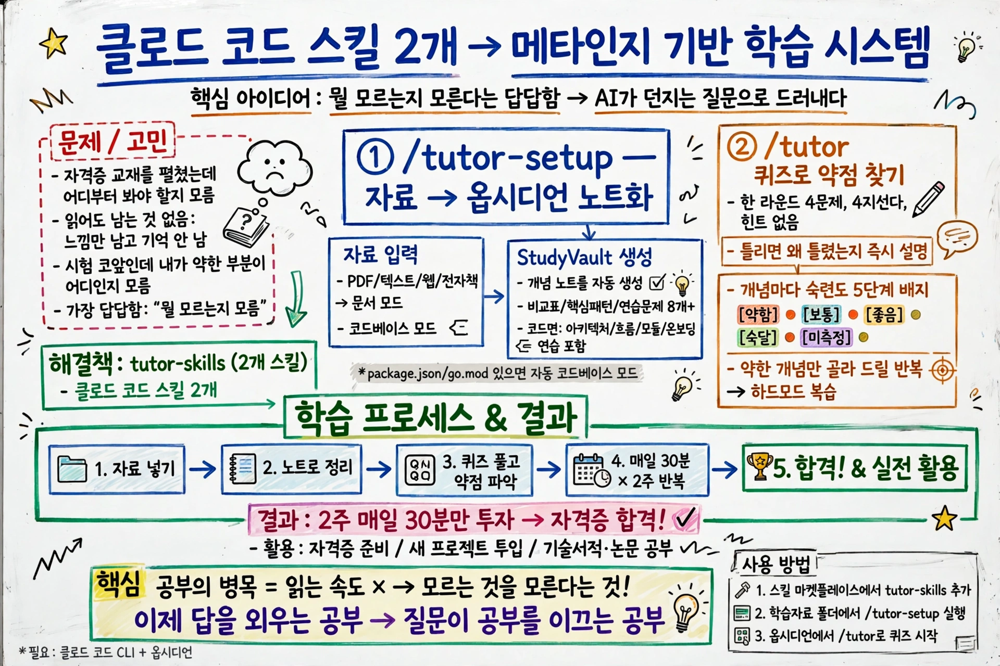
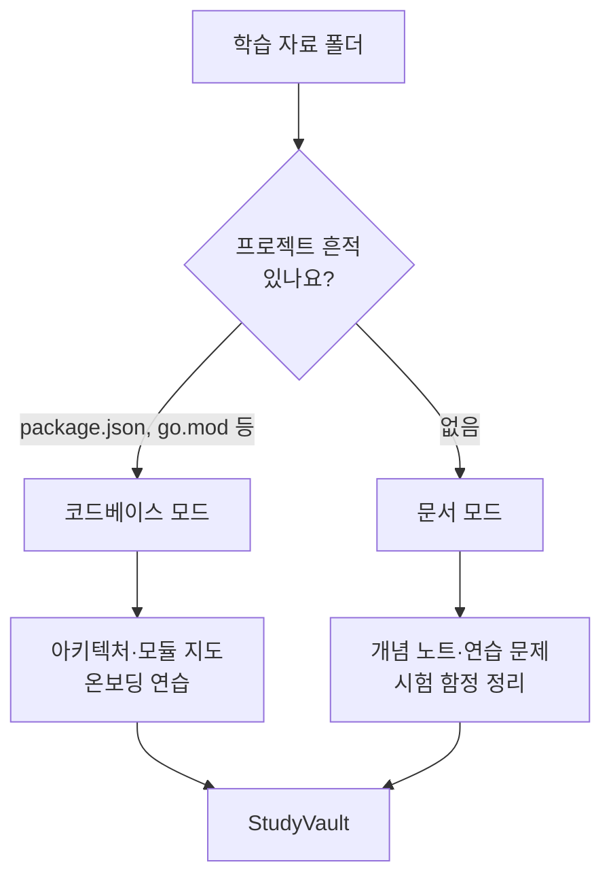
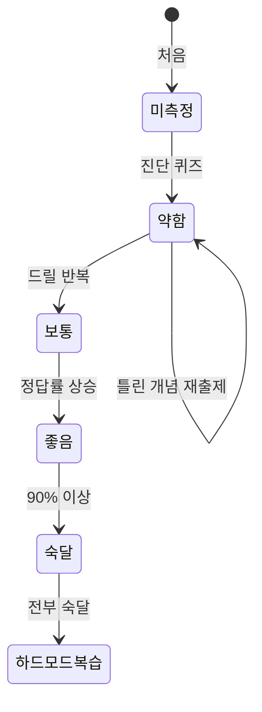

# tutor-skills: AI가 먼저 묻는 공부법, 2주 매일 30분으로 자격증을 땄습니다

> **Summary**
> tutor-skills는 클로드 코드 스킬 두 개로 교재나 코드베이스를 옵시디언 학습 노트로 바꾸고, 퀴즈로 약점을 찾아 반복하는 메타인지 학습 시스템입니다. 자료를 넣으면 /tutor-setup이 개념 노트와 연습 문제를 담은 StudyVault를 만들고, /tutor가 한 라운드 4문제씩 물어 개념별 숙련도를 5단계 배지로 추적합니다. 2주 동안 매일 30분씩 돌린 결과 자격증에 합격했고, 자격증 준비와 새 프로젝트 온보딩, 기술 서적 공부에 그대로 쓸 수 있습니다.

---

- 클로드 코드 스킬 두 개가 교재나 코드베이스를 옵시디언 학습 노트로 바꾸고, 퀴즈로 약점을 찾아 반복합니다.
- 핵심은 메타인지입니다. 뭘 모르는지 모른다는 답답함을, AI가 던지는 질문으로 드러냅니다.
- 2주 동안 매일 30분씩 돌린 결과 자격증에 합격했습니다. 자격증·새 프로젝트·기술 서적 공부에 그대로 쓸 수 있습니다.


## 자격증 교재를 펼쳤는데, 어디부터 봐야 할지 모르겠던 적 있으시죠?

두꺼운 교재를 펼쳤습니다. 목차는 봤고, 첫 장도 읽었습니다. 그런데 한 시간 뒤에 남은 게 뭘까요? 읽었다는 느낌만 남고, 뭐가 머리에 들어왔는지 모르겠습니다. 시험이 코앞인데, 어디가 약한지조차 가늠이 안 됩니다.

이럴 때 필요한 건 더 읽는 게 아니라, 물어보는 겁니다. 뭘 모르는지 모른다는 게 공부의 가장 답답한 부분입니다. 클로드 코드 스킬 두 개가 바로 이 부분을 파고듭니다!

🎥 [동영상 보기](https://www.youtube.com/watch?v=TzJecWCbex0)

## 공부 스킬, 어떻게 돌아가나요?

`tutor-skills`는 클로드 코드 스킬 두 개입니다. 하나는 학습 자료를 옵시디언 노트로 바꾸고, 다른 하나는 그 노트로 퀴즈를 냅니다. 자료를 넣으면 노트가 되고, 노트를 읽으면 퀴즈가 되고, 퀴즈를 풀면 약점이 드러납니다.

착안은 평소 개발할 때 쓰던 플랜 모드였습니다. 플랜 모드는 결정하지 못한 부분이 있으면 `AskUserQuestion` 도구로 사용자에게 되묻습니다. 개발자가 미처 놓친 부분을 짚어주는 친절한 질문 말입니다. 이걸 공부에 적용하면 어떨까요? AI가 먼저 묻는 겁니다. 뭘 모르는지!

```mermaid
flowchart LR
    A[교재·코드베이스<br/>PDF, EPUB, 소스 코드] --> B[/tutor-setup<br/>학습 노트 보관함 생성]
    B --> C[StudyVault<br/>개념 노트 + 대시보드]
    C --> D[/tutor<br/>진단 퀴즈]
    D --> E{약점 발견?}
    E -->|예| F[틀린 개념만<br/>반복 드릴]
    F --> D
    E -->|아니오| G[하드 모드 복습]
```

## 자료를 넣으면, 노트가 됩니다

첫 번째 스킬 `/tutor-setup`은 자료를 넣으면 학습 노트 보관함인 `StudyVault`를 만들어줍니다. 자료 종류에 따라 방식이 달라집니다.

교재처럼 문서만 있으면 문서 모드입니다. PDF·텍스트·웹 페이지·전자책을 스캔해 개념 노트를 만듭니다. 비교표와 시험에 자주 나오는 패턴까지 정리하고, 주제마다 연습 문제를 8개 이상 달아줍니다. 답은 접어두었다가 펼쳐보는 방식이라, 외운 게 아니라 떠올리는 연습이 됩니다.

코드베이스를 넣으면 코드베이스 모드로 바뀝니다. 기술 스택과 아키텍처 패턴, 모듈 경계를 자동으로 파악하고, 요청 흐름과 데이터 흐름을 끝까지 추적합니다. 모듈마다 핵심 파일과 공개 인터페이스를 정리한 노트를 만들고, 코드 읽기·설정·디버깅·확장 같은 온보딩 연습까지 붙여줍니다. 새 프로젝트에 투입된 개발자가 처음부터 끝까지 따라갈 수 있는 구조입니다.

이 부분이 저는 가장 인상 깊었습니다. 같은 명령어인데, 자료가 코드인지 문서인지 알아서 방식을 바꾸는 겁니다. `package.json`이나 `go.mod` 같은 흔적이 있으면 코드베이스 모드, 없으면 문서 모드입니다. 사용자가 모드를 고를 필요가 없습니다.



## 퀴즈는 어떻게 약점을 찾나요?

두 번째 스킬 `/tutor`는 만든 노트로 퀴즈를 냅니다. 한 라운드에 4문제, 4지선다, 힌트는 없습니다. 답을 고르면 채점하고, 틀린 문제는 왜 틀렸는지 설명해줍니다.

진도는 개념마다 따로 잽니다. 약함·보통·좋음·숙달·미측정, 다섯 단계 배지로 표시됩니다. 약한 개념이 있으면 그 개념만 골라서 드릴하고, 다 익히면 하드 모드 복습으로 넘어갑니다. 틀린 개념은 다른 문맥으로 다시 물어봐서, 답을 외운 건지 개념을 안 건지 가려냅니다!



## 2주 매일 30분, 결과는 합격이었습니다!

이 워크플로우를 2주 동안 매일 30분씩 반복한 결과, 자격증 시험에 합격했습니다. 하루 30분이라는 숫자가 저는 가장 와닿았습니다. 벼락치기라고 하면 밤새는 걸 떠올리기 쉽지만, 이 방식은 매일 조금씩 묻고 답하는 쪽입니다. 짧게 자주, 약한 곳만 골라서 말입니다.

시작은 간단합니다. 스킬 마켓플레이스에서 `tutor-skills`를 검색해 추가하고, 학습 자료가 있는 폴더에서 `/tutor-setup`을 실행합니다. 생성된 노트를 옵시디언으로 열어 읽고, `/tutor`로 퀴즈를 시작하면 됩니다. 필요한 건 클로드 코드 CLI와 옵시디언뿐입니다.

자격증 준비 중인 분, 새 프로젝트에 투입되는 개발자, 기술 서적이나 논문을 체계적으로 공부하고 싶은 분에게 잘 맞습니다. 공부의 병목이 읽는 속도가 아니라 모르는 걸 모른다는 사실이라면, 묻는 쪽으로 방향을 틀어보는 건 어떨까요? 답을 외우는 공부는 끝났고, 질문이 공부를 이끄는 시대가 왔습니다!

