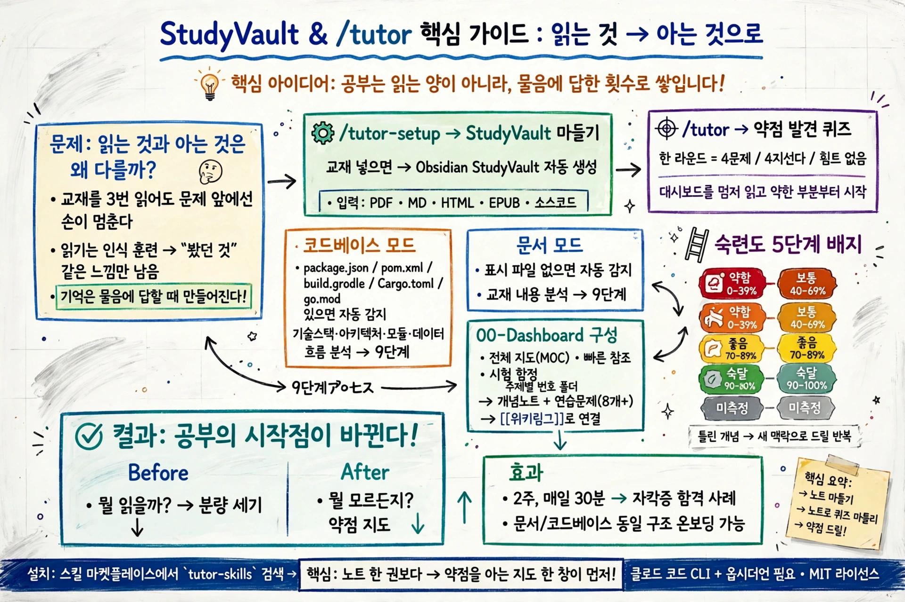
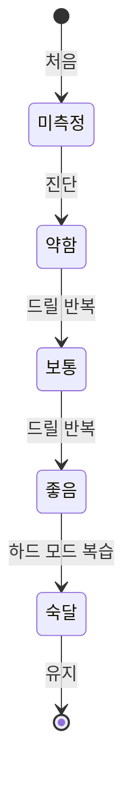

# tutor-skills: 교재를 노트로 바꾸면, 퀴즈가 약점을 먼저 찾아줍니다

> **Summary**
> tutor-skills는 교재나 코드베이스를 옵시디언 학습 노트로 바꾸는 게 아니라, 노트로 퀴즈를 만들어 약점을 찾는 메타인지 학습 시스템입니다. 자료를 넣으면 /tutor-setup이 대시보드와 주제별 폴더로 정리된 StudyVault를 만들고, /tutor가 한 라운드 4문제씩 힌트 없이 물어 개념별 숙련도를 5단계 배지로 추적합니다. 문서 모드와 코드베이스 모드가 각각 9단계로 나뉘어 있어, 교재 공부와 새 프로젝트 온보딩을 같은 구조로 돌릴 수 있습니다.

---

- 교재를 넣으면 `/tutor-setup`이 주제별 폴더와 대시보드(MOC·빠른 참조·시험 함정)로 정리된 옵시디언 `StudyVault`를 만듭니다.
- `/tutor`는 한 라운드 4문제씩 힌트 없이 물어보고, 개념별 숙련도를 5단계 배지로 추적해 약한 개념만 골라 다시 드릴합니다.
- 문서 모드 9단계와 코드베이스 모드 9단계가 따로 있어, 교재 공부와 새 프로젝트 온보딩을 같은 구조로 돌릴 수 있습니다.


시험 전날, 교재를 세 번이나 읽었는데 막상 문제 앞에서는 손이 멈춘 적 있으시죠? 읽을 때는 다 아는 것 같은데, 물으면 입이 안 떨어집니다. 왜 그럴까요?

🎥 [동영상 보기](https://www.youtube.com/watch?v=BGg-eWQk6bk)

## 읽는 것과 아는 것은 왜 다를까요?

읽는 공부는 인식을 훈련합니다. 다시 보면 "봤던 내용"이라는 느낌이 들지만, 그 느낌이 기억은 아닙니다. 기억은 물음에 답할 때 만들어집니다. 그래서 이 시스템은 노트를 만드는 데서 멈추지 않습니다. 노트로 퀴즈를 만드는 데까지 갑니다!

## StudyVault는 어떻게 생겼나요?

자료를 넣으면 `/tutor-setup`이 옵시디언 `StudyVault`를 만듭니다. 입력은 PDF·MD·HTML·EPUB·소스 코드입니다. 폴더에 `package.json`·`pom.xml`·`build.gradle`·`Cargo.toml`·`go.mod` 같은 표시가 있으면 코드베이스 모드, 없으면 문서 모드로 자동 감지합니다.

구조는 이렇습니다. `00-Dashboard` 폴더에 전체 지도(MOC), 빠른 참조, 시험 함정이 들어갑니다. 주제마다 번호 폴더가 생기고, 개념 노트와 연습 문제가 들어갑니다. 모든 노트는 `[[위키 링크]]`로 서로 연결됩니다!

```mermaid
flowchart TD
    A[교재 또는 코드베이스] --> B[/tutor-setup]
    B --> C[StudyVault]
    C --> D[00-Dashboard\nMOC·빠른 참조·시험 함정]
    C --> E[01-주제1\n개념 노트 + 연습 문제]
    C --> F[02-주제2\n개념 노트 + 연습 문제]
    D --- E
    D --- F
    E --- F
```

문서 모드는 9단계를 거칩니다. 자료 발견, 내용 분석, 태그 기준, 볼트 구조, 대시보드, 개념 노트, 연습 문제, 상호 연결, 자체 검토 순서입니다. 연습 문제는 주제당 8개 이상 만들고, 답은 접어서 숨깁니다. 보기 전에 먼저 떠올려야 하니까요.

코드베이스 모드도 9단계입니다. 기술 스택과 아키텍처, 모듈 경계를 파악하고, 요청 흐름과 데이터 흐름을 끝까지 추적합니다. 모듈별 노트에는 핵심 파일과 공개 인터페이스, 의존 관계가 들어갑니다. 온보딩 연습은 코드 읽기, 설정, 디버깅, 확장 네 가지로 나옵니다.

## 퀴즈는 약점을 어떻게 찾나요?

`/tutor`는 퀴즈부터 내지 않습니다. 대시보드를 먼저 읽습니다. 어디가 약한지 알고 시작합니다.

한 라운드 4문제, 4지선다, 힌트 없음! 답하면 채점하고, 틀린 문제는 설명까지 해줍니다. 개념마다 시도 횟수와 정답 수, 마지막 테스트 날짜, 오답 노트를 저장합니다. 틀린 개념은 다음 드릴에서 새 맥락으로 바꿔 다시 물어봅니다.

숙련도는 5단계 배지로 보입니다. 🟥 약함 0–39%, 🟨 보통 40–69%, 🟩 좋음 70–89%, 🟦 숙달 90–100%, ⬜ 미측정입니다. 세션은 상황에 따라 네 가지로 갈립니다. 미측정 영역은 진단, 약한 곳은 약점 드릴, 원하는 부분만 골라 푸는 섹션 선택, 전부 숙달했으면 하드 모드 복습입니다.

```mermaid
flowchart LR
    A[/tutor 실행] --> B[대시보드 읽기\n어디가 약한가?]
    B --> C[세션 선택\n진단·드릴·섹션·하드 모드]
    C --> D[4문제 한 라운드\n4지선다·힌트 없음]
    D --> E[채점 + 오답 설명]
    E --> F[숙련도 배지 갱신]
    F --> G{약한 개념 남았나?}
    G -->|예| C
    G -->|아니오| H[하드 모드 복습]
```



## 이 구조로 공부하면 뭐가 달라지나요?

공부의 시작점이 "뭘 읽을까"에서 "뭘 모르는지"로 바뀝니다. 대시보드가 약점을 먼저 보여주니까요! 읽은 분량을 세는 대신, 답한 횟수와 맞힌 개념을 셉니다.

이 구조로 2주 동안 매일 30분씩 돌린 결과 자격증에 합격했다는 사례도 있습니다. 자격증 준비, 새 프로젝트 온보딩, 기술 서적 공부에 그대로 쓸 수 있습니다.

설치는 스킬 마켓플레이스에서 `tutor-skills`를 검색해 추가하면 됩니다. 클로드 코드 CLI와 옵시디언이 필요합니다. MIT 라이선스입니다.

공부는 읽는 양이 아니라, 물음에 답한 횟수로 쌓입니다. 노트 한 권보다 약점을 아는 지도 한 장이 먼저입니다!

