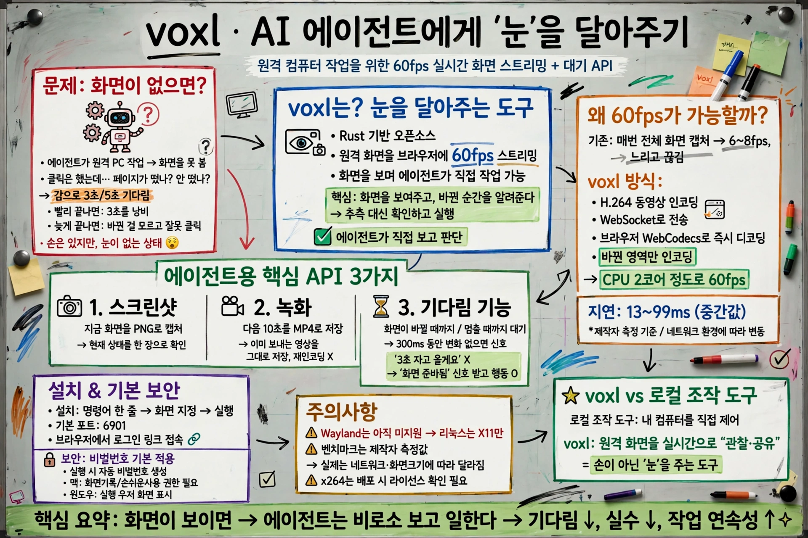
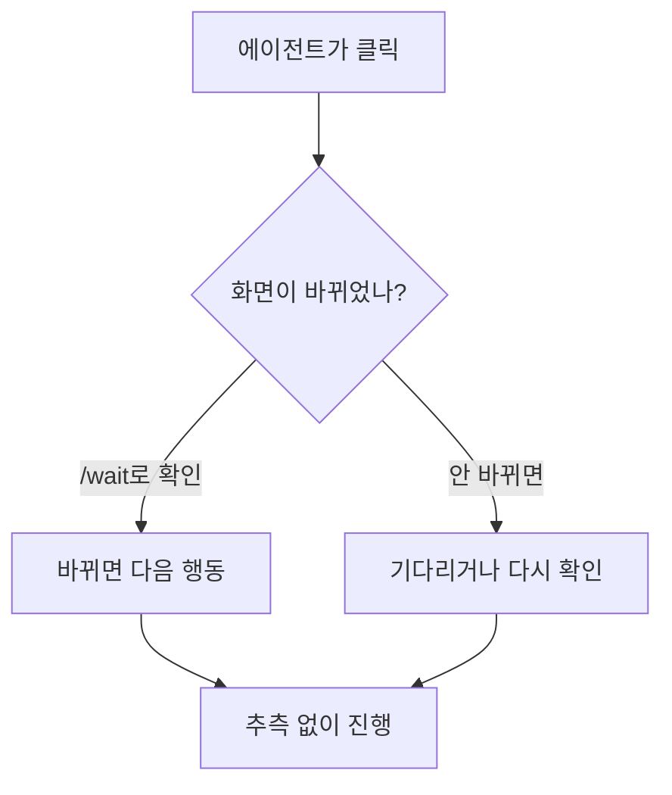

# voxl: 에이전트에게 화면을 60프레임으로 보여주면, 기다림이 사라집니다

> **Summary**
> voxl은 원격 컴퓨터 화면을 브라우저에 초당 60프레임으로 스트리밍해 AI 에이전트가 작업 결과를 실시간으로 확인하도록 돕는 Rust 기반 오픈소스 도구입니다. 스크린샷·녹화·화면 변화 감지 API를 제공해 고정된 시간만큼 기다리는 대신 화면 상태에 맞춰 작업할 수 있으며, 리눅스·맥·윈도우를 지원하지만 Wayland는 아직 지원하지 않습니다.

---

- AI 에이전트가 원격 컴퓨터에서 일하려면 화면을 봐야 합니다. voxl은 원격 화면을 초당 60프레임으로 브라우저에 보여주는 Rust 기반 오픈소스 도구입니다.
- 화면을 보여주는 데서 끝나지 않습니다. 스크린샷·녹화 API에, 화면이 바뀌거나 멈출 때까지 기다리는 기능까지 있어 에이전트가 감으로 기다리지 않고 일합니다.
- 리눅스·맥·윈도우를 지원하고, 비밀번호로 잠그는 기본 보안도 갖췄습니다. 다만 아직 Wayland는 지원하지 않습니다.

에이전트에게 컴퓨터 작업을 맡겼는데, 화면이 안 보인다면 어떻게 될까요? 클릭은 했는데, 페이지가 떴는지 안 떴는지 알 수 없습니다. 그래서 에이전트는 일단 기다립니다. 3초? 5초? 감으로 정한 시간만큼요. 로딩이 빨리 끝나면 시간을 버리고, 늦게 끝나면 엉뚱한 곳을 클릭합니다!

이 장면, 낯설지 않으시죠? 에이전트가 손은 있는데 눈이 없는 상태입니다. voxl은 그 눈을 달아주는 도구입니다. 원격 컴퓨터의 화면을 초당 60프레임으로 브라우저에 띄워줍니다. 에이전트가 화면을 직접 보면서 일하게 되는 것이죠.

🎥 [동영상 보기](https://www.youtube.com/watch?v=ODaHJzOyVCQ)

## 에이전트는 왜 화면을 봐야 할까요?

에이전트는 명령을 내릴 수는 있습니다. 키를 누르고, 마우스를 움직이고, 버튼을 클릭하죠. 그런데 결과를 확인하지 못하면 다음 행동을 정할 수 없습니다. 버튼을 눌렀는데 화면이 그대로면, 클릭이 안 된 걸까요? 로딩이 안 끝난 걸까요?

그래서 지금까지 에이전트는 `sleep`에 의존했습니다. "일단 3초 기다리고 다음으로 넘어가자"는 식이죠. 그런데 이 방식은 두 가지로 망가집니다. 화면이 빨리 바뀌면 3초가 아깝고, 늦게 바뀌면 에이전트는 바뀐 줄 모르고 다음 행동을 해버립니다.

voxl의 답은 단순합니다. 화면을 보여주고, 화면이 바뀌는 순간을 알려주는 것입니다. 에이전트가 추측하지 않고, 눈으로 확인하고 일하게 만드는 것이죠.

## 60프레임은 어떻게 나올까요?

원격 화면을 보여주는 도구는 이미 많습니다. 그런데 대부분 느립니다. 화면을 이미지로 찍어 보내다 보니 초당 6~8프레임 수준에 머무는 경우가 많습니다. 마우스를 움직이면 한참 뒤에 따라오고, 스크롤은 뚝뚝 끊깁니다.

voxl은 화면을 동영상으로 바꿔서 보냅니다. `H.264`로 인코딩한 뒤 WebSocket 하나로 브라우저에 흘려보내고, 브라우저는 `WebCodecs`로 바로 풉니다. 별도 프로그램도 필요 없습니다. 브라우저만 있으면 됩니다!

핵심은 바뀐 부분만 인코딩한다는 점입니다. 화면 전체를 매번 다시 그리는 게 아니라, 바뀐 영역만 골라서 처리합니다. 그래서 CPU 2코어 남짓으로도 60프레임이 나옵니다. 공개된 측정에서는 지연이 중간값 기준 13~99ms였습니다. 단, 이 수치는 만든 쪽이 직접 잰 것이고, 프레임이 그려져서 화면에 풀리기까지의 시간이라는 점은 알고 써야 합니다.

## 에이전트용 API, 세 가지가 핵심입니다

화면을 보여주는 것만으로는 부족합니다. 에이전트는 화면을 "쓸 수" 있어야 합니다. voxl은 에이전트를 위해 세 가지 API를 준비했습니다.

첫째, `/screenshot`입니다. 지금 화면을 PNG 한 장으로 찍어줍니다. 에이전트가 지금 화면을 보여달라고 하면, 답이 되는 것이죠.

둘째, `/record`입니다. 다음 10초를 MP4로 녹화합니다. 이미 보내고 있는 영상을 그대로 저장하는 방식이라, 다시 인코딩하는 비용이 들지 않습니다.

셋째, `/wait`입니다. 이게 가장 재미있는 부분입니다! 화면이 가만히 있을 때까지, 혹은 화면이 바뀌는 순간까지 기다려줍니다. "300ms 동안 아무것도 안 바뀌면 알려줘", "이 사각형 안에서 뭔가 바뀌면 알려줘" 같은 식으로 물어볼 수 있습니다.

`/wait`의 비결은 운영체제가 이미 알고 있는 정보를 쓴다는 점입니다. 화면이 바뀐 영역을 알려주는 기능이 운영체제마다 있습니다. 그래서 스크린샷을 계속 찍어 비교하지 않아도 됩니다. 에이전트가 "3초만 자고 올게요"라는 감을 버리고, 화면이 준비됐다는 신호를 받고 움직이는 것이죠.

## 설치는 어떻게 할까요?

설치는 명령어 한 줄로 시작합니다. `cargo install`로 설치하고, 스트리밍할 화면을 지정해 실행하면 됩니다. 기본 포트는 `6901`입니다. 실행하면 로그인 링크가 나옵니다. 링크를 브라우저에서 열면 원격 화면이 뜹니다.

보안은 기본으로 켜져 있습니다. 비밀번호를 정하지 않으면 실행할 때 자동으로 만들어줍니다. 비밀번호 없이 화면을 여는 일은 없습니다. 맥에서는 화면 기록과 손쉬운 사용 권한을 물어보고, 윈도우에서는 실행한 사용자의 화면을 그대로 보여줍니다. 화면 전체가 그대로 노출되는 도구인 만큼, 비밀번호 설정은 건너뛰지 않는 게 좋습니다.

## 어디까지 조심해야 할까요?

몇 가지는 알고 쓰는 게 좋습니다. 먼저 Wayland는 아직 지원하지 않습니다. 리눅스에서는 X11 화면을 대상으로 합니다. 둘째, 벤치마크 수치는 만든 쪽이 직접 잰 가장 좋은 결과입니다. 실제 환경에서는 네트워크나 화면 크기에 따라 달라질 수 있습니다. 셋째, 인코딩에 쓰는 `x264`는 배포할 때 라이선스를 확인해야 하는 경우가 있습니다.

그리고 한 가지 구분이 필요합니다. 같은 묶음의 다른 글에서 다룬 로컬 조작 도구는 내 컴퓨터를 에이전트가 직접 만지는 쪽입니다. voxl은 다릅니다. 원격 컴퓨터의 화면을 실시간으로 보여주고, 에이전트가 그 화면을 보면서 작업하게 만드는 관찰·공유 쪽입니다. 손이 아니라 눈을 주는 도구라고 보면 됩니다!

에이전트에게 눈을 달아주는 일, 생각보다 큰 변화입니다. 기다림이 줄고, 실수가 줄고, 작업이 이어집니다. 화면이 보이면 에이전트는 비로소 "보고" 일합니다!

