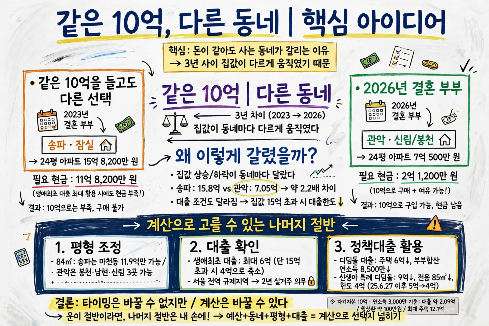
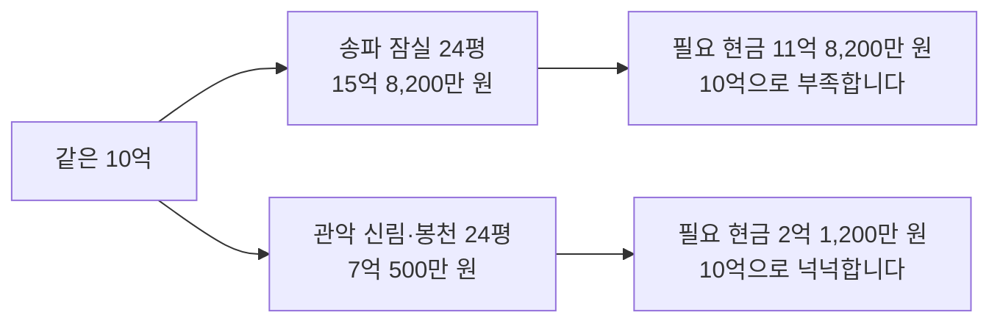
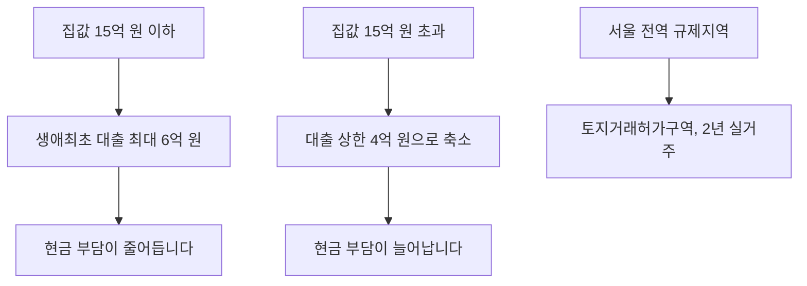

# 같은 10억, 3년 차이로 송파와 관악이 갈렸습니다. 첫 집은 타이밍이 절반입니다

> **Summary**
> 같은 10억이라도 집값과 대출 조건에 따라 살 수 있는 동네와 평형은 달라지며, 3년 사이 송파와 관악의 격차가 이를 보여줍니다. 타이밍은 바꾸기 어렵지만 예산, 평형, 지역, 대출 조건을 꼼꼼히 계산하면 현실적인 선택지를 찾을 수 있습니다.

---

- 같은 10억을 들고 2023년에 결혼한 부부는 송파에, 2026년에 결혼한 부부는 관악에 등기를 쳤습니다. 돈이 같아도 사는 동네가 갈린 건, 집값이 3년 사이에 움직였기 때문입니다.
- 숫자로 보면 더 또렷합니다. 24평 기준 송파 잠실은 15억 8,200만 원, 관악 신림·봉천은 7억 500만 원입니다. 같은 생애최초 대출을 써도 필요한 현금이 11억 8,200만 원과 2억 1,200만 원으로 갈립니다.
- 타이밍은 고를 수 없습니다. 하지만 예산에 맞는 동네와 평형, 대출 조건은 계산으로 고를 수 있습니다. 운이 절반이라면, 나머지 절반은 계산입니다.

결혼을 앞두고 집을 보러 다닌 적 있으시죠? 같은 예산을 들고 같은 조건으로 알아봤는데, 동네마다 가격이 천차만별이라 고개를 갸웃한 적 말입니다. 같은 10억인데, 3년 차이로 송파와 관악이 갈렸다는 얘기가 있습니다. 과장일까요? 숫자를 펼쳐보면, 과장이 아니었습니다!

🎥 [동영상 보기](https://www.youtube.com/watch?v=_Xg0_FmTuwQ)

## 왜 3년 만에 동네가 갈렸을까요?

같은 돈, 다른 동네. 이유는 단순합니다. 집값이 움직였고, 그 움직임이 동네마다 달랐기 때문입니다.

국토교통부 실거래(2026년 8월 기준)를 보면, 24평 기준으로 송파 잠실은 15억 8,200만 원, 관악 신림·봉천은 7억 500만 원이었습니다. 같은 24평인데 가격이 두 배 넘게 차이 납니다. 10억을 들고 가면, 관악에서는 사고도 남지만 송파 잠실에서는 현금이 모자랍니다. 생애최초 대출을 최대로 써도 송파 잠실에는 현금 11억 8,200만 원이 필요하고, 관악에는 2억 1,200만 원이면 됩니다. 같은 10억이 한쪽에서는 부족하고, 다른 한쪽에서는 넉넉한 겁니다!

## 10억으로 살 수 있는 집, 숫자로 따져볼까요?

자기자본 10억에 연소득 3,000만 원이면, 서울에서 살 수 있는 최대 금액은 약 12억 1,000만 원입니다. 대출은 2억 900만 원쯤, 월 상환은 100만 원 안팎입니다. 이 예산으로 아파트 84㎡를 사려면, 송파에서는 마천동 한 곳(11억 9,000만 원)만 남고, 관악에서는 봉천동·남현동·신림동 세 곳이 열립니다. 59㎡로 낮추면 송파 네 곳, 관악 두 곳이 됩니다. 평형을 한 단계만 낮춰도 선택지가 달라집니다. 이 장면이 저는 가장 인상 깊었습니다. "예산이 같으면 동네가 같다"는 착각이, 숫자 앞에서는 그대로 무너지니까요!

대출 조건도 따져봐야 합니다. 생애최초 대출은 최대 6억 원까지 나옵니다. 그런데 집값이 15억 원을 넘으면 대출 상한이 4억 원으로 잘립니다. 송파 잠실 24평이 15억 8,200만 원이라면, 딱 그 선을 넘는 겁니다. 대출이 줄어드는 만큼 현금이 더 듭니다. 서울은 25개 구 전역이 규제지역이고 토지거래허가구역이라 2년 실거주도 붙습니다. 집을 사는 순간, 2년은 그 집에서 살아야 한다는 뜻입니다.

## 그럼 운만 탓하면 될까요?

타이밍이 절반은 맞습니다. 2023년에 샀으면 송파, 2026년에 사면 관악. 이건 노력으로 바꿀 수 없는 부분입니다. 하지만 나머지 절반은 계산입니다. 어떤 평형을 볼지, 어느 동네까지 눈을 돌릴지, 어떤 대출을 쓸지는 고를 수 있습니다.

신혼부부라면 디딤돌 대출도 있습니다. 6억 원 이하 주택, 부부합산 연소득 8,500만 원 이하가 조건입니다. 아이가 태어났다면 신생아 특례 디딤돌도 있습니다. 9억 원 이하 주택에 전용 85㎡ 이하, 한도는 4억 원입니다. 2025년 6월 27일 이후 계약분부터 한도가 5억 원에서 4억 원으로 줄었다는 점은 알고 계셔야 합니다. 조건이 맞는 대출이 있는지, 내 예산에 맞는 평형이 어디까지인지, 이 두 가지만 먼저 따져봐도 선택지가 훨씬 또렷해집니다.

한 가지 분명히 밝혀둡니다. 원문 게시글 전문은 로그인 벽 때문에 직접 읽지 못했습니다. 이 글은 게시글 제목의 전제와 공개된 실거래·대출 자료로 재구성했습니다. 그래서 게시글 뒤에 이어진 결론이 무엇인지는 이 글에 담지 않았습니다. 전제 하나만으로도, 숫자는 충분히 말을 해줍니다. 서울 아파트 매수자 10명 중 4명이 30대라는 사실도, 첫 집이 이제는 선택이 아니라 숙제처럼 느껴진다는 뜻이겠죠.

같은 10억, 다른 동네. 타이밍은 바꿀 수 없지만, 계산은 바꿀 수 있습니다. 운이 절반이라면, 나머지 절반은 내 손에 있습니다!

