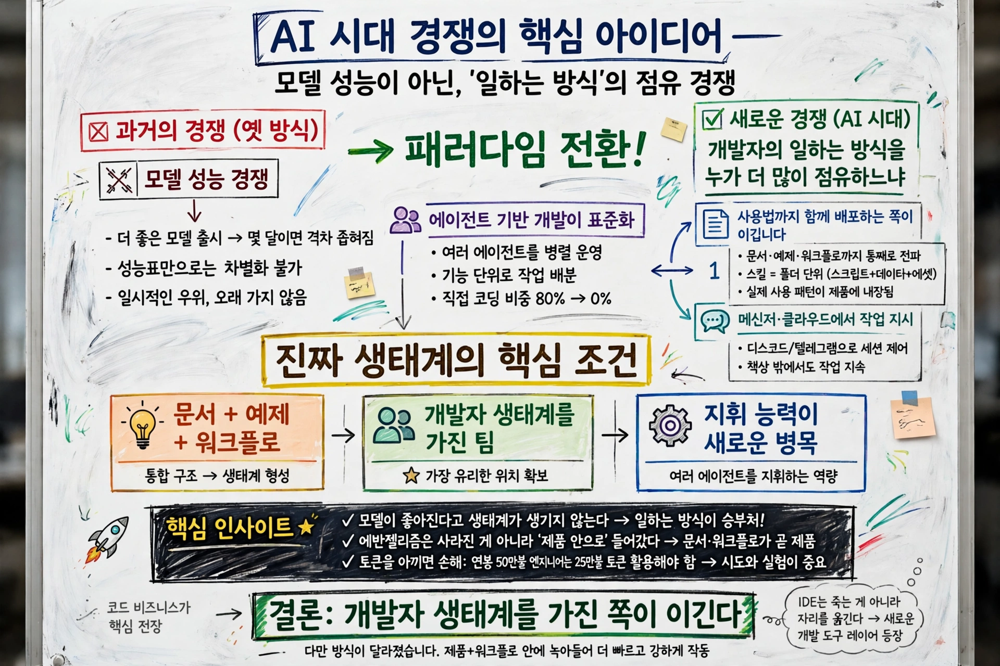
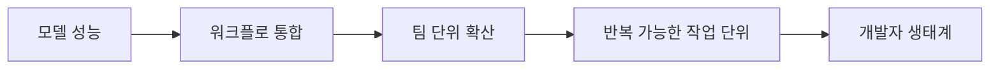
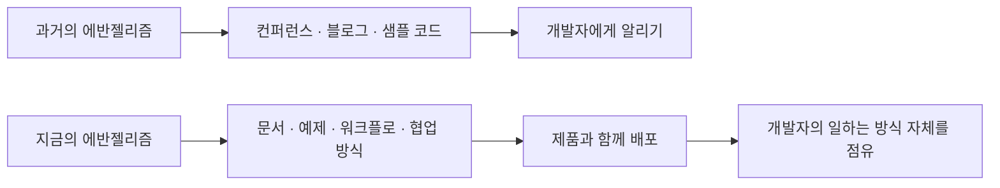
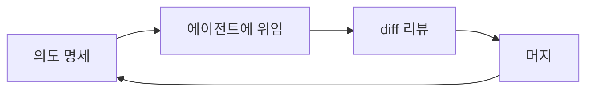

# 개발자 생태계를 가진 쪽이 이깁니다. AI 시대의 승부는 모델이 아니라 일하는 방식입니다

> **Summary**
> AI 시대의 경쟁은 모델 성능이 아니라, 개발자의 일하는 방식을 누가 더 많이 점유하느냐로 이동하고 있습니다. 사용법을 제품과 함께 배포하는 쪽이 이깁니다. 문서·예제·워크플로까지 통째로 전하는 구조가 생태계를 만듭니다. 에이전트 기반 개발이 표준이 되면, 개발자 생태계를 가진 팀이 가장 유리한 위치를 차지하게 됩니다.

---

- AI 시대의 경쟁은 모델 성능이 아니라, 개발자의 일하는 방식을 누가 더 많이 점유하느냐로 이동하고 있습니다.
- 사용법을 제품과 함께 배포하는 쪽이 이깁니다. 문서·예제·워크플로까지 통째로 전하는 구조가 생태계를 만듭니다.
- 에이전트 기반 개발이 표준이 되면, 개발자 생태계를 가진 팀이 가장 유리한 위치를 차지하게 됩니다.

새로운 AI 모델이 나올 때마다 이런 질문이 따라옵니다. 이번에는 뭘 얼마나 더 잘할까요? 그런데 정작 현장에서는 다른 질문이 더 중요해졌습니다. 이 모델을 내 일하는 방식 안에 어떻게 녹일 것인가요?

🎥 [동영상 보기](https://www.youtube.com/watch?v=kwSVtQ7dziU)

## 모델이 좋아진다고 생태계가 생기나요?

모델 성능만으로는 차별화가 오래 유지되지 않습니다. 더 좋은 모델이 나오면 몇 달 안에 격차가 좁혀지니까요. 진짜 생태계는 개발자들이 그 모델을 자신의 워크플로에 통합하고, 팀 단위로 확산시키고, 반복 가능한 작업 단위로 정착시킬 때 만들어집니다. 성능표가 아니라, 일하는 방식이 승부처입니다!

## 사용법까지 함께 배포하는 쪽이 이깁니다

그런 관점에서 요즘 가장 눈에 띄는 움직임은 클로드 코드 쪽입니다. 최근 몇 주 사이에도 기능 발표가 이어졌는데, 발표 방식이 달랐습니다. 스킬 개념을 공개하고, 메신저로 작업을 지시하는 기능을 내놓고, 클라우드 기반 예약 작업을 추가했죠. 단순히 기능만 던진 게 아니라, "이걸 어떻게 써야 하는지"를 함께 전달했습니다.

스킬은 프롬프트 확장이 아니라 폴더 단위 구조입니다. 스크립트·데이터·에셋을 묶어 모델이 직접 탐색하고 실행하게 하죠. 함정 모음과 점진적 공개 패턴 덕분에, 조직의 개발 문화를 코드로 정의할 수 있게 됐습니다. 이 장면이 저는 가장 인상 깊었습니다. 기능 목록이 아니라 사용 패턴 자체가 제품의 일부가 된 거니까요!

메신저로 작업을 지시하는 기능도 같은 맥락입니다. 텔레그램이나 디스코드에서 세션을 제어할 수 있게 됐죠. 일하는 장소가 책상 앞이 아니어도, 작업은 계속 이어집니다.

## 에반젤리즘은 사라진 게 아니라 제품 안으로 들어갔습니다

과거에는 개발자 에반젤리스트가 컨퍼런스와 블로그, 샘플 코드로 생태계를 키웠습니다. 지금은 그 역할이 제품 안으로 더 깊이 들어와 핵심 레이어가 됐습니다. 문서, 예제, 워크플로, 협업 방식까지 포함해 "개발자가 쓰는 방식 자체"를 제품과 함께 배포하는 구조로 바뀐 것입니다. 겉으로는 개발자 관계 이야기가 줄어든 것처럼 보이지만, 실제로는 더 깊은 수준에서 작동하고 있습니다.

## 왜 하필 코드 비즈니스일까요?

AI 혁신의 핵심 영역 중 하나가 바로 코드 비즈니스입니다. 대중 인지도에서는 다른 회사가 앞서 있지만, 개발자 워크플로와 코드 중심 채택에서는 빠르게 존재감을 키우는 쪽이 있습니다. 코딩 제품 성과가 부진하면 공동 창업자가 회사를 떠나는 일까지 벌어졌습니다. 개발자 기반과 코드 생태계가 기업 경쟁력의 핵심 축으로 올라왔다는 뜻이죠.

비슷한 맥락에서 과거 애플이 보여준 사례도 떠올려볼 만합니다. 애플은 단순히 좋은 소비자 제품을 만든 것을 넘어서, 개발자들이 선호하는 플랫폼을 기반으로 생태계를 구축해왔습니다. 개발자들이 먼저 선택하고, 그 위에 도구와 소프트웨어가 쌓이면서 장기적인 경쟁력이 만들어졌습니다. 지금 AI에서도 비슷하게, 어떤 모델이 더 뛰어난가보다 어떤 플랫폼이 개발자들의 기본 선택지가 되느냐가 더 중요한 질문이 되고 있습니다.

## 토큰을 아끼면 손해라는 말이 나옵니다

엔비디아 CEO는 최근 팟캐스트에서 이런 말을 남겼습니다. 연봉 50만 달러 엔지니어가 1년에 25만 달러어치 토큰도 쓰지 않는다면, 그것이 더 큰 문제라고요. 에이전트 기반 개발이 되면 "어렵다 / 오래 걸린다 / 사람이 많이 필요하다" 같은 제약은 점점 사라집니다. 남는 것은 얼마나 많은 시도를 하고, 무엇을 만들어내느냐입니다. 한 명의 엔지니어가 수십, 수백 개의 에이전트를 활용하는 것이 자연스러운 작업 방식이 될 가능성이 큽니다!

## 병목은 이제 모델이 아니라 지휘 능력입니다

2024년 12월을 기점으로 개발 방식이 크게 바뀌었습니다. 직접 코드를 타이핑하는 비중이 80%에서 거의 0%로 급감했다는 개발자의 증언이 나왔죠. 여러 에이전트를 병렬로 운영하며 기능 단위로 작업을 배분하는 방식이 새로운 개발 패러다임으로 자리 잡는 중이고, 핵심 병목은 모델 능력이 아니라 사용자의 숙련도입니다. 도구가 좋아질수록, 도구를 지휘하는 능력이 실력이 되니까요!

## IDE는 죽는 게 아니라 자리를 옮깁니다

기존 IDE가 개발 도구 중 하나로 축소되고, 더 큰 작업 단위와 워크플로를 관리하는 새로운 레이어의 개발 도구가 등장할 수 있다는 논의도 이어지고 있습니다. 그 자리를 AI 회사가 직접 차지하게 될 가능성이 높습니다. 클로드 코드가 새로운 개발 도구로 자리 잡은 것처럼요. 이런 변화가 현실화될수록, 단순한 도구보다 개발자 생태계를 가진 팀이 더 유리한 위치를 차지하게 됩니다.

결국 AI 시대에도 변하지 않는 것은 하나입니다. 개발자 생태계를 가진 쪽이 이깁니다. 다만 그 방식은 많이 달라졌습니다. 예전처럼 에반젤리스트라는 이름으로 드러나기보다, 제품과 워크플로 안으로 녹아들어 더 빠르고 더 강하게 작동합니다. 에이전트 기반 개발이 표준이 되면, 경쟁은 개발자 생태계를 누가 더 잘 만들어내느냐로 수렴하게 될 것입니다.

