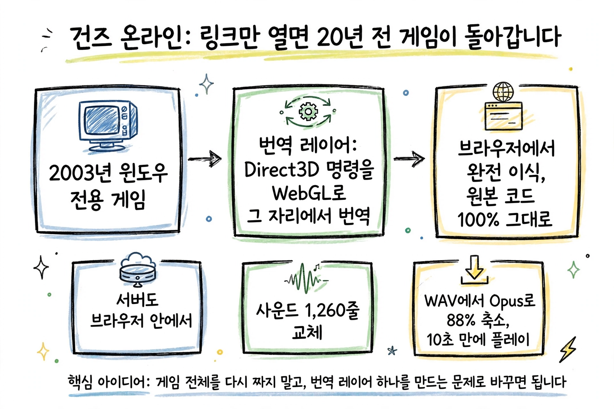
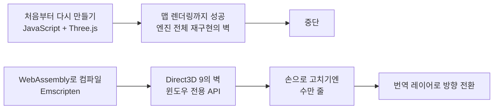
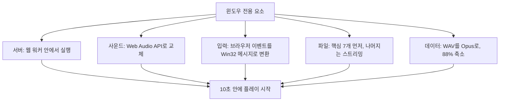

# 건즈 온라인: 다운로드 없이 링크만 열면, 20년 전 게임이 브라우저에서 돌아갑니다

> **Summary**
> 건즈 온라인을 원본 C++ 코드를 그대로 둔 채 WebAssembly와 WebGL 기반 번역 레이어로 브라우저에 이식해, 설치 없이 10초 안에 플레이할 수 있게 했습니다. 서버·사운드·입력·파일 처리도 웹 환경에 맞게 구현했으며, 새 코드의 99%는 AI가 작성했습니다. 다만 유출된 원본 소스의 저작권 문제는 남아 있습니다.

---

- 2003년 윈도우 전용 게임 건즈 온라인이 WebAssembly와 WebGL로 브라우저에 완전히 이식됐습니다.
- 핵심은 게임 코드를 고치는 게 아니라, 게임과 그래픽 API 사이에 번역 레이어를 끼워 넣은 것입니다.
- 새로 필요한 코드의 99%는 AI가 썼고, 원본 코드는 100% 그대로입니다. 설치 없이 링크만 열면 10초 안에 플레이할 수 있습니다.

게임 하나 설치하려고 저녁을 통째로 쓴 적 있으시죠? 다운로드가 끝나면 설치, 설치가 끝나면 패치, 패치가 끝나면 재시작. 2000년대 PC 게임은 그게 기본이었습니다. 그런데 2003년 게임이, 설치도 다운로드도 없이 링크만 열면 바로 돌아간다면 어떨까요?

🎥 [동영상 보기](https://www.youtube.com/watch?v=MaL7YjszuTo)

## 건즈 온라인, 어떤 게임이었을까요?

건즈 온라인은 2003년에 출시된 윈도우 전용 온라인 TPS입니다. 벽을 타고 달리고, 공중에서 콤보를 이어가고, 칼과 총을 오가며 싸우는 움직임이 특징이었습니다. 당시로서는 파격적인 속도감이었습니다.

2007년에는 클라이언트와 서버의 C++ 소스 전체가 유출됐고, 그 뒤로 커뮤니티가 유지·보수해 왔습니다. 그런데 20년이 넘도록 아무도 이 게임을 브라우저에서 돌리지 못했습니다. 그러다 이번에 완전히 이식됐습니다!

한국어 글은 3월 26일 기준으로 좋아요 102개를 받으며 개발자 커뮤니티에서 화제가 됐습니다.

## 왜 두 번이나 실패했을까요?

첫 번째 시도는 처음부터 다시 만드는 것이었습니다. `JavaScript`와 `Three.js`로 브라우저판을 새로 짜는 방식이었습니다. 맵 렌더링까지는 갔지만, 게임 엔진 전체를 다시 구현하는 벽에 막혀 프로젝트가 중단됐습니다.

두 번째 시도는 C++ 소스를 `Emscripten`으로 WebAssembly로 컴파일하는 것이었습니다. 이론상 쉬워 보였지만, 건즈는 렌더링·사운드·입력까지 윈도우 전용 API에 달라붙어 있었습니다. 렌더링 엔진은 `Direct3D 9`를 직접 호출했고, `Emscripten`은 `Direct3D` 명령을 브라우저가 이해하는 형태로 바꿔주지 않았습니다.

수만 줄의 렌더링 코드를 손으로 고치는 건 불가능에 가까웠습니다. 그래서 이 프로젝트는 "이론상 가능하지만"이라는 칸에 수년 동안 머물렀습니다.

## 게임을 고치지 않고, 어떻게 옮겼을까요?

핵심 질문은 이것 하나였습니다. "게임이 `Direct3D`를 그대로 호출하게 두고, 명령을 그 자리에서 `WebGL`로 번역하면 어떨까?"

그래서 게임과 그래픽 API 사이에 번역 레이어를 끼워 넣었습니다. 게임은 여전히 `Direct3D`에 명령을 보낸다고 생각하지만, 실제로는 브라우저 위에서 돌아가는 구조입니다. 원본 게임 코드는 100% 그대로입니다!

세 가지 방법을 놓고 보면 차이가 분명합니다. 직접 고치기는 수만 군데를 수정해야 해서 유지보수가 불가능했고, 트랜스파일러를 만드는 건 의미 차이 때문에 불가능했습니다. 번역 레이어는 래퍼만 구현하면 됐습니다. 그게 정답이었습니다.

## 렌더링 말고 또 뭘 옮겼을까요?

렌더링이 가장 큰 산이었지만, 옮길 것은 그게 다가 아니었습니다.

네트워크부터 놀랍습니다. 원본 C++ 서버까지 WebAssembly로 컴파일해, 같은 탭 안의 웹 워커로 돌렸습니다. 클라이언트와 서버는 `postMessage`로 대화하고, 진행 상황은 `SQLite`와 `IDBFS`에 저장돼 탭을 닫아도 남습니다. `WebSocket`으로 실제 서버에 연결해 다른 사람과 플레이할 수도 있습니다.

사운드는 `FMOD`를 `Web Audio API`로 통째로 교체했습니다. 3D 공간 음향, 배경음악 스트리밍, 거리 감쇠까지 다시 구현했고, 분량은 1,260줄이었습니다.

입력은 브라우저 키보드·마우스 이벤트를 원래 엔진이 기대하는 `Win32` 메시지(`WM_KEYDOWN`, `WM_MOUSEMOVE`, `WM_CHAR`)로 바꿨습니다. 마우스 고정은 포인터 잠금 API로, 로그인 입력은 HTML 입력창 오버레이로 해결했습니다.

파일도 따로 손봤습니다. 게임 에셋은 전용 `.mrs` 아카이브에 들어 있습니다. 핵심 파일 7개만 먼저 받고 나머지는 백그라운드로 스트리밍하며, 캐시 API 덕분에 두 번째 방문은 바로 열립니다.

데이터 최적화는 몇 주가 걸렸습니다. 음향 효과를 `WAV`에서 `Opus`로 바꾸는 것만으로 44.3MB가 5.30MB로 줄었습니다. 88% 축소입니다! 그 결과 첫 로딩 10초 안에 플레이가 시작됩니다.

## AI가 99%를 썼다면, 사람은 뭘 했을까요?

새로 필요한 코드의 99%는 AI가 작성했습니다. 원본 소스는 거의 손대지 않았습니다.

도구는 두 가지였습니다. `Google Antigravity`로 시작해 코드베이스 분석, 윈도우 API 의존성 찾기, `Direct3D` 호출 추상화, `Emscripten`용 빌드 수정까지 맡겼습니다. 그런데 속도 제한이 갑자기 조여지면서, 이 정도 규모는 일주일 할당량을 순식간에 쓸 지경이 됐습니다.

그래서 `Claude Code`로 바꿨습니다. 일주일 동안 막혔던 버그가 몇 시간 만에 풀렸다고 합니다.

이 장면이 가장 인상 깊었습니다. 기술을 몰라도 된다는 게 아니라, 문제를 어떻게 쪼개느냐가 성패를 갈랐다는 점입니다. 게임 전체를 다시 짜는 게 아니라 번역 레이어 하나를 만드는 문제로 바꾸는 순간, 불가능해 보이던 일이 풀리기 시작했습니다!

원문 글쓴이는 `WebGL`이나 `Direct3D`를 잘 몰랐다고 직접 밝혔습니다. 몰라도 됐던 이유는, 방향을 정하고 문제를 쪼개는 일이 사람의 몫이었기 때문입니다.

## 뭘 조심해야 할까요?

정직하게 짚을 점이 있습니다. 원본은 2007년에 유출된 소스 코드입니다. 국내에서는 게임이 지금도 서비스 중이고 스팀 출시도 예고된 상태라, 웹 이식의 저작권 문제는 열린 질문으로 남아 있습니다. 기술적으로는 대단하지만, 법적인 부분은 따로 봐야 합니다.

모바일에서도 돌아가지만, 진지하게 플레이하기는 어렵다고 합니다. 키보드와 마우스가 필요한 게임이니까요.

그래도 20년 된 게임을 링크 하나로 다시 만날 수 있게 됐다는 사실 자체가 놀랍습니다!

20년 전 게임이 `<canvas>` 태그 안에서 돌아갑니다. 기다림이 기술을 만난 순간, 불가능하다고 여겨졌던 일이 현실이 됐습니다.

