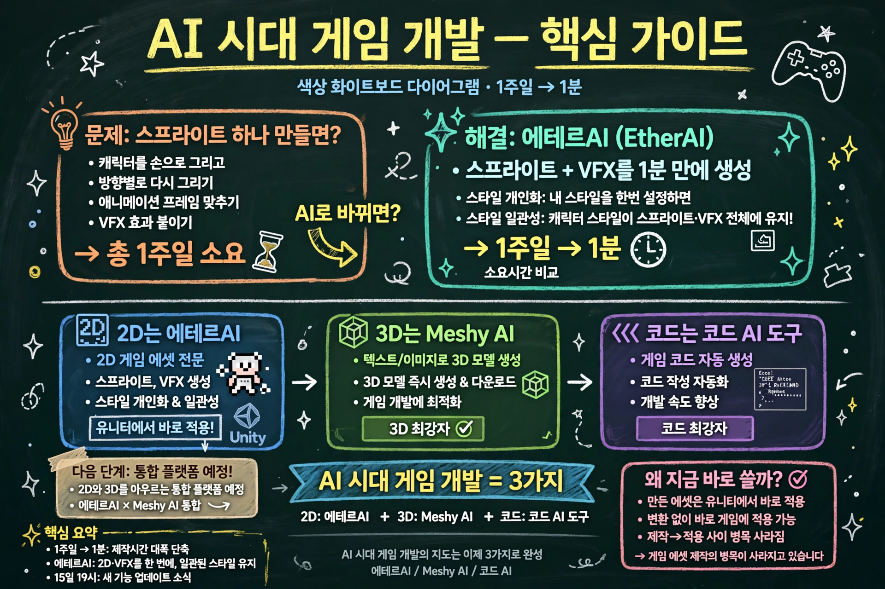
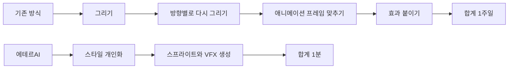
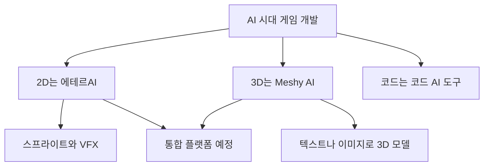

# 게임 스프라이트 만드는 데 1주일? 에테르AI에서는 1분이면 됩니다

> **Summary**
> 에테르AI는 스타일을 개인화하고 일관성을 유지하며 2D 스프라이트와 VFX를 빠르게 제작하고, 결과물을 유니티에서 바로 사용할 수 있게 합니다. AI 게임 개발에서는 2D에 에테르AI, 3D 모델에 Meshy AI, 코드에 AI 도구를 활용하며, 두 플랫폼을 통합하는 서비스도 예정돼 있습니다.

---

- 스프라이트 하나에 1주일 걸리던 일이 에테르AI에서는 1분이면 됩니다. 스타일 개인화부터 스타일 일관성, VFX와 스프라이트까지 한 번에 만듭니다.
- 만든 에셋은 유니티에서 바로 적용할 수 있습니다. 2D는 에테르AI, 3D는 Meshy AI, 코드는 코드 AI 도구 — AI 시대 게임 개발은 이 3가지로 나뉩니다.
- 2D와 3D를 아우르는 통합 플랫폼도 예정돼 있습니다. 게임 에셋 제작의 병목이 사라지고 있습니다.

게임 캐릭터 스프라이트 하나 그리려고 일주일을 잡아본 적 있으시죠? 그림을 그리고, 방향별로 다시 그리고, 애니메이션 프레임까지 맞추다 보면 일주일은 금방 갑니다. 그런데 이걸 1분이면 끝낼 수 있다면 어떨까요?

🎥 [동영상 보기](https://www.youtube.com/watch?v=S8oilV9C4AQ)

## 에테르AI, 도대체 뭘까요?

에테르AI는 2D 게임 에셋을 AI로 만드는 도구입니다. 스프라이트와 VFX를 만듭니다. 핵심은 두 가지입니다. 스타일을 개인화하고, 그 스타일을 끝까지 일관되게 유지하는 겁니다. 캐릭터 하나를 만들면, 그 캐릭터의 스타일이 스프라이트와 VFX 전체에 그대로 이어집니다!

## 1주일이 1분으로, 뭐가 달라질까요?

스프라이트 하나 만드는 데 1주일이 걸렸습니다. 그리는 시간만 1주일이 아닙니다. 방향별로 다시 그리고, 애니메이션 프레임을 맞추고, 효과를 붙이는 시간까지 합치면 일주일은 금방 갑니다. 에테르AI에서는 1분이면 됩니다. 1주일과 1분의 차이, 이게 바로 이 도구의 핵심입니다!

## AI 시대 게임 개발, 3가지만 기억하면 될까요?

AI 시대 게임 개발은 3가지로 나뉩니다. 2D는 에테르AI, 3D는 Meshy AI, 코드는 코드 AI 도구입니다. 에테르AI가 2D 최강자라면, Meshy AI는 3D 최강자입니다. Meshy AI는 텍스트나 이미지로 3D 모델을 만듭니다. 그리고 에테르AI에 Meshy AI를 통합한 플랫폼도 예정돼 있습니다. 2D와 3D를 한곳에서 만드는 겁니다! 15일 19시에는 새 기능 업데이트 소식도 함께 전해졌습니다.

## 유니티에서 바로 쓴다는 건 뭘까요?

만든 에셋은 유니티에서 바로 적용할 수 있습니다. 따로 변환하거나 다시 그릴 필요가 없습니다. 에테르AI에서 만들고, 유니티에서 바로 쓰는 겁니다. 이게 왜 중요할까요? 에셋을 만드는 시간과 게임에 넣는 시간 사이에 간격이 없기 때문입니다. 만들자마자 바로 써볼 수 있습니다!

## 그래서, 뭐가 바뀔까요?

게임 에셋 제작의 병목이 사라지고 있습니다. 스프라이트 하나에 1주일을 쓰던 시대에서, 1분이면 만드는 시대로 넘어가고 있습니다. 2D는 에테르AI, 3D는 Meshy AI, 코드는 코드 AI 도구. 이 3가지를 기억하면, AI 시대 게임 개발의 지도가 보입니다!

