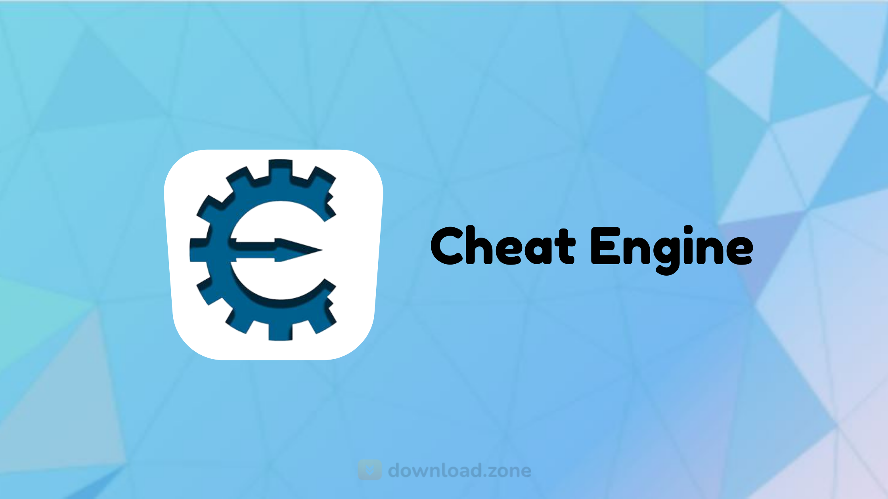

# 게임핵 개발01 

> **Summary**
> 비주얼 스튜디오에서 프로세스를 불러오고 관리하는 방법에 대한 코드 예제와 예외 처리 방법을 설명하며, 프로세스 ID를 추출하는 방법과 관련된 유용한 팁을 제공한다. 코드 샘플은 프로세스 목록을 가져오고 선택된 프로세스에 대한 권한을 얻는 과정을 포함한다.

---



🎥 [동영상 보기](https://www.youtube.com/watch?v=mZ40JEzqhHQ&list=PLnIaYcDMsScxvz3yyClxLU9W6upAUyPzc&index=6)


> 🔥 ****코드에서 빨간줄 생길때 대처법****
> 비주얼스튜디오에서 오류나는곳에서 `alt + enter` 하면 `using System.Diagnostics `라고 옵션이 뜨는데 이거 클릭하면 자동으로 라이브러리 추가해줌
>
>

> 🔥 ****활성화 되어있는 프로세스 불러와 리스트화 시키는 방법****
> ```c#
> using System.Diagnostics;
>
> Process[] MyProcess; //프로세스 목록을 저장할 장소로 리스트로 설정한다
>
> Process_comboBox.Items.Clear();  //기존의 프로세스 목록을 초기화
>   MyProcess = Process.GetProcesses(); //프로세스 목록을 아주 쉽게 Process[] 에 넣을 수 있다
>
>   for (int i = 0; i < MyProcess.Length; i++) 
>   {
>       String text = MyProcess[i].ProcessName + "-" + MyProcess[i].Id; //프로세스 리스트에 들어간 프로세스 이름을 text에 저장한다
>   }
> ```
>
>

> 🔥 ****Spit 기능을 활용한 프로세스 ID만 불러오기****
>
> Split이란 인자 ‘n’ 을 기준으로 나누는것
>
> 만약
>
> ```c#
> selectedItem.Split('-')[Hello-World-000]
> ```
>
>
> 이라면 결과값은 `Hello` , `World` , `000` 으로 3개로 나뉘는것이다
>
> 즉 ‘-’ 기준으로 문자열을 가른것.
>
> 그리고 해당 split 코드는 정수 `3` 을 반환한다.
>
> `[’Hello’.’World’,’000’]`
>
> 하지만 우리에게 필요한건 마지막에 붙는 ID 000 마지막만 불러오는 방법은 다음과 같다
>
> ```c#
> int pid = int.Parse(selectedItem.Split('-')[selectedItem.Split('-').Length - 1]);
> ```
>
> `selectedItem.Split('-').Length - 1` 의 값은 2를 가진다. Split의 총 길이는 3을 가지고 배열은 0부터 시작하니 Length 에서 1을 빼주어 배열의 길이에 맞출 수 있도록 2를 반환시키는 것이다 (0, 1,  2 순이기 때문에 2로 만들어줘야함) 
>
>

> 🔥 **C#에선 예외처리를 try / catch (Exption ex) 로 하는구나**


# 오늘 공부한 전체코드

```c#
using System.Diagnostics;
using ProcessMemoryReaderLib;

namespace AssaltCubeGameHack
{
    public partial class Form1 : Form
    {

        Process[] MyProcess; //프로세스 목록을 저장할 장소로 리스트로 설정한다
        ProcessMemoryReader mem = new ProcessMemoryReader(); //mem이라는 친구가 하는 역할은 ProcessMemoryReader.cs 내부에있는 코드를 사용하게 해줄 역할
        bool attach = false; // 파일이 attach 되어있는지 안되었는지 확인하는 변수

        public Form1()
        {
            InitializeComponent();
        }

        private void label1_Click(object sender, EventArgs e)
        {

        }

        private void Health_BT_Click(object sender, EventArgs e)
        {

        }

        private void Exit_BT_Click(object sender, EventArgs e)
        {
            DialogResult result; //정말로 닫을거야?
            result = MessageBox.Show("종료하시겠습니까?","종료 메시지", MessageBoxButtons.OKCancel);

            if (result == DialogResult.OK)
            {
                this.DialogResult = DialogResult.Abort;
                Application.Exit();
            }
            if(result == DialogResult.Cancel)
            {
                MessageBox.Show("죽어라");
            }
        }
        //클릭했을 때 프로세스 목록이 보이는것
        private void Process_comboBox_Click(object sender, EventArgs e)
        {
            Process_comboBox.Items.Clear();  //기존의 프로세스 목록을 초기화
            MyProcess = Process.GetProcesses(); //프로세스 목록을 아주 쉽게 Process[] 에 넣을 수 있다

            for (int i = 0; i < MyProcess.Length; i++) 
            {
                String text = MyProcess[i].ProcessName + "-" + MyProcess[i].Id; //프로세스 리스트에 들어간 프로세스 이름을 text에 저장한다
                Process_comboBox.Items.Add(text); // Items에 MyProcess[i] 가 순차적으로 추가된다
            }
        }

        //프로세스를 선택했을 때 어떤 행동을 선택할지
        private void Process_comboBox_SelectedIndexChanged(object sender, EventArgs e)
        {
            try
            {
                // 클릭했을때 해당 프로세스에 대한 권한을 가져온다
                // 권한을 가져와 프로세스 메모리를 읽고 수정하기 위함이다

                if (Process_comboBox.SelectedIndex != -1) //빈칸일땐 SelectedIndex 가 -1의 값을 가진다
                {
                    string selectedItem = Process_comboBox.SelectedItem.ToString(); //무언가를 클릭했다면 해당 프로세스가 선택되며 문자열에 
                    int pid = int.Parse(selectedItem.Split('-')[selectedItem.Split('-').Length - 1]); // 문자열을 -로 나눈 후 가장 마지막 문자열을 가지고온다
                                                                                                      //int pid는 문자형으로 들어오는 프로세스 넘버를 숫자로 전환해주는 역할을 한다
                    Process attachProc = Process.GetProcessById(pid);

                    // 프로세스를 열어 권한을 얻는 과정

                    mem.ReadProcess = attachProc; // 어떤 프로세스를 열지 저장
                    mem.OpenProcess(); // 프로세스 열기
                    attach = true;

                    MessageBox.Show("Complete Open Process! : " + attachProc.ProcessName + " / Process ID : " + pid);

                }
            }
            catch (Exception ex) //시도했을 때 예외 처리
            { 
                attach= false;
                MessageBox.Show("Failed Open Process / " + ex.Message);
            }

        }
    }
}
```

[https://download.zone/wp-content/uploads/2019/05/Cheat-Engine-Software-Download.png](https://download.zone/wp-content/uploads/2019/05/Cheat-Engine-Software-Download.png)

