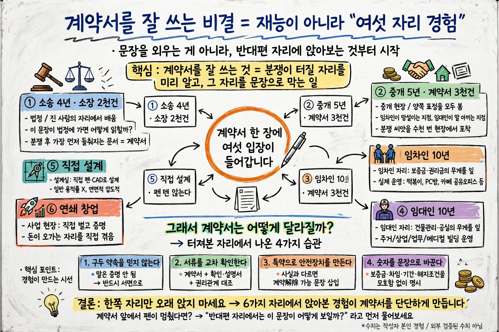
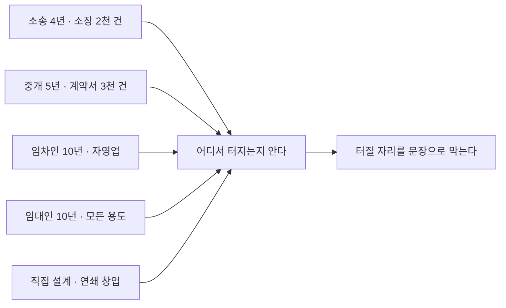
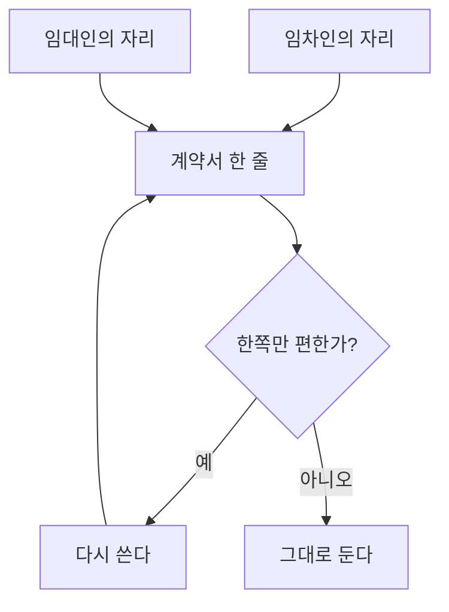
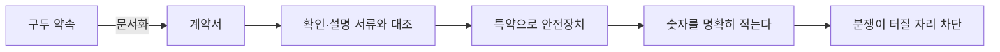

# 계약서를 잘 쓰는 비결은 재능이 아닙니다. 여섯 자리에서 앉아본 경험입니다

> **Summary**
> 계약서를 잘 쓰는 핵심은 문장 재능보다 소송, 중개, 임차·임대, 설계와 창업 등 여러 입장을 직접 경험하는 데 있습니다. 구두 약속을 문서화하고 관련 서류를 대조하며, 특약과 금액·기간·해지 조건을 명확히 해 분쟁이 생길 지점을 미리 막아야 합니다.

---

- 계약서를 잘 쓰는 비결은 재능이 아닙니다. 여섯 자리에서 앉아본 경험이 만듭니다.
- 소송 4년·2천 건, 중개 5년·3천 건, 임차인 10년, 임대인 10년, 직접 설계, 연쇄 창업까지 — 계약서 한 장에 여섯 입장이 들어 있습니다.
- 계약서를 잘 쓰고 싶다면, 문장을 외우는 게 아니라 반대편 자리에 앉아보는 것부터 시작하면 됩니다.

계약서 앞에서 펜이 멈춘 적 있으시죠? 조항은 읽히는데, 이 문장이 나중에 어떻게 터질지 감이 안 잡힐 때가 있습니다. 서명란은 작은데, 그 뒤에 붙는 책임은 크니까요. 그래서 사람들은 묻습니다. 계약서를 잘 쓰는 사람은 도대체 뭘 다르게 볼까요?

🎥 [동영상 보기](https://www.youtube.com/watch?v=C4MUNerxaK8)

## 계약서를 잘 쓴다는 건, 무슨 뜻일까요?

계약서를 잘 쓴다는 말은 문장을 예쁘게 쓴다는 뜻이 아닙니다. 분쟁이 터질 자리를 미리 알고, 그 자리를 문장으로 막는 일입니다. 어디서 터지는지는 책에서 배우는 게 아니라, 터지는 현장을 직접 겪어봐야 압니다. 한 편의 글에서 그 현장을 여섯 가지 자리로 정리했습니다. 숫자는 글쓴이 본인이 밝힌 것으로, 외부에서 검증된 수치는 아니라는 점을 먼저 밝혀둡니다.

## 여섯 자리, 여섯 가지 눈

### 소송 4년, 소장 2천 건 — 진 사람의 자리에서 배웁니다

첫 번째 자리는 법정입니다. 글쓴이의 말로는 4년 동안 2천 건이 넘는 소장을 직접 쓰고 변론에 나섰다고 합니다. 전자소송이 없던 시절이라, 서류 한 장 한 장을 손으로 챙기던 때였습니다. 소송을 해본 사람은 압니다. 계약서는 분쟁이 터진 뒤에 가장 먼저 들춰지는 문서라는 것을요. 어떤 문장이 판사를 설득하고, 어떤 문장이 발목을 잡는지, 패소한 쪽의 자리에서 배웁니다. 그래서 계약서를 쓸 때, 이 문장이 법정에 가면 어떻게 읽힐지를 먼저 떠올립니다!

### 중개 5년, 계약서 3천 건 — 도장을 찍는 사람이 봅니다

두 번째 자리는 중개 현장입니다. 5년 동안 3천 건이 넘는 계약서에 직접 도장을 찍었다고 합니다. 중개인은 계약 당사자가 아닙니다. 그런데도 중개인은 양쪽의 표정을 다 봅니다. 임차인이 망설이는 지점, 임대인이 말을 아끼는 지점이 어디인지, 그 미묘한 틈을 가장 가까이에서 봅니다. 도장을 찍는 손은 중립이지만, 눈은 중립이 아닙니다. 나중에 분쟁이 될 씨앗이 어디에 심기는지, 수천 번의 현장에서 익힙니다.

### 임차인 10년, 임대인 10년 — 양쪽 탁자에 앉아봅니다

세 번째와 네 번째 자리는 탁자의 양쪽입니다. 임차인으로 10년을 살았다고 합니다. 부동산은 물론 떡볶이, PC방, 고시원, 카페, 공유오피스, 클럽까지 자영업을 여러 업종에서 해봤다고 합니다. 그리고 임대인으로도 10년을 살았다고 합니다. 주거용, 상업용, 업무용, 메디컬 빌딩까지 소유했고, 대기업과도 다수 계약했다고 합니다. 임차인의 자리에서는 보증금과 권리금이 얼마나 무거운지 압니다. 임대인의 자리에서는 건물 관리와 공실이 얼마나 무거운지 압니다. 양쪽에 앉아본 사람은 계약서의 한 줄이 한쪽에는 방패가 되고 다른 쪽에는 족쇄가 된다는 것을 압니다. 그래서 한쪽만 편한 문장은 쓰지 않습니다!

## 직접 설계하고, 직접 벌고 — 숫자로 증명되는 자리

다섯 번째 자리는 설계실입니다. 모든 건물을 직접 펜으로, 캐드로 설계했다고 합니다. 일반 용적률로 만든 빌딩은 단 한 채도 없고, 연면적은 남들보다 압도적이라고 합니다. 입지를 보는 눈도 남다르다고 합니다. 여섯 번째 자리는 사업 현장입니다. 연쇄적으로 창업을 이어가고 있다고 합니다. 남들이 열 번 투자해서 벌 것을 한 번에 번다는 것이 본인의 표현입니다. 이 대목은 자랑처럼 들릴 수 있습니다. 하지만 계약서 이야기로 바꿔 읽으면 뜻이 분명해집니다. 계약서를 잘 쓰는 능력은 문장력에서 오는 게 아니라, 돈이 오가는 자리를 직접 겪어본 횟수에서 온다는 것입니다!

## 그래서 계약서는 어떻게 달라질까요?

여섯 자리를 거친 계약서는 달라집니다. 첫째, 구두 약속을 믿지 않습니다. 말로 한 약속은 분쟁이 터지면 증명이 안 되니까요. 둘째, 서류를 교차로 확인합니다. 계약서 한 장만 보는 게 아니라, 뒤에 붙는 확인·설명 서류와 권리관계를 대조합니다. 셋째, 특약으로 안전장치를 만듭니다. 나중에 사실과 다른 것이 드러나면 계약을 풀 수 있는 문장을 미리 넣어둡니다. 넷째, 숫자를 문장으로 바꿉니다. 보증금, 차임, 기간, 해지 조건 같은 숫자가 모호하게 남지 않도록 적습니다. 이 네 가지는 모두 "터져본 자리"에서 나온 습관입니다.

## 계약서 한 장에 여섯 입장이 들어갑니다

계약서를 잘 쓰는 비결을 한 줄로 정리하면 이렇습니다. 한쪽 자리에서 오래 앉아 있는 게 아니라, 여러 자리에서 앉아본 경험이 계약서를 만듭니다. 소송에서 진 사람의 눈, 중개 현장의 눈, 임차인의 눈, 임대인의 눈, 설계자의 눈, 사업자의 눈이 한 장에 모일 때, 계약서는 비로소 단단해집니다. 계약서 앞에서 펜이 멈춘다면, 문장을 더 고치기 전에 물어보면 어떨까요? 반대편 자리에서는 이 문장이 어떻게 보일까요?

