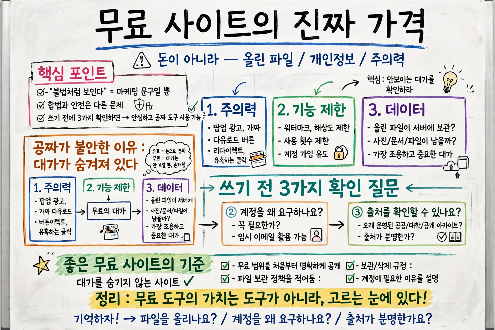
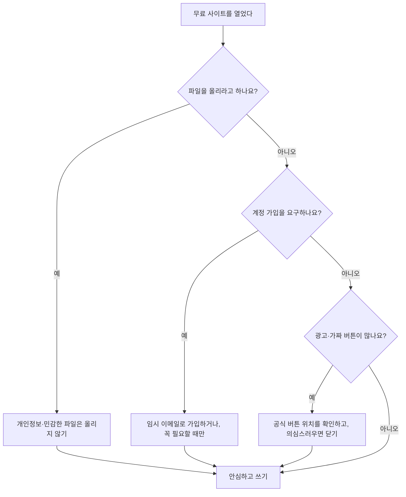
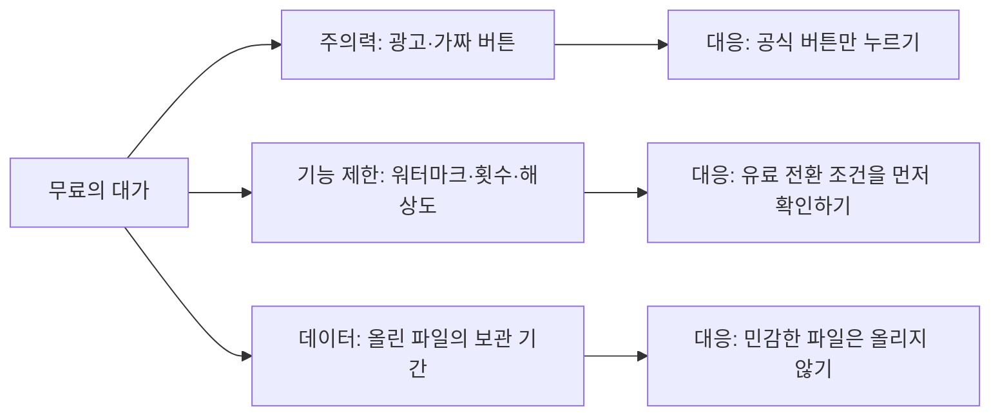

# 공짜 사이트, 쓰기 전에 확인하세요. 무료의 대가는 따로 있습니다

> **Summary**
> 무료 사이트는 광고와 기능 제한, 데이터 수집으로 대가를 치를 수 있으므로, 파일 보관 정책과 계정 요구 이유, 운영 주체와 출처를 확인해야 합니다. 민감한 파일은 올리지 않고 약관과 무료 범위가 투명한 서비스를 선택하면 더 안전하게 이용할 수 있습니다.

---

- 무료 사이트의 진짜 가격은 돈이 아니라, 올린 파일과 개인정보, 그리고 주의력입니다.
- '불법처럼 보인다'는 말은 마케팅 문구일 뿐, 합법과 안전은 다른 문제입니다.
- 쓰기 전에 세 가지만 확인하면, 공짜 도구를 안심하고 골라 쓸 수 있습니다.

"이 사이트, 불법 아니야?" 친구가 보낸 링크를 눌렀다가 멈칫한 적 있으시죠? 동영상 다운로드, 사진 배경 지우기, 임시 이메일, 교과서 검색까지. 돈 한 푼 안 내고 웬만한 유료 기능을 다 해주니까, 오히려 불안해집니다. 공짜가 이렇게까지 좋을 수 있나요?

🎥 [동영상 보기](https://www.youtube.com/watch?v=chU4Ed37yF8)

## 공짜가 불안한 이유, 뭘까요?

불안의 정체는 단순합니다. 대가가 안 보이기 때문입니다. 유료 서비스는 대가가 명확합니다. 돈을 냈으니까요. 무료 사이트는 대가가 안 보일 뿐, 없는 게 아닙니다. 광고로 벌거나, 기능 일부를 유료로 팔거나, 횟수를 제한하거나, 데이터를 모읍니다. 대가가 숨어 있을 뿐입니다!

그래서 "완전 무료"라는 말부터 의심해 보는 게 좋습니다. 서버비는 누가 냈을까요? 개발자 시간은요? 이 질문에 답이 없는 사이트는, 답이 어딘가에 숨어 있는 사이트입니다.

## 무료의 대가, 세 가지로 나뉩니다

첫째, **주의력**입니다. 팝업 광고, 가짜 다운로드 버튼, 리다이렉트가 대표적입니다. 누르는 버튼 하나하나가 수익입니다. 실수로 광고를 눌렀다고 큰일이 나는 건 아니지만, 짜증은 쌓입니다.

둘째, **기능 제한**입니다. 워터마크, 횟수 제한, 해상도 제한, 계정 가입 유도가 여기에 속합니다. 처음엔 공짜처럼 보이다가, 막상 제대로 쓰려면 결제를 권합니다. 이건 나쁜 모델이 아닙니다. 정직한 모델이죠. 뭐가 무료고 뭐가 유료인지 처음부터 보여주니까요.

셋째, **데이터**입니다. 가장 조용하고 가장 중요한 대가입니다. 배경을 지우겠다고 올린 사진, 압축하겠다고 올린 문서, 변환하겠다고 올린 파일. 그 파일이 서버에 얼마나 남을까요? 누가 볼 수 있을까요? 이 질문에 답이 없는 사이트에 민감한 파일을 올리는 건, 모르는 사람에게 서류를 맡기는 것과 같습니다!

## 쓰기 전에 확인하는 3가지 질문이 있습니다

**첫째, 내 파일을 올리는 사이트인가요?** 이미지 압축, 배경 제거, PDF 변환, 파일 공유 사이트가 여기에 속합니다. 올린 파일이 서버에 저장되는지, 얼마나 보관되는지, 삭제는 되는지 확인합니다. 확인이 안 되면, 공개돼도 되는 파일만 올립니다. 이력서, 신분증 사진, 회사 문서는 안 됩니다!

**둘째, 계정을 왜 요구하나요?** 임시 이메일 발급 사이트가 본인 이메일을 요구한다면, 뭔가 이상합니다. 가입이 꼭 필요하다면 임시 이메일로 가입하는 방법도 있습니다. 비밀번호는 다른 곳에서 쓰는 것과 겹치지 않게 만듭니다.

**셋째, 출처를 확인할 수 있나요?** 오래 운영된 공개 아카이브, 대학 공개 강의, 공공 데이터처럼 출처가 분명한 서비스는 안심하고 쓸 수 있습니다. 반대로 운영 주체가 안 보이고, 문의처도 없고, 약관도 없는 사이트는 한 번 더 생각해 봅니다. "불법처럼 보인다"는 말과 "불법이다"는 말이 다르듯, "무료다"와 "안전하다"도 다른 말입니다!

## 그럼 어떤 무료 사이트가 좋은 사이트일까요?

기준은 의외로 단순합니다. 대가를 숨기지 않는 사이트가 좋은 사이트입니다. 무료 범위를 처음부터 보여주고, 파일 보관 정책을 적어두고, 계정이 왜 필요한지 설명하는 사이트. 이런 사이트는 공짜여도 믿을 수 있습니다.

반대로 "완전 무료, 무제한, 가입 불필요"를 외치면서 약관 한 줄 없는 사이트는 조심하는 게 좋습니다. 공짜는 고마운 일이지만, 공짜라서 확인을 건너뛰면 안 됩니다. 확인하는 데 1분, 당하는 데는 그보다 훨씬 오래 걸립니다!

무료 도구의 가치는 도구가 아니라, 고르는 눈에 있습니다. 세 가지 질문만 기억하면 됩니다. 파일을 올리나요? 계정을 왜 요구하나요? 출처가 분명한가요? 이 질문에 답할 수 있는 사이트라면, 공짜여도 마음 놓고 쓰셔도 됩니다.

