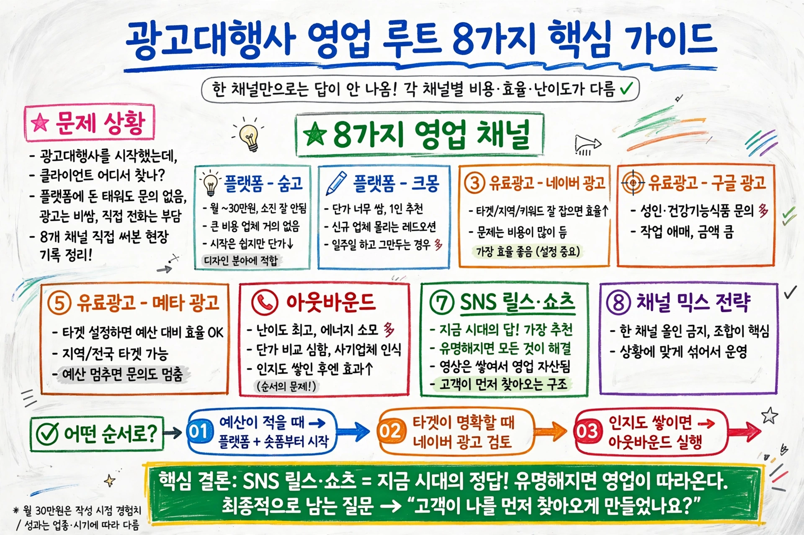
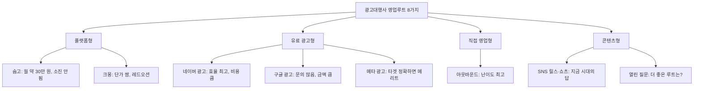
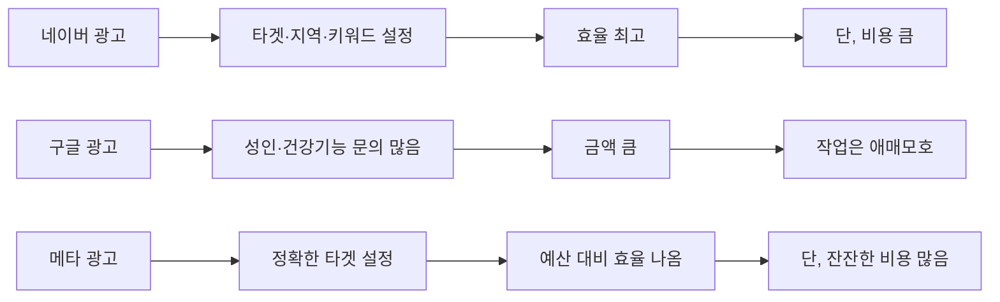
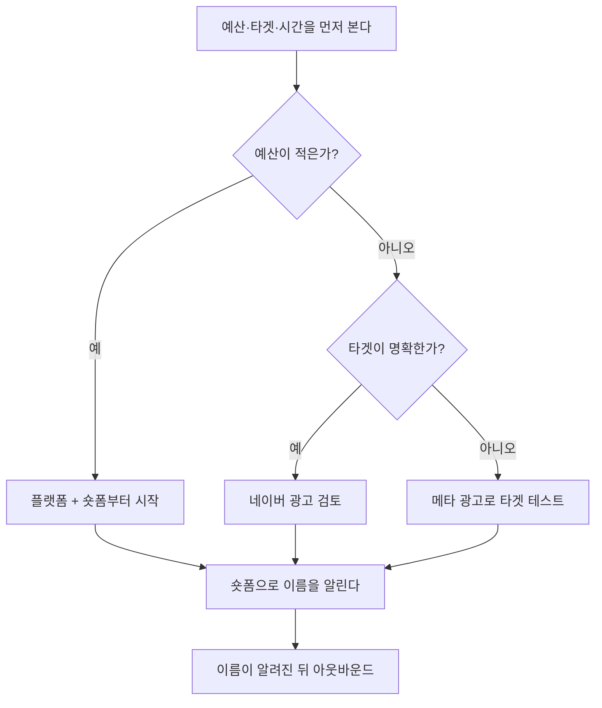

# 광고대행사 영업루트 8가지, 결국 남는 건 릴스·쇼츠입니다

> **Summary**
> 광고대행사의 영업 루트는 플랫폼·유료 광고·아웃바운드·숏폼까지 8가지로 갈립니다. 채널마다 비용·효율·난이도가 다릅니다. 한 채널만으로는 답이 안 나옵니다. 현장에서 가장 지금 시대에 맞는 답은 SNS 릴스·쇼츠 마케팅이었습니다. 유명해지면 영업이 따라옵니다.

---

- 광고대행사의 영업 루트는 플랫폼·유료 광고·아웃바운드·숏폼까지 8가지로 갈립니다.
- 채널마다 비용·효율·난이도가 다릅니다. 한 채널만으로는 답이 안 나옵니다.
- 현장에서 가장 지금 시대에 맞는 답은 SNS 릴스·쇼츠 마케팅이었습니다. 유명해지면 영업이 따라옵니다.

광고대행사를 시작했는데, 클라이언트는 어디서 찾으시나요? 플랫폼에 돈을 태워도 문의는 안 오고, 광고는 비싸고, 직접 전화는 부담스럽습니다. 이 글은 영업 채널 8개를 직접 써본 현장 기록을 정리했습니다!

🎥 [동영상 보기](https://www.youtube.com/watch?v=EswPU6FGl3Q)

## 플랫폼에서 찾는 길, 숨고와 크몽은 왜 다를까요?

첫 번째 루트는 `숨고`입니다. 한 달에 약 30만 원 정도를 태우는데, 소진이 잘 안 됩니다. 큰 비용을 쓰는 업체가 거의 없다는 게 이유입니다. 소규모 의뢰가 중심이라 규모를 키우기 어렵습니다.

두 번째 루트는 `크몽`입니다. 단가가 너무 쌉니다. 1인에게는 추천할 만합니다. 그런데 신규 업체가 몰리는 레드오션이라, 일주일 해보고 그만두는 경우도 많습니다. 디자인 영역을 다루는 분들에게는 좋은 편입니다.

플랫폼의 공통점은 시작이 쉽다는 것입니다. 그런데 단가 경쟁이 심합니다. 싸게 시작하면 싸게만 남을 수 있습니다. 플랫폼은 첫 고객을 만나는 문으로는 좋지만, 주력 채널로 삼기에는 한계가 분명합니다.

## 유료 광고 3종, 돈이 드는 만큼 효율이 나올까요?

세 번째 루트는 네이버 광고입니다. 타겟 설정, 지역 설정, 키워드 설정만 잘하면 가장 효율이 좋습니다. 문제는 돈이 많이 들어간다는 점입니다. 설정이 정확할수록 돈이 더 들어갑니다. 효율과 비용이 함께 올라갑니다.

네 번째 루트는 구글 광고입니다. 성인·건강기능식품 관련 문의가 많습니다. 작업하기 애매모호한데, 금액은 큽니다. 문의의 질과 금액이 따로 노는 채널입니다. 업종에 따라서는 맞는 채널이지만, 아무 업종에나 맞는 길은 아닙니다.

다섯 번째 루트는 메타 광고입니다. 정확한 타겟 설정만 하면 충분히 메리트가 있습니다. 지역 기반이든 전국 기반이든, 타겟을 잡으면 예산 대비 효율은 나옵니다. 다만 잔잔한 비용이 많습니다. 작은 지출이 쌓여서 예산을 갉아먹습니다.

유료 광고 3종을 한 줄로 정리하면 이렇습니다. 네이버는 효율이 좋고 비쌉니다. 구글은 금액은 크고 문의의 결이 다릅니다. 메타는 타겟만 맞으면 쓸 만합니다. 공통점은 돈을 태우는 속도만큼 결과가 나온다는 것입니다. 예산이 멈추면 문의도 멈춥니다!

## 아웃바운드, 왜 가장 힘들까요?

여섯 번째 루트는 아웃바운드입니다. 난이도가 높습니다. 에너지 소비가 많습니다. 단가 비교가 엄청 심합니다. 사기업체라는 인식이 있어서 뚫기 어렵습니다.

직접 전화를 걸고, 메일을 보내고, 문을 두드리는 일입니다. 거절을 견디는 힘이 필요합니다. 그런데 거절보다 더 힘든 건 비교입니다. 견적을 받자마자 단가부터 비교당합니다. 실력을 보여줄 기회조차 얻기 어렵습니다.

아웃바운드가 나쁜 채널이라는 뜻은 아닙니다. 다만 시작 단계에서 쓰기에는 에너지가 너무 많이 듭니다. 이름이 알려진 뒤에 쓰면 이야기가 달라집니다. 순서의 문제입니다!

## SNS 릴스·쇼츠, 왜 지금 시대의 답일까요?

일곱 번째 루트는 SNS 릴스·쇼츠 마케팅입니다. 현장 기록에서 가장 지금 시대에 맞다고 꼽은 루트입니다. "내가 유명해지면 모든 것이 다 해결된다"는 게 핵심 주장입니다.

광고는 돈을 태우는 동안만 돌아갑니다. 그런데 영상은 올린 뒤에도 남습니다. 영상이 쌓이면 채널 자체가 영업 자산이 됩니다. 고객이 먼저 찾아오는 구조가 됩니다. 그래서 댓글에서도 이 항목에 공감이 가장 많이 모였습니다. 어떤 댓글은 앞의 다섯 가지 루트가 없어도 된다고까지 말했습니다. 물론 모든 채널을 다 써야 한다는 의견도 있었습니다. 의견은 갈렸지만, 숏폼이 지금 시대의 중심이라는 데는 공감대가 있었습니다.

숏폼이 만능이라는 뜻은 아닙니다. 영상을 만드는 데도 시간과 실력이 듭니다. 그런데 한 번 만든 영상이 계속 일한다는 점이 다릅니다. 광고비와 달리, 만든 콘텐츠는 멈추지 않습니다!

## 어떤 순서로 골라야 할까요?

여덟 번째 항목은 루트가 아니라 질문입니다. "더 좋은 것 있으면 추천해줄래..?" 현장 기록은 열린 질문으로 끝납니다. 7개를 써보고도 답이 덜 나왔다는 뜻입니다.

그래서 채널을 고를 때는 순서가 중요합니다. 예산이 적으면 플랫폼과 숏폼부터 시작합니다. 타겟이 명확하면 네이버 광고를 검토합니다. 이름이 알려진 뒤에는 아웃바운드가 힘을 냅니다. 한 채널에 올인하지 않고, 단계마다 맞는 채널을 섞는 것이 핵심입니다.

이 글은 한 현장 운영자의 경험담을 정리한 것입니다. 월 30만 원 같은 수치는 게시글 작성 시점의 경험이고, 채널별 성과는 업종과 시기에 따라 달라집니다. 그래도 결론은 분명합니다. 채널은 8개지만, 결국 남는 질문은 하나입니다. 고객이 나를 먼저 찾아오게 만들었나요?

