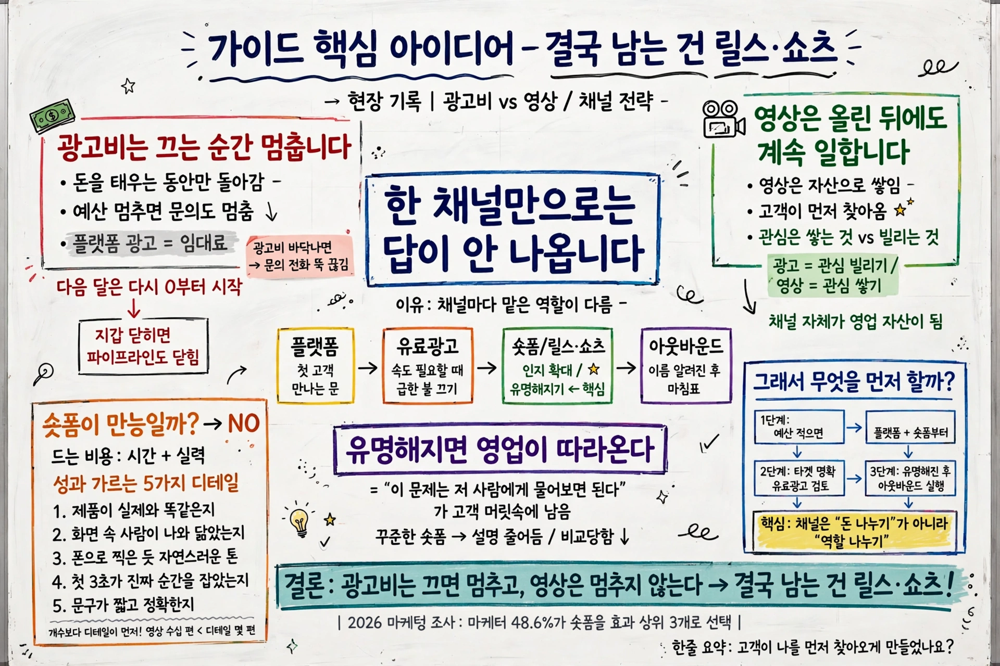
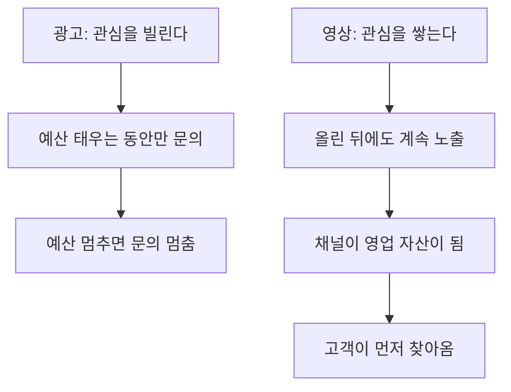
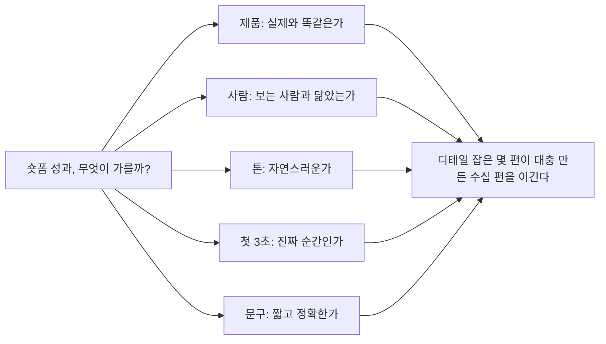
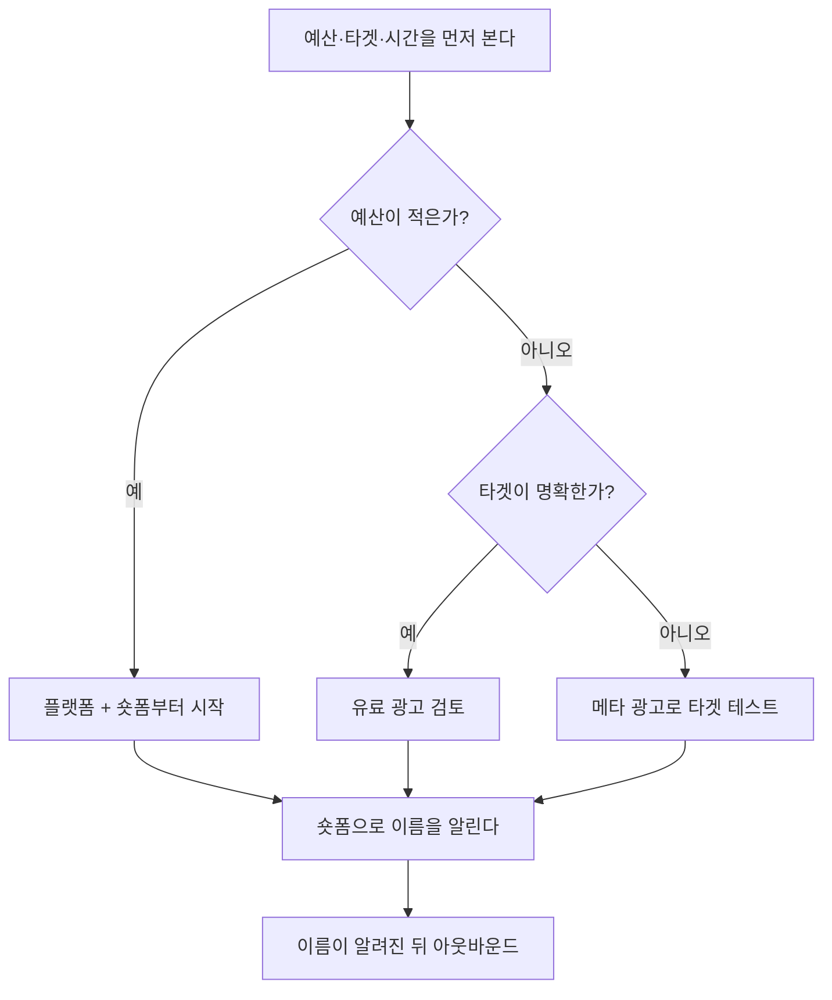

# 광고비는 끄는 순간 멈춥니다. 영상은 올린 뒤에도 계속 일합니다

> **Summary**
> 광고비는 끄는 순간 문의도 멈추지만, 영상은 올린 뒤에도 계속 일해 채널 자체가 영업 자산이 됩니다. 한 채널만으로는 답이 안 나옵니다. 채널마다 맡은 역할이 달라서 예산이 적으면 플랫폼과 숏폼부터 시작해 이름을 알린 뒤 아웃바운드로 마무리하는 순서가 맞고, 숏폼도 대충 많이 찍는 것보다 제품·사람·톤·첫 3초·문구 다섯 가지 디테일을 잡은 몇 편이 매출을 더 만듭니다.

---

- 광고비는 끄는 순간 문의도 멈춥니다. 영상은 올린 뒤에도 계속 일합니다.
- 한 채널만으로는 답이 안 나옵니다. 채널마다 맡은 역할이 다르기 때문입니다.
- 결국 남는 건 릴스·쇼츠입니다. 유명해지면 영업이 따라오기 때문입니다.

광고비를 태우던 달 말, 예산이 바닥나자 문의 전화가 뚝 끊긴 적 있으시죠? 그달은 열심히 돌았는데, 다음 달은 다시 0부터 시작해야 했습니다. 이 글은 광고대행사 영업 채널 8개를 직접 써본 현장 기록에서, 왜 결국 릴스·쇼츠가 남았는지 그 이유를 깊게 파봅니다!

🎥 [동영상 보기](https://www.youtube.com/watch?v=LO-AboAjFaw)

## 광고는 왜 끄는 순간 멈출까요?

광고는 돈을 태우는 동안만 돌아갑니다. 예산이 멈추면 문의도 멈춥니다. 플랫폼에 월 30만 원 정도를 태워도, 소진이 잘 안 되는 달이 있고, 돈이 드는 만큼 결과가 나오는 구조라서 지갑이 닫히면 파이프라인도 닫힙니다.

영상은 다릅니다. 올린 뒤에도 남습니다. 영상이 쌓이면 채널 자체가 영업 자산이 됩니다. 고객이 먼저 찾아오는 구조가 됩니다. 빌린 관심과 가진 관심의 차이가 바로 여기에 있습니다. 광고는 관심을 빌리는 일이고, 영상은 관심을 쌓는 일입니다!

> 돈을 태우는 동안만 돌아가는 채널과, 만든 뒤에도 계속 일하는 채널. 어느 쪽에 시간을 쓸까요?

이 차이가 현장에서 가장 크게 와닿았습니다. 광고비는 매달 새로 내야 하는 임대료 같고, 영상은 한 번 지으면 계속 쓰는 집 같습니다. 그래서 현장 기록의 결론은 "유명해지면 모든 것이 해결된다"였습니다. 과장처럼 들리지만, 영업의 본질을 찌르는 말입니다.

## 유명해지면 영업이 따라올까요?

유명해진다는 건 얼굴을 알리는 게 아닙니다. "이 문제는 저 사람에게 물어보면 된다"는 기억이 고객 머릿속에 남는 것입니다. 영상을 꾸준히 올리면, 고객은 견적을 받기 전에 이미 나를 알고 있습니다. 설명할 필요가 줄어들고, 비교당할 일도 줄어듭니다. 영업이 쉬워지는 이유가 여기에 있습니다!

현장 기록의 댓글에서도 이 항목에 공감이 가장 많이 모였습니다. 어떤 댓글은 앞의 다섯 가지 루트가 없어도 된다고까지 말했습니다. 반대로 모든 채널을 다 써야 한다는 의견도 있었습니다. 의견은 갈렸지만, 숏폼이 지금 시대의 중심이라는 데는 공감대가 있었습니다. 왜 이렇게까지 의견이 모였을까요?

숏폼은 숫자로도 뒷받침됩니다. 2026년 마케팅 조사에서 숏폼 영상은 모든 미디어 형식 중 투자 대비 효과가 가장 높은 형식으로 꼽혔습니다. 마케터의 48.6%가 숏폼을 효과 상위 3개 안에 넣었습니다. 현장의 감각과 조사 결과가 같은 방향을 가리키고 있습니다.

## 숏폼이 만능일까요?

아닙니다. 숏폼에도 비용이 듭니다. 돈이 아니라 시간과 실력입니다. 영상을 만드는 데 시간이 들고, 잘 만드는 데는 감각이 필요합니다. 대충 많이 찍는다고 성과가 나지 않는다는 게 현장의 교훈입니다. 실제 광고를 운영해본 기록에 따르면, 디테일 없이 찍어낸 영상 수십 편보다 디테일을 잡은 영상 몇 편이 매출을 더 만듭니다!

성과를 가르는 디테일은 다섯 가지입니다. 제품이 실제와 똑같은지, 화면 속 사람이 보는 사람과 닮았는지, 폰으로 찍은 듯 자연스러운 톤인지, 첫 3초가 진짜 순간을 잡았는지, 문구가 짧고 정확한지. 보는 사람은 1~2초 안에 이 모든 것을 무의식적으로 판단하고 넘길지 말지를 정합니다. 개수보다 디테일이 먼저입니다.

## 한 채널만으로는 왜 안 될까요?

채널마다 맡은 역할이 다르기 때문입니다. 플랫폼은 첫 고객을 만나는 문으로 좋습니다. 유료 광고는 속도가 필요할 때 씁니다. 아웃바운드는 이름이 알려진 뒤에 힘을 냅니다. 직접 전화를 걸고 메일을 보내는 일은, 이름이 알려지기 전에는 단가 비교부터 당하기 쉽습니다. 거절보다 힘든 게 비교입니다. 실력을 보여줄 기회조차 얻기 어렵습니다.

그래서 순서가 중요합니다. 예산이 적으면 플랫폼과 숏폼부터 시작합니다. 타겟이 명확하면 유료 광고를 검토합니다. 이름이 알려진 뒤에는 아웃바운드가 힘을 냅니다. 한 채널에 올인하지 않고, 단계마다 맞는 채널을 섞는 것이 핵심입니다. 그런데 여기서도 질문이 남습니다. 섞는다고 다 되는 걸까요?

섞는다고 다 되는 건 아닙니다. 채널을 섞는다는 건 돈을 나누는 게 아니라 역할을 나누는 것입니다. 숏폼이 이름을 알리는 동안, 플랫폼은 첫 만남을 만들고, 유료 광고는 급한 불을 끄고, 아웃바운드는 이미 아는 사람에게 마침표를 찍습니다. 역할이 겹치면 돈만 두 번 듭니다.

## 그래서 무엇을 먼저 할까요?

현장 기록은 열린 질문으로 끝납니다. "더 좋은 것 있으면 추천해줄래..?" 7개를 써보고도 답이 덜 나왔다는 뜻입니다. 그런데 답은 이미 글 안에 있었습니다. 고객이 나를 먼저 찾아오게 만들었나요?

이 글은 한 현장 운영자의 경험담을 정리한 것입니다. 채널별 성과는 업종과 시기에 따라 달라지고, 월 30만 원 같은 수치는 작성 시점의 경험입니다. 일반 데이터가 아니라는 점을 분명히 밝힙니다. 그래도 결론은 분명합니다. 광고비는 끄면 멈추고, 영상은 멈추지 않습니다. 그래서 결국 남는 건 릴스·쇼츠입니다!

