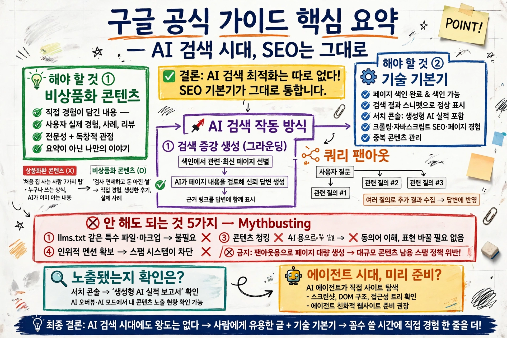
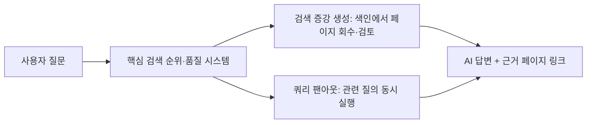
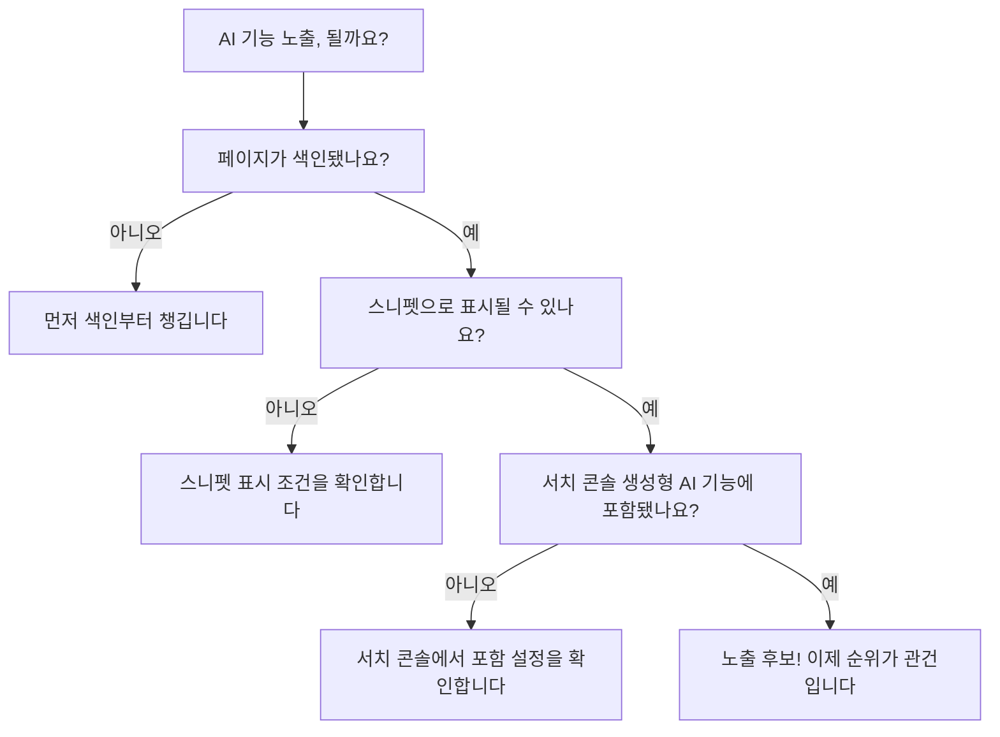
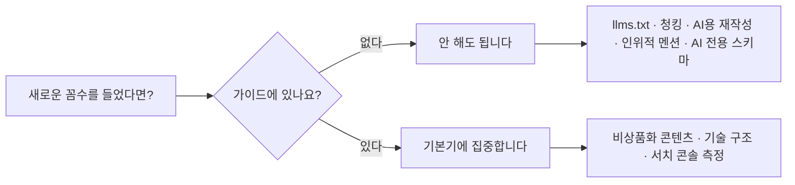

# 구글 공식 GEO 가이드: AI 검색 최적화, 따로 할 게 없습니다

> **Summary**
> 구글 공식 가이드에 따르면 AI 검색 최적화는 따로 없습니다. AI 오버뷰와 AI 모드는 핵심 검색 순위·품질 시스템 위에서 돌아가기 때문입니다. llms.txt, 청킹, AI 전용 스키마 같은 꼼수는 안 해도 되고, 대신 직접 경험이 담긴 비상품화 콘텐츠와 색인·스니펫·서치 콘솔까지 챙긴 기술 구조가 남습니다.

---

- 구글 공식 가이드의 결론은 하나입니다. AI 검색 최적화는 따로 없습니다. SEO 기본기가 그대로 통합니다.
- `llms.txt` 만들기, 콘텐츠 잘게 쪼개기, AI 전용 스키마 달기 같은 꼼수는 안 해도 됩니다. 구글은 필요 없다고 잘라 말했습니다.
- 대신 남는 건 두 가지입니다. 직접 경험이 담긴 비상품화 콘텐츠, 그리고 색인·스니펫·서치 콘솔까지 챙긴 기술 구조입니다.

AI 검색 시대라면서 `llms.txt` 파일 하나 만들라고 하던데요? 콘텐츠를 잘게 쪼개야 AI가 잘 읽는다고 하던데요? 이런 얘기 들어보셨죠? 2026년 5월, 구글이 직접 가이드를 내놨습니다. 결론부터 말하면, 그 얘기들 대부분은 안 해도 되는 일이었습니다!

🎥 [동영상 보기](https://www.youtube.com/watch?v=AGvy5vUIbsg)

## SEO, 아직 유효할까요?

가이드가 던진 첫 질문에 대한 답은 짧습니다. "짧게 답하면, 그렇습니다!" AI 오버뷰와 AI 모드 같은 생성형 AI 기능은 구글 핵심 검색의 순위·품질 시스템 위에 서 있기 때문입니다. AI가 따로 돌아가는 게 아닙니다. 기존 검색이 고른 페이지를 AI가 다시 읽어 답을 만드는 구조입니다.

작동 방식은 두 가지입니다. 첫째는 검색 증강 생성, 흔히 그라운딩이라고 부르는 방식입니다. 핵심 순위 시스템이 색인에서 관련 있고 최신인 페이지를 꺼내오고, 시스템이 그 페이지 내용을 검토해 더 믿을 만한 답변을 만든 뒤, 근거가 된 페이지 링크를 눈에 띄게 답니다. 둘째는 쿼리 팬아웃입니다. 모델이 원래 질문과 관련된 질의 여러 개를 동시에 만들어 추가 결과를 가져옵니다. "잔디 잡초 없애는 법"을 물으면 "잔디용 제초제", "화학약품 없이 잡초 제거", "잡초 예방법" 같은 질의가 함께 돌아간다는 얘기입니다.

## 그럼 뭘 해야 할까요?

첫째, 비상품화 콘텐츠입니다. 가이드가 가장 오래 공들인 대목입니다. 남이 이미 쓴 얘기를 요약만 하면, AI가 이미 아는 얘기를 되풀이하는 셈입니다. 직접 경험, 전문성, 독창적 관점이 들어간 글이 남습니다. 가이드가 든 대비가 재밌습니다. "처음 집 사는 사람을 위한 7가지 팁"은 누구나 쓸 수 있는 상식이라 상품화된 콘텐츠이고, "검사 면제하고 돈 아낀 썰: 하수관 속을 들여다본 이야기"는 직접 경험이 담긴 비상품화 콘텐츠입니다. 목록형 BEST 7이 AI 인용에 유리해 보인다는 말이 돌았지만, 가이드의 입장은 정반대입니다!

둘째, 사람이 읽기 쉽게 씁니다. 문단, 제목, 섹션으로 구조를 잡고, 필요하면 고품질 이미지와 동영상을 함께 둡니다. 이미지와 동영상도 AI 기능에 뜰 수 있으니, 글만으로 끝내지 않는 게 좋습니다.

셋째, 기술 기본기입니다. AI 기능에 뜨려면 페이지가 색인돼 있고, 검색 결과 스니펫으로 표시될 수 있어야 하며, 서치 콘솔에서 생성형 AI 기능에 포함돼 있어야 합니다. 크롤링, 자바스크립트 SEO, 페이지 경험, 중복 콘텐츠 관리가 그대로 유효합니다. 시맨틱 HTML은 완벽하지 않아도 됩니다. 사람 가독성 중심이면 충분합니다.

넷째, 지역 비즈니스나 이커머스라면 상품·매장 정보를 챙깁니다. 비즈니스 프로필과 Merchant Center 피드로 관리하면 AI 답변에도 상품과 매장 정보가 뜰 수 있습니다.

## 안 해도 되는 것, 다섯 가지일까요?

가이드에는 "Mythbusting" 섹션이 따로 있습니다. AEO, GEO라는 말이 흔하지만, 구글 검색이 실제로 돌아가는 방식과 맞지 않는 꼼수가 많다는 얘기입니다. 다섯 가지를 콕 집어 안 해도 된다고 했습니다.

첫째, `llms.txt` 같은 특수 파일과 마크업입니다. AI용 파일을 새로 만들 필요가 없습니다. 구글 검색 자체가 그런 파일을 쓰지 않기 때문입니다. 둘째, 콘텐츠 청킹입니다. AI가 잘 읽도록 본문을 잘게 쪼갤 필요가 없습니다. 짧은 페이지가 좋을 수도, 긴 페이지가 좋을 수도 있습니다. 주제와 독자에 맞게 쓰면 됩니다. 셋째, AI만을 위한 재작성입니다. AI는 동의어와 의미를 이해하니, 특정 표현을 맞추려고 문체를 바꿀 필요가 없습니다. 넷째, 인위적인 멘션 확보입니다. 여기저기서 우리 브랜드를 언급하게 만드는 건 스팸 시스템이 차단합니다. 다섯째, AI 전용 스키마 과몰입입니다. 생성형 AI용 특수 스키마는 없습니다. 기존 스키마는 리치 결과용으로 계속 쓰면 됩니다.

여기에 한 가지는 아예 금지선입니다. 팬아웃 쿼리의 변형마다 페이지를 대량으로 만드는 행위는 '대규모 콘텐츠 남용' 스팸 정책 위반입니다. 질의 하나하나에 대응하려고 유사한 페이지를 양산하면 불이익을 받습니다.

## 노출됐는지, 어떻게 알까요?

서치 콘솔에 생성형 AI 실적 보고서가 있습니다. AI 오버뷰와 AI 모드에서 내 콘텐츠가 어떻게 보이는지 확인할 수 있습니다. 감으로 짐작하지 말고, 보고서로 확인하면 됩니다. 가이드의 마지막 조언도 같습니다. SEO 기본기를 우선하고, 꼼수보다 비상품화 콘텐츠를 만들고, 서치 콘솔로 측정하라는 얘기입니다.

## 에이전트 시대, 미리 준비할까요?

AI 에이전트가 예약을 하고, 스펙을 비교하고, 정보를 수집하는 시대가 오고 있습니다. 브라우저 에이전트는 사이트를 직접 열어 스크린샷을 보고, DOM 구조를 뜯고, 접근성 트리를 읽습니다. 가이드도 여유 있으면 에이전트 친화적 웹사이트 준비를 살펴보라고 권합니다. 범용 커머스 프로토콜 같은 새 규격도 나오고 있습니다. 다만 이건 "여유 있으면" 영역입니다. 핵심은 앞의 기본기입니다.

결론은 심플합니다. AI 검색 시대에도 왕도는 없습니다. 사람에게 유용한 글을 쓰고, 기술 기본기를 챙기면 됩니다. 꼼수에 쓸 시간에, 직접 경험 한 줄을 더 쓰는 게 낫습니다!

