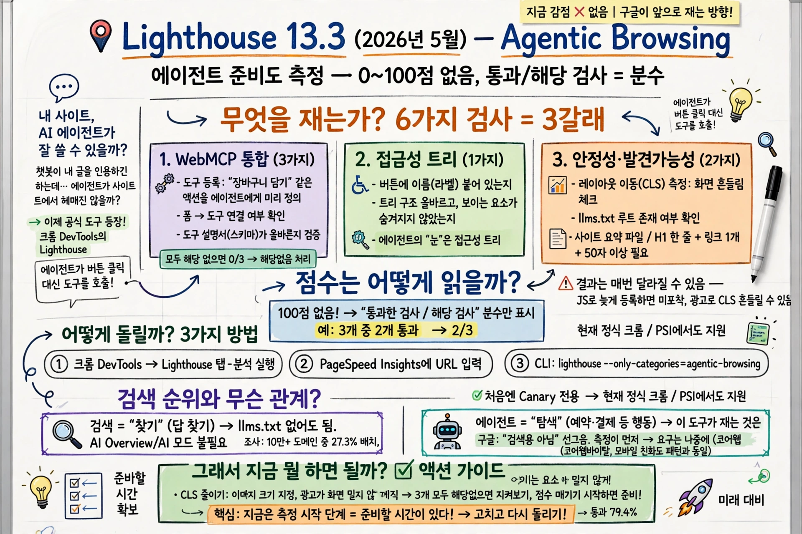
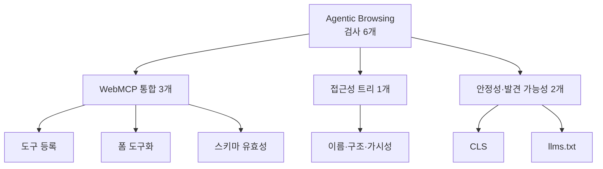
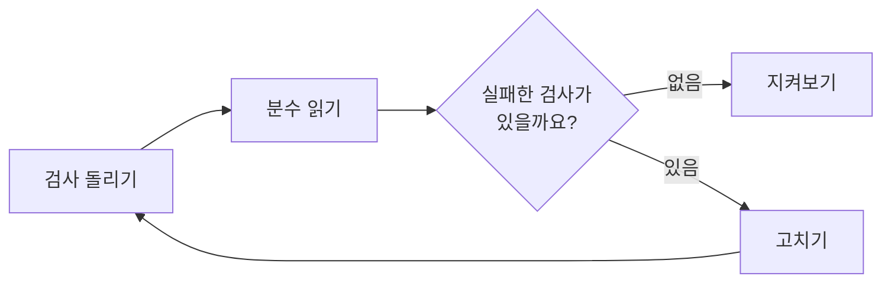
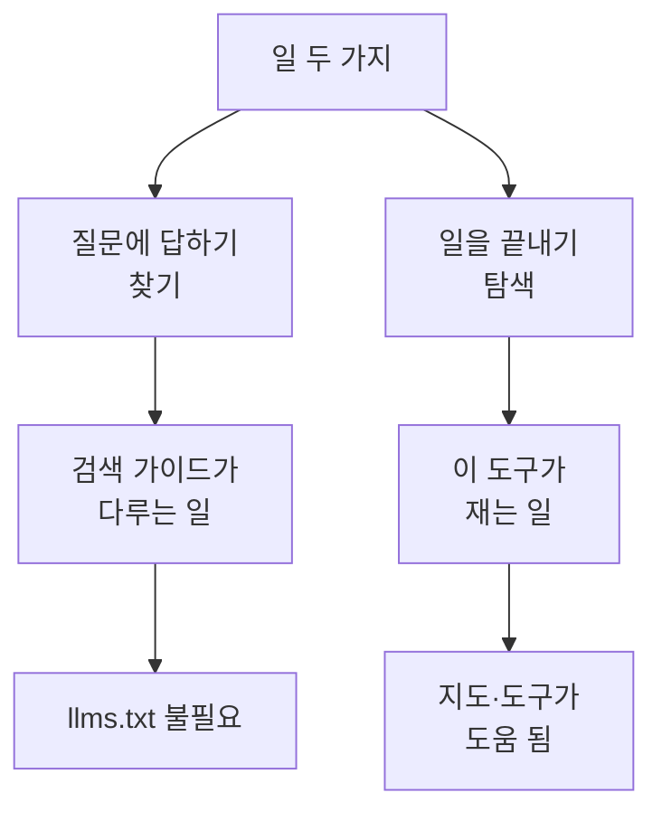

# 구글 공식 GEO 진단 도구, 점수가 없습니다. 대신 분수가 나옵니다

> **Summary**
> 라이트하우스의 Agentic Browsing 검사는 WebMCP, 접근성 트리, 레이아웃 안정성, llms.txt 등 6개 항목을 점수 대신 통과한 검사 수로 보여줍니다. 이는 검색 순위가 아니라 에이전트가 사이트에서 작업을 수행하기 쉬운지를 진단하며, 지금은 접근성과 화면 안정성을 개선하고 WebMCP는 필요해질 때까지 지켜보면 됩니다.

---

- 라이트하우스 13.3(2026년 5월)에 사이트의 에이전트 준비도를 재는 "Agentic Browsing" 검사 항목이 새로 들어왔습니다.
- 0~100점 점수는 없습니다. 여섯 가지 검사 중 통과한 게 몇 개인지, 분수로만 보여줍니다.
- 지금 당장 감점되는 검사는 하나도 없지만, 구글이 무엇을 재기 시작했는지가 앞으로의 방향을 알려줍니다.

내 사이트, AI 에이전트가 잘 쓸 수 있을까요? 이런 적 있으시죠? 챗봇이 내 글을 인용해주면 좋겠는데, 정작 에이전트가 내 사이트에 들어와서 뭘 해야 할지 헤매는 건 아닐까 궁금해진 적 말입니다. 이제 그 질문에 답해주는 공식 도구가 생겼습니다. 크롬 개발자 도구에 들어 있는 라이트하우스입니다!

🎥 [동영상 보기](https://www.youtube.com/watch?v=3sY-xxqZ_wA)

### 무엇을 재는 걸까요?

검사는 여섯 가지입니다. 세 갈래로 나뉩니다.

첫째는 **WebMCP 통합**, 세 가지 검사입니다. WebMCP는 사이트가 에이전트에게 할 일을 직접 알려주는 방식입니다. 버튼을 찾아 클릭하게 두는 대신, "장바구니에 담기" 같은 도구를 미리 등록해두는 겁니다. 라이트하우스는 도구가 등록됐는지, 폼이 도구로 닿는지, 도구 설명서(스키마)가 올바른지 봅니다.

둘째는 **접근성 트리**, 한 가지 검사입니다. 에이전트는 화면을 눈으로 보는 게 아니라 접근성 트리를 "눈" 삼아 읽습니다. 버튼마다 이름이 붙어 있는지, 트리 구조가 올바른지, 보이는 요소가 트리에서 숨겨져 있지는 않은지 봅니다.

셋째는 **안정성·발견 가능성**, 두 가지 검사입니다. 화면이 흔들리면 에이전트도 헤맵니다. 레이아웃 이동(CLS)을 재고, 사이트 요약 파일인 `llms.txt`가 루트에 있는지도 봅니다.

### 어떻게 돌리면 될까요?

방법은 세 가지입니다. 크롬 개발자 도구에서 라이트하우스 탭을 열고 분석을 누르면 됩니다. 페이지스피드 인사이트에 URL만 넣어도 같은 검사가 돕니다. 명령줄이 편하면 `lighthouse --only-categories=agentic-browsing` 한 줄이면 됩니다. 처음 나왔을 때는 카나리아에서만 돌릴 수 있었고, 이후 정식 크롬과 페이지스피드 인사이트로도 들어왔습니다.

### 점수는 어떻게 읽을까요?

점수가 없다는 게 이 도구의 가장 큰 특징입니다! 다른 항목은 0~100점으로 나오는데, 여기는 "통과한 검사 / 해당하는 검사"라는 분수만 나옵니다. 예를 들어 "3개 중 2개 통과" 같은 식입니다.

"해당 없음"도 자주 봅니다. WebMCP 검사는 사이트가 WebMCP를 안 쓰면 세 개 모두 "해당 없음"이 됩니다. `llms.txt` 검사도 파일이 없으면 "해당 없음"입니다. 없는 걸로 감점하지 않는다는 뜻입니다. 다만 파일이 있는데 서버가 오류를 내면 실패로 뜹니다. 형식이 틀려도 실패입니다. 실제 감사 코드 기준으로는 제목 한 줄(H1), 링크 최소 하나, 50자 이상이 필요합니다. 링크 없는 URL 나열은 통과하지 못합니다.

결과가 매번 조금씩 달라질 수도 있습니다. 도구를 자바스크립트로 늦게 등록하면 스냅샷에 안 잡히고, 광고나 크기 없는 이미지가 화면을 밀면 CLS가 흔들립니다. 한 번 돌려보고 끝낼 게 아니라, 고치고 다시 돌리는 용도입니다.

### 검색 순위랑은 무슨 관계일까요?

여기가 가장 헷갈리는 지점입니다. 구글 검색 가이드는 `llms.txt`가 없어도 된다고 못 박았습니다. AI 오버뷰나 AI 모드에 나오는 데 이 파일은 필요 없습니다. 그런데 크롬은 같은 파일을 검사합니다. 모순일까요?

아닙니다. 일이 두 가지이기 때문입니다. 질문에 답하는 건 "찾기"의 일이고, 일을 끝까지 해내는 건 "탐색"의 일입니다. 검색이 답을 찾는 일이라면, 에이전트가 사이트를 돌아다니며 예약하고 결제하는 일은 탐색입니다. 이 도구는 두 번째 일을 재는 겁니다!

구글 측도 "검색을 위한 게 아니다"라고 선을 그었습니다. 측정이 먼저 오고 요구가 나중에 오는 건 구글의 오래된 패턴입니다. 코어 웹 바이탈도 순위 신호가 되기 한참 전부터 라이트하우스에서 잴 수 있었고, 모바일 친화도·HTTPS도 마찬가지였습니다. 지금 이 도구가 재는 건, 구글이 앞으로 잴 준비를 하고 있다는 신호입니다.

### 그래서 지금 뭘 하면 될까요?

비율부터 보면, 10만 개 넘는 도메인을 측정한 한 조사에서 `llms.txt`를 둔 사이트는 27.3%였고, 있는 파일 중 형식 검사를 통과한 건 79.4%였습니다. 파일 하나 만드는 건 오후면 됩니다! 제목 한 줄, 한 줄 요약, 핵심 페이지 링크를 마크다운 링크로 적으면 됩니다.

접근성 트리 고치는 일은 에이전트용이 아니라 20년 전부터 옳았던 일입니다. 버튼에 이름 붙이고, 시맨틱 HTML을 쓰고, 보이는 요소를 트리에서 숨기지 않는 겁니다. 화면 흔들림 줄이는 일도 마찬가지입니다. 이미지 크기를 정하고 광고가 화면을 밀지 않게 하면 됩니다.

WebMCP는 아직 만들지 않아도 됩니다. 세 가지 검사가 모두 "해당 없음"으로 남아 있는 동안은 지켜보는 게 맞습니다. 검사가 점수를 매기기 시작하면 그때 움직이면 됩니다.

참고로, 원문 게시글은 로그인 뒤에 있어 전문을 직접 읽지 못했습니다. 이 글은 구글 공식 문서와 검증 기사로 내용을 교차 확인해 썼습니다. 측정이 시작됐다는 사실 자체가, 준비할 시간이 있다는 뜻이니까요!

