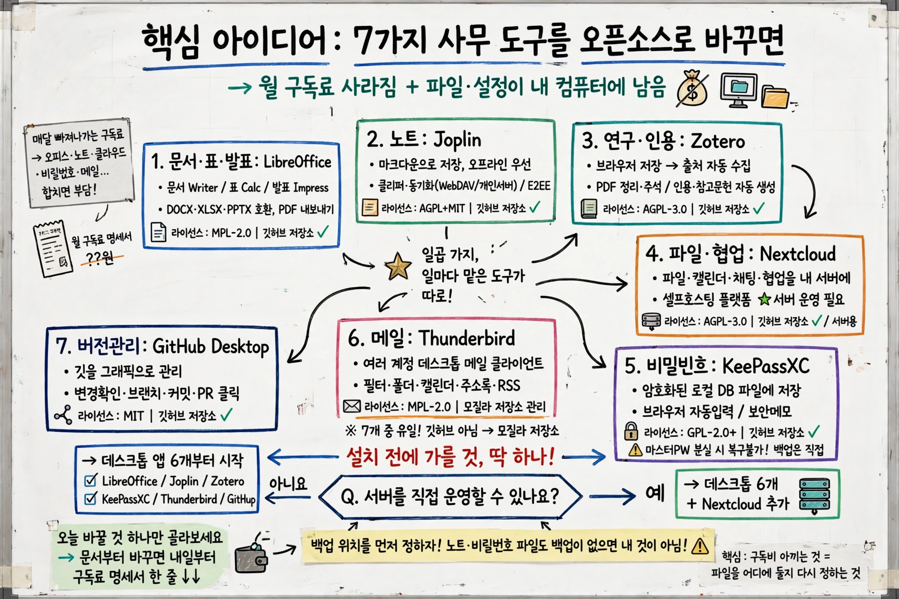
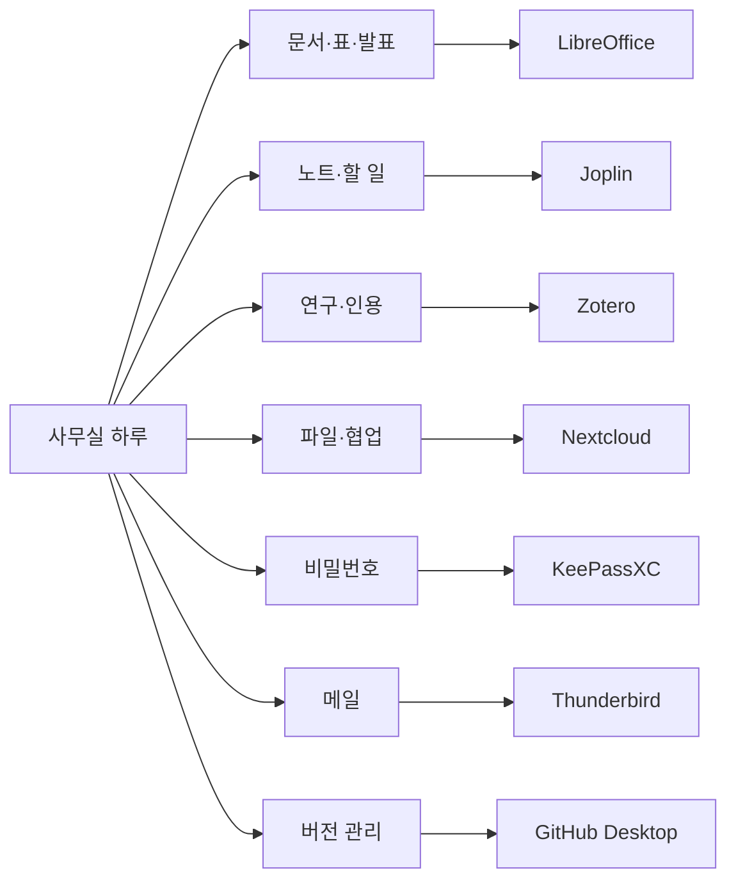
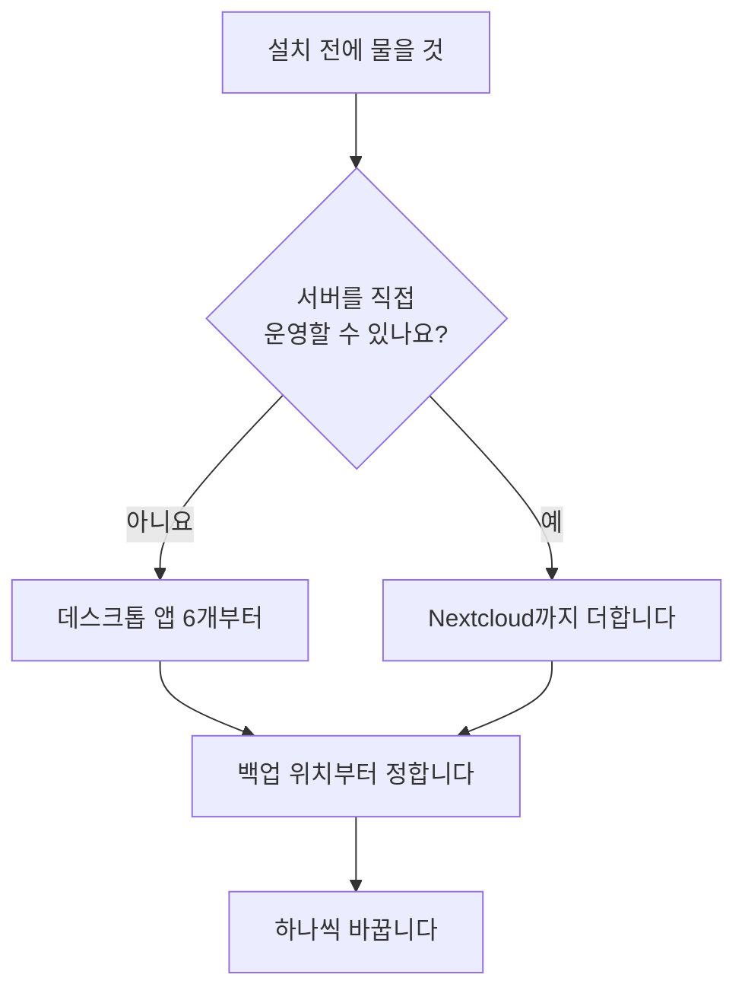

# 구독료 대신 오픈소스 7가지, 파일은 내 컴퓨터에 남습니다

> **Summary**
> LibreOffice, Joplin, Zotero, KeePassXC, Thunderbird, GitHub Desktop, and Nextcloud can replace common office subscriptions while keeping files and settings under your control. Start with the six desktop apps unless you can manage a server for Nextcloud, and plan backups before moving your files.

---

- 7가지 사무 도구를 오픈소스로 바꾸면, 월 구독료가 사라지는 대신 파일과 설정이 내 컴퓨터에 남습니다.
- 문서·노트·연구·파일·비밀번호·메일·버전 관리, 일곱 가지 일을 각각 맡은 도구가 따로 있습니다.
- 일곱 개 중 여섯 개는 깃허브 저장소가 확인됐고, 하나는 모질라 저장소에서 관리됩니다. 설치 전에 데스크톱용인지 서버용인지부터 가르면 됩니다.

매달 빠져나가는 구독료 명세서, 한 번쯤 들여다보신 적 있으시죠? 오피스, 노트 앱, 클라우드, 비밀번호 관리까지 합치면 적지 않은 금액이 됩니다. 그런데 그 돈을 내는 이유를 따져보면, 대부분은 "파일을 만들고 정리하는 일" 때문입니다.

한 가지 먼저 밝힙니다. 원문 공유 링크는 구글의 로봇 확인 절차에 막혀 직접 열지 못했습니다. 그래서 제목이 가리키는 7가지 사무 보조 도구를, 저장소가 확인된 오픈소스 프로젝트로 다시 정리했습니다.

🎥 [동영상 보기](https://www.youtube.com/watch?v=P1AwDj5KCPo)

## 7가지, 왜 하필 이 조합일까요?

사무실 하루를 떠올려보시면 답이 나옵니다. 문서를 쓰고, 메모를 하고, 자료를 찾고, 파일을 나누고, 비밀번호를 입력하고, 메일을 확인하고, 변경 이력을 남깁니다. 일곱 가지 일이 따로 노는데, 도구 하나가 이걸 다 잘할 수는 없습니다. 그래서 일마다 맡은 도구가 따로 있는 겁니다!

## 문서·표·발표는 하나로: LibreOffice

**LibreOffice**는 문서·표·발표·그림·데이터베이스·수식, 여섯 가지 도구를 한 번에 설치하는 오피스 제품군입니다. `Writer`가 문서를, `Calc`가 표를, `Impress`가 발표를 맡습니다. `DOCX`, `XLSX`, `PPTX` 파일을 열고 저장할 수 있고, 기본 파일 형식은 개방형 문서 형식입니다. PDF로 내보내는 기능도 들어 있습니다. 라이선스는 MPL-2.0입니다.

한 가지는 확인하고 쓰셔야 합니다. 고급 서식이나 매크로가 들어간 파일은 상대방 프로그램에서 열기 전에 미리 확인하는 게 안전합니다.

## 노트는 마크다운으로: Joplin

**Joplin**은 오프라인 우선 노트 앱입니다. 노트를 마크다운으로 저장해서 파일이 그대로 남고, 브라우저에서 웹페이지를 잘라 저장하는 클리퍼와 플러그인도 갖췄습니다. 동기화는 클라우드 서비스나 개인 서버, `WebDAV`, 파일 시스템 중에서 고를 수 있고, 종단간 암호화도 지원합니다. 라이선스는 AGPL과 MIT가 섞여 있습니다.

메모가 쌓일수록 어디에 두는지가 중요해집니다. 동기화 방식을 먼저 정하고 노트를 쌓는 게 순서입니다.

## 연구·인용은 자동으로: Zotero

**Zotero**는 자료를 모으고 인용을 만드는 연구 도구입니다. 브라우저에서 출처를 저장하면 제목과 저자 정보를 알아서 채우고, PDF를 정리하고 주석을 다는 일까지 한곳에서 합니다. 글을 쓸 때는 워드 프로세서나 문서 도구와 연결해 인용과 참고문헌 목록을 자동으로 만들어줍니다. 비영리 단체가 개발하는 오픈소스이고, 라이선스는 AGPL-3.0입니다.

인용을 자동화했다고 사실 확인까지 맡기면 안 됩니다. 서식과 쪽수, 번역된 제목은 한 번 더 눈으로 확인하셔야 합니다.

## 파일·협업은 내 서버에: Nextcloud

**Nextcloud**는 파일·캘린더·연락처·채팅·협업을 한 환경에 묶은 셀프호스팅 플랫폼입니다. 클라우드에 맡기던 일을 내 서버로 가져오는 게 핵심입니다. 라이선스는 AGPL-3.0입니다.

다만 이건 데스크톱 앱이 아닙니다! 서버를 직접 운영해야 해서 백업과 업데이트, 보안 관리까지 따라옵니다. 편하려고 들였다가 관리 일이 늘어날 수도 있습니다. 서버 관리가 부담스러우면, 나머지 여섯 개부터 시작하는 게 맞습니다.

## 비밀번호는 암호화 파일로: KeePassXC

**KeePassXC**는 로그인과 비밀번호를 암호화된 로컬 데이터베이스 파일에 넣어두는 도구입니다. 브라우저 자동 입력과 보안 메모 기능도 있습니다. 라이선스는 GPL 2.0 이후 버전입니다.

여기서 책임이 바뀝니다. 마스터 비밀번호를 잊으면 복구할 방법이 없고, 데이터베이스 파일 백업도 직접 챙겨야 합니다. 편한 대신, 열쇠는 온전히 내 손에 있습니다!

## 메일은 데스크톱에서: Thunderbird

**Thunderbird**는 여러 계정을 한곳에서 보는 데스크톱 메일 클라이언트입니다. 필터와 폴더로 받은 편지함을 정리하고, 달력과 주소록, RSS 구독 기능도 들어 있습니다. 라이선스는 MPL-2.0입니다.

한 가지는 정확히 짚고 넘어가겠습니다. 데스크톱 **Thunderbird**의 소스는 깃허브 저장소가 아니라 모질라 저장소에서 관리됩니다. 깃허브 조직에는 안드로이드 앱 같은 다른 저장소가 있습니다. "깃허브 도구 7가지"라는 제목과 딱 맞지 않는 유일한 항목이지만, 메일 자리는 이 도구가 맡는 게 맞습니다.

## 버전 관리는 눈으로: GitHub Desktop

**GitHub Desktop**은 깃을 그래픽으로 다루는 도구입니다. 저장소를 복제하고, 변경 내용을 눈으로 확인하고, 브랜치를 만들고, 커밋하고, 풀 리퀘스트를 보내는 일을 클릭으로 처리합니다. 라이선스는 MIT입니다.

공식 지원은 Windows와 macOS입니다. 리눅스는 커뮤니티 빌드를 써야 합니다. 문서 작업을 하는 팀도 버전 관리를 쓰게 되는 순간, 이 도구가 가장 먼저 떠오릅니다.

## 설치 전에 가를 것, 딱 하나입니다

일곱 개를 한꺼번에 설치하지 마세요. 먼저 물을 질문은 하나입니다. 서버를 직접 운영할 수 있나요? 답이 아니면 데스크톱 앱 여섯 개부터, 답이 예이면 거기에 **Nextcloud**를 더하면 됩니다. 그리고 백업 위치를 먼저 정합니다. 노트도, 비밀번호 파일도, 백업이 없으면 내 것이 아닙니다!

구독료를 아끼는 일은 돈을 아끼는 일이기도 하지만, 파일을 어디에 두는지 다시 정하는 일이기도 합니다. 오늘 당장 바꿀 것 하나만 골라보세요. 문서부터 바꾸면 내일부터 구독료 명세서가 한 줄 짧아집니다!

