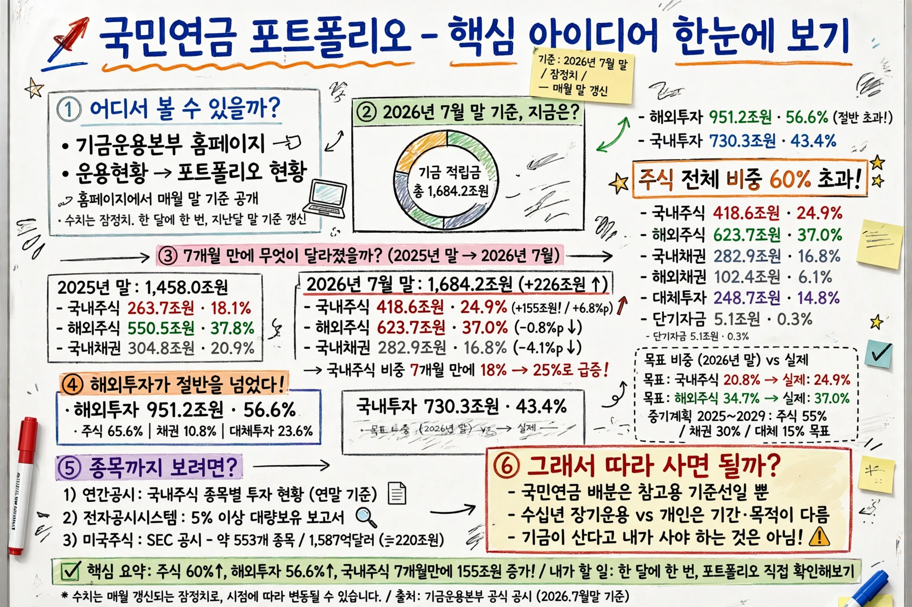
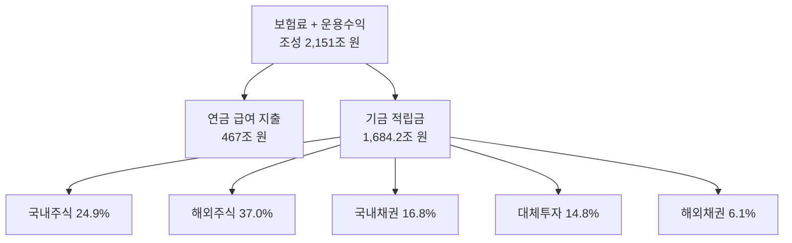
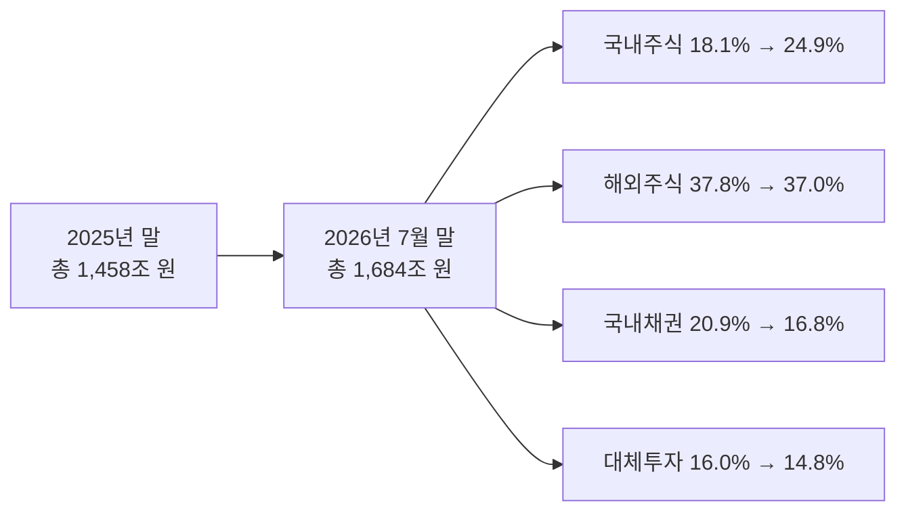
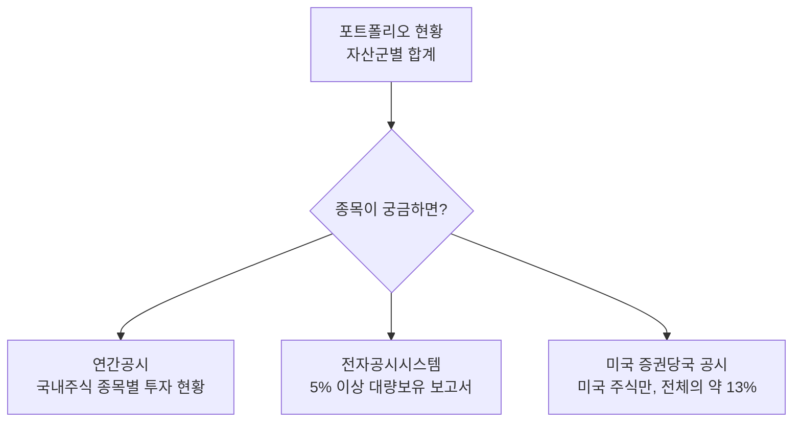

# 국민연금 포트폴리오, 국내주식이 7개월 만에 18%에서 25%가 됐습니다

> **Summary**
> 국민연금의 2026년 7월 말 포트폴리오에서 국내주식 비중은 24.9%로 2025년 말보다 6.8%포인트 상승했고, 해외투자는 전체의 56.6%를 차지합니다. 실제 비중은 시장 변동으로 목표와 달라질 수 있으며, 국민연금의 자산 배분은 개인 투자자가 그대로 따라 하기보다 참고 기준으로 보는 것이 좋습니다.

---

- 국민연금 포트폴리오, 기금운용본부 홈페이지에서 매월 말 기준으로 직접 볼 수 있습니다.
- 2026년 7월 말 기준 기금 1,684조 원 중 국내주식이 418조 원, 비중이 7개월 만에 18%에서 25%로 뛰었습니다.
- 해외투자 비중은 56.6%, 주식 전체 비중은 60%를 넘었습니다. 따라 사는 건 따로 생각할 일입니다.

매달 월급에서 빠져나가는 국민연금, 그 돈이 지금 어디에 있는지 궁금했던 적 있으시죠? 얼마가 쌓였고, 뭐를 샀는지, 직접 확인할 수 있는 곳이 있습니다. 기금운용본부 홈페이지의 포트폴리오 현황 페이지입니다.

🎥 [동영상 보기](https://www.youtube.com/watch?v=JiebUa8YnaI)

## 포트폴리오는 어디서 볼 수 있을까요?

기금운용본부 홈페이지에서 `운용현황` 메뉴로 들어가 `포트폴리오 현황`을 열면 됩니다. 매월 말 기준으로 공개되고, 수치는 잠정치라고 적혀 있습니다. 한 달에 한 번, 지난달 말 기준으로 갱신되는 구조입니다.

2026년 7월 말 기준 포트폴리오는 이렇습니다.

| 자산군 | 규모 | 비중 |
| --- | --- | --- |
| 국내주식 | 418.6조 원 | 24.9% |
| 국내채권 | 282.9조 원 | 16.8% |
| 해외주식 | 623.7조 원 | 37.0% |
| 해외채권 | 102.4조 원 | 6.1% |
| 대체투자 | 248.7조 원 | 14.8% |
| 단기자금 | 5.1조 원 | 0.3% |

금융부문 합계는 1,683.2조 원, 복지·기타 부문을 더한 기금 적립금 전체는 1,684.2조 원입니다. 가장 큰 덩어리는 해외주식, 그다음이 국내주식입니다! 주식 두 개를 합치면 61.9%, 기금의 3분의 2 가까이가 주식입니다!

## 7개월 만에 뭐가 달라졌을까요?

2025년 말과 비교하면 변화가 확 보입니다. 총액은 1,458.0조 원에서 1,684.2조 원으로 226조 원 늘었습니다. 그중 국내주식이 263.7조 원에서 418.6조 원으로, 155조 원이나 늘었습니다. 비중으로 보면 18.1%에서 24.9%, 6.8%포인트 상승입니다.

국내주식이 7개월 만에 155조 원이나 늘었다는 대목이 저는 가장 인상 깊었습니다. 물론 주가 상승으로 평가액이 불어난 효과도 큽니다. 새로 산 것만으로 설명되는 숫자는 아닙니다. 그래도 방향은 분명합니다! 해외주식은 550.5조 원에서 623.7조 원으로 늘었지만 비중은 37.8%에서 37.0%로 오히려 조금 줄었습니다. 국내채권은 304.8조 원에서 282.9조 원으로 줄었고, 비중은 20.9%에서 16.8%로 떨어졌습니다.

채권의 자리는 계속 좁아지고 있습니다. 2020년에는 채권이 전체의 44.5%였는데, 2025년에는 27.9%까지 떨어졌습니다. 같은 기간 주식은 44.3%에서 55.8%로 올랐습니다. 국민연금은 오래전부터 채권에서 주식으로, 국내에서 해외로 무게중심을 옮겨왔습니다.

## 해외투자가 절반을 넘었다고요?

네, 넘었습니다! 2026년 7월 말 기준 해외투자는 951.2조 원으로 전체의 56.6%입니다. 국내투자는 730.3조 원, 43.4%입니다. 해외투자 안에서는 주식이 65.6%로 가장 크고, 채권 10.8%, 대체투자 나머지로 이어집니다.

그런데 목표 비중과 실제 비중은 다릅니다. 2026년 말 목표 비중은 국내주식 20.8%, 해외주식 34.7%, 국내채권 23.1%, 해외채권 7.4%, 대체투자 14.0%입니다. 실제 국내주식 비중 24.9%는 이미 목표를 넘었습니다. 목표 비중은 방향을 정하는 기준이고, 실제 비중은 시장 상황에 따라 움직입니다. 주가가 오르면 가만히 있어도 비중이 올라가니까요.

더 긴 그림도 있습니다. 2025~2029년 중기 계획에서 기금운용위원회는 5년 목표수익률을 5.4%로 정했습니다. 2029년 말 목표 비중은 주식 55% 내외, 채권 30% 내외, 대체투자 15% 내외입니다. 주식 중심, 해외 중심이라는 큰 방향은 앞으로도 이어집니다.

## 종목까지 보려면 어떻게 할까요?

포트폴리오 현황 페이지는 자산군별 합계만 보여줍니다. "그래서 뭘 샀는데요?"라는 질문에는 답이 없습니다. 종목까지 보려면 자료를 한 단계 더 들어가야 합니다.

첫째, 연간공시에 있는 국내주식 종목별 투자 현황 파일입니다. 연말 기준으로 어떤 종목을 얼마큼 들고 있는지 나옵니다. 둘째, 전자공시시스템에서 5% 이상 들고 있는 종목의 대량보유 보고서를 찾는 방법입니다. 셋째, 미국 주식은 미국 증권당국 공시에서도 볼 수 있습니다. 다만 이건 미국 주식만 보이고, 전체 기금의 약 13% 수준이라 일부만 보는 셈입니다. 미국 주식 553개 종목의 평가액이 1,587억 달러, 우리 돈으로 약 220조 원 정도입니다.

## 그래서 따라 사면 될까요?

국민연금의 배분은 참고 기준선일 뿐입니다. 주식 60%, 채권 20%대, 대체투자 15%라는 배분 자체는 장기 포트폴리오를 짤 때 참고할 만한 숫자입니다. 하지만 기금은 수십 년을 보고 굴리는 돈이고, 개인의 기간과 목적은 다릅니다. 기금이 산다고 내가 사야 하는 건 아닙니다.

한 가지 더 짚고 넘어가겠습니다. 원문 게시글은 직접 읽지 못했습니다. 게시글이 있는 곳이 로그인 벽 뒤에 있어, 기금운용본부 공식 공시 페이지로 내용을 다시 세웠습니다. 글에 쓴 수치는 모두 공식 공시 기준이고, 기준 시점을 함께 적었습니다. 수치는 매월 갱신되는 잠정치라, 이 글을 읽는 시점에는 또 달라져 있을 수 있습니다.

내 연금이 어디에 있는지, 한 달에 한 번쯤은 직접 열어보는 습관이 어떨까요?

