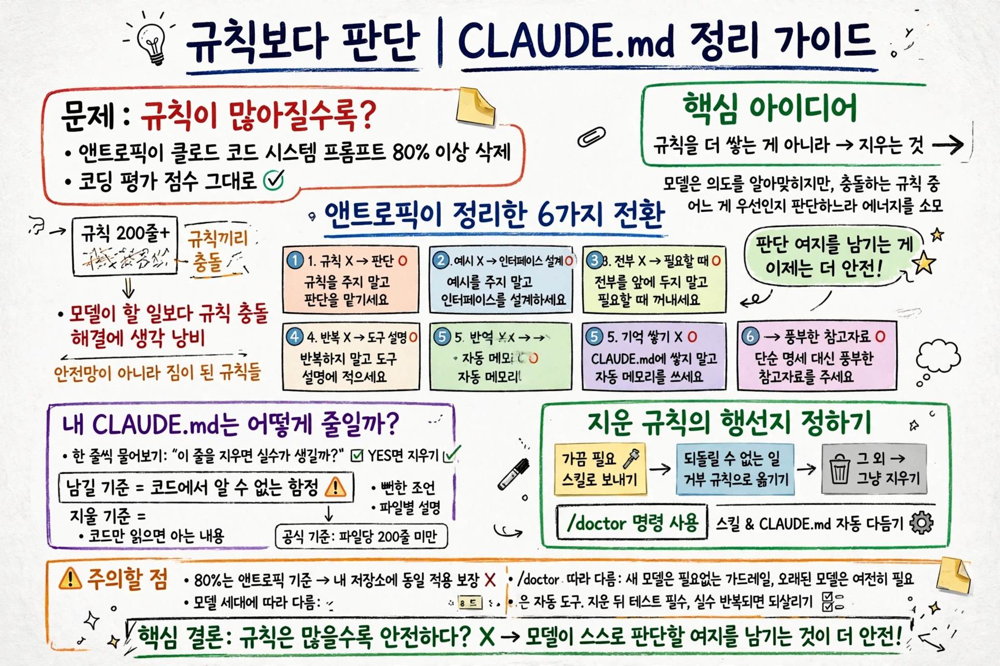
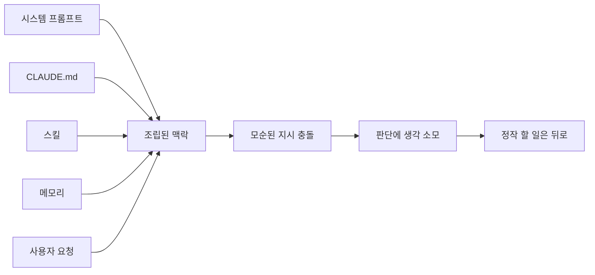
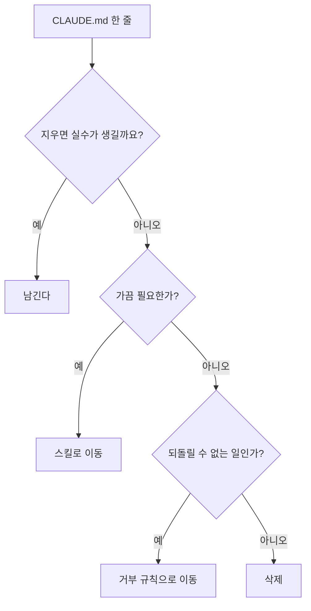
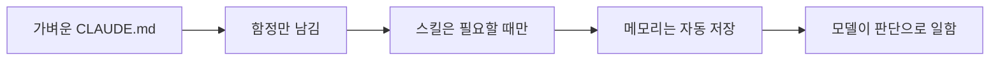

# 규칙을 쌓을수록 못해집니다. 지우는 게 잘 쓰는 법입니다

> **Summary**
> 클로드 코드의 성능을 유지하면서 시스템 프롬프트 규칙을 80% 이상 줄인 사례를 바탕으로, 규칙은 쌓기보다 충돌을 줄이고 모델의 판단에 맡기는 것이 효과적이라고 설명합니다. CLAUDE.md에는 코드만으로 알 수 없는 함정과 팀 고유의 관례만 남기고, 가끔 필요한 지침은 스킬로 옮기거나 삭제하되, 변경 후 테스트로 확인해야 합니다.

---

- 앤트로픽이 클로드 코드의 시스템 프롬프트 80% 이상을 지웠는데, 코딩 평가 점수는 그대로였습니다.
- 규칙이 많아지면 모델은 일보다 규칙끼리 부딪히는 데 생각을 씁니다. 그래서 새 규칙은 쌓는 게 아니라 지우는 것입니다.
- 내 `CLAUDE.md`도 마찬가지입니다. 코드에서 알 수 없는 함정만 남기고, 나머지는 스킬로 보내거나 지우면 됩니다.

클로드 코드에 규칙을 하나씩 추가하다 보면 어느새 파일이 200줄을 넘습니다. 실수할 때마다 한 줄씩 덧붙였더니, 나중에는 뭘 지워야 할지 몰라서 그냥 두게 됩니다. 이런 적 있으시죠? 그런데 앤트로픽이 이번에 정반대 얘기를 했습니다. 규칙을 더 쌓는 게 아니라, 80%를 지우라는 겁니다!

🎥 [동영상 보기](https://www.youtube.com/watch?v=8Pg6G5h05hk)

### 규칙이 많은데 왜 결과가 나빠질까요?

모델이 받는 맥락은 프롬프트 한 줄이 아닙니다. 시스템 프롬프트, `CLAUDE.md`, 스킬, 메모리가 한데 모여서 조립됩니다. 문제는 이 층들이 서로 부딪힌다는 점입니다. 앤트로픽이 자기네 사용 기록을 살펴보니, 한 번의 요청 안에 "문서는 적절히 남겨라"와 "주석은 절대 달지 마라" 같은 모순된 지시가 같이 들어 있었습니다. 모델은 결국 의도를 알아맞히긴 합니다. 그런데 어느 지시가 이기는지 먼저 판단하느라 생각을 써버립니다. 규칙이 안전망이 아니라 짐이 된 겁니다!

### 여섯 가지 뒤집힌 규칙, 뭐가 바뀌었나요?

앤트로픽이 정리한 여섯 가지 전환이 있습니다. 핵심만 보면 이렇습니다.

- **규칙을 주지 말고 판단을 맡기세요.** 예전에는 "주석은 기본적으로 쓰지 마라. 한 줄까지만"이라고 못 박았습니다. 새 문장은 한 줄입니다. "주위 코드처럼 써라. 주석 밀도·이름·관용구를 맞춰라." 문서가 필요한 경우와 복잡한 코드에는 옛 규칙이 틀렸기 때문입니다.
- **예시를 주지 말고 인터페이스를 설계하세요.** 도구 사용법을 예시로 잔뜩 적어주면, 모델은 그 예시 안에서만 탐색합니다. 할 일 도구에는 짧은 설명과 `pending`·`in_progress`·`completed` 상태 목록, "한 번에 하나만 진행 중"이라는 규칙 하나면 충분했습니다.
- **전부 앞에 두지 말고 필요할 때 꺼내세요.** 검증과 코드 리뷰 방법은 매번 필요하지 않습니다. 스킬로 빼두면 필요할 때만 불러옵니다. `CLAUDE.md`도 중앙 저장소가 아니라, 때맞춰 열리는 파일 나무가 되어야 합니다.
- **반복하지 말고 도구 설명에 적으세요.** 옛 모델은 맥락 끝부분 지시를 더 잘 들었습니다. 그래서 같은 내용을 여러 곳에 적었습니다. 새 모델은 그럴 필요가 없습니다.
- `**CLAUDE.md**`**에 기억을 쌓지 말고 자동 메모리를 쓰세요.** 예전에는 `#` 단축키로 기억을 파일에 적었습니다. 이제는 모델이 일과 관련된 기억을 스스로 저장합니다.
- **단순 명세 대신 풍부한 참고자료를 주세요.** 마크다운 계획서보다 HTML 목업이, 설명보다 테스트 스위트나 평가 기준이 더 정확하게 뜻을 전합니다.
### 내 [CLAUDE.md](http://claude.md/)는 어떻게 줄일까요?

한 줄씩 물어보면 됩니다. "이 줄을 지우면 실수가 생길까요?" 아니면 지우세요. 남길 기준도 분명합니다. 코드에서 알 수 없는 함정이 첫째입니다. 빌드·테스트 명령, 팀만의 관례, 아키텍처 결정의 이유가 여기에 들어갑니다. 반대로 지울 것은 코드만 읽으면 아는 내용, 뻔한 조언, 파일별 설명입니다. "깨끗한 코드를 쓰세요" 같은 문장은 아무것도 바꾸지 못합니다. 공식 문서가 제시하는 기준은 파일당 200줄 미만입니다.

지운 규칙의 행선지도 정해두면 마음이 편합니다. 가끔만 필요하면 스킬로 보내고, 되돌릴 수 없는 일은 거부 규칙으로 옮기고, 나머지는 그냥 지우면 됩니다. 그리고 손으로 한 줄씩 지우기 귀찮다면, 클로드 코드 안에 `/doctor` 명령이 있습니다. 스킬과 `CLAUDE.md`를 새 기준에 맞게 자동으로 다듬어줍니다.

### 지우다 실수하면 어떻게 될까요?

조심할 점도 있습니다. 80%라는 숫자는 앤트로픽 자기네 시스템 프롬프트와 자기네 코딩 평가 기준입니다. 내 저장소에도 똑같이 적용된다는 보장은 없습니다. 그리고 이 얘기는 모델 세대 얘기입니다. 새 모델에는 필요 없어진 가드레일도, 오래된 모델에는 여전히 필요할 수 있습니다. 마지막으로 `/doctor`도 자동 도구라 맹신은 금물입니다. 제안은 검토하고 적용하세요. 지운 뒤에는 테스트를 돌려서 확인하고, 실수가 반복되는 줄만 되살리면 됩니다. 지우는 일에도 순서가 있습니다!

규칙은 많을수록 안전해지는 게 아닙니다. 모델이 판단할 여지를 남기는 게, 이제는 더 안전한 쪽입니다!

